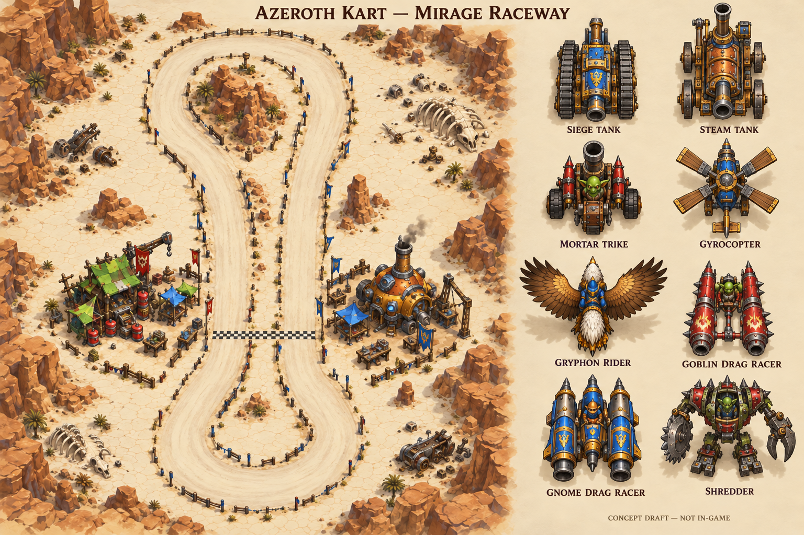

# Mirage Raceway — map and vehicle brief

Owner direction accepted 2026-10-20 in [ADR 0008](../adr/0008-mirage-raceway-art-direction.md). This replaces the proposed Tinker Speedway as the first production map. The geometry blockout is now selectable with one original salt-flat background; the kart is the original [Goblin Drag Car sprite](karts/goblin-drag-car.md), with the primitive as fallback (client check pending). This is the art/geometry brief, not completed production art or an acceptance result.

## Place and composition

Depict the dry, Classic-era Shimmering Flats, before the later flooding. The owner's screenshots and [Mirage Raceway reference](https://warcraft.wiki.gg/wiki/Mirage_Raceway) establish the salt lake bed, rival workshops, drag cars and elongated circuit. Build an adaptation with playable width and readable corners; do not claim surveyed reconstruction from the minimap.

- Warm ivory cracked salt, dusty pale racing lane, sparse tire scuffs and ochre rock edges. Avoid asphalt and dense high-contrast ground noise under racers.
- An elongated loop with rounded ends, its northern bend near a rocky mound and a pit/start area near the lower portion. Retain the broad route identity in the supplied circuit image; final geometry is authored separately.
- Opposing engineering camps: a crooked goblin workshop, green patchwork roof/awnings, red canisters and scrap; a rounded gnomish riveted workshop, orange/brass chimney, workbenches and gears. Final camp positions require alignment with the chosen track blockout; the board is a mood/composition draft.
- Scatter wreckage, spare machinery, small tents, bones and low marker barriers away from the driving lane. Keep an unobstructed view of approaching gates and the next corner.
- Bake immobile scenery into the background. Reserve foreground occlusion for a few deliberate elements; a roof/banner must not hide the next checkpoint or the whole player sprite.

## Concept board and its limits



Built with the imagegen skill's built-in tool; [exact prompts/provenance](concepts/mirage-raceway-direction.prompts.md) and [manifest](concepts/manifest.json) are preserved. This is a concept draft outside the addon. It illustrates eight roster silhouettes and a scenery direction; it is not a texture to install or a set of cutouts to slice directly. Some unit viewpoints/facing remain inconsistent with strict overhead north-facing production art, especially the mech/trike treatment. Rebuild individual sprites with consistent camera, pivot, padding and separate shadows. Tank forms must continue to read as traditional fantasy siege/steam machines, with no modern go-kart substitutions. No user approval of this specific generated image is inferred.

## Recognizable roster

| Owner-facing archetype | Features that must survive the overhead silhouette |
|---|---|
| Siege Tank | Heavy armored siege-engine cabin, broad steel running gear, chunky gun/ram silhouette and riveted faction plates |
| Steam Tank | Distinct boiler body, smokestack, heavy iron-rimmed wheels and old-fashioned cannon; preserve it as a separate concept from Siege Tank |
| Goblin Mortar Trike | Three wheels, conspicuous mortar tube, small goblin driver and improvised mechanical frame |
| Gyrocopter | Large rotor, compact pilot cockpit, tail boom and gnomish mechanical detailing |
| Gryphon Rider | Feathered wings, eagle head/beak, lion-like rear body, dwarf rider/saddle; retain the creature rather than turning it into a vehicle chassis |
| Goblin Drag Car | Mirage-style paired rocket pods, braces and exposed/suspended small cockpit; reference the actual goblin drag-car silhouette |
| Gnome Drag Car | Distinct compact gnomish cockpit, brass engineering and rocket nacelles; readable contrast with the goblin drag car |
| Shredder, optional after initial pair | Goblin mech torso/cockpit, two legs, saw arm and claw arm |

The [source ledger](ASSET_SOURCES.md) contains actual candidates and their unverified permissions. The requested roster is a content target, not eight implemented balance classes. Start with the two drag cars. Aircraft use cosmetic hover over the same local ground collision/checkpoint rules initially; no flying shortcuts or flight simulation are implied.

## Rendering contract

Agree with one precomposed background and a limited sprite pool. The prototype's 96 road bands are Texture regions on one canvas, not hundreds of Frames; replacing those regions is still a sensible authoring simplification. Performance gains remain unmeasured.

Runtime paths below distinguish delivered files from future art:

```text
addon/AzerothKart/Assets/
  Tracks/SaltFlats/Background.tga   # delivered original blockout
  Tracks/SaltFlats/Foreground.tga   # optional transparent occlusion
  Tracks/SaltFlats/Preview.tga
  Karts/GoblinDragCar.tga           # delivered original sprite (client check pending)
  Karts/GnomeDragCar.tga
  Props/OilBarrel.tga
  Props/Wreckage.tga
  Props/BoostPad.tga
  UI/Countdown.tga
  UI/CheckeredFlag.tga
```

Countdown and flags can continue using existing text/primitives until an asset improves readability. A planned prop image does not implement its gameplay behavior. Expand filenames to the other roster entries as each asset is authored.

Keep editable source/layers and PNG masters outside runtime. Author against the blockout's common origin and 1024×1024 world bounds; transform art, simulation positions, gates and props with one uniform scale and offset. Mirage play uses a north-up follow camera at scale 1.5, with 60 world units of heading look-ahead and a view clamped to map edges. Background UV cropping fills the 800×480 canvas without stretching art; kart/gate/wall dimensions share the transform, with gate/wall regions clipped to the canvas. The whole-map fit at scale 0.46875, offset (160,0), remains the authoring overview only. Square 1024/2048 art masters remain candidates, while the current blockout TGA is 1024×1024. This is not a client-verified maximum.

For freely rotated single sprites use a strict 90-degree overhead orthographic camera, front facing north, consistent pivot, padding and neutral diffuse lighting. Keep world-oriented shadows separate. A stronger Warcraft III three-quarter camera needs directional frames; rotating one angled image does not change which side faces the camera. Start with separate images to establish facing/alpha before adding atlas UVs or animation. Check readability at intended play size and rotation endpoints before producing a full roster.

Texture methods are supported by build-matching source: parent-workspace `research/upstream/wow-ui-source-forever-70450/version.txt` is `1.60.1.70450`; `SimpleTextureBaseAPIDocumentation.lua` defines `SetRotation(radians, optionalPivot)` at line 527, `SetTexCoord` at 580 and `SetTexture(textureAsset, ...) -> success` at 604. [Pinned source](https://github.com/Gethe/wow-ui-source/blob/172a387e3ab85b26e6640d3058d5ec1e6ccd4c63/Interface/AddOns/Blizzard_APIDocumentationGenerated/SimpleTextureBaseAPIDocumentation.lua#L527). The current kart already uses rotation, with earlier live movement/rotation observations. The owner's screenshot confirms the opaque whole-map TGA loading and broad north-up orientation. A separate stopped build-70450 check confirmed the closer background UV crop and Start/West strip alignment/clipping. Camera motion/edges, transparent sprites, production facing/pivot/sign and sprite appearance remain **NOT RUN**; source signatures alone do not establish them.

An uncompressed 1024×1024 RGBA32 image has 4 MiB of raw pixel payload; two full layers have 8 MiB before preview/sprites/overhead. Export-format and file-size checks must distinguish raw pixels from TGA headers/compression and actual client memory. Do not create textures during simulation ticks.

## Implemented geometry blockout and next art slice

`MirageRaceway.new(crossesGate)` owns version-1 pure geometry: a closed 16-vertex centerline in a 1024-square world, a 112-wide road made from radius-56 capsules, perimeter wall inset 18 and a north-facing spawn at (700,360). Its ordered gates are North at (550,900) toward −x, West at (410,520) toward −y, South at (540,140) toward +x, then Start at (700,360) toward +y. Rough salt reuses the grass mechanic; the closer camera leaves current Physics v6 unchanged. Artwork never supplies lap or collision decisions; the factory injects the gate-crossing predicate explicitly.

The [SVG layout](mirage-layout.svg) and [JSON guide](mirage-layout.json) are generated by `scripts/build_mirage_layout.py` from the actual Lua factory plus `Presentation.fitViewport/project` through pinned Lupa. The corresponding `unproject` helper supplies inverse mapping for future UI use. The road follows the authored unsmoothed centerline with a 112-wide round stroke; labels identify gates, spawn and walls. SVG export inverts Y once, while simulation coordinates stay unchanged. Regenerate the guide after geometry changes before painting road edges; do not independently redraw a smoothed route that disagrees with collision.

The factory is bundled directly after Track within the twelve-module addon. While stopped, **Track: Test Oval** toggles to **Track: Mirage Raceway** and loads the original geometry-derived `Background.tga`; a failed guarded load leaves the current map/result/sample intact. Successful selection resets the run and sample. Test Oval remains the reload default and fallback; the background and old oval bands remain pooled. Current explicit UI counts remain 9/111/13 through camera movement. Physics v6 and input/drift/countdown/three-lap/best-lap behavior remain unchanged; rough salt reuses the grass mechanic. The concept board is not cropped into runtime art. The supplied screenshot establishes earlier whole-map loading/orientation. A separate stopped build-70450 check confirmed the close UV crop, larger kart and Start/West strip alignment/clipping at counts 9/111/13. Moving camera/edges and transparent-sprite client checks remain **NOT RUN**; see [the short camera probe](../FEASIBILITY.md#mirage-blockout-first-load-probe) and PROGRESS for actual executed checks.

The closer camera responds first to the owner's report that the whole-map view made the kart too distant. At scale 1.5, the current 17×31 world-unit placeholder becomes 25.5×46.5 canvas units and the road is 168 wide, both 3.2 times their former linear size. This makes intended play size explicit before sprite authoring. That slice is now the original [Goblin Drag Car](karts/goblin-drag-car.md): a 64×128 north-facing sprite drawn as a 20×40 world-unit quad whose visible body stays inside the 17×31 footprint, loaded once with a primitive fallback; client appearance is pending. Painterly scenery can then replace the blockout while preserving its road registration. No full roster pipeline is required first. M0/M1/M3 acceptance and the multiplayer transport gate remain open; there is no roster selection, save migration or multiplayer.
