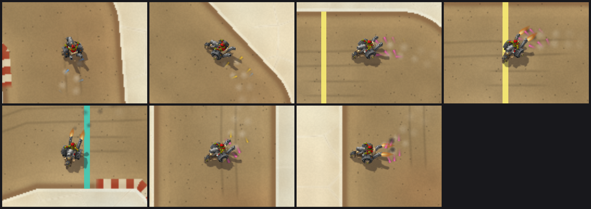
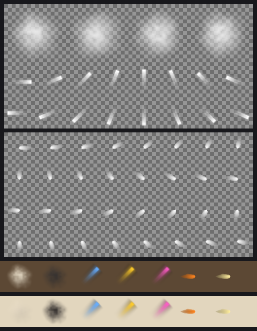

# Drift and boost effects

**Status (2026-10-21):** original procedural effects on `claude/track-ui`, wired to every registered kart (see [the roster](../karts/roster.md)) and to the primitive kart. Offline tests pass. Their appearance in WoW Forever is **NOT RUN**; see [the client check](#client-check-not-run).



`scripts/preview_effects.py` made this image. It runs the addon's own Lua against a recording mock of the widget API and composites every shown texture in draw order.

The image shows seven moments of a scripted Mirage drive, at two canvas pixels per pixel:

1. charging, blue;
2. tier 1, gold;
3. tier 2, magenta;
4. the boost firing;
5. mid-boost;
6. a right-hand drift at tier 2;
7. its boost.

The kart itself is no longer tinted: the owner retired the phase washes on 2026-10-21, as placeholders until real effects existed. This is a review picture, not a client screenshot. WoW's own filtering, blending and pixel snapping are not reproduced.

## What players see

The owner chose "Sparks, smoke and flame".

| Moment | Effect |
|---|---|
| Drifting | Pale dust puffs from alternating rear tyres. Sparks spray backward and toward the outside of the turn. |
| Spark colours | They follow the drift meter: blue while charging, gold at tier 1, magenta at tier 2. |
| Spark rate | The spray thickens as the charge grows (every 3, 2, then 1 ticks). It thins to every 4 ticks while a steering correction holds the charge. |
| Boosting | A flickering two-layer flame (orange outer, pale yellow core) burns from each exhaust pipe, pointing behind the kart. It is longest when the boost is fresh. |
| Boost soot | Dark goblin soot puffs trail from the pipes, with a small burst on the tick the boost fires. |
| Off-road, wall hit, finish | Effects stop with the state that drives them. A wall hit or rough ground already cancels drift and boost. |

Effects are presentation only. They read the drawn pose and the current state's drift and boost fields, and never write simulation or race state. Offline drives give identical simulation with effects on, refused or replaced by the primitive kart.

## Files

Both atlases are original. `scripts/build_effect_sprites.py` paints them procedurally with `paintkit`; no model, photo, game texture or external image is an input.

| File | Size | Layout |
|---|---|---|
| `addon/AzerothKart/Assets/Effects/Particles.tga` | 256×128, 131,090 bytes | Top row: four 64×64 smoke puffs. Two rows below: sixteen 32×32 spark streaks, streak k pointing `k * 2pi/16` counter-clockwise from east, head first |
| `addon/AzerothKart/Assets/Effects/Flame.tga` | 512×256, 524,306 bytes | Thirty-two 64×64 flames. Flame k points along world heading `k * 2pi/32` as the trike sheet's camera sees it: north is foreshortened by 0.8. The flame's base is the cell center |



The atlases' review image shows the two atlases on a checkerboard, then tinted samples on the dirt lane and on the salt: dust, soot, the three spark tiers, and the outer and inner flame.

Both are BGRA32 TGAs with straight alpha and a bottom-left origin. Every cell keeps a transparent one-texel border, and transparent texels get bled edge colour.

Texels are white or near-white; `SetVertexColor` colours them at runtime. One puff therefore serves both dust and soot, and one streak serves every tier. Sparks carry a faint dark halo so they stay readable on the pale salt. The build uses only exact arithmetic and integer hashing, so the bytes are the same on every platform.

Reproduce or verify:

```
python scripts/build_effect_sprites.py            # write both TGAs
python scripts/build_effect_sprites.py --check    # verify bytes, cells and directions
python scripts/build_effect_sprites.py --preview  # also docs/art/effects/drift-boost-atlases.png
python scripts/preview_effects.py                 # this page's review image (needs pinned Lupa)
```

## Anchors

Each kart sprite may carry `effects = {wheels, exhausts, view}`. The fields are:

- anchor points in the kart's own frame, in world units (+x forward, +y left, z up);
- the art's camera tilt `(cos, sin)`, so a point lands where the sprite draws it.

| Kart | Wheels | Exhausts | Source |
|---|---|---|---|
| Goblin Mortar Trike | (−5.9, ±6.0) | (−13.9, 5.4, 10.6) and (−14.8, −4.9, 10.5) | The model's own emitters, listed by `build_wc3_kart.py --source DIR --emitters`. The wheel anchors take x from its rear-wheel dust emitters (−5.85) and y from the tyres' ground contact (±6.0). The exhausts are its two exhaust emitters. Tilt (0.8, 0.6) |
| Goblin Drag Car | (−14.0, ±6.6) | (−15.3, 0, 0) | The slicks' trailing edge and the rocket bell's lip in `build_kart_sprites.py`. Overhead, no tilt |
| Primitive kart | (−13, ±7) | (−15.5, 0, 0) | The rear corners of the 17×31 body. Overhead, no tilt |

The anchors are positions read from the published model, not pixels from it; the trike's provenance and credits are in [its sheet](../karts/goblin-mortar-trike.md).

## Runtime

**Pools.** `UI.Create` makes 38 textures once:

- 20 smoke puffs;
- 14 sparks;
- two flames of two layers each.

They are hidden while idle. Explicit UI allocations become 151 textures (113 before the effects); with the Kart and Close results buttons, the combined counts are 11 frames, 151 textures and 13 font strings. Nothing is created or loaded per tick or frame, and the oldest particle is reused when a pool is full. Offline, at most 31 effect textures were shown at once.

**Layers.**

| Effect | Draw layer and sublevel |
|---|---|
| Smoke | ARTWORK 6, above the track markers |
| Sparks | OVERLAY −2, just under the kart (OVERLAY 0) |
| Flames, pipe on the near side | OVERLAY 2 and 3, in front of the kart |
| Flames, pipe on the far (north) side | OVERLAY −4 and −3, behind the body |

**Drawing.**

- Each atlas is loaded with the guarded `SetTexture(path) == true`, then a `SetTexCoord` and `SetVertexColor` probe. Any refusal disables every effect; the kart and the race carry on.
- No `SetRotation` and no `SetBlendMode`. Directions come from pre-rendered cells chosen by heading or particle velocity. Effects use normal alpha blending, which stays readable on the bright salt where additive light would wash out.
- `SetTexCoord` is written only when a texture's cell changes.
- There is no clipping API, so a quad that would cross the canvas edge is hidden.
- Selecting a map clears all effects.

**Time.** Effect time is the interpolated simulation tick, so effects freeze with a stopped or finished run. A new run, where the tick goes backward, clears them. Randomness is a seeded Park–Miller sequence, so the same states always give the same particles.

**Memory.** The atlases add 640 KiB of raw texture data, against 4 MiB for the trike sheet.

## Client check (NOT RUN)

Fully restart the client after installing: the atlases are new files. On Mirage:

1. While drifting, pale dust puffs leave the rear tyres. Sparks spray from behind the rear wheels: blue while charging, then gold, then magenta, matching the meter.
2. On release, both exhaust pipes flame backward and puff dark soot. The flame shrinks as the boost runs out and stops when it ends.
3. Facing away from the camera, the flames burn in front of the kart's rear. Facing the camera, they are hidden behind the body, not drawn over the driver.
4. No effect shows a box, a dark fringe or a neighbouring cell's slice, and none spills outside the canvas.
5. No hitch when drifting starts, and Print Probe shows 11/151/13.
6. On Test Oval the same effects appear at the smaller scale, with gray tyre smoke.

Open question: these are the first `SetDrawLayer` calls with sublevels other than the grass's −1. The creation-time calls are guarded, and a refusal disables the effects; the flames' later front/behind switches are not guarded.
