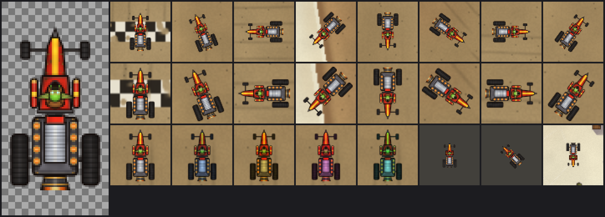

# Goblin Drag Car — first runtime kart sprite

**Status (2026-10-20):** original runtime sprite generated, integrated and offline-validated on `claude/track-ui`. Actual WoW Forever loading, alpha, filtering, facing and tint appearance are **NOT RUN**. See [the client check](#client-check-not-run) below.



The image shows the actual 64×128 runtime texture at 4× on a checkerboard (left). The grid on the right is composited by the generator, which emulates the client's rotated quad with straight-alpha bilinear filtering over the real Mirage background:

- Row 1: Mirage at about 1 pixel per UI unit (roughly 1080p at the observed 0.72 effective UI scale), eight headings.
- Row 2: the same poses at 1.36 pixels per UI unit (roughly 1440p).
- Row 3: the normal, drift-charge, Tier 1, Tier 2 and boost tints, then the scale-1 Test Oval kart on its primitive road, then rough salt.

Tiles are enlarged 2× with nearest-neighbor sampling. This is an offline preview, not a client screenshot. The sheet was regenerated over [Mirage scenery v1](../mirage-background.md); the TGA bytes did not change. [4× master](goblin-drag-car-master.png).

## Design

A strict-overhead goblin dragster, front facing north, lit straight down so it can rotate freely:

- iron ram and long red nose with a yellow hazard stripe on a narrow front axle;
- open cockpit with a big-eared green goblin in brass goggles, between two strapped-on red/yellow explosive canisters;
- an oversized engine — gunmetal block, chrome finned supercharger, red scoop and rows of glowing exhaust stacks — flanked by huge rear slicks;
- a rocket bell glowing at the tail.

Narrow pointed front versus wide dark rear keeps heading readable at play size and under rotation. The palette is a Warcraft III-flavored goblin workshop: saturated red paint with rust and grime, brass, chrome, gunmetal and lime-green skin. Each part has a warm near-black contour so the silhouette separates from both the tan road and the pale salt. Steel and chrome surfaces carry the multiplicative drift/boost tint clearly. No baked shadow is included: world-oriented shadows belong in a separate sprite.

## Runtime asset specification

| Property | Value |
|---|---|
| Path | `addon/AzerothKart/Assets/Karts/GoblinDragCar.tga`; client path `Interface\AddOns\AzerothKart\Assets\Karts\GoblinDragCar.tga` |
| Format | Uncompressed true-color TGA (type 2), 32-bit BGRA, eight alpha bits, bottom-left origin (descriptor `0x08`), no color map/ID/footer — the header convention of the client-observed Mirage background |
| Size | 64×128 texels (power of two); 32,786 bytes; 32 KiB raw pixels |
| Alpha | Straight (non-premultiplied). 3,190 texels are visible (alpha > 0), 2,562 fully opaque. Fully transparent texels carry color bled from their visible neighbors, so bilinear filtering cannot darken or tint the anti-aliased edge |
| Quad | Drawn as a 20×40 world-unit Texture region: uniform 3.2 texels per world unit. Canvas size is 20×40 on Test Oval (scale 1) and 30×60 on Mirage (scale 1.5) |
| Body | All visible texels lie inside the central 17×31 world-unit footprint (54.4×99.2 texels). This is the primitive's footprint and the clearance the 18-unit perimeter inset assumes. Transparent padding fills the rest of the quad and at least one border texel on every side |
| Pivot / facing | The visible bounds (texel columns 5–58, rows 15–112) are centered on the texture center, which the UI anchors at the kart's interpolated physical center. Front = top = north; the UI rotates by `heading - math.pi/2` |
| Lighting | Neutral, from directly overhead; centered highlights; no directional cast shadow |
| SHA-256 | `cc7c1c6928501bcb9943040c13c478efb7ac08ddab47e7fa527e11f7d3bb126a` |

Art never feeds collision, gates, input or timing. The sprite does not change the 17×31 body or wall clearance.

## Integration summary

[`Presentation.KART_SPRITES`](../../../addon/AzerothKart/Presentation.lua) registers path, texture size and quad. `KART_FOOTPRINT_WIDTH/HEIGHT` record the shared body. `UI.lua` loads the default sprite once at `UI.Create`, with a guarded `SetTexture`. The result must be exactly `true`, and a neutral `SetVertexColor` must succeed, before `UI.kartSprite` is set. Any missing, erroring, `false` or `nil` result keeps the original primitive: 17×31 body, `SetColorTexture` phase colors, no retry per frame, run or map.

`SetColorTexture` replaces a texture's image with a solid color, so only the primitive path calls it. The sprite is tinted multiplicatively instead, only when the phase changes:

| Phase (render tint index) | Primitive `SetColorTexture` | Sprite `SetVertexColor` |
|---|---|---|
| 0 normal | 0.98, 0.54, 0.14 | 1.00, 1.00, 1.00 |
| 1 drift charging | 0.35, 0.65, 1.00 | 0.70, 0.84, 1.00 |
| 2 Tier 1 ready | 1.00, 0.86, 0.20 | 1.00, 0.86, 0.40 |
| 3 Tier 2 ready | 1.00, 0.35, 0.78 | 1.00, 0.62, 0.90 |
| 4 boost | 0.20, 1.00, 0.88 | 0.56, 1.00, 0.94 |

The meter and HUD text keep carrying the phase in words and color, so the kart wash is supplementary. Explicit UI allocations stay 9 frames/111 textures/13 font strings: the sprite reuses the existing kart Texture. Build-matched API documentation at [the pinned UI source](https://github.com/Gethe/wow-ui-source/blob/172a387e3ab85b26e6640d3058d5ec1e6ccd4c63/Interface/AddOns/Blizzard_APIDocumentationGenerated/SimpleTextureBaseAPIDocumentation.lua) lists `SetTexture(textureAsset?, wrapModeHorizontal?, wrapModeVertical?, filterMode?) -> success`, `SetColorTexture` and `SetRotation`. `SetVertexColor(colorR, colorG, colorB, a?)` is on `SimpleRegionAPI` in the same tree. Documentation presence is not runtime proof.

## Reproduction

```powershell
python scripts/build_kart_sprites.py            # regenerate the runtime TGA
python scripts/build_kart_sprites.py --check    # exact bytes + invariants, writes nothing
python scripts/build_kart_sprites.py --preview  # also rewrite the PNG master/review sheet here
```

The generator uses only the Python standard library, the shared painting toolkit `scripts/paintkit.py` and, for previews, `addon/.../Background.tga`. Every part is a layered signed-distance shape in world units, with procedural materials (overhead form shading, painted rim highlights, value-noise mottling, rust and grime from integer hashing). Each texel receives 4×4 supersamples, then an exact integer box filter. Pixel values use only IEEE-exact operations (`+ - * /`, `sqrt`, `floor`), so the TGA bytes are platform-independent.

Built twice — Python 3.13 in the cloud workspace and Python 3.10 on the developer's Linux shell — both produced the SHA-256 above. Previews and the master are review aids: their PNG bytes depend on the local zlib, and `--check` does not compare them.

`--check` and the build both validate:

- the header and payload size;
- no visible texel outside the 17×31 body;
- a transparent border;
- an opaque silhouette larger than 40% of the body;
- bounds centered on the quad;
- mirror-symmetric alpha;
- north-facing landmarks — pointed nose up, open front corners, rear slicks down;
- edge-color bleeding.

`tests/test_presentation.lua` independently re-reads the TGA against the Lua metadata.

To add a kart, write a painter function, register it in the generator's `KARTS` table and in `Presentation.KART_SPRITES`, then add its landmark check.

## Provenance

| Asset path | Author/source | License / permission | Date | Intended use |
|---|---|---|---|---|
| `addon/AzerothKart/Assets/Karts/GoblinDragCar.tga`, `docs/art/karts/goblin-drag-car-master.png`, `docs/art/karts/goblin-drag-car-review.png` | Original procedural art by Claude for Azeroth Kart, painted by `scripts/build_kart_sprites.py` | Project-authored; no third-party input | 2026-10-20 | Runtime kart sprite and its review/master images |

Inputs are the generator's own shapes, palette and integer noise. The review sheet additionally composites the project-authored Mirage background. No screenshot, concept-board crop, Blizzard file, WC3Vault model, other third-party texture or model, or image-generation output is copied or traced.

The silhouette follows the written [map/vehicle brief](../MIRAGE_RACEWAY.md#recognizable-roster) and the owner's request: an oversized engine, exaggerated proportions and Warcraft III-flavored goblin engineering. A goblin dragster is a generic fan-fantasy subject. As the [source ledger](../ASSET_SOURCES.md) notes, newly drawn fan art does not clear underlying Warcraft IP.

## Client check (NOT RUN)

**Owner observation, 2026-10-20:** the owner's [in-game screenshot](../../evidence/2026-10-20-mirage-scenery-owner-check.md) shows the sprite instead of the orange primitive, nose north and centered on the Mirage start checkers, with no visible box or halo. Probe counts, rotation while driving and phase tints (steps 3 and 5–7 below) were not recorded and remain open.

Run only after an authorized, coordinated install: the WoW AddOns folder is shared with Codex. Use the verified installer; do not hand-copy.

1. Fully restart the client after installing. The sprite is a new file, and clients commonly discover new addon files only at startup, not on `/reload`.
2. Run `/akart`. On Test Oval the kart should be the drag car — red nose up, dark slicks at the rear — not an orange rectangle. There should be no white, black or green box, dark halo or bright fringe around it.
3. Run `/dump AzerothKart.UI.kartSprite ~= nil` and `/dump AzerothKart.UI.kart:GetTexture()`. Click **Print Probe**: counts should remain 9 frames/111 textures/13 font strings.
4. While stopped, select Mirage. The larger sprite faces north at spawn, centered on the Start strip.
5. Start and drive a short bend. The nose leads in every direction with no mirror or flip, edges stay clean while rotating, and the image is never replaced by a solid rectangle.
6. Charge a drift and release it. A blue wash, then gold/magenta when ready, then cyan while boosting; normal colors return afterwards.
7. Record build, resolution/UI scale, observations and any error dialog. Stop with Escape.

Fallback behaviour and simulation equivalence are covered offline. Do not rename or delete installed files to provoke a fallback in the shared install.

Open questions for that check: whether `SetTexture` returns `false` for a missing file in this client; mipmapping/minification shimmer at Test Oval's scale 1 (`SetTexture` accepts a `filterMode`); and whether default pixel-grid snapping causes visible jitter on the moving sprite. The road bands disable snapping; the kart keeps the client default.
