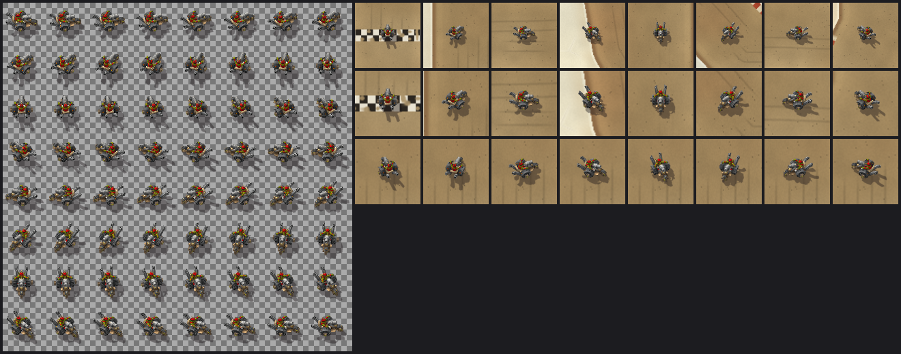

# Goblin Mortar Trike — default kart (Warcraft III model)

**Status (2026-10-20):** rendered from a published Warcraft III model and wired in as the default kart on `claude/track-ui`. The owner [approved it](../../evidence/2026-10-20-trike-and-shadows-owner-approval.md) as installed at `cf71394`; [the client check](#client-check) notes what that approval does not record.



The left of the image is the runtime sheet of 64 headings at half size. The right composites the trike on the real Mirage background:

- the first two rows show eight headings at about 1080p and 1440p UI sizes;
- the last row shows eight in-between headings at the larger size.

These are offline previews, not client screenshots.

## Source and permission

| Item | Value |
|---|---|
| Model | Goblin Mortar Trike (internal name `TrikeRigged121unit`), unit version, by **erwtenpeller and Chriz** (Vast Graphics); the Read Me is dated 2.10.07 |
| Where | [WC3Vault listing](https://wc3vault.com/0fbe959f-489b-48f0-82bf-8c4322f1f060), an archival upload by AdinizWarcraft tagged `wc3c`. Archive `GoblinMortarTrike_Updated_.rar`: 291,657 bytes, SHA-256 `f0b4341c9615a3f1da5c4b1bd80d5e70bbcba7ad982cfb5c5805f6c60b02b86b` |
| Files used | `GoblinMortarTrike[unit].MDX` (SHA-256 `5880a72800251d2b48871ba3230ec4ffe97dad4e9c685b8afa860287cf155764`) and `GoblinMortarTrike.blp` (SHA-256 `5030e2ca3a16e88c1e3eedeff6d09b5e42d66ac6afae43e060a4e29f7c208168`). The hero model and the BTN/DISBTN icons are unused |
| Author terms | The archive's Read Me says: "This model is meant for use, not modification. DO NOT edit or modify this model or texture in any way without first contacting either erwtenpeller or Chriz. and gaining permission." The listing states no license. WC3Vault asks users to credit creators |
| Owner direction | On 2026-10-20, after being shown that Read Me, the owner said: "Use it and do your intended edits to it, that readme is outdated." This is recorded as the owner's statement; the authors' current permission was not independently confirmed |
| Release status | Credit the authors (done in the addon README and here). Redistribution permission stays **unresolved** for release review under [ADR 0009](../../adr/0009-warcraft-iii-asset-reuse.md): confirm with the authors or replace the asset before a public release |

## What the render does

The mesh, UVs and texture are used as published. Nothing is edited, repainted or remodeled; `scripts/build_wc3_kart.py` only does what a game engine does when it shows the unit:

- **Pose.** The skeleton is posed at the first frame of the `Stand` sequence (frame 6367). Only the geosets visible there are kept: the trike body and the team-colored goblin. Muzzle-flash, death, gore and team-glow geosets are left out.
- **Team color.** The team-color layer shows Warcraft III player-1 red through the texture's alpha.
- **Scale.** The trike's widest part is 21 world units, and its length (30.3) then nearly matches the kart's 31-unit physics body. It is 2 units wider than the 17-unit body on each side; art never feeds collision.
- **Camera.** An orthographic camera is tilted 36.87 degrees from vertical (cosine 0.8), looking north as the map's camera does. The trike is turned to 64 headings, 5.625 degrees apart.
- **Lighting.** Lighting comes from the scenery's north-west sun.
- **Shadow.** A soft shadow is cast south-east with the background's shadow vector (0.57, −0.76 per unit of height), so kart and scenery shadows agree.
- **Sampling.** Each texel takes 4×4 samples, resolved with paintkit's exact integer box filter. Frames have a transparent one-texel border, and transparent texels carry bled edge color.

## Runtime format and integration

| Property | Value |
|---|---|
| File | `addon/AzerothKart/Assets/Karts/GoblinMortarTrike.tga`, 4,194,322 bytes, SHA-256 `a723b06721c5039c072f7c40c0223fc3ae774d91bca53f211eed249663ee3208` |
| Encoding | 1024×1024 uncompressed true-color TGA (type 2), 32-bit BGRA, straight alpha, bottom-left origin; 4 MiB of raw pixels, the same as the Mirage background |
| Layout | 8×8 frames of 128×128 texels. Frame k faces heading k × 2π/64, counter-clockwise from east, read left to right and top to bottom |
| Frame quad | 41×41 world units (3.12 texels per unit), centered 3 units east of the kart position, which leaves room for the south-east shadow. With height and shadow, a frame reaches 15.6 units west, 21.9 east and 19.4 north or south of the kart |

`Presentation.KART_SPRITES.goblin_mortar_trike` registers the sheet, and `Presentation.DEFAULT_KART` now names it. The Goblin Drag Car stayed registered as a single-image kart until 2026-10-23, when the [Goblin Pod Racer](goblin-pod-racer.md) sheet took its slot.

UI loads the sheet once at creation. The load counts only if `SetTexture` returns `true`, a frame crop with `SetTexCoord` succeeds, and a neutral `SetVertexColor` succeeds; otherwise the orange primitive is kept.

While drawing, UI asks `Presentation.kartFrame` for the nearest frame. It rewrites the crop with `SetTexCoord` only when the frame changes, anchors the quad at the kart position plus the pivot times the view scale, and never rotates the texture. Explicit UI counts stayed 9/111/13: the sheet reuses the existing kart texture. Since 2026-10-21 the art is never tinted: the [drift and boost effects](../effects/drift-boost.md) show the phase, and the [Kart button](roster.md#kart-button) can swap the sheet while stopped.

Near the very top map edge, a frame's top can reach about 1.4 world units past the edge, roughly 2 canvas pixels at Mirage scale. This is visual only.

## Reproduction

1. Download the archive from the WC3Vault listing and check its SHA-256.
2. Extract it with any RAR tool (for example `bsdtar -xf`) into a folder outside Git, such as `local-artifacts/third-party/goblin-mortar-trike/`.
3. Run:

```powershell
python scripts/build_wc3_kart.py --source local-artifacts/third-party/goblin-mortar-trike            # write the sheet
python scripts/build_wc3_kart.py --source local-artifacts/third-party/goblin-mortar-trike --check    # exact bytes, writes nothing
python scripts/build_wc3_kart.py --source local-artifacts/third-party/goblin-mortar-trike --preview  # also the review sheet here
```

The script uses only the standard library and reads MDX v800 and paletted BLP1 itself. It verifies both input hashes first.

Headings come from half-angle square roots rather than libm trigonometry, and only IEEE-exact arithmetic feeds pixel values. Python 3.13 in the cloud workspace and Python 3.10 on the developer's Linux shell produced the same SHA-256. The PNG review sheet depends on the local zlib.

`tests/test_presentation.lua` re-reads the sheet:

- header and size;
- every frame's transparent border and a minimum vehicle size;
- frame crops matching the layout;
- different pictures for opposite headings;
- nearest-frame lookup with wrap-around.

`tests/test_ui.lua` covers:

- the once-only guarded load, including refused `SetTexCoord`;
- nearest-frame display at several headings, with no rotation;
- crop writes only on frame changes;
- pivot anchoring and quad scaling on both maps;
- untinted art in every drift/boost phase (originally phase tints, removed 2026-10-21);
- the unchanged single-image rotation path;
- identical simulation in sprite and primitive mode.

## Client check

**Owner approval, 2026-10-20:** after the install of `cf71394`, the owner wrote "The trike and shadows are approved by me." ([evidence](../../evidence/2026-10-20-trike-and-shadows-owner-approval.md)). He did not report the items below one by one, and no Print Probe output or timing came with the approval, so item 5 stays unmeasured. Claude did not run the client.

For a re-check after a future change, install it and fully restart the client; `/reload` may not pick up new files or replaced textures. Then:

1. The kart is the goblin trike in three-quarter view (red-hatted goblin, big rear wheels, front mortar), not the orange rectangle or the old drag car.
2. Turning steps smoothly through the headings. The mortar leads in the driving direction, with no mirroring, flipping, or slivers of neighboring frames at the edges.
3. The shadow falls south-east, like the scenery's.
4. The kart keeps its own colours while drifting and boosting; the effects show the phase. (The approved build still had phase washes; the owner retired them on 2026-10-21.)
5. No hitch when the 4 MiB sheet loads at creation; Print Probe shows 11/151/13 in the combined build with effects, Kart and Close results buttons, and 65/160/79 with the front end (9/111/13 at the approval).

This is the first use of `SetTexCoord` on the kart texture; the background already uses it, and it was observed working there. A refused crop leaves the orange primitive, so the approved trike suggests the crop also works on the kart, but no probe output records it.
