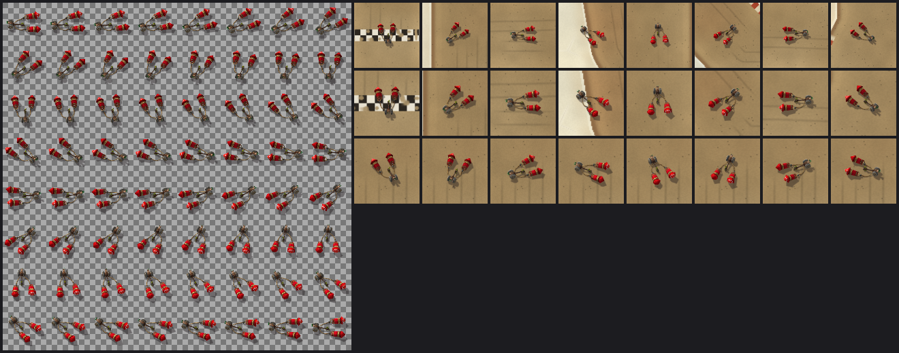

# Goblin Pod Racer — World of Warcraft's goblin rocket car

The owner (2026-10-23), with a picture of a goblin pod racer: "Create/add the goblin pod racer (see image) - replace it with our first kart (the only one that's not a wc3 asset)". His picture shows two red, rope-bound rocket pods with shark faces, roped to a goblin driver on a two-wheeled cart.

**Status:** reviewed and integrated by Codex on 2026-10-24, runtime77a1891 ([review](../../reviews/2026-10-24-podracer-score-integration.md)). **NOT RUN in the client.** See [the client check](#client-check-not-run).



The review image is an offline preview, not a client screenshot.

- **Left:** the runtime sheet of 64 headings, at half size.
- **Right:** the kart at eight headings at about 1080p and 1440p sizes, then eight in-between headings.

## What it is

It is World of Warcraft's own goblin rocket car, `creature/goblinrocketcar/goblinrocketcar.m2`. The model is the rocket car of Mirage Raceway on the Shimmering Flats, the map this game started from. The [map and vehicle brief](../MIRAGE_RACEWAY.md#recognizable-roster) asked for the goblin drag car as "paired rocket pods, braces and exposed/suspended small cockpit", and this is that car. The pods' shark faces show when it faces the camera.

It takes the slot of the original [Goblin Drag Car](goblin-drag-car.md), the project's first kart and its only original one. That kart is retired: its sprite and painter script are removed.

- **Id kept:** the slot keeps the id `goblin_drag_car`, so saved kart choices still name it.
  - The multiplayer kart code is unchanged too: `RaceGrid.lua` (Codex's) sends the slot as code 9.
  - Its name in the game is **Goblin Pod Racer**.
  - Renaming the id is a possible follow-up for Codex, since it touches the grid's codes and tests.
- **Place:** it stays last in `Presentation.KART_ORDER`.

## Source

The source is Blizzard Entertainment's World of Warcraft: the owner's WoW Forever client, product `wow_classic_beta`, version 1.60.1.70532. `scripts/wowcasc.py` reads the client's files by FileDataID and writes nothing in the install.

The client streams many files on demand, and four of these were not stored locally yet. `--cdn` fetched them from Blizzard's CDN, the way the client would:

- the install's own CDN archive indices give each file's archive, offset and size;
- one range request reads those bytes;
- the hosts and path come from the build's `.build.info`.

The same command gave the same six files (by SHA-256) on the owner's machine and in Claude's workspace.

| FileDataID | File (listfile path) | SHA-256 |
|---|---|---|
| 124234 | `creature/goblinrocketcar/goblinrocketcar.m2` | `2d1f0ce6…5e82208d` |
| 476171 | `creature/goblinrocketcar/goblinrocketcar00.skin` | `d537e557…83889773` |
| 197786 | `world/generic/goblin/passivedoodads/goblinrocketcarts/rocketcart01.blp` | `d0c382c8…cbcc0ad2` |
| 197800 | `world/generic/goblin/passivedoodads/goblintntwagon/goblinwagonwheel01.blp` | `516bdd4e…e411673b` |
| 197788 | `world/generic/goblin/passivedoodads/goblinrocketcarts/westfallwagonwood copy.blp` | `7fbf7fdb…07f3b194` |
| 124223 | `creature/goblin/goblin.blp` | `bd09f69e…64abe9ec` |

The full hashes are in `scripts/build_wc3_kart.py` (`WOW_VEHICLES`), which checks them before building. The files are not stored in this repository.

## What the render does

`scripts/wowmodel.py` reads the M2 model (its MD21 chunk), the skin profile's sections and texture units, and the BLP2 textures. The textures are DXT1/3/5, decoded with `wc3render.py`'s exact integer block decoders, at their second mip level. `scripts/build_wc3_kart.py` then renders the car as it renders every other kart:

- three-quarter view, 64 headings;
- the scenery's north-west sun and soft south-east shadow;
- 4×4 samples per texel.

What differs from the Warcraft III karts:

- **Facing:** a WoW model faces −y, so the car is turned a quarter turn to face +x (an exact swap of coordinates).
- **Effect units:** the model's additive fire rings (`spells/firering1a.blp`, the rockets' flames) are not drawn, as a Warcraft III model's effect layers are not.
- **Team colour:** none.

| Sheet | Scale | Frame window (quad, pivot) | Opaque texels per frame | SHA-256 |
|---|---|---|---|---|
| `addon/AzerothKart/Assets/Karts/GoblinPodRacer.tga`, 1024×1024 BGRA32, 64 frames | 36 world units long (25 wide) | 44, (1.2, 0) | 1,548–1,807 | `88a0dfbd…af5c2ccb` |

It is the longest kart: its pods run well ahead of its cart. The physics body is unchanged: every kart drives the same 17×31 body.

The client already holds this model, and [ADR 0009](../../adr/0009-warcraft-iii-asset-reuse.md) prefers referencing what the client holds over bundling a copy. That fits textures. The kart renderer instead needs 64 frames pre-rendered in the project's camera and light. Showing the model live through a WoW Model frame would need Forever APIs nobody has verified, and it would look unlike the other karts.

## Effects

The anchors in `Presentation.KART_SPRITES.goblin_drag_car` were measured on the model:

- **Drift dust and sparks** come from the cart's two wheels, where they touch the ground: (−12.6, 0.8) and (−12.6, −4.9).
- **Boost flame and soot** come from the rocket pods' tails: (2.3, 7.6, 3.0) and (2.4, −8.1, 2.9), at the start of the model's own fire rings. They burn back past the goblin towards the cart, as the model's do.

`build_wc3_kart.py --emitters` lists a WoW model's effect units, each side's centre and trailing point.

## Rebuilding

```
python scripts/wowcasc.py "C:\Program Files (x86)\World of Warcraft" extract WOW 124234=creature/goblinrocketcar/goblinrocketcar.m2 476171=creature/goblinrocketcar/goblinrocketcar00.skin 197786=world/generic/goblin/passivedoodads/goblinrocketcarts/rocketcart01.blp 197800=world/generic/goblin/passivedoodads/goblintntwagon/goblinwagonwheel01.blp "197788=world/generic/goblin/passivedoodads/goblinrocketcarts/westfallwagonwood copy.blp" 124223=creature/goblin/goblin.blp --cdn
python scripts/build_wc3_kart.py --wow WOW --vehicle goblin_drag_car --preview
python scripts/build_wc3_kart.py --wow WOW --vehicle goblin_drag_car --check
python scripts/build_kart_outlines.py
```

The last line rebuilds its [outline sheet](outlines.md) too.

## Provenance and rights

- **Author:** Blizzard Entertainment (World of Warcraft model and textures).
- **Source:** the owner's own WoW Forever client, at the owner's request (2026-10-23).
- **Modifications:**
  - posed and rendered as 64 sprite frames with the project's camera, light and shadow;
  - turned to face east;
  - its flame effects left out.
- **Rights:** used under the owner's direction, as [ADR 0009](../../adr/0009-warcraft-iii-asset-reuse.md) uses Warcraft III's own models. **Redistribution rights are not established** and stay open for release review, as for all Blizzard art.

## Client check (NOT RUN)

1. Fully restart the client after installing: `GoblinPodRacer.tga` and the outline sheets are new files.
2. In the Garage the last kart reads **Goblin Pod Racer**, spins on the turntable and credits Blizzard Entertainment (World of Warcraft).
3. Drive a lap. Check each of these:
   - the pods lead at every heading;
   - there is no mirroring or neighbouring-frame sliver;
   - drift dust starts at the cart's wheels;
   - boost flames start at the pods' tails.
4. A player who had the old drag car chosen sees the pod racer after the update.
