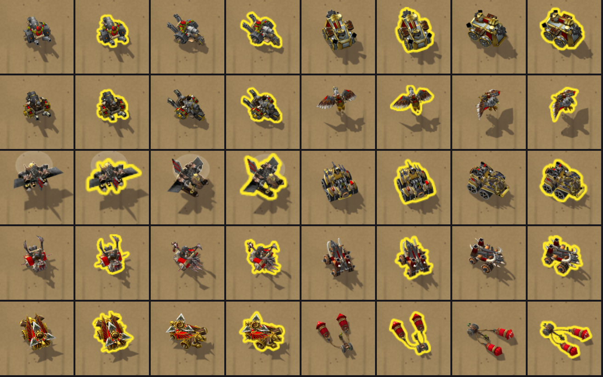

# Kart outlines — "Outline my kart"

The owner (2026-10-23): "Visually it can sometimes be difficult to see your cart, add an option in the settings to enable an outline of your own cart when driving (like a bright yellow line or something)".

**Status:** proposed on `claude/podracer-arrows-outline` for Codex review and integration. **NOT RUN in the client:** see [the client check](#client-check-not-run).



The review image is an offline preview, not a client screenshot. Each pair shows one kart without its outline, then with it.

## The setting

- **Where:** Settings has a new check, **Outline my kart**: "A bright yellow line round your own kart, so you never lose it." It sits under Drift and boost effects.
- **Default:** off.
- **Saved:** like the other settings, as the `outline` field of `AzerothKartDB.preferences`. An older build keeps the field when it saves.
- **When it shows:** whenever your own kart is drawn: on the grid, in the countdown, while racing and stopped.
  - It follows the kart through every heading, at its frame, size and place.
  - Other players' karts get none.
- **The line:** a bright yellow line (`Presentation.KART_OUTLINE.color`, 1, 0.92, 0.16) about 2.5 pixels wide at 1440p.
  - It hugs the kart's body, not its shadow.
  - It is drawn over the kart's shadow and never over the kart itself.

## The outline sheets

Each kart sheet has an outline sheet with the same name under `addon/AzerothKart/Assets/Karts/Outlines/`. `scripts/build_kart_outlines.py` derives each one from its kart sheet alone, so no model or texture outside the repository is needed.

- **Body:** the body is the frame's texels at least half opaque. The baked ground shadow is at most 42% opaque, so it is not body.
- **The line:** every texel outside the body within 5 texels of it is fully opaque, fading out over one more texel.
- **Size:** each frame is then halved by an exact 2×2 box filter. A sheet is 512×512: the same 8×8 grid of frames, 64 texels each, over the same quad.
- **Colour:** white, so the game tints it.
- **Border:** each frame keeps a clear one-texel border, as the kart sheets do.

The bytes are reproducible: integer distances, IEEE square roots and integer averages. The script checks every frame for a line, a clear border and a line that never covers the body, and `tests/test_presentation.lua` checks the same.

| Kart | Outline sheet | Lit texels per frame (at least) |
|---|---|---|
| Goblin Mortar Trike | `GoblinMortarTrike.tga` | 460 |
| Steam Tank | `SteamTank.tga` | 453 |
| Dwarven Biker | `DwarvenBiker.tga` | 455 |
| Gryphon Rider | `GryphonRider.tga` | 461 |
| Gyrocopter | `Gyrocopter.tga` | 451 |
| Dwarf Car | `DwarfCar.tga` | 469 |
| Meat Wagon | `MeatWagon.tga` | 554 |
| Orc Demolisher | `OrcDemolisher.tga` | 523 |
| Glaive Thrower | `GlaiveThrower.tga` | 587 |
| Goblin Pod Racer | `GoblinPodRacer.tga` | 742 |

Each sheet is 1,048,594 bytes, 10 MiB for the ten. The game loads only the current kart's, and only while the setting is on. The Gyrocopter's translucent rotor disc is not body, so the line goes round the craft, not the blur.

```
python scripts/build_kart_outlines.py             # write all ten
python scripts/build_kart_outlines.py --check     # exact bytes and invariants, writes nothing
python scripts/build_kart_outlines.py --preview   # also the review image above
```

Rebuild the outlines whenever a kart sheet changes.

## In the game

`UI.lua` adds one pooled texture, `UI.kartOutline`, created with the window. It sits in the canvas's OVERLAY layer at sublevel 1: over the kart (sublevel 0) and its sparks, under the front exhaust flames.

- **Loading:** `UI.SetKartOutline(enabled)` is the Settings switch. Switched on, the current kart's outline sheet loads with the same guards as the kart's, once per kart.
  - A refused load hides the line and is not retried.
  - Switched off, nothing loads.
- **Drawing:** `render` gives it the kart's frame crop and position. The kart's quad size is set when the kart or map changes.
- **Simulation:** none of this reads or writes the simulation.
- **Object counts:** the outline adds one texture, and the Settings check adds one button and two lines of text. The explicit counts become 80 frames, 167 textures and 83 font strings.
- **No outline:** single-image karts and the plain fallback kart have no outline sheet, so they show none.

## Client check (NOT RUN)

1. Fully restart the client after installing: the outline sheets are new files.
2. Settings: **Outline my kart** starts unchecked. Check it, then race:
   - a bright yellow line hugs your kart at every heading;
   - it lies over the shadow and never over the kart;
   - it shows no stray box or neighbouring-frame sliver;
   - it causes no hitch.
3. Change karts in the Garage: the line follows each kart's shape.
4. `/reload`: the setting stays on. Uncheck it: the line disappears.
5. Print Probe shows the new counts: 80 frames, 167 textures, 83 font strings.
