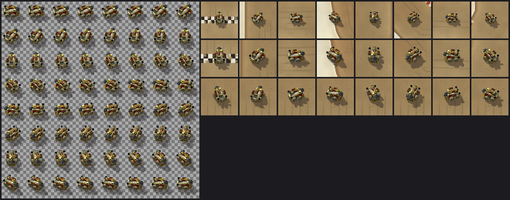
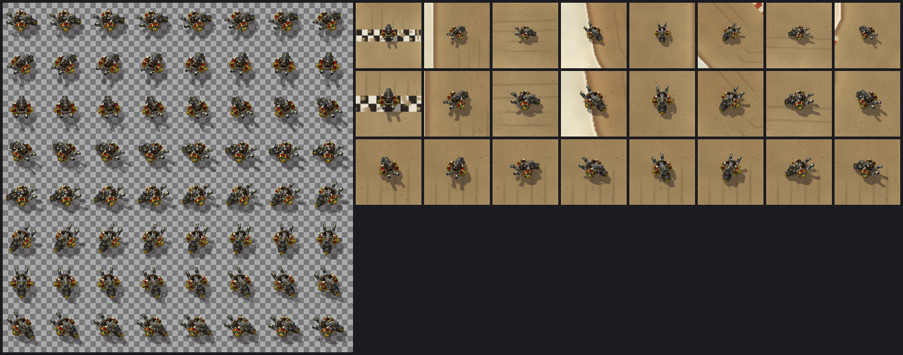
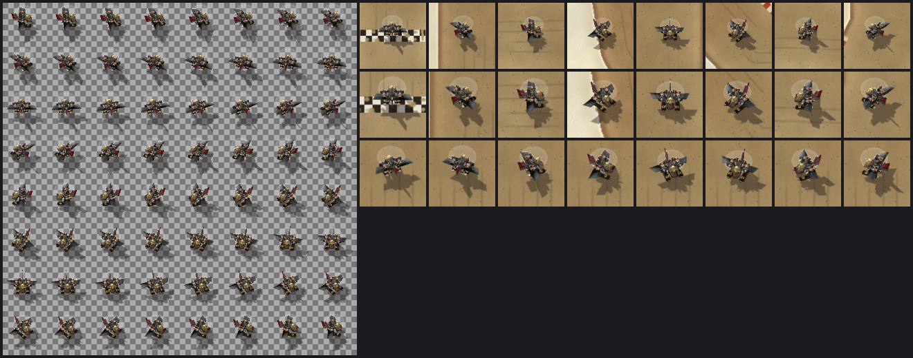

# Kart roster — four more Warcraft III vehicles and the Kart button

**Status (2026-10-21):** the owner chose four vehicles; each is rendered from its published Warcraft III model and registered on `claude/track-ui`. They are the Steam Tank, Dwarven Biker, Gryphon Rider and Gyrocopter.

While stopped, a new **Kart** button cycles six karts: the [Goblin Mortar Trike](goblin-mortar-trike.md) (default), these four, and the original [Goblin Drag Car](goblin-drag-car.md). Karts are cosmetic: every one drives the same 17×31 physics body with the same handling.

The karts' appearance in WoW Forever is **NOT RUN**; see [the client check](#client-check-not-run).

| Steam Tank | Dwarven Biker |
|---|---|
|  |  |
| **Gryphon Rider** | **Gyrocopter** |
|  |  |

Each review image shows:

- on the left, the runtime sheet of 64 headings at half size;
- on the right, the kart on the real Mirage background at eight headings, at about 1080p and 1440p UI sizes, then eight in-between headings.

They are offline previews, not client screenshots.

## Sources and terms

The owner picked these from [WC3Vault](https://wc3vault.com/assets) listings on 2026-10-21. Each archive holds the model and its own textures and nothing else: no Read Me, license or credits file. WC3Vault lists every author as "Unknown (WC3C)" and describes each as part of the "ITE project, wc3c". The Gryphon Rider's texture sits at Warcraft III's own Gryphon Rider path, so it may be Blizzard Entertainment's original texture or derived from it.

Under [ADR 0009](../../adr/0009-warcraft-iii-asset-reuse.md) these are accepted project sources, but no permission or license has been found. **Redistribution is unresolved for release review.** The credits name the source as found.

| Vehicle | Listing | Archive (SHA-256) | Files used (SHA-256 prefix) |
|---|---|---|---|
| Steam Tank | [WC3Vault](https://wc3vault.com/c3bda868-1673-4042-b72b-81549a02a471) | `SteamTank.zip`, 247,495 bytes (`61505f48…4c3e`) | `SteamTank.mdx` (`bc48eb0a`), `Textures/Steamtank.blp` (`3bcbf46b`), `Textures/wc1knight_mace.blp` (`1086df69`) |
| Dwarven Biker | [WC3Vault](https://wc3vault.com/2bfa9372-652a-49a9-bebc-3919f867809d) | `DwarvenBiker.zip`, 139,963 bytes (`75254992…81d2`) | `DwarvenBiker.mdx` (`21a5c917`), `Textures/dwarfbike.BLP` (`5ff96109`) |
| Gryphon Rider | [WC3Vault](https://wc3vault.com/fad9e36c-199c-4463-825a-b2696199e970) | `GryphonRider.zip`, 353,439 bytes (`597fbda5…60eb`) | `gryphonrider.mdx` (`ff20667a`), `Units/Human/GryphonRider/gryphonrider.blp` (`617d2ea8`) |
| Gyrocopter | [WC3Vault](https://wc3vault.com/20900e69-d9dc-455a-a5e0-057cb36c4bdf) | `Gyrocopter.zip`, 130,380 bytes (`f810c818…9b81`) | `GyroCopter.mdx` (`630c9f03`), `Textures/FlyingMachine.blp` (`53e35e01`) |

The full file hashes are in `scripts/build_wc3_kart.py`, which verifies them before building. The archives and their extracted files are kept outside Git, under `local-artifacts/third-party/<slug>/`.

The Dwarven Biker shares its skeleton and effect emitters with the Goblin Mortar Trike: the two models evidently come from a common base.

## What the render does

`scripts/build_wc3_kart.py` renders these the same way as the trike: three-quarter view, 64 headings, the scenery's light and shadow, and player-1 red team colour. Mesh, UVs and shipped textures are used as published.

- **Textures** are JPEG-compressed BLP1. The new `scripts/wc3jpeg.py` decodes them with libjpeg's integer inverse DCT in pure Python. Offline, its samples matched libjpeg (through Pillow) exactly for all five textures.
- **Effect layers** whose textures the archives don't ship (glows, dust, flames) are not drawn, as with the trike.
- **Flyers** are lifted so their lowest point hovers 4 world units up, so their shadows fall detached on the ground.
- **Gyrocopter, two original stand-ins.** The game blurs its spinning main rotor with a texture the archive does not ship, so the blades are hidden and a faint translucent disc is drawn instead. The pilot's body uses Warcraft III's Mortar Team texture, also not shipped, so it is shaded in a flat leather tone; the head and helmet keep their shipped texture.

| Vehicle | Pose | Scale | Frame window (quad, pivot) | Sheet SHA-256 |
|---|---|---|---|---|
| Steam Tank | Stand | 22 units wide | 45, (3.7, 0) | `e5ff5c65…184c` |
| Dwarven Biker | Walk (it has no Stand) | 21 wide | 41, (3, 0) | `564d5256…0e38` |
| Gryphon Rider | Stand, wings spread | 32 wingspan, hover 4 | 41, (2.6, 0) | `06d94738…e92b` |
| Gyrocopter | Stand | 28 long, hover 4 | 58, (4, 0) | `2f00ca98…f50d` |

Each sheet is a 1024×1024 BGRA32 TGA of 64 frames (4 MiB raw), like the trike's. The frame windows fit the vehicle, its shadow and the gyrocopter's disc at every heading; the build checks this. Bytes are reproducible: the scripts use only exact arithmetic.

Build or verify every vehicle:

```
python scripts/build_wc3_kart.py --all local-artifacts/third-party            # write all five sheets
python scripts/build_wc3_kart.py --all local-artifacts/third-party --check    # verify bytes
python scripts/build_wc3_kart.py --source local-artifacts/third-party/gyrocopter --vehicle gyrocopter --emitters
```

## Effects

Drift and boost effects use per-kart anchors in `Presentation.KART_SPRITES`, taken from `--emitters`: each model's own exhaust and dust emitters and its lowest geometry.

| Kart | Effect anchors |
|---|---|
| Steam Tank | Smoke-stack flames |
| Dwarven Biker | The trike's two exhausts |
| Gyrocopter | Its wing engines; dust from its skids |
| Gryphon Rider | No flame: wingtip wind trails while boosting, and dust on the ground under it while drifting |

See [the effects sheet](../effects/drift-boost.md).

Loaded karts are never tinted: the effects show the drift and boost phase (owner direction, 2026-10-21). Only the plain fallback rectangle, used when no art loads, keeps its phase colours.

## Kart button

- **Placement and labels:** the button sits right of the Track button and reads **Kart: \<name\>**.
- **While stopped:** a click loads the next kart in `Presentation.KART_ORDER` with the same guarded checks as at creation.
  - A refused load keeps the current kart.
  - A choice never touches the run, its result, the track or the simulation state.
- **During a run:** the button is disabled and direct choices are refused.
- **Remembered:** [the front end](../ui/front-end.md#saved-preferences) saves the choice, from the kart screens or this button, and restores it when the window is created. Without the front end, the default kart returns after `/reload`.

The Kart button adds one Frame alongside the existing Close results button: combined explicit UI counts become 11 frames, 151 textures and 13 font strings, and 65/160/79 with the front end. The front end's kart screens reuse these sheets for the turntable and add no kart art.

## Client check (NOT RUN)

Fully restart the client after installing: the sheets are new files. Then, while stopped:

1. Click **Kart** repeatedly: Steam Tank, Dwarven Biker, Gryphon Rider, Gyrocopter, Goblin Drag Car, then back to the Goblin Mortar Trike. The label matches the kart, and each choice appears at once.
2. Drive a lap with each. The kart faces its travel direction at every heading, with no mirroring, flipping or neighbouring-frame slivers. The flyers' shadows sit detached south-east of them.
3. The Gyrocopter's rotor reads as a faint spinning blur, not a solid lid. Its pilot doesn't look odd.
4. Drift and boost effects start at sensible points on each kart, with no whole-kart colour change.
5. The button is disabled during a run. No hitch when switching karts; each sheet is 4 MiB. Print Probe shows 65/160/79 with the front end (11/151/13 without it).
