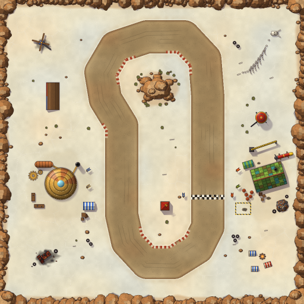
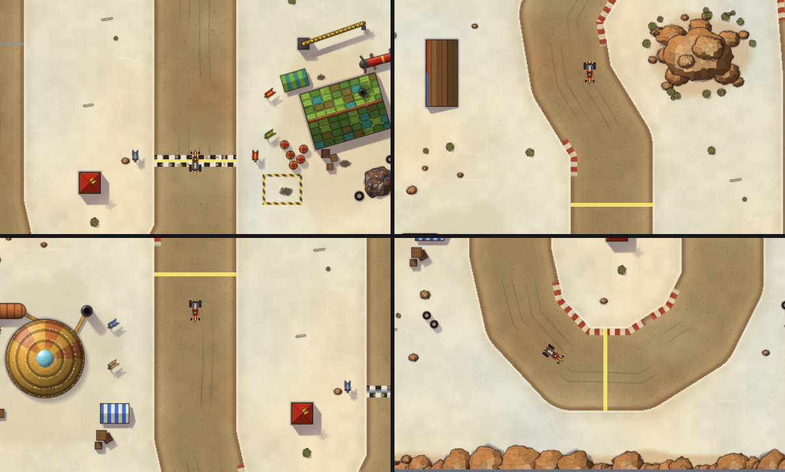

# Mirage Raceway background — scenery v1

**Status (2026-10-20):** original procedural scenery on `claude/track-ui`. The owner's [in-game screenshot](../evidence/2026-10-20-mirage-scenery-owner-check.md) showed the first version rendering at the Mirage start and flagged detached shadows; the [shadow pass](#shadows) replaces them. The owner [approved the revised shadows](../evidence/2026-10-20-trike-and-shadows-owner-approval.md) as installed at `cf71394`; see [the client check](#client-check).



`addon/AzerothKart/Assets/Tracks/SaltFlats/Background.tga` is painted by `scripts/build_mirage_background.py`. Scenery v1 replaces the earlier flat blockout art at the same path, size, format and registration. Geometry, collision, gates, camera and UI code are unchanged, and explicit UI counts stay 9 frames/111 textures/13 font strings.



The views emulate the play camera offline: scale 1.5, 60 world units of look-ahead, clamped to the map. They draw the kart sprite, the gate strips and the gray wall strips approximately. They are review aids, not client screenshots. In reading order:

1. the start straight beside the goblin pit;
2. the west straight leaving the north bend, between the bleachers and the rock mound;
3. the gnome dome beside the West gate;
4. the south hairpin at the South gate.

## Format

| Property | Value |
|---|---|
| Size | 1024×1024 texels, one texel per world unit |
| Encoding | Uncompressed true-color TGA (type 2), 32-bit BGRA with eight alpha bits, fully opaque, bottom-left origin (the world's +Y-up orientation) |
| File | 4,194,322 bytes; SHA-256 `cd5aecb95daca106e3494c8ed72a2a6b227f49ca51680a8c6b403f766a1c567e` |
| Raw pixel payload | 4 MiB, unchanged from the blockout |

Play crops this image to fill the 800×480 canvas at scale 1.5. The whole-map 0.46875 fit is only an authoring overview.

## Registration and readability guarantees

Painted pixels never decide collision, surfaces or laps. These checks keep the picture faithful to the geometry that does:

- **Exact road edges.** The exporter evaluates the actual `MirageRaceway` `isDrivable` predicate at every pixel center, using Lua 5.1 through pinned Lupa. Each pixel is painted as road or salt from that answer alone.
- **Nothing on the road.** Scenery and shadow coverage is tracked per texel, and the build fails if any covered or shadowed texel is road. Objects keep at least 20 world units from the road edge. The two start-line banner poles are a deliberate exception at 6.
- **A readable edge.** Interior road must stay at luma ≤ 180: that is 12 or more units inside the edge, excluding the checkers. The salt rim 0.5–3 units outside the edge must stay at ≥ 190. A light crust therefore outlines the darker lane everywhere. Current values: road ≤ 168 over 169,984 texels, rim ≥ 201 over 11,089 texels.
- **Orientation.** Ten asymmetric landmarks — five road, five salt, including two pairs of texels that straddle a road edge — must match their expected ground color exactly and stay free of scenery.
- **Markings agree with gameplay data.** Gates, walls and the kart remain separate pooled UI textures. The painted checkers lie under the existing Start gate (x 644–756, y 352–368), and kerbs only cover drivable texels.

`tests/test_presentation.lua` independently re-reads the TGA and samples every third texel against `isDrivable` with the same luma limits. It requires at least 15,000 road and 900 rim samples; there are currently 18,887 and 1,191. A flipped or shifted image fails.

## Layers

1. **Salt flat.** Warm-to-cool ivory mottling over domain-warped Voronoi crust plates about 46 units across. Their pressure ridges and hairline cracks fade in and out, so the plates never read as paving. A bright crust lines the road for 3 units, and dust thrown off the lane fades out over the next 19.
2. **Racing lane.** Packed red-brown dirt with a traffic-worn center, a looser margin and a darker berm along both edges. Two wobbling racing lines carry intermittent tire streaks. Red and cream kerbs in 7-unit blocks mark the inside of each sharp bend, fading in and out. Sparse pebbles finish the surface.
3. **Start/finish.** Two rows of worn 8-unit checkers across the Start gate.
4. **Scenery.** Static set pieces in a hand-painted Warcraft III key, lit from the north-west (the map never rotates), outlined in dark ink and grounded by the [shadows](#shadows) below:
   - sandstone boulders and corner formations ringing the map behind the wall strips, and the rock mound inside the north bend;
   - the **goblin pit**, east of the start straight: a crooked green patchwork workshop, a striped awning, red fuel barrels, crates, oil stains, a scrap heap, a rocket on a rack, a crane, a hazard-striped pit box and red/green banners;
   - the **gnome camp**, west of the west straight: a riveted brass dome with a glass skylight, a copper boiler with pipes and a chimney, workbenches, gears, a blue-striped awning and blue/brass banners;
   - an infield timing tower opposite the start line, plus gnome-blue and goblin-red banners flanking the checkers;
   - bleachers on the north-west flats, a tent camp with a campfire in the south-east, and a fuel tank tower on the east side;
   - a wrecked drag car (south-west), a crashed gyrocopter (north-west) and a kodo skeleton (north-east);
   - tire stacks at the bends, and up to 30 hash-placed rocks, shrubs and bones on the open flats.

## Shadows

Revised 2026-10-20 after the owner's in-game check, where each shadow was an offset copy of its object and read as a detached gray shape. Now every object queues one shadow before it is drawn (`paintkit.Shadow`, `Canvas.cast`):

- **Attached by construction.** Objects are described by convex volumes with real heights in world units. A barrel is a 9-unit column, the workshop a gable with 14-unit eaves and a 24-unit ridge, and the timing tower a 20-unit block with a 28-unit apex. A volume's shadow is the convex hull of its vertices, each moved 0.95 units toward the south-east per unit of height, so a grounded object's shadow always touches its base.
- **Raised parts lift away.** The banner cloth 16 units up, the crane boom, the fuel drum on its stilts and the gyrocopter's rotor cast displaced shadows. The thin shadows of their poles, legs or cable join them to the ground.
- **Soft and grounded.** A contact rim darkens the ground right around each grounded footprint. The penumbra widens, and the shadow lightens, toward its far tip.
- **Multiplied, never stacked.** Shadows multiply the painted color toward a slightly cool tint, so the salt texture shows through. Each texel keeps only its strongest shadow, so overlaps such as a rock cluster or the rocket and its cradles never double-darken. Fresh paint clears that level, so a taller object's shadow falls across the low props queued before it; each set piece queues its low props first.
- **No shadow look-alikes.** Oil stains are now small, crisp, lobed splats instead of soft gray blobs, and the banners are swallowtail flags whose lifted shadows repeat their shape.

## Reproduction

```powershell
python scripts/build_mirage_background.py            # regenerate the runtime TGA (about 40 s)
python scripts/build_mirage_background.py --check    # exact bytes plus all checks above; writes nothing
python scripts/build_mirage_background.py --preview  # also rewrite the two review PNGs here
```

The generator needs the pinned Lupa runtime from `requirements-dev.txt` (install it as `scripts/test_lua.py` describes) and the standard library. Painting code shared with the kart generator lives in `scripts/paintkit.py`: SDF shapes, the coverage canvas, the shadow caster, materials, the exact integer resolve and TGA/PNG encoding. Pixel values use only IEEE-exact arithmetic (`+ - * /`, `sqrt`, `floor`) and integer hashing, so the bytes are platform-independent. Python 3.13 in the cloud workspace and Python 3.10 on the developer's Linux shell produced the same SHA-256. PNG previews depend on the local zlib, and `--check` does not compare them.

To move or add scenery, edit `paint_scenery()`. The build refuses any placement that touches road, and `scatter()` stays out of the set pieces' areas. After a `MirageRaceway.lua` geometry change, regenerate this file together with the layout guide. Until then `--check` reports `STALE`, and the Lua background test fails wherever sampled road and painted lane disagree.

## Provenance

| Asset path | Author/source | License / permission | Date | Intended use |
|---|---|---|---|---|
| `addon/AzerothKart/Assets/Tracks/SaltFlats/Background.tga`, `docs/art/mirage-background-overview.png`, `docs/art/mirage-background-views.png` | Original procedural art by Claude for Azeroth Kart, painted by `scripts/build_mirage_background.py` | Project-authored; no third-party input | 2026-10-20 | Mirage runtime background (scenery v1) and its review images |

Inputs are the Lua track geometry and the generator's own shapes, palette and integer noise. The views sheet also composites the project-authored Goblin Drag Car sprite. The [map brief](MIRAGE_RACEWAY.md) informed the composition: dry salt, a rocky mound by the northern bend, rival goblin and gnome camps, and wreckage and bones away from the lane.

No screenshot, concept-board crop, Blizzard or Warcraft III file, WC3Vault model, other third-party texture or model, or image-generation output is copied or traced. [ADR 0009](../adr/0009-warcraft-iii-asset-reuse.md) permits Warcraft III material, but this pass imported none, so it carries no third-party credit. Log any later import in [the source ledger](ASSET_SOURCES.md).

The earlier blockout used the same path and format: a flat tan road on pale cracked salt, generated from the same predicate. It remains in Git history.

## Client check

Offline checks establish bytes, registration and contrast, not appearance in WoW Forever. The owner's [in-game screenshot](../evidence/2026-10-20-mirage-scenery-owner-check.md) showed the first version of this scenery loading with the expected orientation and crop at spawn. After the install of `cf71394`, he approved the revised shadows: "The trike and shadows are approved by me." ([evidence](../evidence/2026-10-20-trike-and-shadows-owner-approval.md)). He did not report the items below one by one, and no screenshot or Print Probe output came with the approval, so item 6 stays unmeasured. Claude did not run the client.

After an authorized install, fully restart the client, because a replaced texture may stay cached through `/reload`. Select **Track: Mirage Raceway** and drive one lap, then check:

1. Shadows touch their objects: the timing tower, workshop, crates and barrels. The banners' and crane boom's shadows lie offset but joined by pole and cable lines. No detached gray squares or streaks remain.
2. The lane edge matches where the kart starts slowing on salt.
3. The checkers sit under the Start strip, and kerbs mark the inside of the bends.
4. No camp or prop covers the lane, a gate strip or the kart, and the gray wall strips sit over the boulder rim.
5. No seams, banding or unexpected blur appear as the camera moves or reaches the map edges.
6. Print Probe still shows 9/111/13.

Record actual results in `docs/PROGRESS.md`.
