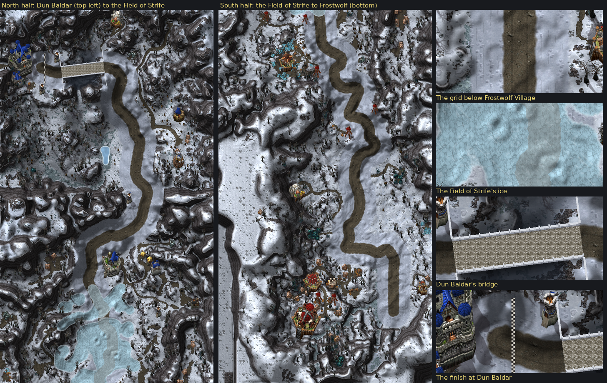

# Alterac Valley (Battlegrounds Cup)

The Battlegrounds Cup's third course, by Claude (rendering/UI owner): a **sprint** down the whole valley, from the Horde's side to the Alliance's, on the battleground's real road, measured from the owner's own World of Warcraft client as Warsong Gulch and Arathi Basin were. One run, eight gates, no fences: the karts keep full grip a few kart lengths either side of the road and run on, slowed, through the deep snow to the valley's natural walls; the Field of Strife in the middle is frozen over.



**Status:** version1, reviewed and integrated by Codex with flat Physics15 ice traction and one-run solo/two-player registration. The earlier proposal notes below describe Claude’s handoff before that integration. **NOT RUN in the client:** scenery seams, memory/frame cost, handling and multiplayer delivery. See [current contract](../../API_CONTRACTS.md).

## What the owner asked

With Arathi Basin settled, the owner (2026-10-28): **"Happy with Arathi Basin. Let's get started on Alterac Valley. This is going to be a long sprint. Starting on the horde side - no fences - but allow for driving and drifting a few kart lengths outside the road - after that, our regular speed reduction like grass - and introduce (get help from codex) a new slide mechanic/physics when the karts touch ice in the middle of the map, handling/turning gets way worse on that patch of ice (field of strife)"**, with the valley's map and a green line from Frostwolf in the south up the valley's road, through the Field of Strife, to Dun Baldar in the north-west.

| Asked | Built |
|---|---|
| A long sprint, from the Horde's side | One run (`laps` 1) of 8,232 units (41 seconds at the karts' top speed of 200, more with the bends and the ice; Arathi Basin's lap is 5,094), from the road below Frostwolf Village up the valley to Dun Baldar's gate: eight gates. |
| No fences | No wall along the street anywhere; the only walls drawn are the Dun Baldar bridge's parapets (a kart cannot leave a bridge's sides). |
| Drive and drift a few kart lengths outside the road | Full grip 145 units from the road's middle: the road (52 either side) and three kart lengths (93) beyond its edge, packed snow. |
| After that, the regular grass slowdown | Beyond the grip the snow is open ground at Physics' grass speed (Circuit's packed passability, `grassMap`, as Arathi's open grass), out to the valley's natural walls: slopes too steep to climb, buildings, rocks, tree trunks. |
| Ice in the middle (the Field of Strife) where handling gets far worse | The Field of Strife's trampled middle is ice (`iceMap`), the road across it too. The slide is Codex's: requested, with a suggested model, in the [proposal](../../API_CONTRACTS.md#proposed-alterac-valley-a-battlegrounds-cup-sprint-claude-claudealterac-valley-2026-10-28-for-codex). Until then the ice is drawn and its data inert. |

## How it was made

`scripts/wow_map_survey.py` measures the battleground (map `PVPZone01`) from the owner's client files, read without modification by `scripts/wowcasc.py`. The numbers are in `scripts/alterac_valley_survey.json`: its 19 ground textures' weights, the terrain's height (1.5-yard steps from −75 yards) and the water's depth every four units over 512 × 1792 texels, and 3,316 placements; no client file is copied. The course's world is the valley at three units to the yard, as the other battlegrounds: a placement at (px, pz) yards stands at X = (px − 17014) × 3, Y = (18633 − pz) × 3, over **2048 × 7168 units**, the valley's whole length from Frostwolf Keep to Dun Baldar.

The route follows the client's road (its trampled-dirt texture) from the owner's green line: traced over the survey by least cost (the road cheap, slopes dear), checked against the line, then smoothed into control points (`AV_ROUTE`), and made straight across the Dun Baldar bridge.

## The course

**One run,** from the grid on the road below Frostwolf Village, facing north:

1. **North past Frostwolf Village** and the relief hut, round the bend west under the village's hill: gate *Frostwolf Village*.
2. **Up the valley's eastern road** past the Horde's watchtowers: gate *Tower Point*, then the road's highest ground (207 units over its lowest).
3. **Down past Iceblood Garrison:** gate *Iceblood Tower*.
4. **Across the Field of Strife,** frozen over: gate *Field of Strife* in its middle, on the ice.
5. **Up past Stonehearth Outpost** and its bunker: gate *Stonehearth Outpost*.
6. **North along the icy basin's eastern road** by Icewing Bunker: gate *Icewing Bunker*, the road's lowest ground just beyond.
7. **West over the gorge on Dun Baldar's bridge** (narrow: the karts' reach 42 over its deck and approaches): gate *Dun Baldar Bridge* on the deck.
8. **Into Dun Baldar:** the finish, *Dun Baldar*, before the castle's gate.

| Measure | Value |
|---|---|
| World | 2048 × 7168 units (one texel per unit), the valley at three units to the yard |
| The street | the road 52 either side of its middle; full grip to 145 (three kart lengths beyond the road's edge); no walls |
| Off the street | open ground at grass speed (`grassMap`, 8-unit cells, 256 × 896), out to the natural walls |
| The run | 8,232 units of centerline (516 points), the route 256 points (every other) |
| Gates | 8: *Frostwolf Village*, *Tower Point*, *Iceblood Tower*, *Field of Strife*, *Stonehearth Outpost*, *Icewing Bunker*, *Dun Baldar Bridge*, *Dun Baldar* (the finish) |
| Narrows | 1, Dun Baldar's bridge: the karts' reach 42 over its deck and 24 units of road either side; its sides shut to 185 |
| Ice | 7,593 cells (about 486,000 square units): the Field of Strife's middle, road included (`iceMap`) |
| Heights | 0 (the road by Icewing) to 207 world units (69 yards, past Tower Point); the grid at 163, the finish at 131; grades to +0.61 and −0.70 over 64-unit runs (inert) |

## How it plays

`Circuit.new` builds it from the generated `Battlegrounds.lua` (`Courses` geometry `circuit`), with two additions:

- **An open course** (`open=true`): the centerline runs from its first point to its last, with no closing segment back, and **`laps` 1**: Race's one run to the last gate, as the Scarlet Crusade Cup's sprints. Shared `Circuit.lua` change, additive, flagged for Codex's review; `test_circuit` covers it.
- **The passability grid** (`grassMap`, Codex's Arathi contract): a bit per 8-unit cell where a kart's centre may stand. Shut: ground steeper than 1.35 yards per yard (the survey's terrain evened once: where the picture's cliffs are more than half rock face), every building's, rock's and tent's plan, each tree's trunk (7 units), all grown by the karts' inset (18); the world's edge; the bridge's sides. Always open: the street's grip (but under a building). 81,959 of 229,376 cells are open; much of the way the road runs between steep sides (a kart length past the grip's edge about two points in five are open), and the Field of Strife and the villages open wide.
- **Gates** are straight cuts across the open ground near each place, wall to wall: the generator shuts each gate's cells and floods the grid to check no way leads round it.
- **The ice** (`iceMap`, the same grid): the survey's trampled-dirt texture within the Field of Strife's box (at least 30% of a cell's weight), evened four times, its holes filled, grown 40 units. The valley's other frozen ponds are snow underfoot. Physics does not read it yet (Codex's slide).
- **The heights** (`elevation`, inert, [ADR 0015](../../adr/0015-track-elevation.md)), one per centerline point: drawn, not felt.
- **The scenery stands in the way where it should:** buildings, rocks, tents and tree trunks are in the grid; bushes, bones, graves, barrels, crates and lanterns are not. Scenery from the survey that would be drawn over the street, or stands in the water, is left out of both the picture and the grid (24 pieces).
- Collision comes from the generated data, never from a pixel.

## Rendering

All of it reads the simulation's copied state and writes none of it.

- **Four pictures:** a texture stays at most 2048 a side, so the valley is drawn in tiles (`Courses` `tiles`): `Background1.tga` to `Background3.tga` (2048 × 2048) and `Background4.tga` (2048 × 1024), bands of the world from south to north, the first the course's `background`. The UI draws the first in its background texture and the others in three pooled background textures, each over its band, cropped from its own picture as the camera moves (`Presentation.tileCrop`; neighbouring tiles share their edge exactly). A refused tile refuses the course as a missing background does. Budget: three more textures and one more frame (its coming-soon button): **93 / 99 / 151**.
- **`Preview.tga`** (512 × 512): the Field of Strife's square, from Iceblood Garrison to Stonehearth, for the track screen.
- **No guiding arrow:** the road is the way (the owner keeps the arrow for Warsong Gulch). The reviewed route stays in the data for the tests.
- **Gate markers** are the existing pool (eight of eight); a sprint's HUD and results count gates, as the Scarlet sprints'.

## Look

- **The ground is the valley's own:** every texel the Warcraft III tile standing for one of the client's snows (Lordaeron's winter snow and Northrend's), its scraped rock, its dirt, its ice, picked by the measured weights against smooth noise; lit by the relief from the north-west, exaggerated 1.5 times, the hollows darker and the sky's openness dimming the gorges.
- **Cliffs** where the ground is steeper than a yard per yard: Lordaeron's winter cliff laid in strata, a snowy brink at their top.
- **The street:** a dark dirt road down its middle (about 104 wide, ragged soft edges, two worn ruts), packed snow to the grip's edge with wheel tracks along it, both in their tiles' plain variations (no tufts or stones) against the valley's busier deep snow; the packed snow's edge blends into the deep snow over ten units.
- **The ice:** Icecrown's ice calmed toward a pale glass, thin streaks of light across it from the north-west, frost along its edge (evened from the cells and ragged); the road shows on through it as a frosted band.
- **The frozen ponds** elsewhere by their measured depth, pale.
- **Dun Baldar's bridge:** a stone deck along the karts' lane, joints across it, white stone parapets with posts and wing walls at both ends out to where its sides stop being shut; the gorge beside it darkened and blued by its depth below the deck (the survey's heights), the bridge's shadow on it.
- **The bases and the battle,** as the Warcraft III buildings that stand for them, at the client's places: Dun Baldar a castle (human castle), Stonehearth Outpost a keep, the bunkers and towers human towers, Dun Baldar's stable, lumber mill, gryphon aviary, farms and blacksmith; Frostwolf Keep an orc fortress (great hall), the Frostwolf towers and Tower Point orc watchtowers, Iceblood Garrison an orc barracks, the Frostwolf war mill, kennel and tents; Irondeep and Coldtooth mines gold mines.
- **The client's scenery** where its map has it: Northrend's pines (the client's winter trees), rocks, thorns, bones and gravestones, stumps, tents, barrels, crates and lanterns.
- **The finish:** a chequered band across Dun Baldar's gate's line.

## Files

| File | What |
|---|---|
| `addon/AzerothKart/Battlegrounds.lua` | The course's data (generated, beside Warsong's and Arathi's): open centerline, `laps` 1, narrows, gates, spawn, heights, route and `routeGates`, `grassMap`, `iceMap`. |
| `addon/AzerothKart/Assets/Tracks/AlteracValley/Background1.tga` … `Background4.tga` | The valley from above in four bands south to north: 2048 × 2048 (16,777,234 bytes) three times and 2048 × 1024 (8,388,626 bytes); BGRA32, opaque. |
| `addon/AzerothKart/Assets/Tracks/AlteracValley/Preview.tga` | The Field of Strife's square, reduced 4× (512 × 512), for the track screen; 1,048,594 bytes. |
| `scripts/alterac_valley_survey.json` | The survey's numbers (ground weights, relief, water, placements). |
| [`alterac_valley-overview.png`](alterac_valley-overview.png) | The whole valley, reduced 8× (256 × 896), for review. |
| [`alterac_valley-review.png`](alterac_valley-review.png) | The valley in two halves and the course at the game's scale: the grid, the Field of Strife's ice, Dun Baldar's bridge and the finish. |
| [`alterac_valley-sources.txt`](alterac_valley-sources.txt) | Every Warcraft III model and texture the pictures use, with placement counts. |

## Rebuilding

The survey (once, with the client; its output is checked in):

```
python scripts/wowcasc.py "%WOW%" extract WOW <FileDataIDs of world/maps/pvpzone01/pvpzone01_{30..34}_{29..35}{,_obj0,_tex0}.adt and pvpzone01.wdt> --product wow_classic_beta
python scripts/wow_map_survey.py WOW community-listfile.csv scripts/alterac_valley_survey.json --map pvpzone01 --origin 17014 18633 --size 2048 7168 --relief -75 1.5
```

The pictures need these Warcraft III files, then build:

```
python scripts/wc3casc.py %W3% extract "^war3\.w3mod:(buildings/(human/(blacksmith|farm|gryphonaviary|humanbarracks|humanlumbermill|humantower|townhall)|orc/(beastiary|greathall|orcbarracks|warmill|watchtower)|other/(barrelsunit|goldmine|tent))/|doodads/(ashenvale/props/ashenhollowstump|lordaeronsummer/(props/lanternpost|terrain/crates)|northrend/(plants/north_thorns|props/(north_bones|northrendtombstone)|rocks/north_rocks)|terrain/northrendtree)/)" WC3
python scripts/wc3casc.py %W3% extract "^war3\.w3mod:(terrainart/(lordaeronwinter|northrend|icecrown|village)/|replaceabletextures/(northrendtree|splats)/|textures/)" WC3
python scripts/build_battlegrounds.py --wc3 WC3 --course alterac_valley --preview
python scripts/build_battlegrounds.py --wc3 WC3 --check
```

- **`scripts/battleground_layouts.py`:** the Alterac Valley section: the route's control points on the real road (`AV_ROUTE`, smoothed, straight across the bridge), the bridge, the street's widths, the gates (each a place and the axis it is cut along), the grid; the passability and ice rules (`ALTERAC["maps"]`); the painting data (the ground's tiles, relief, cliffs, water, the street's surfaces, the ice, the bridge, the four tiles, the preview's square); the scenery by hand (the bases and the battle's buildings) and from the survey (`_av_dressing`, by the client's model names).
- **`scripts/battleground_sprint.py`:** `sprint_geometry`: the open centerline and its narrows, the heights, the scenery kept (`sprint_props`), the passability and ice grids (`sprint_maps`), the gates (`sprint_gates`: a straight cut near each place across the open ground, checked by flooding the grid); `validate_sprint` walks the route through the gates in order; the grids packed as Circuit reads them.
- **`scripts/battleground_paint.py`:** `build_sprint`: the ground, the water, the client's roads off the course, the cliffs, the street (`paint_sprint_course`), the ice (`paint_sprint_ice`), the bridge (`paint_sprint_bridges`), the finish, the scenery north to south; written as the four tiles and the preview.

## Provenance and rights

**Pictures:** Blizzard Entertainment's Warcraft III: Reforged, build 3.0.1.24371, from the owner's own install, read without modification by `scripts/wc3casc.py`, used under [ADR 0009](../../adr/0009-warcraft-iii-asset-reuse.md): [the sources list](alterac_valley-sources.txt). Modifications: models posed and rendered as sprites with the project's light, shadows and lean (team colours: Horde red, Alliance blue; the Northrend pines with their own replaceable bark and needles); terrain atlases halved and shaded, picked and mixed by the generator (the street's in their plain variations), Lordaeron's winter cliff texture laid in strata over the steep ground, Icecrown's ice calmed toward glass; everything else painted by the generator (the frozen water, the roads, ruts and wheel tracks, the ice's streaks and frost, the bridge's deck, parapets, wing walls and shadow, the finish) and composited.

**Layout and ground pattern:** measured from World of Warcraft's Alterac Valley (Blizzard Entertainment) in the owner's own client, read without modification by `scripts/wowcasc.py`: numbers only (placements, heights, texture weights, water depths), no World of Warcraft file or picture is stored or shipped. A tracing of the battleground's layout, as Warsong Gulch's and Arathi Basin's; recorded here for the release review.

**Author:** Blizzard Entertainment. **Redistribution rights are not established** and stay open for release review.
