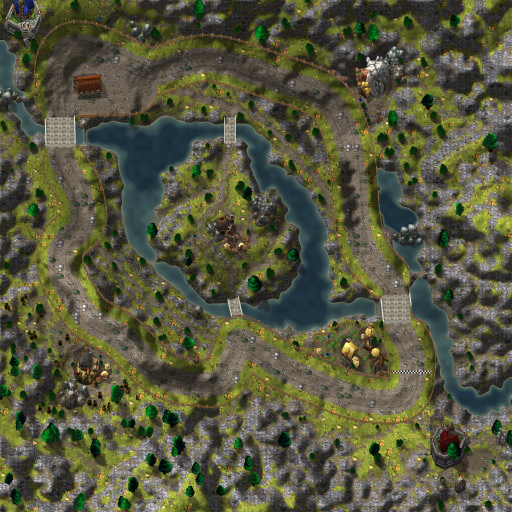
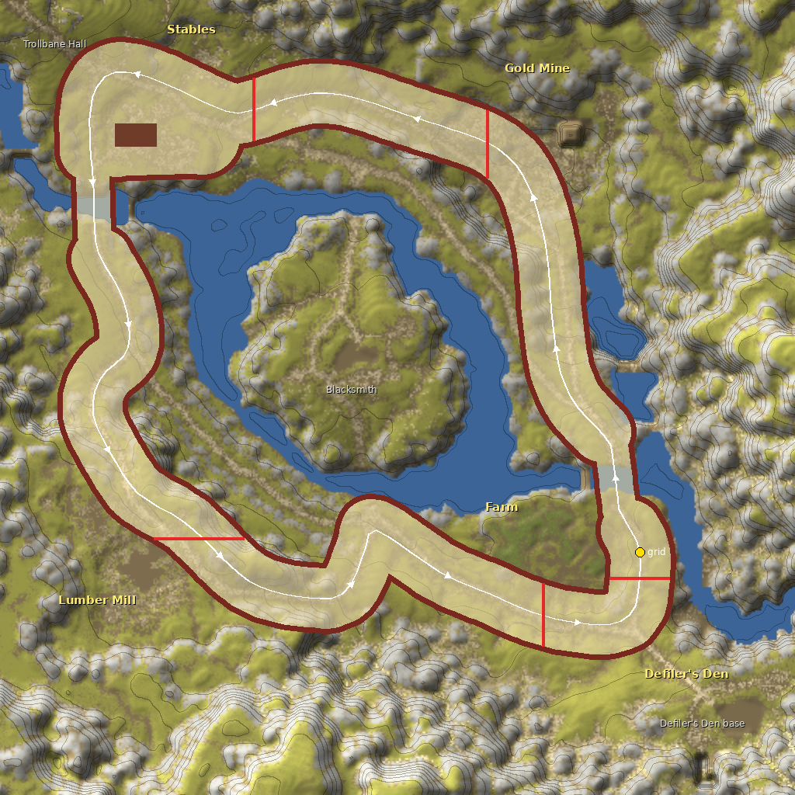
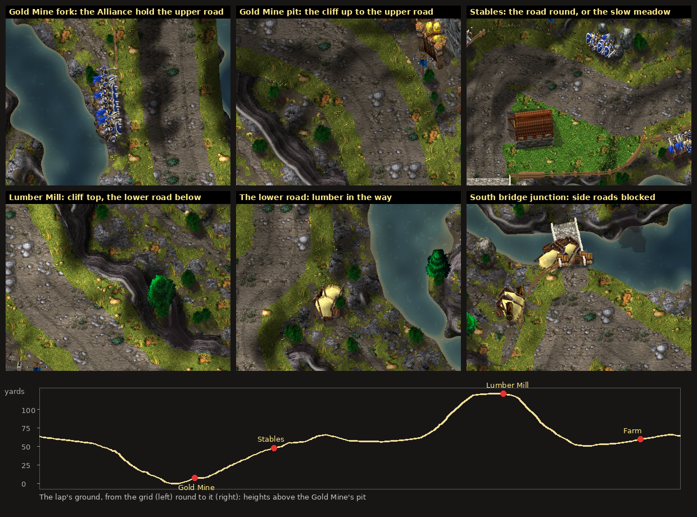

# Arathi Basin (Battlegrounds Cup)

The Battlegrounds Cup's second course, by Claude (rendering/UI owner): a **circuit** round the basin on its real roads, laid out on the battleground measured from the owner's own World of Warcraft client, as Warsong Gulch version 2 and 3 were. One floor, heavy slopes: three laps down into the Gold Mine's hollow and up past the Lumber Mill.



**Status:** version 1 reviewed, registered (race code D, score code B, Physics12) and installed by Codex (`8bf3218`; [integration status](../../INTEGRATION_STATUS.md)). **Version 2** ([below](#version-2)), after the owner drove it, is built on `claude/arathi-v2` for Codex's review, with most of the street's fences since taken down after his second look (painting only): not installed. **NOT RUN in the client:** version 2's look and drive.

## What the owner asked

With Warsong version 3 looking right, the owner (2026-10-28): **"Okay. Looks alright. Let's take what we learned creating this map and make Arathi Basin. (No insides here but heavy slopes)"**, with a way round drawn on the battleground's world map: a loop round the basin from beside Defiler's Den. Shown it on the game's own map, he gave the way round: **"East > DOWN to Gold Mine > Up to the stables > UP to the Lumbermill and then down to the farm and around"**.

He left three questions open; this version takes the recommended answers, to be confirmed:

| Question | Taken |
|---|---|
| The Stables, where he drew two lines round the barn | **Both ways round the barn:** the yard is open, the barn solid in it; north of it by the road to Trollbane Hall, south of it across the yard by the river. |
| The slopes | **Drawn from the real heights now, felt later:** the relief shades the ground and every centerline point carries its height (`elevation`, inert, [ADR 0015](../../adr/0015-track-elevation.md)); karts feeling the grade needs Codex's physics ([proposal](../../API_CONTRACTS.md#proposed-arathi-basin-a-battlegrounds-cup-circuit-claude-2026-10-28-for-codex)). |
| The grass beside the road | **Full speed to the fences,** as on the cities. |

## Version 2

The owner drove version 1 (2026-10-28) and asked, with screenshots of it and of the real basin:

1. **"No need for arrow on maps that are obvious where you drive, right now - only map with arrow should be Warsong Gulch."** Arathi has no guiding arrow (and so no glowing gate).
2. **The Gold Mine:** "The road going to right down to Gold Mine is directly connected to the road going left and above Gold Mine. Make it look seamless but put objects blocking the road to the left (like a group of angry alliance players - forcing people down to the gold mine." And between the mine and the upper road, "a way massively better visible downhill", as on Thunder Bluff.
3. **The Stables:** "Make it a grassy on the whole left side of the stables - slowed - I want to introduce this as a shortcut going over slow grass, but if you boost over grass - normal speed is retained - if you don't have boost here, going the road to the right around the stables is optimal." Asked who should add the driving rule, he chose **Codex**.
4. **The Lumber Mill:** "The other road should not be blocked by a fence, but rather something else just being 'in the way', leading you up to lumber mill", and "Way more visible ridge/drop needed here. It's supposed to be a straight cliff down to the lower road".

Then, looking at version 2's overview with red lines drawn along most of the street's edges (inner and outer, stopping at the bridges, the Gold Mine fork, the Stables' meadow, the home straight beside the Farm, the junction under the south bridge, and the roads to Trollbane Hall and Defiler's Den): **"Map feels better now. You can basically remove the fences where the red line is. following the road is obvious - and the map has natural boundaries"**.

What changed:

- **No arrow** (`Courses.lua`): the route stays in the data for the tests.
- **Every real road that leaves the course runs on**, seamless across the verge, with no fence across it; **what stands in it** blocks it at the street's edge, where the karts stop (the walls are the street's, as before): a group of angry Alliance soldiers (footmen, riflemen, a priest) on the upper road at the Gold Mine fork and where it meets the course again at the Stables, and on the Stables' roads to Trollbane Hall and north; spilled lumber and a broken cart on the lower road under the Lumber Mill's cliff, at both its ends; a cart, crates and barrels on the south bridge's road to the Blacksmith; Horde grunts on the road to Defiler's Den. The painter checks every gap in the fence lies within 9 units of something standing in it.
- **The client's roads off the course** are painted as roads (its road texture, evened, its small patches left out): the upper road above the Gold Mine, the lower road under the Lumber Mill, the paths on the Blacksmith's island.
- **Cliffs:** ground steeper than one yard up per yard along (the survey's terrain, evened once) is a rock face, wholly from 1.7: Lordaeron's cliff texture laid along the contours in strata, lit by its own steepness, a pale brink at its top, its foot and the ground below it in shade; and the sky's openness dims pits and the feet of cliffs (the Gold Mine's pit reads deep). The Gold Mine's pit has its cliff up to the upper road; the Lumber Mill's plateau its cliff down to the lower road.
- **The Lumber Mill's cliff top:** the lap moved 8 to 60 units south-west along the plateau, so the street's edge stands at the brink, the whole cliff face beyond it (the mill moved with it; the Lumber Mill gate is now across the road at x 504).
- **The Stables' meadow:** the yard round the barn is slow grass (`Circuit.lua`'s grass plaza): long grass with tufts, the road's verge beside it worn to dirt so full speed and slow grass do not look alike. Until Codex adds the boost rule, the meadow slows every kart; the road round north of the barn is the fast way.
- **Fewer fences** (the second look; painting only, the karts' walls stand where they did and `Battlegrounds.lua` is unchanged): no timber fence along eight stretches of the edge, seven-eighths of it (87% of the fence's texels), traced from his red lines (`open_edges`: each a side of the lap from one place to another). The fence stays only where it marks something: beside the Alliance at the Gold Mine fork, round the Stables' meadow and the west bridge's inner end, along the home straight's Farm side from the finish to the east bridge, at the junction under the south bridge, at Trollbane's corner and Defiler's road, and at the bridges' ends; where it stops beside open ground, its last post. Along the open edges the verge has no fence's shadow, and where the ground beyond is grass (or the Farm's crops) the long grass starts at the karts' reach, a little darker toward the verge and tufted, so the edge still shows; elsewhere the cliffs, the river and the rocks are the boundary.

## How it was made

`scripts/wow_map_survey.py` measures the battleground (map `PVPZone04`) from the owner's client files, read without modification by `scripts/wowcasc.py`; it now takes the world's size and relief range and records the water. The numbers are in `scripts/arathi_basin_survey.json`: the six Arathi Highlands ground textures' weights and the terrain's height (−133 to +141 yards, 1.4-yard steps) every four units, the river's depth, and 3,065 placements; no client file is copied. The course's world is the basin at three units to the yard, as Warsong's: a placement at (px, pz) yards stands at X = (px − 15760) × 3, Y = (16450 − pz) × 3, over 2048 × 2048 units.

The client paints its roads with one texture (its "rubble"); traced from the survey, they make the course: the ring road round the river, its bridges and forks, the bases where they stand. The street follows them, widened for karts as the cities' streets are (a road 10 yards wide in the game is a street 180 units wide between its fences here, 60 yards).



*The tracing: the client's ground textures as flat colours, its roads, water and relief (contours every 10 yards), with the street (its fences dark red), the barn, the gates (red) and the lap (white, counter-clockwise).*

## The course



**One lap,** from the grid on the east road just north of its junction with the farm road (the owner's X lies on the road from that junction to Defiler's Den; the grid stands on the lap itself, as Thunder Bluff's does since version 2, so the race starts straight up the road with no turn to find):

1. **North up the east road** and over **the east bridge** (narrow: its deck, and 84 units of road either side, are walled at 42 from the middle).
2. **Past the pond to the fork**, where the upper road goes left above the Gold Mine (held by a group of Alliance soldiers), then **down the Gold Mine's road** along the pond's west shore into the mine's pit, 110 yards below the basin's datum: the lap's lowest ground, the cliff up to the upper road on the left. Through its yard past the mine's mouth: gate *Gold Mine*.
3. **Up the north road** to the Stables, 55 yards up: gate *Stables* at the yard's east edge.
4. **Round the barn:** by the road to Trollbane Hall north of it and down the west road (full speed), or across the meadow south of it by the river (slow grass, shorter: a shortcut for a boost once Codex's rule is in). Both meet at **the west bridge** (narrow like the east one).
5. **Down the west road** to its fork (the lower road under the cliff blocked by lumber), then **up the hill** on the Lumber Mill's road (60 yards up in under 200), along the cliff top past the mill, the cliff dropping to the lower road beyond the verge: gate *Lumber Mill*.
6. **Down the cliff road** (70 yards in about 160) to the junction at the south bridge (the road over it to the Blacksmith and the lower road's end blocked by carts, crates and lumber), **sharp back east** along the farm road past the Farm: gate *Farm*.
7. **Round the corner north** onto the east road: the finish, *Defiler's Den*, just behind the grid.

| Measure | Value |
|---|---|
| World | 2048 × 2048 units (one texel per unit), the basin at three units to the yard |
| The street | road radius 56, the karts' reach 76 from the middle, its edge (a fence or open ground) 14 beyond (Circuit's city street); full grip to the edge |
| A lap | 5,094 units of centerline (324 points), the route 163 points (every other) |
| Gates | 5: *Gold Mine*, *Stables*, *Lumber Mill*, *Farm*, *Defiler's Den* (the finish) |
| Narrows | 2, the bridges: the karts' reach 42 over each deck and 84 units of road either side |
| Plazas | 1: the Stables' yard (radius 96), a meadow: slow grass beyond the road's reach |
| Solids | 1: the barn (106 × 57) |
| Fences' junctions | 1,037 (the walls' 14-unit clearance where capsules meet) |
| Heights | 0 (the Gold Mine's pit) to 365 world units (122 yards, the Lumber Mill's hill); the grid at 191 |

## How it plays

`Circuit.new` builds it from the generated `Battlegrounds.lua` (`Courses` geometry `circuit`); the rules are Codex's and the cities': the kart's centre stays within its reach of the course or inside a plaza, everything else is wall; a solid box blocks with Track's swept collision.

- **Full grip** from edge to edge, the cities' rule (the owner's choice for city streets, taken here for the verges), except the Stables' meadow.
- **The bridges** are narrows: 84 units wide where the street is 152, and so is the road 84 units either side of each, so the road's full width never reaches the water beside a deck.
- **The Stables' yard** is open (a plaza) with the barn solid in it, and a meadow (version 2): slow grass wherever the road's reach ends (Physics' grass, 70 at most, a boost ended). The lap's route goes north of the barn on the road; the meadow south of it is the shortcut. Codex is to add the owner's rule that a boost keeps normal speed on grass.
- **The slopes are drawn, not felt:** Physics is flat (version 12, three laps). Every centerline point carries the ground's height under it (`elevation`), for the grade term proposed in ADR 0015.
- Collision comes from the generated data, never from a pixel.

## Rendering

All of it reads the simulation's copied state and writes none of it.

- **One picture:** `Background.tga` (no roofs: the basin has no insides), `Preview.tga` for the track screen.
- **No guiding arrow** since version 2 (the owner keeps it for Warsong Gulch alone); the reviewed route (`route`, `routeGates`) stays in the data for the tests.
- **Gate markers** are the existing pool (five of eight). Budget: one more frame for the coming-soon button in the track list (92 frames, 96 textures, 151 font strings), and the list's rows step 30 units instead of 32 so thirteen fit above the Back button.

## Look

- **The ground is the basin's own.** Every texel takes the Warcraft III tile standing for one of the client's six Arathi Highlands textures (Lordaeron's summer grass made the Highlands' olive, its dirt greyed, its rock pale grey for the boulders, its rough dirt for the roads, the village's crops for the Farm's fields), picked by the measured weights against smooth noise.
- **The slopes:** the measured relief, evened (three 3 × 3 passes of the 1.4-yard steps), lights the ground from the north-west, exaggerated 1.7 times; the hollows are a little darker and the hills brighter (18% at the survey's extremes), so the Gold Mine's hollow reads low and the Lumber Mill's hill high.
- **The water** by its measured depth (evened, so the client's cell edges do not show): pale at the bank, dark in the deep river, a slow swell of light over it.
- **The street:** a grey-brown dirt road down its middle (about 100 wide, ragged edges, two worn ruts), grass to its edge; the Stables' meadow long grass with tufts, the road's verge beside it worn to the yard's dirt; a timber rail fence (posts every 30 units) only where it marks something, never where a real road leaves; elsewhere open ground, the long grass starting at the verge where the ground beyond is grass (see [version 2](#version-2)).
- **The roads off the course,** from the client's road texture: a dirt road, paler down the middle and darker at its edges.
- **Cliffs** where the ground is steeper than a yard per yard (see [version 2](#version-2)); the sky's openness dims the pits. **The bridges:** stone decks from bank to bank with parapets; the two the course does not cross (the roads to the Blacksmith) as narrow as the client's, their parapets too.
- **The bases,** as the Warcraft III buildings that stand for them, at the client's places: the Stables a Lordaeron barn (solid in its yard), the Gold Mine the gold mine, the Lumber Mill the human lumber mill, the Farm a farmhouse with Lordaeron's windmill and granary among its fields, the Blacksmith the human blacksmith, Trollbane Hall and Defiler's Den town halls (Alliance blue; Horde red and darkened). Each node's flag (a Lordaeron banner) beside the course.
- **What stands in the side roads:** Warcraft III footmen, riflemen and priests (Alliance blue), grunts (Horde red), logs, a broken hay cart, crates and barrels, facing the course.
- **The client's scenery** where its map has it, as the Warcraft III model that stands for each kind: trees, bushes (the Highlands' olive), stumps, hay carts, barrels, crates, wheelbarrows, graves, rocks, lanterns, and a human banner on its pole for each scarecrow; the field fences drawn along their own line as rail fences; anything that would stand on the street or in the water is left out.
- **The finish:** a chequered band across the street.

## Files

| File | What |
|---|---|
| `addon/AzerothKart/Battlegrounds.lua` | The course's data (generated, beside Warsong's): centerline, narrows, the yard (a meadow), gates, spawn, the barn, the fences' junctions, the heights, the reviewed route and `routeGates`. |
| `addon/AzerothKart/Assets/Tracks/ArathiBasin/Background.tga` | The basin from above: 2048×2048 BGRA32, opaque; 16,777,234 bytes. |
| `addon/AzerothKart/Assets/Tracks/ArathiBasin/Preview.tga` | The same, reduced 4× (512×512), for the track screen; 1,048,594 bytes. |
| `scripts/arathi_basin_survey.json` | The survey's numbers (ground weights, relief, water, placements). |
| [`arathi_basin-overview.png`](arathi_basin-overview.png) | The preview as PNG, for review. |
| [`arathi_basin-sources.txt`](arathi_basin-sources.txt) | Every Warcraft III model and texture the picture uses, with placement counts. |
| [`arathi_basin-review.png`](arathi_basin-review.png) | Version 2 at the game's scale: the Gold Mine fork and pit, the Stables' meadow, the Lumber Mill's cliff, the lower road and the south bridge junction; the lap's heights. |
| [`arathi_basin-route-sketch.png`](arathi_basin-route-sketch.png) | The tracing from the survey's numbers; a design reference, not shipped. |

## Rebuilding

The survey (once, with the client; its output is checked in):

```
python scripts/wowcasc.py "%WOW%" extract WOW <FileDataIDs of world/maps/pvpzone04/*> --product wow_classic_beta
python scripts/wow_map_survey.py WOW community-listfile.csv scripts/arathi_basin_survey.json --map pvpzone04 --origin 15760 16450 --size 2048 2048 --relief -140 1.4
```

The picture needs these Warcraft III files, then build:

```
python scripts/wc3casc.py %W3% extract "^war3\.w3mod:(buildings/(human/(blacksmith|farm|humanlumbermill|townhall)|other/(barrelsunit|goldmine))/|doodads/(ashenvale/(plants/ashenbush0|props/(ashenhollowstump|ashenlogstraight))|lordaeronsummer/(props/(bannerhuman|grave|haycart|haycartbroken|lanternpost|wheelbarrel)|rocks/lords_rock|structures/(barn|granary|windmill)|terrain/crates)|terrain/lordaerontree)/|units/(human/(footman|rifleman|priest)|orc/(grunt|headhunter|tauren))/)" WC3
python scripts/wc3casc.py %W3% extract "^war3\.w3mod:(terrainart/(lordaeronsummer|village)/|replaceabletextures/(lordaerontree|splats)/|textures/)" WC3
python scripts/build_battlegrounds.py --wc3 WC3 --course arathi_basin --preview
python scripts/build_battlegrounds.py --wc3 WC3 --check
```

`--geometry-only` writes only `Battlegrounds.lua`; `--schematic OUT.png` (with Pillow) draws each course's plan, the course's id added to the name.

- **`scripts/battleground_layouts.py`:** the Arathi section: the loop's control points on the real roads (smoothed, straight across each bridge), the bridges' decks and approaches, the yard, the gates, the grid; the painting data (the ground's tiles, relief, water, street, fences and the open stretches of the edge, `AB_OPEN_EDGES`, the wild grass beyond them, the bridges off the course); the scenery by hand (the bases, the Farm's windmill and granary, the flags) and from the survey (`_ab_dressing`; optional).
- **`scripts/build_battlegrounds.py`:** `circuit_geometry` (the cities' street, the narrows as `build_city_tracks.narrow_segments` names them, the junctions as `circuit_boundary` finds them, the heights from the survey (evened over 48 units, straight across each bridge), the route); `validate_circuit` (the cities' rules, `build_city_tracks.validate_geometry`, then the route through the gates in order, recording `routeGates`); the circuit's Lua.
- **`scripts/battleground_paint.py`:** `build_circuit`: the ground (its light dimmed by `occlusion`), the water, the roads off the course (`survey_road_mask`, `paint_survey_roads`), the cliffs (`paint_cliffs`), the street and the meadow, the wild grass beyond the open edges (`paint_wild_edges`), the fences and parapets (none in an opening: `openings`; none along an open stretch: `open_edges`, a post where one stops), the bridges off the course, the field fences, the finish, the scenery north to south with what stands in each opening (`place_blockers`). It stops on a building or flag that would stand on the street (a flag `nudge`s off it), on an opening no road crosses, and on a gap in the fence nothing covers; it leaves out optional scenery that would stand on the street.

## Provenance and rights

**Pictures:** Blizzard Entertainment's Warcraft III: Reforged, build 3.0.1.24371, from the owner's own install, read without modification by `scripts/wc3casc.py`, used under [ADR 0009](../../adr/0009-warcraft-iii-asset-reuse.md): [the sources list](arathi_basin-sources.txt). Modifications: models posed and rendered as sprites with the project's light, shadows and lean (team colours; Defiler's Den darkened; the bushes tinted olive; the units in their own Stand Defend, Attack, Stand Ready and Spell Attack poses); terrain atlases halved and shaded, picked and mixed by the generator, Lordaeron's cliff texture laid in strata over the steep ground; everything else painted by the generator (the water, the roads, their ruts, fences, decks, parapets, the meadow's and the wild grass's tufts, the finish) and composited.

**Layout and ground pattern:** measured from World of Warcraft's Arathi Basin (Blizzard Entertainment) in the owner's own client, read without modification by `scripts/wowcasc.py`: numbers only (placements, heights, texture weights, water depths), no World of Warcraft file or picture is stored or shipped. A tracing of the battleground's layout, like Warsong Gulch's; recorded here for the release review.

**Author:** Blizzard Entertainment. **Redistribution rights are not established** and stay open for release review.
