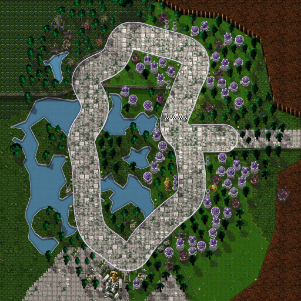
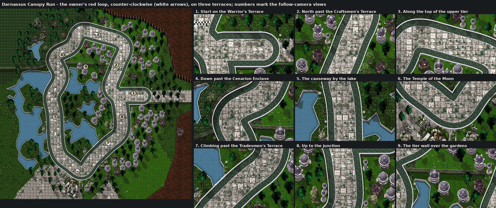

# Darnassus Canopy Run (Capital Cities Cup)

The fourth Capital Cities Cup track, by Claude (rendering/UI owner), 2026-10-23, on the pipeline built for [Stormwind](stormwind.md), [Ironforge](ironforge.md) and [Orgrimmar](orgrimmar.md). With Orgrimmar pushed, the owner asked for Darnassus and Undercity together and sent his in-game Darnassus map with a red loop, a blue arrow pointing north at the central terrace and red marks on the road in from the Warrior's Terrace. Asked whether the karts should start on that road heading into the city and join the loop going north, he answered "Yes, like that". He also asked for "a way to add elevation to maps, as some of our maps clearly need it"; Darnassus is the first city painted on several levels ([ADR 0015](../../adr/0015-track-elevation.md), proposed).



**Status:** reviewed and integrated from `claude/darnassus-undercity`9143949 on `codex/two-city-integration`; selectable in the combined developer build. Exact installation/source evidence is in [PROGRESS](../../PROGRESS.md). **NOT RUN in the client:** the drive, the look in the follow camera, performance. See [the client checklist](../../../tests/MANUAL_CLIENT_CHECKLIST.md).



## The route

Counter-clockwise, as his arrow points, along his red line (control points snapped to the line's red pixels on his 1000×660 screenshot, world = map pixels × 4.3):

1. **The Warrior's Terrace.** The start grid is on the road in from the east, at his red marks, on the city's upper tier.
2. **Up past the Craftsmen's Terrace.** The road joins the loop at the central terrace and turns north, the Craftsmen's houses either side. Gate: *Craftsmen's Terrace*.
3. **Along the top.** West along the upper tier below the Howling Oak, then down past the Cenarion Enclave on its hill. Gate: *Cenarion Enclave*.
4. **The Temple Gardens.** South down the causeway by the gardens' lake, the lake on the right. Gate: *Temple Gardens*.
5. **The Temple of the Moon.** Round the temple's moon wells and its shrine. Gate: *Temple of the Moon*.
6. **The Tradesmen's Terrace.** North-east and up past the Tradesmen's houses. Gate: *Tradesmen's Terrace*.
7. **Back to the central terrace** and across the line. Gate: *Warrior's Terrace*, the finish line.

Lap: 3,895 world units; approach: 206. Six gates, named for the districts.

## How it plays

The shared street circuit: a 112-unit road (`roadRadius` 56) and the kart centre's reach of 76 units (`wallRadius`), full grip to the walls (`fullSpeedToWalls`, as Stormwind and Orgrimmar), the exposed-wall clearance (`wallClearance` 14, 931 generated junctions). No plazas, solids or narrows. Collision comes from analytic Lua data in `CapitalCities.lua`; no pixel decides it. The terraces are painted: the karts drive them flat (slopes you can feel are [proposed](../../API_CONTRACTS.md#proposed-track-elevation-claude-2026-10-23-for-codex-review)).

## Look

The city in Teldrassil's crown, in Warcraft III's Ashenvale and Ruins art: the World Tree's bark beyond the city's floors (its top in the World Tree's own bark texture, its south-facing edge in the Ashenvale tree's bark), the gardens and terraces in Ashenvale grass, leaves and lumpy turf.

- **Levels.** Three tiers: the Craftsmen's and Warrior's Terraces and the Cenarion Enclave at 44, the Tradesmen's Terrace at 22, the Temple Gardens, the lake and the Temple of the Moon at 0. Where a tier rises north of a lower one its retaining wall shows, in the Ashenvale cliff's strata with a lit brink; each tier throws the sun's shadow south-east; higher ground is a little brighter. The start road and the course's north run on the upper tier; the course ramps down past the Enclave (up to 13.9%) and back up past the Tradesmen's Terrace (up to 9.9%), each ramp lit by its slope with its paving joints across it.
- **Street:** large pale Ruins bricks from wall to wall (the mossy round-tile shoulders are gone since 2026-10-23), a silver-violet kerb at the foot of a low pale parapet.
- **Water:** the Temple Gardens' lake and the gardens' pools, traced from the map's water, with pale quays.
- **Districts:** Silvermoon's houses and small towers with their roofs made Darnassus violet, hunter's halls, bear dens, ancients, moon wells; Ashenvale trees and canopy trees; obelisks, Ruins pillars, sentinel statues, shrubs and flowers; archers and runners.
- **Landmarks:** the Temple of the Moon (the altar of elders between two moon wells), the Tree of Eternity in the Cenarion Enclave, a hunter's hall and a hippogryph on the Warrior's Terrace, the Howling Oak.

## Files

| File | What |
|---|---|
| `addon/AzerothKart/Assets/Tracks/Darnassus/Background.tga` | 2048×2048 opaque BGRA32, uncompressed, bottom-left origin; 16,777,234 bytes. |
| `addon/AzerothKart/Assets/Tracks/Darnassus/Preview.tga` | 512×512 (the background reduced 4×) for the track screen; 1,048,594 bytes. |
| `addon/AzerothKart/CapitalCities.lua` | The circuit data (with the other cities'), generated; with its proposed `elevation` heights. |
| [`darnassus_canopy-overview.png`](darnassus_canopy-overview.png) | The preview as PNG, for review. |
| [`darnassus_canopy-sources.txt`](darnassus_canopy-sources.txt) | Every Warcraft III model and texture the picture uses, with placement counts. |
| [`darnassus_canopy-review.png`](darnassus_canopy-review.png) | The loop with its direction and nine follow-camera views, as sent to the owner. |

## Rebuilding

Extract the earlier cities' files ([Stormwind](stormwind.md#rebuilding), [Ironforge](ironforge.md#rebuilding), [Orgrimmar](orgrimmar.md#rebuilding)), then Darnassus's:

```
python scripts/wc3casc.py %W3% models "^war3\.w3mod:(buildings/nightelf/[^/]+/[^/]+\.mdx|doodads/(ashenvale|ruins|silvermoon)/.*\.mdx|doodads/terrain/ashentree/ashentree[0-9]\.mdx|units/nightelf/[^/]+/[^/]+\.mdx)$" WC3
python scripts/wc3casc.py %W3% extract "^war3\.w3mod:(terrainart/(ashenvale|ruins)/|replaceabletextures/(ashenvaletree|water)/|doodads/ashenvale/structures/worldtree/)" WC3
python scripts/build_city_tracks.py --wc3 WC3 --preview --city darnassus_canopy
python scripts/build_city_tracks.py --wc3 WC3 --check
```

The layout is `DARNASSUS` in `scripts/city_layouts.py`: the route, the start road, gates, districts and palettes, the lakes, the bark's floors, the landmarks and the `elevation` (tiers and the street's ramps). The painter's elevation layer (`Relief`, `paint_relief` in `scripts/city_paint.py`) and the level options are described in [ADR 0015](../../adr/0015-track-elevation.md); a city without `elevation` paints exactly as before.

## Provenance and rights

Source: Blizzard Entertainment's Warcraft III: Reforged, build 3.0.1.24371, from the owner's own install, read by `scripts/wc3casc.py` without modifying it; used under [ADR 0009](../../adr/0009-warcraft-iii-asset-reuse.md). Modifications as for the earlier cities: models posed and rendered as sprites with the project's light, shadows and lean; Silvermoon's teal and gold roofs recoloured violet and silver; the trees' shadows following their leaves' cut-outs; terrain atlases halved, shaded and desaturated; a bark and a cliff texture stretched over the bark's plateau, its edge and the tiers' walls; kerbs, parapets, quays, walls, shadows and ramps painted by the generator; everything composited into one picture. Author: Blizzard Entertainment. **Redistribution rights are not established** and stay open for release review. The route was traced from the owner's red line on his screenshot of the in-game map; the lakes from its water; the tiers placed by hand. The screenshots are not stored.
