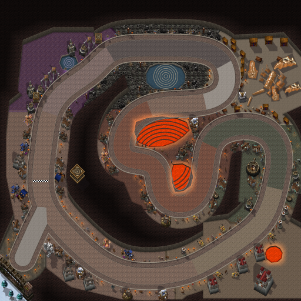

# Ironforge Grand Prix (Capital Cities Cup)

The second Capital Cities Cup track, by Claude (rendering/UI owner), 2026-10-22, on the pipeline built for [Stormwind](stormwind.md). After approving Stormwind ("Stormwind looks good. Start work on Ironforge."), the owner sent his in-game Ironforge map with his route in red and chose a lap that goes "Through the Forge". Shown the mockup, he sent the same map again; the course keeps his whole line.



**Status:** built and checked offline; selectable on the track screen. **NOT RUN in the client:** loading the second 2048×2048 picture, the drive (the walls, the lava railings), the follow camera, the track screen's preview, performance. See [the client checklist](../../../tests/MANUAL_CLIENT_CHECKLIST.md).

## The route

Clockwise round the city, along the owner's line:

1. **The Gates of Ironforge.** The start grid is in the gate hall, the Gates (a portcullis) behind it and Dun Morogh's snow and pines beyond; Modimus Anvilmar's statue stands guard beside the road.
2. **The Commons.** Into the Commons' great ring and north along it, past the Vault (the bank) and the market; the finish line is here.
3. **Mystic Ward.** Round the north-west past the Mystic Ward's violet halls and its spiral pool. Gate: *Mystic Ward*.
4. **Forlorn Cavern.** East along the north of the city above the Forlorn Cavern's lake. Gate: *Forlorn Cavern*.
5. **Hall of Explorers.** Down past the Hall of Explorers: its library and a giant fossil skeleton on show. Gate: *Hall of Explorers*.
6. **The Great Forge.** West along the Forge's north side, down its west side and into the Forge between its two forges, round the southern one and out. Gate: *Great Forge*.
7. **Tinker Town.** North-east and round Tinker Town's great machine and workshops, the Deeprun Tram's gate to the east. Gate: *Tinker Town*.
8. **Military Ward.** South-west through the Military Ward: the Hall of Arms, steam tanks and a lava pit. Gate: *Military Ward*.
9. **Back along the Commons** to the finish. Gate: *The Commons*, the finish line.

Lap: 7,077 world units (about 1.8 times Stormwind's 3,831); approach: 369. Seven gates, named for the districts.

Where the owner's line touches itself north-east of the Forge (the road back from the Hall of Explorers and the road out to Tinker Town), the two passes are moved apart, one north and one south, so that a wall stands between them: separate stretches of a course may not run within one street of each other, or karts could cut across.

## How it plays

The same street circuit as Stormwind: a 112-unit road (`roadRadius` 56), a 20-unit rough kerbside strip, the street ending at `wallRadius` 76 from the course's centerline. What stands there is drawn as the wall: the halls' stone foundations, the mountain's rock, dark iron railings along the lava and the water. No plazas, no solids: the course's centerline never meets a wall. Collision is Lua data in `CapitalCities.lua`; no pixel decides it.

## Look

The city is underground. Open floor is the halls: a band of 165 units either side of the course plus traced halls (the Commons' ring, the Great Forge's hall, the Mystic Ward, the Forlorn Cavern, the Hall of Explorers, Tinker Town with the tram, the Military Ward, the snow outside the Gates). Everything else is the mountain's rock, cut away at the top: dark rock darkening deeper in, and where rock rises north of open ground, a dressed-stone face in courses with a lit coping, lean × 56 units tall.

- **Ground:** Warcraft III terrain on its 32-unit grid. The Dungeon tileset's red rock is shaded to the grey-brown of dwarven stone (tiles take per-channel shading and a saturation): flagstones in the Commons, the Gates and the Great Forge (warmer), the Mystic Ward Dalaran's violet tiles (beside the street, never on it), grey stone in the Forlorn Cavern, darkened marble in the Hall of Explorers, Underground plates in Tinker Town, dark bricks in the Military Ward, snow outside.
- **Street:** each district paves its own stretch (flagstones, pale marble by the Hall of Explorers, warm flagstones in the Forge, metal plates in Tinker Town, brick in the Military Ward, white marble in the gate hall), with kerbs and flagstone pavement out to the walls.
- **The Great Forge:** two molten forges, NW and SE of the Forge's centre, with the concentric stone ridges of the in-game map; the lava lights the floor round it. Smithies and a gryphon aviary stand on the island the course winds round.
- **Water:** the Forlorn Cavern's lake and the Mystic Ward's pool, dark, with spiral rings of stone.
- **Light:** braziers and torches along the halls cast warm pools on the stone; the Mystic Ward's crystal lamps a violet one.
- **Districts:** each from its own palette, sparse, at most a few of each model: smithies, workshops, the tavern and market in the Commons (dark slate roofs); arcane buildings in the Mystic Ward (violet roofs); rocks, stalagmites and chains in the Forlorn Cavern; shelves, tables and fossils in the Hall of Explorers; smithies and weapon racks at the Forge; workshops (verdigris roofs), the great machine, junk and a gyrocopter in Tinker Town; barracks and towers (red roofs), steam tanks and banners in the Military Ward. People: dwarven riflemen and peasants, citizens and the guard, standing back from the street.

## Files

| File | What |
|---|---|
| `addon/AzerothKart/Assets/Tracks/Ironforge/Background.tga` | 2048×2048 opaque BGRA32, uncompressed, bottom-left origin; 16,777,234 bytes. |
| `addon/AzerothKart/Assets/Tracks/Ironforge/Preview.tga` | 512×512 (the background reduced 4×) for the track screen; 1,048,594 bytes. |
| `addon/AzerothKart/CapitalCities.lua` | The circuit data (with Stormwind's), generated. |
| [`ironforge_gp-overview.png`](ironforge_gp-overview.png) | The preview as PNG, for review. |
| [`ironforge_gp-sources.txt`](ironforge_gp-sources.txt) | Every Warcraft III model and texture the picture uses, with placement counts. |

## Rebuilding

Extract [Stormwind's files](stormwind.md#rebuilding), then add Ironforge's:

```
python scripts/wc3casc.py %W3% models "^war3\.w3mod:(doodads/(dungeon|underground|northrend)|units/(human/(rifleman|mortarteam|gryphonrider|heromountainking|muradin|gyrocopter|warwagon)|other/dwarfcar))/" WC3
python scripts/wc3casc.py %W3% extract "^war3\.w3mod:terrainart/(dungeon|dungeon2|lordaeronwinter|northrend|icecrown)/" WC3
python scripts/wc3casc.py %W3% extract "^war3\.w3mod:replaceabletextures/(northrendtree|undergroundtree)/" WC3
python scripts/build_city_tracks.py --wc3 WC3 --preview --city ironforge_gp
python scripts/build_city_tracks.py --wc3 WC3 --check
```

The layout is `IRONFORGE` in `scripts/city_layouts.py`: the route (traced map points), the gate hall's start spur, gates, districts and palettes, halls, lava, water, rings and landmarks. The underground painting is generic and optional per city (`rock`, `lava`, `rings`, `lights`, a model's `light`, `wall_styles`, district `density`, a palette entry's `limit`); Stormwind uses none of it and its bytes are unchanged.

## Provenance and rights

Source: Blizzard Entertainment's Warcraft III: Reforged, build 3.0.1.24371, from the owner's own install, read by `scripts/wc3casc.py` without modifying it; used under [ADR 0009](../../adr/0009-warcraft-iii-asset-reuse.md). Modifications as for Stormwind: models posed and rendered as sprites with the project's light, shadows and lean; roof hues moved (blue slate to dark slate, red, violet or verdigris); a statue made from Muradin's model in warm grey; terrain atlases halved, shaded and desaturated; the rock, its faces, lava, rings, kerbs and walls painted by the generator; everything composited into one picture. Author: Blizzard Entertainment. **Redistribution rights are not established** and stay open for release review. The route was traced by hand on the owner's screenshot of the in-game map; the halls, lava pools and lake were placed by hand from it. The screenshot is not stored.
