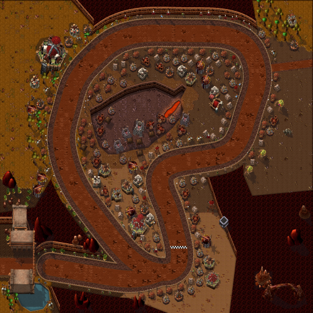
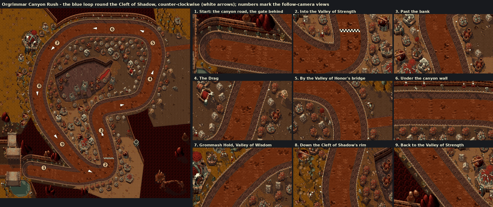

# Orgrimmar Canyon Rush (Capital Cities Cup)

The third Capital Cities Cup track, by Claude (rendering/UI owner), 2026-10-22, on the pipeline built for [Stormwind](stormwind.md) and [Ironforge](ironforge.md). After the textured forge and the four Warcraft III karts, the owner chose Orgrimmar as the next city and sent his in-game Orgrimmar map with his route in red: from a start at the West Gate out along the western canyon road, round the city (the Cleft of Shadow, the Valley of Honor's lake, the Drag, the Valley of Strength) and back along the same canyon road. Then: "I dont know how laps would work with that long start/end stretch - if its an issue: use the blue line here", with a second copy of the map and a blue loop round the Cleft of Shadow.

It was an issue: the red line drives the canyon road out and back and crosses to the Valley of Honor and back over one bridge, so it could only be lapped by splitting the canyon into two one-way roads with a rock wall between them, a hairpin at the West Gate and a second bridge, and the whole route would only fit the 2048-unit world at about half Ironforge's scale. The course is his blue loop; the karts start on the canyon road, as his "start" at the West Gate asked, and join the loop.



**Status:** built and checked offline; selectable on the track screen (proposed on `claude/orgrimmar`, not yet reviewed or installed). **NOT RUN in the client:** the drive, the look in the follow camera, performance. See [the client checklist](../../../tests/MANUAL_CLIENT_CHECKLIST.md).



## The route

Counter-clockwise round the Cleft of Shadow, along the owner's blue line (traced on his half-size copy, registered onto the full map by image correlation: 1.904× and a 6-, 2-pixel offset):

1. **The canyon road.** The start grid is on the last straight of the road in from the west, a gate of the city wall (Warcraft III's own Orgrimmar gate, in sandstone) closing the road behind it, the canyon's red walls either side and the Valley of Spirits' pool by the gate.
2. **The Valley of Strength.** The road joins the loop at the valley's south end; the finish line is just round the corner, north up the valley past the bank (a stronghold) and the wind riders' roost.
3. **The Drag.** East along the Cleft's south side and north up the Drag, tents, huts and goblin stalls either side; the closed bridge to the Valley of Honor at its north end. Gate: *The Drag*.
4. **Under the north wall.** West along the foot of the canyon's north wall, the huts of the upper terraces inside. Gate: *Valley of Wisdom*.
5. **The Valley of Wisdom.** Round the north-west corner below Grommash Hold, the valley's spirit lodges and palms on the right. 
6. **The Cleft of Shadow's rim.** South down the Cleft's west rim, the chasm on the left. Gate: *Cleft of Shadow*.
7. **Back into the Valley of Strength** and across the line. Gate: *Valley of Strength*, the finish line.

Lap: 4,769 world units (between Stormwind's 3,831 and Ironforge's 7,077); approach: 734. Four gates, named for the districts.

## How it plays

The shared street circuit: a 112-unit road (`roadRadius` 56) and the kart centre's reach of 76 units (`wallRadius`). As Stormwind (the owner's choice there), the whole street is full grip to the walls (`fullSpeedToWalls`); the darker gravel beyond the paving is drawn shoulder, not rough ground. The exposed-wall clearance (`wallClearance` 14, 1,222 generated junctions) keeps the kart centre 14 units inside the painted wall everywhere, concave corners included: an offline probe found no disagreement between `surfaceAt` and an independent disc-inside-union test at 13,440 points round the walls. No plazas, solids or narrows. Collision comes from analytic Lua data in `CapitalCities.lua`; no pixel decides it.

## Look

Orgrimmar lies in Durotar's red canyons. Open ground is the valleys (Wisdom, Strength, the Drag's east side, the approach to the Valley of Honor, the Valley of Spirits, the ground inside the loop) and a band of 124 units either side of the course; everything else is the canyon's rock, a red plateau seen from above whose south-facing walls show as cliffs of layered stone, 48 rows tall, with a lit brink. The road runs at the foot of those walls along the start straight and the north side, a ledge of 34 units between the street's palisade and the cliff.

- **Ground:** Warcraft III's Barrens tileset on its 32-unit grid: sand in the Valley of Strength, red earth on the Drag and under the north wall, dark desert in the Cleft, dry grass in the Valley of Wisdom and by the Valley of Spirits.
- **Street:** a packed red-orange dirt road (Outland's light dirt), dark timber kerbs and gravel shoulders (the Barrens' pebbles) to a timber palisade with an iron spike every 14 units.
- **The Cleft of Shadow:** a chasm sunk below the city inside the loop, its dark floor tinted towards violet; along its north edge the far wall drops 46 rows in the same cliff strata, then its shadow on the floor. Ragefire Chasm's mouth is a fissure of lava in its east end, glowing. Voodoo lounges, an altar of storms, troll burrows, tents, skulls on stakes.
- **Water:** the Valley of Spirits' pool beside the start, with a low red quay.
- **Districts:** the Horde's buildings from Warcraft III (red team colour): burrows, troll burrows, barracks, war mills, spirit lodges, voodoo lounges, watch towers, chieftains' huts and tents; goblin merchants' stalls and the mercenary camp on the Drag; spirit lodges, tauren totems, totem poles and palms in the Valley of Wisdom; barrels, crates, hitching posts and orc banners along the streets. Buildings stand back 12 units from the street; grunts, peons, shamans, witch doctors and headhunters stand in front of them and on the ledges.
- **Landmarks:** Grommash Hold (Warcraft III's great hall at its fortress stage) in the Valley of Wisdom; the bank (a stronghold), a watch tower, a wyvern cage and a wind rider in the Valley of Strength; the city gate behind the grid; red rock spires, a Barrens rock arch and spires on the canyon's rock.

## Files

| File | What |
|---|---|
| `addon/AzerothKart/Assets/Tracks/Orgrimmar/Background.tga` | 2048×2048 opaque BGRA32, uncompressed, bottom-left origin; 16,777,234 bytes. |
| `addon/AzerothKart/Assets/Tracks/Orgrimmar/Preview.tga` | 512×512 (the background reduced 4×) for the track screen; 1,048,594 bytes. |
| `addon/AzerothKart/CapitalCities.lua` | The circuit data (with Stormwind's and Ironforge's), generated. |
| [`orgrimmar_canyon-overview.png`](orgrimmar_canyon-overview.png) | The preview as PNG, for review. |
| [`orgrimmar_canyon-sources.txt`](orgrimmar_canyon-sources.txt) | Every Warcraft III model and texture the picture uses, with placement counts. |
| [`orgrimmar_canyon-review.png`](orgrimmar_canyon-review.png) | The loop with its direction and nine follow-camera views, as sent to the owner. |

## Rebuilding

Extract [Stormwind's](stormwind.md#rebuilding) and [Ironforge's files](ironforge.md#rebuilding) (the Ragefire fissure uses the Dungeon tileset's lava), then add Orgrimmar's:

```
python scripts/wc3casc.py %W3% models "^war3\.w3mod:(buildings/orc/[^/]+/[^/]+\.mdx|doodads/barrens/.*\.mdx|doodads/outland/(rocks|props)/.*\.mdx|doodads/cinematic/thrallshut/thrallshut\.mdx|doodads/terrain/barrenstree/barrenstree[0-9]\.mdx|doodads/ruins/props/firepot/firepot\.mdx|doodads/ashenvale/props/totem/.*\.mdx|doodads/lordaeronsummer/props/(bannerorc|tutorialorcbanner|skullonstick|headonspear|skullpile|hitchingpost|trough|cauldronwithheads|hay|weapons|armorrack|brazier)/.*\.mdx|buildings/other/(pigfarm|chieftainhut|tent|tent1|taurentent|taurentent2|wyverncage|wyverncage2|merchant|mercenary|centaurtent|centaurtent1|centaurtent2)/[^/]+\.mdx)$" WC3
python scripts/wc3casc.py %W3% models "^war3\.w3mod:units/(orc/(grunt|peon|headhunter|shaman|witchdoctor|tauren|wolfrider|kotobeast|kotobeastnorider|riderlesswyvern|wyvernrider|battroll|thrall|thrallmountless|spiritwalker|orcwarlord|heroshadowhunter|herofarseer|heroblademaster|catapult|hellscream)|critters/(pig|vulture|skink))/[^/]+\.mdx$" WC3
python scripts/wc3casc.py %W3% extract "^war3\.w3mod:terrainart/(barrens|outland|blackcitadel|lordaeronfall)/" WC3
python scripts/wc3casc.py %W3% extract "^war3\.w3mod:replaceabletextures/(cliff|barrenstree)/" WC3
python scripts/build_city_tracks.py --wc3 WC3 --preview --city orgrimmar_canyon
python scripts/build_city_tracks.py --wc3 WC3 --check
```

The layout is `ORGRIMMAR` in `scripts/city_layouts.py`: the route (the blue line's traced points), the canyon start spur and the gate behind it, gates, districts and palettes, the valleys' floors, the Cleft, the fissure, the pool and the landmarks. New painter options, all optional per city (Stormwind's and Ironforge's bytes are unchanged): `rock.face_texture` (a rock face in a region of a plain cliff texture, `Strata`), `pits` (sunken ground with its far wall and shadow), `land_wall` (a city's own street wall style: Orgrimmar's spiked palisade), and per model `cut` (drop a Barrens doodad's square patch of ground) and `alpha_shadow` (a shadow that follows the texture's cut-outs: the palms' leaves; `wc3render.render(..., alpha_shadow=True)`).

## Provenance and rights

Source: Blizzard Entertainment's Warcraft III: Reforged, build 3.0.1.24371, from the owner's own install, read by `scripts/wc3casc.py` without modifying it; used under [ADR 0009](../../adr/0009-warcraft-iii-asset-reuse.md). Modifications as for Stormwind and Ironforge: models posed and rendered as sprites with the project's light, shadows and lean, in the Horde's red team colour; the gate and wall tinted from grey to sandstone; the Barrens rocks' and spires' ground patches dropped; terrain atlases halved, shaded and desaturated; a cliff texture's strata stretched over the rock and chasm faces; the lava, kerbs, palisade and quays painted by the generator; everything composited into one picture. Author: Blizzard Entertainment. **Redistribution rights are not established** and stay open for release review. The route was traced from the owner's blue line on his screenshot of the in-game map; the valleys' floors, the Cleft and the pool were placed by hand from it. The screenshots are not stored.
