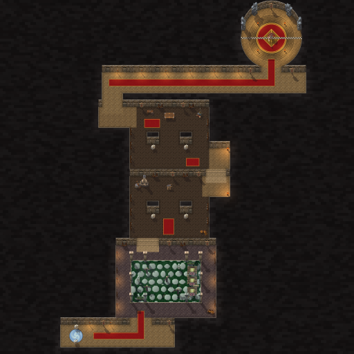

# Scarlet Armory (Scarlet Crusade Cup)

The third Scarlet Crusade Cup course, by Claude (rendering/UI owner), 2026-10-26. It is a **dungeon sprint**, like [Scarlet Graveyard](scarlet-graveyard.md) and [Scarlet Library](scarlet-library.md): no lapped road. It recreates the Scarlet Monastery's Armory wing, and the karts find their own way from its portal to Herod, in one run.

The owner sent four images:

- the wing's in-game map;
- a battle map of it (Sanctum of Maps);
- a screenshot of the Training Grounds: a grass yard with stepping stones, archery targets and training dummies inside an arcade;
- a screenshot of the Hall of Champions: a round hall, statues round its upper floor, a ring of stairs down to a red arena with a gold diamond.

He wrote: "Sweet. In the meantime let's get to work on Scarlet Armory. Image 3 is the training grounds area. Final room is the iconic round room with stairs leading down to herod (image 4). Same style. Free driving through the whole map. The Training grounds is the only outside you see on this map."

Asked where the finish line goes, he chose **"Down at Herod"**: the karts come in at the top of the Hall of Champions, drive down its ring of stairs and finish on a line across the hall's middle, beside Herod.



**Status:** version 1 is integrated on Codex's `codex/scarlet-integration` and installed (runtime `9c80746`); the owner has driven it. **Version 2**, below, is proposed on `claude/scarlet-fixes` for Codex's review. (On `claude/scarlet-cathedral` Herod took a model of his own, since Renault Mograine stands at the Cathedral's altar.)

- **Scores:** Armory runs save on their own one-run board, and Codex's score sync knows the Armory (code `A`). Version 2 is a new geometry version, so its boards start fresh; version 1's records stay saved.
- **NOT RUN in the client:** version 2's drive, look and picture load. See [the client checklist](../../../tests/MANUAL_CLIENT_CHECKLIST.md).

## Version 2: the Training Grounds as the owner's screenshot

After his first drive he sent his client view of the yard and a World of Warcraft screenshot of the Training Grounds, and wrote: "Make image 2(armory courtyard/training grounds) look more(exactly) like image 3. should be able to drive through this without being slowed."

His screenshot shows the yard paved with large pale octagonal flags, the grass growing between them; wooden training dummies, posts with arms, and padded ones; archery targets before tall plank backstops along the east side, hay at their feet; flowers and a bush in a corner; the roofed arcade round it all. Version 2:

- **No slowing.** The yard is stone underfoot (`road`), as its walks are: nothing in the Armory slows the karts.
- **Paved.** Large pale octagonal flags in staggered rows fill the yard, each its own size, cut and shade, bevelled, the grass between them (version 1 scattered small stepping stones over two thirds of it).
- **Training dummies.** Four wooden dummies (a post bound with iron, a beam through it for arms) and two padded ones (a cloth sack on a post), procedural models (`city_meshes.py`: Warcraft III has none) in the hitching post's weathered wood. They replace version 1's scarecrows.
- **Targets.** Three archery targets down the east side, each before a plank backstop, hay at their feet.
- **Flowers and bushes.** A bush and a bed of flowers in the south-west and north-east corners.
- **Everything in the yard blocks where it is drawn** (`blocks`): a kart stops at a dummy's arms or a target's backstop as it sees them, never short of them on open flags, and never runs over them. The bushes are round solids the size of their crowns.
- **The reviewed route** now runs straight through the yard, between the dummies.


## The course

The rooms follow the two maps at karting scale. Halls are 120 to 130 units wide and doors 120 to 130, so a kart can drive them. Every room of the wing on the way is open to the karts, side rooms and dead ends included: free driving, as he asked. The run:

1. **The entrance hall.** The karts arrive through the instance portal at its west end, between two Scarlet guards, facing east. A red runner leads east, then north through the door to the Training Grounds.
2. **The Training Grounds.** The first gate, *Training Grounds*, is in the door. Four roofed walks surround the yard, the wing's one open sky:
   - large pale octagonal flags with the grass between them, driven at full speed;
   - the arcade's columns round it, with an opening in the middle of each side;
   - three archery targets down its east side before plank backstops, hay at their feet;
   - four wooden training dummies and two padded ones;
   - a bush and a bed of flowers in two corners;
   - armour stands along the walks and weapon racks on the north walk's wall.
3. **The stairs up** from the north walk. The second gate, *Footman's Armory*, is on the stairs.
4. **The Footman's Armory**: two bands and three aisles round two great square pillars (the maps' two octagons), with armour stands down its side walls, weapon racks along its north wall, a forge and an anvil, crates, two Scarlet footmen at the pillars and red mats.
5. **Its east side room**, and stairs up from it. The third gate, *Crusader's Armory*, is on the stairs. They lead to the Crusader's side room and west into **the Crusader's Armory**, laid out as the Footman's: armour stands, weapon racks, a table, a cart, junk and footmen.
6. **Out of its north-west corner:** an antechamber, a hall north, then the long hall east on a red runner, past torches and banners. Its east end runs on past the Hall of Champions' door.
7. **The Hall of Champions.** The fourth gate, *Hall of Champions*, is in its door. The round hall has:
   - an upper floor round its wall;
   - four champions' statues round the north of the wall, facing in, and a Scarlet banner between them;
   - a ring of stairs down to the arena: a red carpet in a gold ring, with a gold lozenge;
   - four candle stands on the stairs.

   The finish, *Herod*, is the chequered line across the hall's middle, through Herod in the arena. He blocks, so the karts come down the stairs and cross either side of him.

| Measure | Value |
|---|---|
| World | 2048 × 2048 units (one texel per unit) |
| The way through | about 4,000 units from the portal to the finish line, along the reviewed route |
| Gates | five: Training Grounds, Footman's Armory, Crusader's Armory, Hall of Champions, Herod (the finish) |
| Rooms | 26: 25 rectangles of stone (the Training Grounds' yard among them, its flags in grass) and the round Hall of Champions |
| Solids | 44: 42 boxes (10 arcade columns, 3 archery targets and 3 backstops, 6 training dummies, 2 flower beds, 2 crates, the forge, the anvil, 2 guards and 4 footmen, a table, a cart, junk, Herod and 4 candle stands) and 2 round (the bushes) |

## How it plays

`Dungeon.new` builds it from `ScarletCrusade.lua`, as it builds the Graveyard and the Library; `Dungeon.lua` is unchanged. The contract is in [ADR 0020](../../adr/0020-dungeon-sprints.md) and [API_CONTRACTS](../../API_CONTRACTS.md#proposed-dungeon-sprints-the-scarlet-crusade-cup).

- **A sprint:** one run, `laps=1`, on the Armory's own board.
- **Open floor, no road, nothing slowing.** Stone everywhere, the Training Grounds' yard included since version 2: its flags and grass are paint, and the karts keep their speed and grip across them.
- **The stairs are paint.** The floor is flat, as in the other dungeons: the karts keep their speed and grip on the steps.
- **The Hall of Champions** is a round room (`shape="disc"`), so a kart slides round its wall.
- **Solids** block as on the test oval. Scenery that stands on the floor is solid; the rest stands against the walls, out of the karts' way. The yard's dummies, targets, backstops, flowers and bushes block where they are drawn (`blocks`, version 2).
- **The gates** span their doors, stairs or hall from wall to wall. The generator checks with a flood fill that none can be driven round. The finish passes through Herod's box. The generator now checks the floor just past a gate all along it, not only at its middle, which Herod covers.
- **Collision** comes from the generated data, never a pixel.

## Look

The Scarlet Monastery at night, in Warcraft III's city, Dalaran and Lordaeron art, with Reforged's Scarlet Crusade, in the style of the Graveyard and the Library:

- **Walls and masonry** as there: the city wall cliff's stones on every north wall, dark coursed stone beyond.
- **Floors:**
  - beige city tiles in the halls;
  - grey Dalaran tiles, kerbed, in the Training Grounds' walks;
  - warm brick from the Dalaran ruins in the two armories;
  - city brick on the stairs, each riser a shadowed line under a lit nose;
  - warm city tiles in the Hall of Champions.
- **The Training Grounds,** the only open sky: city grass paved with large pale octagonal flags in staggered rows (each its own size, cut and shade, mottled, lit from the north-west and bevelled), under the same cool, green-tinged moonlight and mist as the Library's courtyard.
- **The Hall of Champions:**
  - the upper floor round the wall;
  - the ring of stairs, each tread shaded darker as it goes down;
  - a gold ring, then the red carpet arena with a quartered gold lozenge;
  - the runner in through its door to the head of the stairs.
- **Light:** torches along the halls and walks, braziers on the landings, candles round Herod.
- **The Scarlet Crusade** (Reforged): standing banners, the guards at the portal and footmen in the armories.
- **Herod:** Reforged has no Herod. Dagren the Orcslayer stands in for him, a hulking armoured champion with a great blade, his gilt armour turned the Crusade's crimson (`recolor`). On `claude/scarlet-armory` Renault Mograine's crimson boss model stood there; the [Cathedral](scarlet-cathedral.md) puts Mograine himself at its altar, so Herod changed on `claude/scarlet-cathedral`.
- **The rest:** procedural wooden and padded training dummies (version 2; version 1 used Lordaeron's scarecrows), the classic archery targets before Reforged's plank boards and hay, Reforged's city flower beds and the classic city bushes, Lordaeron's statues with a sword and with a shield (tinted the hall's pale green-grey), smithy tools as the forge, the anvil and the cart, Lordaeron furniture as the table, crates, junk, armour stands and weapon racks.

## Files

| File | What |
|---|---|
| `addon/AzerothKart/ScarletCrusade.lua` | The Armory's data beside the Graveyard's and the Library's: rooms, gates, solids, spawn, `laps`, the reviewed route (generated). |
| `addon/AzerothKart/Assets/Tracks/ScarletArmory/Background.tga` | 2048×2048 opaque BGRA32, uncompressed, bottom-left origin; 16,777,234 bytes. |
| `addon/AzerothKart/Assets/Tracks/ScarletArmory/Preview.tga` | 512×512 (the background reduced 4×) for the track screen; 1,048,594 bytes. |
| [`scarlet_armory-overview.png`](scarlet_armory-overview.png) | The preview as PNG, for review. |
| [`scarlet_armory-sources.txt`](scarlet_armory-sources.txt) | Every Warcraft III model and texture the picture uses, with placement counts. |
| [`scarlet_armory-review.png`](scarlet_armory-review.png) | The way through and nine follow-camera views. |

## Rebuilding

Extract the files the Armory draws on, then build. The build also computes the other dungeons' geometry, so extract their files too ([the Graveyard's sheet](scarlet-graveyard.md#rebuilding), [the Library's](scarlet-library.md#rebuilding), [the Cathedral's](scarlet-cathedral.md#rebuilding)):

```
python scripts/wc3casc.py %W3% models "^war3\.w3mod:(doodads/(cityscape/(plants/citybush|props/emptycrates|structures/city_columnsingle)|dungeon/props/junkpile|lordaeronsummer/props/(archeryrange|armorrack|brazier|hayclump|torchhuman|weapons))/[^/]+\.mdx|_de\.w3mod:(doodads/(cityscape/(plants/flowerbedstraight|props/scarletcrusadestandingbanners)|lordaeronfall/props/plankboard|lordaeronsummer/props/(hay|hitchingpost)|lordaeroncapital/props/(lordaeronfurniture|smithytools|statues))|units/human/(herodagren|scarletfootman))/[^/]+\.mdx)$" WC3
python scripts/wc3casc.py %W3% extract "^war3\.w3mod:terrainart/(cityscape|dalaran|dalaranruins)/" WC3
python scripts/build_dungeon_tracks.py --wc3 WC3 --preview
python scripts/build_dungeon_tracks.py --wc3 WC3 --check
```

The layout is `SCARLET_ARMORY` in `scripts/dungeon_layouts.py`: its rooms, gates, spawn, reviewed route, props with their collision boxes (`blocks` for the yard's), floors, carpets, the yard's `stones`, the stairs' `axis` and the Hall of Champions' `rings`. The hitching post is extracted for its wood, which paints the training dummies (`training_dummy` and `sack_dummy` in `scripts/city_meshes.py`). `scripts/build_dungeon_tracks.py` writes the data and validates the geometry as for the other dungeons, invisible walls included. `scripts/dungeon_paint.py` paints the picture, and stops on a model that is not solid standing where the karts drive. It gained three things for the Armory, and the other dungeons' pictures are byte for byte unchanged:

- `rings` bands may be stairs, `(outer, "stairs", tread)`, and the rings may carry a gold lozenge, `diamond` (its half-diagonal);
- `stairs` may be a list, and `axis` `"y"` lays the treads across a stair that climbs north;
- `stones` scatters stepping stones over one floor style: `{floor, step, radius, density, seed}`, in staggered rows.

## Provenance and rights

**Source:** Blizzard Entertainment's Warcraft III: Reforged, build 3.0.1.24371, from the owner's own install, read without modification by `scripts/wc3casc.py`. The files are used under [ADR 0009](../../adr/0009-warcraft-iii-asset-reuse.md). The Scarlet Crusade's banners and footman, Dagren the Orcslayer, the Lordaeron statues, smithy tools and furniture, the plank boards, hay and flower beds, and the hitching post's texture (on the training dummies) come from Reforged's `_de.w3mod` set; the rest are the classic models. The training dummies are procedural (`scripts/city_meshes.py`), painted with that texture.

**Modifications:**

- models posed and rendered as sprites with the project's light, shadows and lean, in a crimson team colour; the statues tinted pale green-grey; Dagren's gilt armour moved to crimson;
- terrain atlases halved and shaded;
- the city wall cliff's stones laid along the faces;
- painted by the generator: the masonry, the faces' shading, carpets and mats, the stairs' treads, the Hall of Champions' rings and lozenge, the yard's flagstones, kerbs, the portal's swirl, the chequered finish, the light pools, the moonlight and the mist;
- everything composited into one picture.

**Author:** Blizzard Entertainment. **Redistribution rights are not established** and stay open for release review.

The rooms follow the wing's in-game map and the Sanctum of Maps battle map, redrawn at karting scale. The owner's screenshots guided the Training Grounds (version 2: his World of Warcraft screenshot of them) and the Hall of Champions. None of these is stored.
