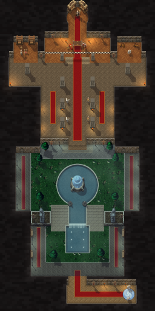

# Scarlet Cathedral (Scarlet Crusade Cup)

The fourth and last Scarlet Crusade Cup course, by Claude (rendering/UI owner), 2026-10-26. It is a **dungeon sprint**, like [Scarlet Graveyard](scarlet-graveyard.md), [Scarlet Library](scarlet-library.md) and [Scarlet Armory](scarlet-armory.md): no lapped road. It recreates the Scarlet Monastery's Cathedral wing, and the karts find their own way from its portal to the altar of the Crusader's Chapel, in one run.

The owner sent four images:

- the wing's in-game map;
- a battle map of it (Sanctum of Maps);
- a screenshot of the Chapel Gardens: the falls between two stairs, giant statues of champions on pillars either side, the cathedral's spires beyond;
- a screenshot of the cathedral's nave: a long red carpet to the altar, pillars, candelabras and the Crusade lining the way.

He wrote: "Scarlet Cathedral next." Asked two questions, he chose:

- **the finish "At the altar"**: a line across the chancel in front of the altar, where Mograine and Whitemane stand; the round chamber behind stays open to drive;
- **the gardens' pools as "Water you drive round"**: the pools and the falls block, as water does in the cities, so the karts pick a side. The round pool needs round obstacles, which `Dungeon.lua` gains for Codex's review.



**Status:** version 1 is integrated on Codex's `codex/scarlet-integration`, with Codex's swept round-solid collision, and installed (runtime `9c80746`); the owner has driven it. **Version 2**, below, is proposed on `claude/scarlet-fixes` for Codex's review. The Cathedral took the place of the coming-soon "Scarlet Monastery"; every course in the catalogue is ready.

- **Scores:** Cathedral runs save on their own one-run board, and Codex's score sync knows the Cathedral (code `C`). Version 2 is a new geometry version, so its boards start fresh; version 1's records stay saved.
- **Round solids** ([ADR 0020's fourth addendum](../../adr/0020-dungeon-sprints.md#addendum-round-solids-and-scarlet-cathedral-reviewed-source-integration-2026-10-26)) are integrated; version 2 adds more of them (the trees and bushes) and no runtime code.
- **NOT RUN in the client:** version 2's drive, look and picture load. See [the client checklist](../../../tests/MANUAL_CLIENT_CHECKLIST.md).

## Version 2: after the owner's first drive

He wrote: "Remove slow from grass in cathedral as well. There are also seemingly some invisible walls. as you can see in image 5 - the stairs are the only path up to the cathedral" (image 5: the battle map's falls, the stairs beside them, the champions' statues on raised platforms either side). He also asked that grass without a clear edge or fence no longer slow the karts.

- **The lawns no longer slow the karts.** Both gardens are stone underfoot (`road`), their lawns paint: nothing in the Cathedral slows the karts.
- **The stairs are the only way up.** In version 1 the lower and upper gardens met across the whole width, the cobbled platforms drivable floor. Now the platforms are raised **plinths**: stone the karts drive round, as a wall, cobbled on top inside a dressed rim, a face toward the lower garden, a champion's statue and a Scarlet standard on each. The lower garden ends at their faces and the upper garden begins behind them; only the two stairs beside the falls join the two. The *Upper Gardens* gate spans the band, so it cannot be passed but by the stairs.
- **No invisible walls.** Version 1's trees stopped the karts at a box round the trunk, hidden under the leaves: a kart drove onto the crown and stopped short of nothing it could see. Now the trees and bushes are round solids the size of their drawn crowns, and the nave's, transept's and chancel's pillars block where they are drawn (`blocks`). The lower garden keeps two trees, clear of the way to the stairs; the upper garden's bushes stand nearer its walks.


## The course

The rooms follow the two maps at karting scale, in a world twice as tall as it is wide, as the wing is. Halls and doors are 120 units wide and the gardens' walks 100, so a kart can drive them. Every room is open to the karts, the side chapels and the round chamber behind the altar included. The run:

1. **The entrance hall.** The karts arrive through the instance portal at its east end, between two Scarlet guards, facing west. A red runner leads west, then north through the garden gate.
2. **The Chapel Gardens,** under the open sky. The first gate, *Chapel Gardens*, is in the garden gate. The lower garden is a lawn inside kerbed walks with red runners:
   - its long pool in the middle, six jets playing in it;
   - two trees on the lawn;
   - lanterns and benches along the walks.
3. **Up to the upper garden,** across the second gate, *Upper Gardens*, which spans the whole width:
   - the falls come down into the lower pool in the middle;
   - stairs climb either side of them, a lion on each top post: the only way up;
   - beyond the stairs, two raised plinths, each with a giant statue of a champion and a Scarlet standard.
4. **The upper garden**: a lawn round the round pool, its fountain playing in the middle, with trees, bushes, walks and lanterns. Round either side of the pool, or across the lawn north of it, to the terrace and the steps up to the cathedral's door.
5. **The Crusader's Chapel.** The third gate, *Crusader's Chapel*, is in the door. Up the nave on its red carpet, between two rows of great pillars, with candles, Scarlet clerics and footmen lining the way, torches on the walls and red runners in the side aisles.
6. **The transept**, its two great pillars and its side chapels (a reading room; a guardroom of crates), then **the chancel's steps** between two pillars.
7. **The finish,** *High Altar*: the chequered line across the chancel's wooden floor in front of the altar, where Scarlet Commander Mograine and High Inquisitor Whitemane stand. Behind them, a hall runs north to Fairbanks' round chamber.

| Measure | Value |
|---|---|
| World | 1024 × 2048 units (one texel per unit) |
| The way through | about 2,250 units from the portal to the finish line, along the reviewed route |
| Gates | four: Chapel Gardens, Upper Gardens, Crusader's Chapel, High Altar (the finish) |
| Rooms | 22: 21 rectangles of stone, wood and the gardens' lawns, and Fairbanks' round chamber; and 2 plinths, which are not floor |
| Solids | 40: 11 round (the round pool, 8 trees' crowns and 2 bushes) and 29 boxes (the lower pool and the falls, 8 pillars and 2 at the chancel, the guards, clerics and footmen, Mograine, Whitemane, Fairbanks, the altar, 2 candle stands, a table and 2 heaps of crates) |

## How it plays

`Dungeon.new` builds it from `ScarletCrusade.lua`, as it builds the other three. The contract is in [ADR 0020](../../adr/0020-dungeon-sprints.md) and [API_CONTRACTS](../../API_CONTRACTS.md#proposed-dungeon-sprints-the-scarlet-crusade-cup).

- **A sprint:** one run, `laps=1`, on the Cathedral's own board.
- **Open floor, no road, nothing slowing.** Stone and wood everywhere, the gardens' lawns included since version 2.
- **The plinths** are not floor: like the masonry they stop a kart at their faces, by the kart's inset. Only the stairs join the gardens.
- **The pools block.** Each pool is a solid of its own shape, painted as water with a stone rim. A kart stops at its rim, by the kart's inset, as at a wall, and slides along it. The round pool is the first **round solid** (`shape="disc"` on a solid): a kart slides round its rim, never into it. The lower pool and the falls are boxes.
- **The stairs are paint.** The floor is flat, as in the other dungeons.
- **Solids** block as on the test oval. Scenery that stands on the floor is solid; the rest stands against the walls, over the water or on the plinths, out of the karts' way. The trees and bushes are round solids the size of their drawn crowns, the pillars boxes the size of their drawn bodies (`blocks`, version 2).
- **The gates** span their doors, the gardens and the chancel from wall to wall. The generator checks with a flood fill that none can be driven round. *Upper Gardens* runs through the falls, as Herod stands on the Armory's finish.
- **Collision** comes from the generated data, never a pixel. The picture's water is the solids' own footprint.

## Look

The Scarlet Monastery at night, in Warcraft III's city, village and Lordaeron art, with Reforged's Scarlet Crusade, in the style of the other three:

- **Walls and masonry** as there: the city wall cliff's stones on every north wall, dark coursed stone beyond.
- **Floors:**
  - beige city tiles in the entrance hall;
  - grey round city tiles in the gardens' walks, with red runners, and village cobbles on the plinths' tops, inside a rim of dressed stone;
  - city grass on the lawns, kerbed;
  - grey city tiles on the terrace and grey-brown ones in the nave and the transept;
  - city brick on the stairs and steps;
  - in the chancel, the side chapels, the hall and the round chamber, a wooden parquet painted by the generator: blocks of planks turned 45 degrees, alternate blocks crosswise, each plank its own tone.
- **The gardens,** the only open sky, under the same cool, green-tinged moonlight and mist as the Library's courtyard and the Armory's yard.
- **The water:** Warcraft III's water, tinted deep blue-green, darker toward the rims; stone rims, their inner faces showing below the north sides; the falls spilling white over their lip; the jets' spray and rings.
- **Light:** torches in the halls, candles before the nave's pillars and at the altar, braziers at the transept's ends, lanterns along the garden walks.
- **The Scarlet Crusade** (Reforged): standing banners, the guards at the portal, clerics and footmen along the nave, Renault Mograine and Sally Whitemane at the altar, and a cleric as High Inquisitor Fairbanks in his chamber.
- **The rest:** Reforged's city fountain in the round pool, Lordaeron's lions over the falls and its sword statue as the champions (tinted pale green-grey), Lordaeron's interior pillars, bookshelves and furniture, summer trees, city bushes, wooden benches, lantern posts and crates.

## Files

| File | What |
|---|---|
| `addon/AzerothKart/Dungeon.lua` | The dungeon geometry; this course adds round solids (proposed for Codex review). |
| `addon/AzerothKart/ScarletCrusade.lua` | The Cathedral's data beside the other three's: rooms, gates, solids (the pools among them), spawn, `laps`, the reviewed route (generated). |
| `addon/AzerothKart/Assets/Tracks/ScarletCathedral/Background.tga` | 1024×2048 opaque BGRA32, uncompressed, bottom-left origin; 8,388,626 bytes. |
| `addon/AzerothKart/Assets/Tracks/ScarletCathedral/Preview.tga` | 256×512 (the background reduced 4×) for the track screen; 524,306 bytes. |
| [`scarlet_cathedral-overview.png`](scarlet_cathedral-overview.png) | The preview as PNG, for review. |
| [`scarlet_cathedral-sources.txt`](scarlet_cathedral-sources.txt) | Every Warcraft III model and texture the picture uses, with placement counts. |
| [`scarlet_cathedral-review.png`](scarlet_cathedral-review.png) | The way through and nine follow-camera views. |

## Rebuilding

Extract the files the Cathedral draws on, then build. The build also computes the other dungeons' geometry, so extract their files too ([the Graveyard's sheet](scarlet-graveyard.md#rebuilding), [the Library's](scarlet-library.md#rebuilding), [the Armory's](scarlet-armory.md#rebuilding)):

```
python scripts/wc3casc.py %W3% models "^war3\.w3mod:(doodads/(cityscape/(plants/citybush|props/(emptycrates|lanternpost))|lordaeronsummer/props/(brazier|torchhuman)|terrain/lordaerontree)/[^/]+\.mdx|_de\.w3mod:(doodads/(cityscape/props/(city_fountain|citywoodbench|scarletcrusadestandingbanners)|lordaeroncapital/(props/(lordaeronbookshelf|lordaeronfurniture|statues)|structures/pillarinterior)|lordaeronfall/props/lionstatue)|units/human/(herorenaultmograine|herosallywhitemane|scarletcleric|scarletfootman))/[^/]+\.mdx)$" WC3
python scripts/wc3casc.py %W3% extract "^war3\.w3mod:(terrainart/(cityscape|village)/|replaceabletextures/(lordaerontree|water)/)" WC3
python scripts/build_dungeon_tracks.py --wc3 WC3 --preview
python scripts/build_dungeon_tracks.py --wc3 WC3 --check
```

The layout is `SCARLET_CATHEDRAL` in `scripts/dungeon_layouts.py`: its rooms, gates, spawn, reviewed route, `pools`, `plinths`, props with their collision boxes (`blocks` for the trees, bushes and pillars), floors, carpets, stairs, the falls (`waterfalls`) and the jets. `scripts/build_dungeon_tracks.py` writes the data and validates the geometry as for the other dungeons, invisible walls included; a pool becomes a solid of its shape, and its water counts as a visible edge, as a wall does. `scripts/dungeon_paint.py` paints the picture, and stops on a model that is not solid standing where the karts drive. It gained two things for the Cathedral, and the other dungeons' pictures are byte for byte unchanged:

- `pools` (with `water`, `waterfalls` and `jets`): water with stone rims, the falls and the fountains' jets;
- a floor style may be a wooden `parquet` ({"block", "plank", "colour"}) instead of a tile.

Version 2 added `plinths` ({"x0", "y0", "x1", "y1", "height", "top", "rim"}): raised blocks off the floor, their tops paved in a floor style inside a dressed rim, their south faces `height` units tall in the walls' stones. A pool beyond the rooms (the falls, now between the plinths' stairs) is painted at the floor's level, no wall rising from its edge. The Graveyard's picture is byte for byte unchanged.

## Provenance and rights

**Source:** Blizzard Entertainment's Warcraft III: Reforged, build 3.0.1.24371, from the owner's own install, read without modification by `scripts/wc3casc.py`. The files are used under [ADR 0009](../../adr/0009-warcraft-iii-asset-reuse.md). The Scarlet Crusade's banners, footman and cleric, Renault Mograine and Sally Whitemane, the city fountain and wooden bench, Lordaeron's statue, lions, pillars, bookshelves and furniture come from Reforged's `_de.w3mod` set; the rest are the classic models.

**Modifications:**

- models posed and rendered as sprites with the project's light, shadows and lean, in a crimson team colour; the champions' statues tinted pale green-grey;
- terrain atlases halved and shaded; the water texture tinted;
- the city wall cliff's stones laid along the faces;
- painted by the generator: the masonry, the faces' shading, carpets and runners, the stairs' treads, the parquet, the plinths' rims and faces, the pools' water and rims, the falls and the jets, kerbs, the portal's swirl, the chequered finish, the light pools, the moonlight and the mist;
- everything composited into one picture.

**Author:** Blizzard Entertainment. **Redistribution rights are not established** and stay open for release review.

The rooms follow the wing's in-game map and the Sanctum of Maps battle map, redrawn at karting scale. The owner's screenshots guided the Chapel Gardens and the nave. None of these is stored.
