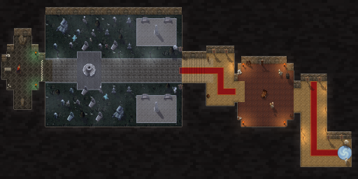

# Scarlet Graveyard (Scarlet Crusade Cup)

The first Scarlet Crusade Cup course, by Claude (rendering/UI owner), 2026-10-25. It is the first **dungeon sprint**: no lapped road, but a recreation of the dungeon in which the karts find their own way from its entrance to its end, in one run.

The owner sent the Scarlet Monastery Graveyard map with his route drawn on it, and a screenshot of the monastery's Grand Vestibule. He wrote: "This will be A-B sprint type maps. Scarlet Crusade Cup Scarlet Graveyard, Scarlet Library, Scarlet Armory, Scarlet Monestary. Start of dungeon to end of dungeon. Let's start with Scarlet Graveyard. It starts in a closed space and enters into an open graveyard. You don't need to put a traditional track here, just recreate the dungeon and let players find their way to the end."

Asked, he chose:

- that Claude add the minimal sprint rules, for Codex's review;
- that the cloister's grass slows the karts and its graves block them.



**Status:** version 1 was proposed on `claude/scarlet-graveyard`, reviewed and integrated by Codex, and installed (runtime `c9ebf03`); the owner has driven it. **Version 2**, proposed on `claude/drive-fixes` for Codex review, fixes what he found ([below](#version-2-fixes-from-the-owners-client-run)).

- **Scores:** Graveyard runs save locally, on their own one-run board. Community sharing needs Codex's score-sync change described in [the handoff](../../handoffs/claude-latest.md#needs-codex-score-sync-learns-the-new-courses). Without that change the sync does not start for any course, so this branch must not be installed on its own.
- **NOT RUN in the client:** the drive, the look in the follow camera, loading the 2048×1024 picture, performance. See [the client checklist](../../../tests/MANUAL_CLIENT_CHECKLIST.md).


## Version 2: fixes from the owner's client run

The owner drove version 1 in the client and sent screenshots. He wrote: "fix invisible wall at infront of kart on image 1 and 2. remove object under kart on image 3 and 4."

- **The invisible wall** (images 1 and 2). The Chamber of Atonement's west wing ran right up to the west hall, so the two floors met with no wall painted between them. The karts' floors stopped 36 units apart there (each room's inset) and joined only through the west door, so a kart stopped in what looked like open floor. The wing now starts 20 units east of the hall, and a wall stands either side of the west door. The door is the way through, as on the chamber's east side.
- **Objects under the kart** (images 3 and 4). The armour rack stood on the stairs and a ghost on the cloister's path, and neither was solid.
  - The rack now stands in the corner at the head of the stairs, off the steps. The ghost on the path is gone.
  - Everything else that stood on the floor now blocks: the two ghosts on the lawns, the sitting corpse and the four stone benches.
  - The skull piles, the banners by the stairs, the iron maiden and the weapons stand back against the walls.
- **The generator** refuses both faults now: a floor that ends with no wall painted beside it, and a model that is not solid with its drawn body on the karts' floor ([Rebuilding](#rebuilding)).
- **Scores:** version 2 has its own boards. Version 1 times stay saved under version 1.

The route, the gates and the spawn are unchanged.

## The course

The rooms follow his map at karting scale. Halls and doors are 120 to 160 units wide, so a kart can drive them, and the layout keeps the map's plan and proportions. The run goes east to west:

1. **The entrance hall.** The karts arrive through the instance portal, a swirl of blue light on the hall's floor, between two Scarlet guards. The grid faces west.
2. **The north hall.** Turn right and run up the long hall north, on its red runner, between torches.
3. **The Chamber of Atonement**, through its east door. The first gate, *Chamber of Atonement*, is in that door. The chamber is a cross-shaped torture room: the karts pass either side of the torture table in its middle, past Interrogator Vishas and his torturer, braziers burning at its corners.
4. **The west hall and the stairs.** Out of the chamber's west door into the west hall, then down the stairs west. The second gate, *Forlorn Cloister*, stands on the stairs.
5. **The Forlorn Cloister**, open to the night sky. A stone path runs west across the graveyard's lawn and round a ruined fountain in the middle. Graves, crypts, dead trees, ghosts and the walking dead fill the lawns, with paved walks and obelisks at the east end.
6. **Honor's Tomb**, the cross-shaped crypt at the cloister's west end. The finish gate, *Honor's Tomb*, is the chequered line across its door. Bloodmage Thalnos waits inside, by a stone tomb lit by green braziers.

| Measure | Value |
|---|---|
| World | 2048 × 1024 units (one texel per unit) |
| The way through | about 2,200 units from the portal to the finish line, along the reviewed route |
| Gates | three: Chamber of Atonement, Forlorn Cloister, Honor's Tomb (the finish) |
| Rooms | 18 rectangles of floor: 17 stone and the cloister's lawn |
| Solids | 59 boxes: 23 graves, 2 crypts, 6 dead trees, the fountain, 3 lanterns, 2 obelisks, 4 stone benches, a broken column, the torture table, the cage, Vishas and his torturer, Thalnos, the tomb and coffins, 4 guards, 2 ghosts, a zombie, a skeleton and a sitting corpse |

## How it plays

`Dungeon.new` builds it from `ScarletCrusade.lua`. The contract is in [ADR 0020](../../adr/0020-dungeon-sprints.md) and [API_CONTRACTS](../../API_CONTRACTS.md#proposed-dungeon-sprints-the-scarlet-crusade-cup).

- **A sprint.** The course sets `laps=1`. The race finishes at the third gate after one run, and the score is a one-run total on the Graveyard's own board.
- **Open floor, no road.** The kart centre stays 18 units (`wallInset`) inside the rooms. Where rooms meet they overlap, so the floor runs on through the doors. A step into a wall ends at the wall and slides along it, counting as a hit, as on the city streets.
- **Stone and grass.** Stone floor has full grip. The cloister's lawn is rough ground, which Physics slows to 70 units a second, so the path is the fast way.
- **Solids** block as the test oval's crates do: each grown by the kart's inset, so a kart slides along their faces.
- **Nothing to drive over.** Scenery that stands on the floor is solid. The rest stands against the walls, out of the karts' way.
- **The gates** span doorways from wall to wall, so they cannot be driven round. The generator checks this for each gate by flood-filling the karts' floor with the gate as a barrier.
- **Collision** comes from the generated analytic data, never a pixel. The picture paints exactly the rooms Dungeon.lua collides with.

## Look

The Scarlet Monastery at night, in Warcraft III's city, dungeon and Lordaeron art:

- **The monastery's masonry** is everything off the floor: dark stone in courses, darkest far from any room.
- **Walls.** A room's north wall faces the camera, so it rises over the masonry beyond, built from the stones and arches of Warcraft III's city wall cliff. Its coping is lit along the top. The other walls show their coping edge.
- **Floors:**
  - beige city tiles in the halls;
  - red-brown tiles in the torture chamber;
  - pale bricks on the stairs, with their risers;
  - grey marble in Honor's Tomb;
  - the Dalaran ruins' dark grass on the lawn;
  - a cobbled stone path with kerbs;
  - round tiles in the fountain's court;
  - bricks on the walks.
- **The Scarlet Crusade:**
  - its standing banners and red runners with gold edges;
  - Scarlet footmen at the portal and the cloister's stairs;
  - a Scarlet invoker as Interrogator Vishas, and a cleric as his torturer.
- **Light:**
  - torches along the halls, braziers in the chamber, lanterns by the path, all in warm pools;
  - green fire in the tomb;
  - the portal's blue swirl.
  - The open cloister is graded to cool moonlight, with drifts of mist.
- **The dead:** spectral banshees over the graves, a zombie, a skeleton, a sitting corpse. Bloodmage Thalnos is the Blood Mage hero.

## Files

| File | What |
|---|---|
| `addon/AzerothKart/Dungeon.lua` | The geometry for open dungeon courses (new; proposed for Codex review). |
| `addon/AzerothKart/ScarletCrusade.lua` | The Graveyard's data: rooms, gates, solids, spawn, `laps`, the reviewed route (generated). |
| `addon/AzerothKart/Assets/Tracks/ScarletGraveyard/Background.tga` | 2048×1024 opaque BGRA32, uncompressed, bottom-left origin; 8,388,626 bytes. |
| `addon/AzerothKart/Assets/Tracks/ScarletGraveyard/Preview.tga` | 512×256 (the background reduced 4×) for the track screen; 524,306 bytes. |
| [`scarlet_graveyard-overview.png`](scarlet_graveyard-overview.png) | The preview as PNG, for review. |
| [`scarlet_graveyard-sources.txt`](scarlet_graveyard-sources.txt) | Every Warcraft III model and texture the picture uses, with placement counts. |
| [`scarlet_graveyard-review.png`](scarlet_graveyard-review.png) | The way through and nine follow-camera views (version 2). |

## Rebuilding

Extract the files the Graveyard draws on, then build:

```
python scripts/wc3casc.py %W3% models "^war3\.w3mod:(doodads/(cityscape/props/(citygrave|city_oblisk|citystonebench|fountainruined|lanternpost)|lordaeronsummer/props/(grave|torchhuman|brazier|cage|skullpile|sittingcorpse|weapons|armorrack)|northrend/(props/(northrendtombstone|northrendgrave|northrendbrokencolumn)|structures/northrendcrypt)|dungeon/props/(torturetable|ironmaiden|chainpost|bench)|terrain/lordaerontree)/[^/]+\.mdx|units/(creeps/(bansheeghost|zombie)|undead/skeleton|human/herobloodelf)/[^/]+\.mdx|_de\.w3mod:(doodads/cityscape/props/scarletcrusadestandingbanners|doodads/undercity/props/(crypttomb|coffin)|units/human/(scarletfootman|scarletcleric|scarletinvoker))/[^/]+\.mdx)$" WC3
python scripts/wc3casc.py %W3% extract "^war3\.w3mod:(terrainart/(cityscape|dungeon|dalaranruins|village)/|replaceabletextures/dalaranruinstree/)" WC3
python scripts/build_dungeon_tracks.py --wc3 WC3 --preview
python scripts/build_dungeon_tracks.py --wc3 WC3 --check
```

The layout is `SCARLET_GRAVEYARD` in `scripts/dungeon_layouts.py`:

- the rooms, each a rectangle of road or rough floor with its floor style;
- the gates, the spawn and the reviewed route;
- the props, each with its collision box, and the graves the generator lays in rows on the lawns;
- the floors, wall, carpets, stairs, portal, lights and mist.

`scripts/build_dungeon_tracks.py` writes `ScarletCrusade.lua` and validates the geometry:

- rooms inside the world, and apart wherever they do not meet;
- no invisible wall: wherever the karts' floor ends, the picture's masonry lies within the inset, with 3 units' slack, measured square;
- the spawn on stone;
- every solid on the floor;
- the route clear of walls and solids, crossing the gates in order;
- each gate axis-aligned, reaching the walls and unavoidable.

`scripts/dungeon_paint.py` paints the picture. It stops on a model that is not solid with its drawn body (not its shadow) more than 3 units onto the kart centre's floor. It shares the city painter's tiles, sprites and compositing, and the cities' pictures are untouched.

## Provenance and rights

**Source:** Blizzard Entertainment's Warcraft III: Reforged, build 3.0.1.24371, from the owner's own install. `scripts/wc3casc.py` read it without modifying it. The files are used under [ADR 0009](../../adr/0009-warcraft-iii-asset-reuse.md). The Scarlet Crusade's banners and soldiers, the crypt tomb and the coffins come from Reforged's `_de.w3mod` set; the rest are the classic models.

**Modifications:**

- models posed and rendered as sprites with the project's light, shadows and lean, in a crimson team colour;
- terrain atlases halved and shaded: the tomb's marble greyed, the path's stones dulled;
- the city wall cliff's stones laid along the faces;
- the masonry, faces' shading, carpets, stairs, kerbs, the portal's swirl, the chequered finish, the light pools, the moonlight and the mist painted by the generator;
- everything composited into one picture.

**Author:** Blizzard Entertainment. **Redistribution rights are not established** and stay open for release review.

The rooms follow the owner's map of the Scarlet Monastery Graveyard (MapsForTanks) and his route on it, redrawn at karting scale. Neither the map nor his screenshot is stored.
