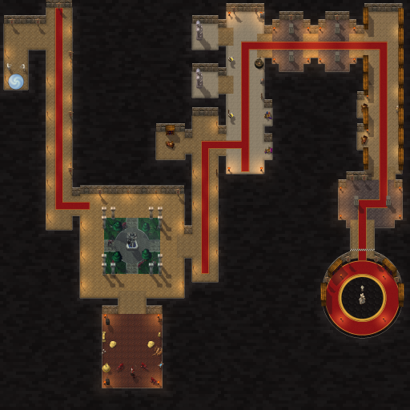

# Scarlet Library (Scarlet Crusade Cup)

The second Scarlet Crusade Cup course, by Claude (rendering/UI owner), 2026-10-25. It is a **dungeon sprint**, like [Scarlet Graveyard](scarlet-graveyard.md): no lapped road. It recreates the Scarlet Monastery's Library wing, and the karts find their own way from its portal to its end, in one run.

The owner sent three images:

- his map of the Library wing (MapsForTanks) with his route;
- a screenshot of the Huntsman's Cloister's courtyard;
- a screenshot of Arcanist Doan's round library.

He wrote: "Scarlet Library. Everything is inside except the first courtyard with the fountain/statue in the middle, everything else is inside - ending in the iconic round library."



**Status:** proposed on `claude/scarlet-library` for Codex review and integration. The branch carries Thunder Bluff and Scarlet Graveyard too, since neither is integrated yet. The Library is selectable in this branch.

- **Scores:** Library runs save locally, on their own one-run board. Community sharing needs Codex's score-sync change, described in [the handoff](../../handoffs/claude-latest.md#needs-codex-score-sync-learns-the-library). Without that change the sync does not start for any course, so this branch must not be installed on its own.
- **NOT RUN in the client:** the drive, the look in the follow camera, loading the picture, performance. See [the client checklist](../../../tests/MANUAL_CLIENT_CHECKLIST.md).


## Before integration: nothing under the kart

The owner's client run of the Graveyard found objects the kart drove over. The rule the generator now enforces for both dungeons holds here too (on `claude/drive-fixes`, still version 1, since the Library has not been installed):

- solid where they stand: the courtyard's eight bushes, the kennel's two cages, its rib cage by the east wall, a heap of hay by the west wall and two hay bales, and the round library's four candle stands;
- gone: the courtyard's flowers, the hay and the rib cage on the kennel's floor by Loksey, the south walk's torches (they leaned out over the floor), and the round library's three southern shelves and two southern banners;
- back against the walls: the skull pile, hay, weapons and trough in the kennel, the gallery's chests, rack and braziers, the Athenaeum's shelves and candles, the round library's eastern and western shelves, and the long hall's banners. The last hall's second banner moved from the doorway to the wall beside it.

## The course

The rooms follow his map at karting scale. Halls are 120 to 140 units wide and doors 90 to 140, so a kart can drive them, and the layout keeps the map's plan. The run:

1. **The portal hall.** The karts arrive through the instance portal at its south end, between two Scarlet guards, facing north. The upper hall turns east, then the long hall runs south on a red runner.
2. **The long hall.** The first gate, *Huntsman's Cloister*, crosses it where the owner drew his line, just past the start.
3. **The Huntsman's Cloister.** Four roofed walks surround the one open courtyard. The arcade's columns stand round the courtyard, with an opening in the middle of each side. In the courtyard:
   - a lawn with a cross of stone paths;
   - a statue in its fountain at the centre, on a round court;
   - four trees;
   - Scarlet huntsmen and their hounds.
4. **Houndmaster Loksey's kennel**, south of the cloister. His route goes in and back out. The second gate, *Houndmaster Loksey*, is his red line across the kennel. Past it the karts turn round by the houndmaster, his hounds, the cages and the hay, and drive back out; crossing the line backwards counts nothing.
5. **The east hall**, north from the cloister's east side, past a reading room, to the third gate, *Gallery of Treasures*, in the gallery's door.
6. **The Gallery of Treasures**: a long hall north with treasure in its niches, chests, armour and shields, and statues in its two west alcoves.
7. **Two columned halls** east, each a cross with two square pillars, the runner between them. The fourth gate, *Athenaeum*, is in the door beyond.
8. **The Athenaeum**: the long library hall south, lined with bookshelves, with reading tables in its niches.
9. **The last hall**, with two pillars. Then the finish, *Arcanist Doan*, the chequered line in the door of the round library. Inside, Doan stands at his lectern in the middle of a gold-ringed red carpet, among bookshelves and banners.

| Measure | Value |
|---|---|
| World | 2048 × 2048 units (one texel per unit) |
| The way through | about 6,200 units from the portal to the finish line, along the reviewed route |
| Gates | five: Huntsman's Cloister, Houndmaster Loksey, Gallery of Treasures, Athenaeum, Arcanist Doan (the finish) |
| Rooms | 41: 38 rectangles of stone, the courtyard's lawn, and two round rooms (the fountain's court and the round library) |
| Solids | 65 boxes: 12 arcade columns, the fountain, 4 trees, 8 bushes, 6 square pillars, the houndmaster and the huntsmen, 6 hounds, 2 cages, a rib cage, a heap and two bales of hay, the guards, treasure, chests, statues and a shield, tables, the cleric, Doan, his lectern and 4 candle stands |

## How it plays

`Dungeon.new` builds it from `ScarletCrusade.lua`, exactly as the Graveyard. The contract is in [ADR 0020](../../adr/0020-dungeon-sprints.md) and [API_CONTRACTS](../../API_CONTRACTS.md#proposed-dungeon-sprints-the-scarlet-crusade-cup).

- **A sprint:** one run, `laps=1`, on the Library's own board.
- **Open floor, no road.** Stone everywhere but the courtyard's lawn, which slows the karts as the Graveyard's does. Walls slide the kart along them.
- **Round rooms** (new, `shape="disc"`): the round library and the fountain's court are true circles. The kart centre stays inside a round wall by the kart's inset, and slides round it.
- **Loksey's kennel** is the one dead end on the way: in across his line, a hairpin turn, and back out. Checkpoints count only the crossing inward.
- **Solids** block as on the test oval. Scenery that stands on the floor is solid; the rest stands against the walls, out of the karts' way.
- **The gates** span their doors or halls from wall to wall. The generator checks with a flood fill that none can be driven round.
- **Collision** comes from the generated data, never a pixel.

## Look

The Scarlet Monastery at night, in Warcraft III's city, dungeon, Dalaran and Lordaeron art, with Reforged's Scarlet Crusade:

- **Walls and masonry** as in the Graveyard: the city wall cliff's stones on every north wall, dark coursed stone beyond.
- **Floors:**
  - beige city tiles in the halls and walks;
  - red-brown dungeon tiles in the kennel;
  - pale marble in the Gallery of Treasures;
  - grey diamond tiles in the columned halls;
  - brick in the Athenaeum;
  - dark octagonal tiles at the round library's centre.
- **The courtyard,** the only open sky:
  - lawn, stone paths with kerbs and the round court;
  - the statue fountain, Lordaeron's summer trees and bushes;
  - graded to a cool, green-tinged moonlight with drifts of mist.
- **The round library:**
  - a gold ring on dark stone, the Scarlet red carpet out to its round wall;
  - bookshelves round the north of the wall, Scarlet banners, and candles round Doan;
  - the runner in through its door.
- **Light:** torches along the halls, braziers in the kennel, gallery and halls, candles among the books.
- **The Scarlet Crusade** (Reforged): standing banners, the guards at the portal, huntsmen in the cloister and as Houndmaster Loksey, a cleric in the Athenaeum, and an invoker hero as Arcanist Doan. Warcraft III's dark hounds, tinted red, are the Scarlet tracking hounds.

## Files

| File | What |
|---|---|
| `addon/AzerothKart/Dungeon.lua` | The dungeon geometry; this course adds round rooms (proposed for Codex review). |
| `addon/AzerothKart/ScarletCrusade.lua` | The Library's data beside the Graveyard's: rooms, gates, solids, spawn, `laps`, the reviewed route (generated). |
| `addon/AzerothKart/Assets/Tracks/ScarletLibrary/Background.tga` | 2048×2048 opaque BGRA32, uncompressed, bottom-left origin; 16,777,234 bytes. |
| `addon/AzerothKart/Assets/Tracks/ScarletLibrary/Preview.tga` | 512×512 (the background reduced 4×) for the track screen; 1,048,594 bytes. |
| [`scarlet_library-overview.png`](scarlet_library-overview.png) | The preview as PNG, for review. |
| [`scarlet_library-sources.txt`](scarlet_library-sources.txt) | Every Warcraft III model and texture the picture uses, with placement counts. |
| [`scarlet_library-review.png`](scarlet_library-review.png) | The way through and nine follow-camera views. |

## Rebuilding

Extract the files the Library draws on, then build. The build also computes the Graveyard's geometry, so extract its files too ([its sheet](scarlet-graveyard.md#rebuilding)):

```
python scripts/wc3casc.py %W3% models "^war3\.w3mod:(doodads/(cityscape/(plants/citybush|props/(city_statue|crystalshield)|structures/city_columnsingle)|dungeon/props/(bigbookshelf|bookshelfwall|bookshelfwall45|tablenchair|treasurepile)|lordaeronsummer/props/(armorrack|brazier|cage|cageempty|hay|hayclump|ribbones|skullpile|torchhuman|trough|weapons)|terrain/lordaerontree)/[^/]+\.mdx|(buildings/other/bookofsummoning|objects/inventoryitems/treasurechest)/[^/]+\.mdx|_de\.w3mod:(doodads/(cityscape/props/scarletcrusadestandingbanners|lordaeroncapital/props/statues|lordaeroncapital/structures/pillarinterior|undercity/props/treasurechest)|units/(creeps/darkhound|human/(scarletcleric|scarletfootman|scarlethuntsman|scarletinvoker)))/[^/]+\.mdx)$" WC3
python scripts/wc3casc.py %W3% extract "^war3\.w3mod:(terrainart/(blackcitadel|cityscape|dalaran|dungeon|village)/|replaceabletextures/lordaerontree/)" WC3
python scripts/build_dungeon_tracks.py --wc3 WC3 --preview
python scripts/build_dungeon_tracks.py --wc3 WC3 --check
```

The layout is `SCARLET_LIBRARY` in `scripts/dungeon_layouts.py`: its rooms (`disc_room` for the round ones), gates, spawn, reviewed route, props with their collision boxes, floors, carpets, the round library's `rings`, the courtyard's `moonlight` and `mist`. `scripts/build_dungeon_tracks.py` writes the data and validates the geometry as for the Graveyard, invisible walls included. It counts a route crossing a gate only across the gate's own segment, as the runtime does, since the Library's route passes beyond the ends of earlier gates. `scripts/dungeon_paint.py` paints the picture, and stops on a model that is not solid standing where the karts drive.

## Provenance and rights

**Source:** Blizzard Entertainment's Warcraft III: Reforged, build 3.0.1.24371, from the owner's own install, read without modification by `scripts/wc3casc.py`. The files are used under [ADR 0009](../../adr/0009-warcraft-iii-asset-reuse.md). The Scarlet Crusade's banners and units, the dark hound, the Lordaeron statue and square pillar, and the small iron chest come from Reforged's `_de.w3mod` set; the rest are the classic models.

**Modifications:**

- models posed and rendered as sprites with the project's light, shadows and lean, in a crimson team colour; the hounds tinted red;
- terrain atlases halved and shaded; the columned halls' and round library's tiles greyed;
- the city wall cliff's stones laid along the faces;
- painted by the generator: the masonry, the faces' shading, carpets and the round library's rings, kerbs, the portal's swirl, the chequered finish, the light pools, the moonlight and the mist;
- everything composited into one picture.

**Author:** Blizzard Entertainment. **Redistribution rights are not established** and stay open for release review.

The rooms follow the owner's map of the Scarlet Monastery Library (MapsForTanks) and his route on it, redrawn at karting scale. His screenshots guided the courtyard and the round library. None of these is stored.
