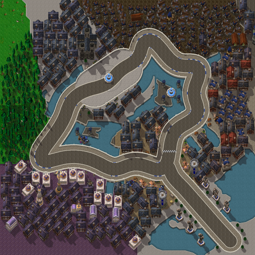

# Stormwind City Circuit (Capital Cities Cup)

The first of the six Capital Cities Cup tracks, by Claude (rendering/UI owner), 2026-10-21, reworked 2026-10-22 from the owner's review. The owner asked for city tracks "with wc3 assets where possible", where "it's important that players recognize where they are", then refined the brief: "we're going for actual paths from the city", along his red line on the in-game Stormwind map. Reviewing the first build, he asked that it "actually look like going over a bridge between the districts", that the course pass right by the Cathedral and skip the square's fountain, and that it "feel like you're driving through stormwind, not that we've forced an actual racetrack onto stormwind". On the mockup he added the Cathedral as Stormwind has it (white stone, golden roofs, the blue carpet up its steps), the street running past the foot of its steps as on his screenshot of the square, and no violet on the road itself.



**Status:** built and checked offline. **NOT RUN in the client:** loading the 2048×2048 scenery (the first texture this large), the follow camera over it, the street walls in a drive (including the edge at the foot of the Cathedral's steps, where no wall is drawn), the track screen's preview, the menu layout and performance. See [the client checklist](../../../tests/MANUAL_CLIENT_CHECKLIST.md).

## The route

The course follows the owner's line, counterclockwise, with the canals on the karts' left most of the lap and the districts on their right:

1. **Valley of Heroes.** The start grid is on the approach between the two lakes, below the heroes' statues; the main gate's towers stand where the approach enters the city.
2. **Trade District.** North up the main street, past the market stalls; the finish line is here.
3. **Over the Old Town bridge.** A straight stone bridge over the canal, then the north-east basin on the left (its island with four guard towers round a fountain) and Old Town's houses, SI:7 and the Pig and Whistle on the right. Gate: *Old Town*.
4. **Dwarven District.** Round the head of the canal, the forges on the right. Gate: *Dwarven District*.
5. **Cathedral Square.** The street comes down from the Dwarven District and runs right along the foot of the Cathedral of Light's steps, Cathedral Square and its fountain across the street on the left, then curves away round the houses toward the Park. Gate: *Cathedral Square*, beyond the curve.
6. **Over the Park bridge** onto the Park bank of the south-west basin, the Park's trees and hedges on the right. Gate: *The Park*.
7. **Mage Quarter.** Round the hairpin and east along the basin, the Mage Quarter's violet domes and the Wizard's Sanctum's spire on the right. Gate: *Mage Quarter*.
8. **Over the Trade District bridge** back into the Trade District, through the gate junction, to the finish. Gate: *Trade District*, the finish line.

Lap: 3,831 world units; approach: 769. Six gates, named for the districts; the HUD names the next one ("Next gate: Old Town").

## How it plays

A street circuit. The road is 112 units wide (`roadRadius` 56, as on Mirage Raceway). Beyond it are20-unit painted kerbside strips. At the owner's direction on2026-10-22, Stormwind v3 retains the full-street setting introduced in v2, `fullSpeedToWalls=true`: those strips have the same speed/grip/drift/boost behavior as the middle, with no off-road slowdown. At `wallRadius`76 from the course's centerline the street ends: the canal parapets, the square's balustrade, house fronts, hedges and the barriers across closed side streets drawn there are wall. The walls are smooth capsule edges, so a kart slides along a curving wall; each contact is a hit and Physics scrubs speed as at any wall. At the foot of the Cathedral's steps the street ends at the same line, though no wall is drawn there: the bottom step is the edge. Nothing is solid inside the street (no plazas, no solids), so the course's centerline never meets a wall. Collision is Lua data in `CapitalCities.lua`; no pixel decides it.

The approach is a dead-end branch: the karts leave it on lap 1 and never return.

## Look

Everything is drawn into one picture from Warcraft III Reforged's classic (SD) art in the owner's install, at one texel per world unit, with the karts' camera lean (heights rise north, 0.6 per unit of height here). A model's body may not cover the street (its shadow may), so a kart is never drawn over a roof.

- **Ground:** Warcraft III terrain tiles on the game's own 32-unit corner grid and transition shapes. Each district has its tileset: Trade District square tiles, Old Town bricks, the Dwarven District's dark marble, Cathedral Square white marble, the Park grass, the Mage Quarter Dalaran's violet tiles, the canal islands cobbles.
- **Street:** each district paves its own street: grey cobbles (Cityscape round tiles) in the Trade District, the Park and the Mage Quarter, Old Town's bricks, the Dwarven District's darker cobbles, Cathedral Square's paler ones, white marble on the Valley approach. The Mage Quarter's violet stays beside the street, never on it. A pale stone kerb, a gutter, square-tiled pavement out to the walls, the walls' shadows and a chequered finish line.
- **Bridges:** three, where the course crosses from one district to the next: each straight, with a slab-paved deck, crenellated parapets pierced by arches over the canal running out on both sides, a lantern-topped post at every corner and the city guard (footmen) at most ends.
- **Walls**, by what lies beyond them: a stone parapet along the canals and along Cathedral Square, low house fronts along the districts, a hedge along the Park, timber barriers across five side streets closed for the race (paved alleys running off between the houses), nothing at the foot of the Cathedral's steps.
- **Cathedral Square:** the Cathedral of Light (×1.68 its Warcraft III size) with its moss-green slate made gold and its dark stone pale and warm, its steps from the street's edge up to the doors with the kingdom's blue carpet and gold edging, two priests on the upper steps and a lamp each side. Across the street the square: white marble with two inlaid rings round the fountain, four lamps, two trees, benches and flower beds, behind the balustrade.
- **Water:** the canal basins and the Valley's lakes, traced from the owner's map, plus canal bands that follow the course; the Reforged water texture, tinted; stone rims; ashlar quay faces below every bank facing the camera, with the bank's shadow.
- **Landmarks:** the Valley's knight and hero statues and the main gate's towers (blue banners), the guard towers on both canal islands, SI:7 (the barracks) and the Pig and Whistle, the Dwarven forges and braziers, the Wizard's Sanctum's spire and an arcane sanctum, Stormwind Keep (the castle) to the north-east, the Park's old trees.
- **Districts:** about 490 generated buildings and props, each district from its own palette, nearest the street first, turned to face it: the Lordaeron city houses with their green slate recolored Stormwind blue (and some red roofs in Old Town), market stalls in the Trade District, Dalaran buildings and violet roofs in the Mage Quarter, forges and workshops in the Dwarven District, trees in the Park; benches, flower beds, crates and carts in the strips the tall buildings must leave. Houses keep off the square.
- **People:** citizens, peasants and the city guard (Warcraft III's villagers, peasant and footman) standing back from the street to watch, from each district's own mix; 594 models are placed in all.

## Files

| File | What |
|---|---|
| `addon/AzerothKart/Assets/Tracks/Stormwind/Background.tga` | 2048×2048 opaque BGRA32, uncompressed, bottom-left origin; 16,777,234 bytes (16 MiB raw pixels: four times Mirage's). |
| `addon/AzerothKart/Assets/Tracks/Stormwind/Preview.tga` | 512×512 (the background reduced 4×) for the track screen; 1,048,594 bytes. |
| `addon/AzerothKart/CapitalCities.lua` | The circuit data, generated. |
| [`stormwind_city-overview.png`](stormwind_city-overview.png) | The preview as PNG, for review. |
| [`stormwind_city-sources.txt`](stormwind_city-sources.txt) | Every Warcraft III model and texture the picture uses, with placement counts. |

SHA-256 values are in [PROGRESS](../../PROGRESS.md) and the handoff for each build.

## Rebuilding

The Warcraft III files are not in this repository. Extract them from a Reforged install with the read-only reader, then build:

```
set W3="C:\Program Files (x86)\Warcraft III"
python scripts/wc3casc.py %W3% models "^war3\.w3mod:(doodads/(cityscape|dalaran|lordaeronsummer|terrain)|buildings/(human|other))/" WC3
python scripts/wc3casc.py %W3% models "^war3\.w3mod:units/(critters/villager(man1?|woman|kid1?)|human/(footman|peasant|priest))/" WC3
python scripts/wc3casc.py %W3% extract "^war3\.w3mod:terrainart/(cityscape|dalaran|lordaeronsummer)/" WC3
python scripts/wc3casc.py %W3% extract "^war3\.w3mod:replaceabletextures/(cliff|lordaerontree|water)/" WC3
python scripts/build_city_tracks.py --wc3 WC3 --preview      # writes the Lua data, pictures and previews
python scripts/build_city_tracks.py --wc3 WC3 --check        # verifies the committed bytes
```

`models` writes each matching model with the textures it names; [the sources list](stormwind_city-sources.txt) names exactly what the picture uses.

Standard library only (Python 3.10+). The output is the same on every Python version: the renderers add float sums left to right (since Python 3.12 the built-in `sum()` compensates float sums, which moved a few texels of the skinned unit models between Python 3.10 and 3.13). A full build renders about 390 model sprites and takes several minutes; `CITY_SPRITE_CACHE=<folder>` keeps rendered sprites between runs (identical output; the key's version, now `sprite-v3`, changes when rendering does). The layout is data in `scripts/city_layouts.py`: the route (traced map points), canal arcs and bridges, paving sections and closed side streets, gates, districts and their palettes, landmarks (a landmark can stand facing the course at a loop arc, `front`), the Cathedral's steps and the square beside the street. `build_city_tracks.py` validates it before painting: every gate spans the street wall to wall and guards one stretch; separate stretches keep a wall between them; the spawn is on the road; solids stand inside the street, clear of the paving unless on a plaza; the street stays inside the world; no landmark covers the street.

## Provenance and rights

Source: Blizzard Entertainment's Warcraft III: Reforged, build 3.0.1.24371, from the owner's own install (`C:\Program Files (x86)\Warcraft III`), read by `scripts/wc3casc.py` without modifying it. Used under [ADR 0009](../../adr/0009-warcraft-iii-asset-reuse.md) (Warcraft III art is an accepted project source by the owner's direction). Modifications: models posed and rendered as sprites with a fixed light, ground shadows and the karts' camera lean; some textures' hues moved (green and red slate to blue or violet; the Cathedral's slate to gold, its grey stone brightened), some districts tinted; terrain atlases halved to one texel per world unit and shaded; the Cathedral's steps, the bridges' decks and parapets, kerbs and walls painted by the generator; everything composited into one picture. Author: Blizzard Entertainment. **Redistribution rights are not established** and stay open for release review, as for every Warcraft III file in this project. The route was traced by hand on the owner's screenshot of the in-game map; the canal outlines with an offline tracing aid (low-saturation map texels), then simplified. The owner's screenshots are not stored.

## Painted wall alignment (2026-10-22)

An owner screenshot exposed an invisible collision wedge at the Park/Mage corner. Version3 measures14-unit centre clearance from the exposed painted capsule union; shrinking each capsule independently had incorrectly removed paved space at concave joins. The offline generator now adds exposed analytic boundary junctions (`scripts/circuit_boundary.py`) from the same rounded runtime geometry, with no art rebuild. Both the reported corner and straight-wall clearance have focused regressions; native retest is pending `/reload`. The existing endpoint-based street solver now also selects reachable slide candidates before rejecting an overlong projection.
