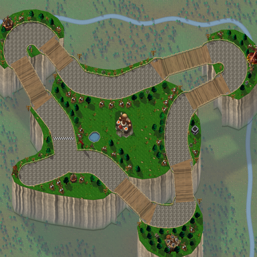
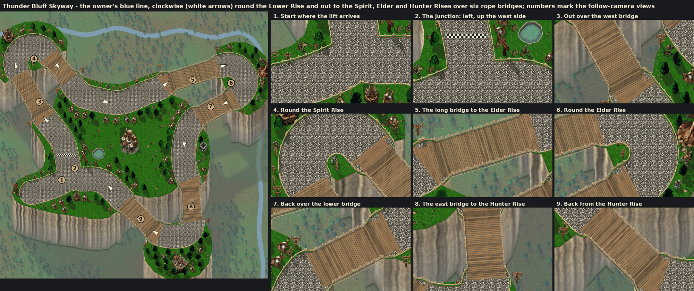

# Thunder Bluff Skyway (Capital Cities Cup)

The sixth and final Capital Cities Cup track, by Claude (rendering/UI owner), 2026-10-25, on the pipeline built for [Stormwind](stormwind.md), [Ironforge](ironforge.md), [Orgrimmar](orgrimmar.md), [Darnassus](darnassus.md) and [Undercity](undercity.md).

The owner sent his in-game Thunder Bluff map with a blue line and three screenshots: the mesas' rope bridges over the drop, a mesa top with tents and a white stone path, and a stone path edged with wooden posts and sagging rope. He wrote: "Thunderbluff - the final map in the capital cities cup. As you can see - plank roped bridges, long way down, white stone paths, if you can - make the road edges like these poles with ropes."



**Status:** proposed on `claude/thunder-bluff` for Codex review and integration. It is selectable in this branch. Thunder Bluff's scores save locally, but sharing them needs Codex's score-sync change described in [the handoff](../../handoffs/claude-latest.md#needs-codex-score-sync-learns-thunder-bluff). **NOT RUN in the client:** the drive, the look in the follow camera, performance. See [the client checklist](../../../tests/MANUAL_CLIENT_CHECKLIST.md).



## The route

The owner marked no direction. His stroke runs from the start road straight on up the Lower Rise's west side, and it closes the loop where it began, at his X. So the course runs **clockwise**. Reversing it is a one-line change in the layout.

The route is traced from his line on his 1055×794 screenshot (world = map pixels × 3.0). The rises' turns are widened so a kart can turn on them.

1. **The lift.** The start grid is on the road in from the west, where the lift arrives, at his X.
2. **Up the west side.** At the junction the road bears left, north up the Lower Rise's west side, and crosses the finish line. A start sign stands in the junction's corner. Gate: *The Lift*, the finish line.
3. **The Spirit Rise.** Out over the west bridge (366 units over the drop) and round the Spirit Rise's hairpin, then back over the north bridge (210). Gate: *Spirit Rise*.
4. **The north side.** East along the Lower Rise's north side. Gate: *Lower Rise*.
5. **The Elder Rise.** Out along the long bridge (408 over the drop) and round the Elder Rise, past Cairne's lodge. Back over the lower bridge (294). Gate: *Elder Rise*.
6. **The east side.** South down the Lower Rise's east side, past the wind riders' roost. Gate: *Wind Rider Roost*.
7. **The Hunter Rise.** Over the east bridge (283) and across the Hunter Rise, past the hunters' hall. Back over the south-west bridge (327). Gate: *Hunter Rise*.
8. **The south side,** west to the junction, then round onto the next lap.

| Measure | Value |
|---|---|
| Lap | 5,616 world units |
| Approach | 285 units; the grid is 200 along it |
| Gates | six, named for the rises and the lift |
| Bridges | six; 2,080 units of deck, 1,888 of them over the drop (about a third of the lap) |

## How it plays

The shared street circuit:

- a 112-unit road (`roadRadius` 56) and the kart centre's reach of 76 units (`wallRadius`);
- full grip to the walls (`fullSpeedToWalls`);
- the exposed-wall clearance (`wallClearance` 14, 1,120 generated junctions);
- no plazas or solids.

**The bridges are narrower** than the street: each deck is one reviewed `narrows`, with a wall radius of 54. The kart centre keeps 54 units either side of the line, and the deck is 136 units between its ropes against the street's 180. The narrows cover the whole deck, which runs 16 units onto the rock at either end, so the street steps in where its planks begin.

Collision comes from analytic Lua data in `CapitalCities.lua`, never a pixel. The drop is painted: a kart cannot fall, and the whole course is on one level, so it carries no heights.

## Look

The mesas over Mulgore, in Warcraft III's summer, Barrens and village art.

- **The drop.** Everything off the mesas (`chasm.mesas`, traced round the course) falls 400 units to the plain. From the karts' camera a point that deep shows 240 rows further south, so each mesa's southern edge hangs a cliff face that tall over the drop.
  - **Faces:** pale sandstone in rain-worn columns that wander down the face, with clefts between them and faint bands. The Lordaeron cliff's strata add detail. The faces are shaded, since the sun is behind the mesas, and lighter where they turn toward it. They grow hazier toward the foot, which fades into the plain. The turf overhangs every brink.
  - **The plain:** Mulgore's grass far below, at half the texture's size. It is hazy, with the mesas' long, soft shadows thrown south-east across it and the bridges' shadows the whole drop away. Small pines grow in woods, and a river winds across the north and down the east.
  - **Rims:** a rocky rim darker toward every edge, and a lit lip where a mesa's top meets a drop to its north.
- **White stone paths.** The village set's cobbles, whitened, are laid from wall to wall.
- **Poles with ropes.** Every street edge is a rope fence. On the rock, posts stand every 34 units with one thick rope sagging between them. On the bridges, taller posts stand every 30 units with a hand rope and a lower rope.
- **Plank rope bridges.** Single boards are laid square to each bridge, each its own shade of weathered wood. The drop shows between them. Under each deck's southern edge show the planks' ends and a beam. Each bridge hangs from a rope along its southern side, sagging under the deck toward mid-span, with the deck tied to it every few strides. A tall totem stands at the bridges' corners.
- **Districts:** tauren tents, totems, fire pits, hitching posts, Lordaeron pines; tauren, spirit walkers and kodos.
- **Landmarks:**
  - the Lower Rise: the great tauren totem at its heart and a pool;
  - the lift: a timber tower at the start road's end;
  - the east side: the wind riders' roost and a wind rider;
  - the Spirit Rise: its lodge and a spirit walker;
  - the Elder Rise: Cairne Bloodhoof before his lodge;
  - the Hunter Rise: the hunters' hall and a kodo.
- **Start sign:** the goblin racing arrow post, as on the other cities that start off the loop. It stands in the junction's corner beyond the walls, pointing north-west: bear left, up the west side.

A model's ground shadow is left off the drop, so a totem at the brink does not shade the far face.

## Files

| File | What |
|---|---|
| `addon/AzerothKart/Assets/Tracks/ThunderBluff/Background.tga` | 2048×2048 opaque BGRA32, uncompressed, bottom-left origin; 16,777,234 bytes. |
| `addon/AzerothKart/Assets/Tracks/ThunderBluff/Preview.tga` | 512×512 (the background reduced 4×) for the track screen; 1,048,594 bytes. |
| `addon/AzerothKart/CapitalCities.lua` | The circuit data (with the other cities'), generated, with the six bridges' `narrows`. |
| [`thunder_bluff_skyway-overview.png`](thunder_bluff_skyway-overview.png) | The preview as PNG, for review. |
| [`thunder_bluff_skyway-sources.txt`](thunder_bluff_skyway-sources.txt) | Every Warcraft III model and texture the picture uses, with placement counts. |
| [`thunder_bluff_skyway-review.png`](thunder_bluff_skyway-review.png) | The loop with its direction and nine follow-camera views, as sent to the owner. |

## Rebuilding

Extract the earlier cities' files ([Stormwind](stormwind.md#rebuilding), [Ironforge](ironforge.md#rebuilding), [Orgrimmar](orgrimmar.md#rebuilding), [Darnassus](darnassus.md#rebuilding), [Undercity](undercity.md)), then Thunder Bluff's:

```
python scripts/wc3casc.py %W3% models "^war3\.w3mod:(buildings/other/(taurentent|taurentent2|wyverncage|chieftainhut)/[^/]+\.mdx|buildings/orc/(taurentotem|spiritlodge|beastiary|watchtower)/[^/]+\.mdx|doodads/barrens/props/(taurentotem|barrens_bones)/[^/]+\.mdx|doodads/northrend/props/firepit/firepit\.mdx|doodads/lordaeronsummer/props/(hay|hitchingpost)/[^/]+\.mdx|doodads/terrain/lordaerontree/lordaerontree[0-9]\.mdx|units/orc/(tauren|spiritwalker|kotobeastnorider|riderlesswyvern|herotaurenchieftain)/[^/]+\.mdx)$" WC3
python scripts/wc3casc.py %W3% extract "^war3\.w3mod:(terrainart/(village|lordaeronsummer|barrens)/|replaceabletextures/(lordaerontree|water)/)" WC3
python scripts/build_city_tracks.py --wc3 WC3 --preview --city thunder_bluff_skyway
python scripts/build_city_tracks.py --wc3 WC3 --check
```

The layout is `THUNDER_BLUFF` in `scripts/city_layouts.py`:

- the route, built from the traced runs, the bridges' straights and the rises' exact turns;
- the start road, gates, districts and palettes;
- the mesas' outlines, crossing each bridge square at its end;
- the bridges and their `narrows`;
- the `chasm` (depth, plain, faces, haze, shadows, trees, river, the ropes the bridges hang from);
- the `rope_fence`;
- the landmarks.

The painter's chasm layer (`chasm_land`, `paint_chasm` in `scripts/city_paint.py`), the rope-plank deck (`rope_plank`) and the rope fence (`_rope_column`) are opt-in: a city without `chasm` or `rope_fence` paints byte for byte as before. All five earlier cities were rebuilt with `--check` and are unchanged.

## Provenance and rights

**Source:** Blizzard Entertainment's Warcraft III: Reforged, build 3.0.1.24371, from the owner's own install. `scripts/wc3casc.py` read it without modifying it. The files are used under [ADR 0009](../../adr/0009-warcraft-iii-asset-reuse.md).

**Modifications**, as for the earlier cities:

- models posed and rendered as sprites with the project's light, shadows and lean, their shadows kept off the drop;
- terrain atlases halved, shaded and desaturated: the summer grass warmed to Mulgore's gold-green, the village cobbles whitened, the plain drawn at half size and hazed;
- the Lordaeron cliff's strata as detail in procedurally shaded sandstone faces;
- the plain's shadows, trees and river, the bridges' planks, beams and hanging ropes, the rope fences, rims and brinks painted by the generator;
- everything composited into one picture.

**Author:** Blizzard Entertainment. **Redistribution rights are not established** and stay open for release review.

The route was traced from the owner's blue line on his screenshot of the in-game map. The mesas' outlines were drawn round the course, guided by the map. The screenshots are not stored.
