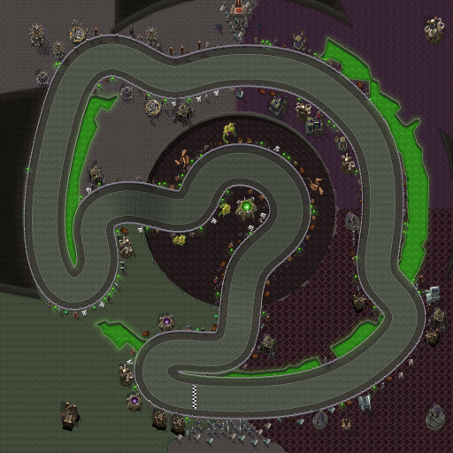
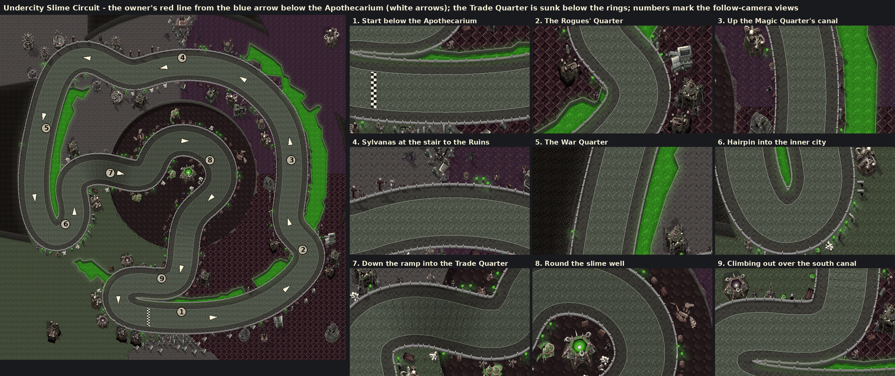

# Undercity Slime Circuit (Capital Cities Cup)

The fifth Capital Cities Cup track, by Claude (rendering/UI owner), 2026-10-23, on the city pipeline ([Stormwind](stormwind.md), [Ironforge](ironforge.md), [Orgrimmar](orgrimmar.md), [Darnassus](darnassus.md)). The owner sent it with Darnassus: his in-game Undercity map with a red route and a blue arrow, and "start at blue line in apothecarium". His arrow lies on the route's southern stretch below the Apothecarium, pointing east. Undercity is the second city painted on more than one level ([ADR 0015](../../adr/0015-track-elevation.md), proposed): its Trade Quarter is sunk below the rings round it.



**Status:** built and checked offline; selectable on the track screen (proposed on `claude/darnassus-undercity`, not yet reviewed or installed). **NOT RUN in the client:** the drive, the look in the follow camera, performance. See [the client checklist](../../../tests/MANUAL_CLIENT_CHECKLIST.md).



## The route

His red line, traced on his 717×734 screenshot (world = map pixels × 3.8), never crosses itself:

1. **The start.** No approach road: the grid is on the loop itself, on the Canals' southern stretch below the Apothecarium where his arrow points, facing east; the finish line is 131 units behind it.
2. **The Rogues' Quarter.** East along the canal and north round the quarter's hall. Gate: *Rogues' Quarter*.
3. **The Magic Quarter.** North up the outer ring beside the Magic Quarter's long canal. Gate: *Magic Quarter*.
4. **Under the Ruins.** West along the north of the ring past the stair up to the Ruins of Lordaeron, where Sylvanas stands before the old throne.
5. **The War Quarter.** South down the outer ring's west side. Gate: *War Quarter*.
6. **The hairpin.** Round the end of the War Quarter's canal and back north inside it, then east and down the ramp into the sunken Trade Quarter.
7. **The Trade Quarter.** Clockwise round its slime well. Gate: *Trade Quarter*.
8. **Out to the south.** Up the ramp out of the Trade Quarter, west along the inner side of the southern canal, round its end and onto the start straight. Gate: *Apothecarium*, the finish line.

Lap: 7,327 world units (the longest city); five gates, named for the quarters.

## How it plays

The shared street circuit: a 112-unit road (`roadRadius` 56), the kart centre's reach of 76 units (`wallRadius`), full grip to the walls (`fullSpeedToWalls`), the exposed-wall clearance (`wallClearance` 14, 1,721 generated junctions). No plazas, solids, narrows or branches: like Mirage Raceway, the spawn lies on the loop (`branches={}`, which `Circuit.new` already accepts). Collision comes from analytic Lua data in `CapitalCities.lua`. The ramps are painted: the karts drive them flat (slopes you can feel are [proposed](../../API_CONTRACTS.md#proposed-track-elevation-claude-2026-10-23-for-codex-review)).

## Look

The Forsaken's city under the Ruins of Lordaeron, in Warcraft III's Dalaran-ruins, Dungeon and Black Citadel tiles and the Scourge's buildings made Forsaken:

- **Floors:** each quarter in its own stone, as the map colours them: grey bricks in the War Quarter (north-west), violet tiles in the Magic Quarter (north-east), dark marble in the Rogues' Quarter (south-east), green-grey slabs in the Apothecarium (south-west). The district borders follow the Trade Quarter's wall.
- **The Trade Quarter:** a round hall of dark octagonal tiles sunk 30 below the rings, drawn exactly to its wall: the wall's dressed stone shows round its north side, its brink is lit round the south, the rings' shadow falls into it, and the hall is darker than the rings. The course ramps down into it from the west (up to 14%) and climbs out to the south (up to 15.9%), each ramp lit by its slope with its paving joints across it. A sacrificial pit filled with slime at its heart.
- **The canals:** the map's green slime, traced and simplified: the Dungeon's lava texture made a glowing green ooze with stone quays, lighting the stone round it.
- **Street:** pale green-grey slabs with brick shoulders to an iron railing, a spike every 22 units; braziers burning green along it.
- **Rock:** beyond the round city and the quarters' halls, dark earth with walls of dressed stone where it rises north of the floor.
- **Districts:** the Scourge's buildings with their red fires made the Forsaken's green (crypts, graveyards, temples of the damned, tombs of relics, slaughterhouses, boneyards, altars of darkness, gargoyle spires, ziggurats), Northrend crypts and goblin merchants; graves and tombstones, iron maidens, torture tables, chain posts, cages, cauldrons, bookshelves, tables, crystal lamps, sewer vents, junk, weapon racks, skulls; acolytes, ghouls, necromancers, skeletons, skeletal mages, banshees and rats.
- **Landmarks:** the slime well, Sylvanas and two banshees before Lordaeron's throne at the stair to the Ruins, a slaughterhouse, a temple of the damned, a graveyard and an altar of darkness in the quarters' halls, an obsidian statue in the Rogues' Quarter.

## Files

| File | What |
|---|---|
| `addon/AzerothKart/Assets/Tracks/Undercity/Background.tga` | 2048×2048 opaque BGRA32, uncompressed, bottom-left origin; 16,777,234 bytes. |
| `addon/AzerothKart/Assets/Tracks/Undercity/Preview.tga` | 512×512 (the background reduced 4×) for the track screen; 1,048,594 bytes. |
| `addon/AzerothKart/CapitalCities.lua` | The circuit data (with the other cities'), generated; with its proposed `elevation` heights. |
| [`undercity_slime-overview.png`](undercity_slime-overview.png) | The preview as PNG, for review. |
| [`undercity_slime-sources.txt`](undercity_slime-sources.txt) | Every Warcraft III model and texture the picture uses, with placement counts. |
| [`undercity_slime-review.png`](undercity_slime-review.png) | The loop with its direction and nine follow-camera views, as sent to the owner. |

## Rebuilding

Extract the earlier cities' files, then Undercity's:

```
python scripts/wc3casc.py %W3% models "^war3\.w3mod:(buildings/undead/[^/]+/[^/]+\.mdx|units/undead/[^/]+/[^/]+\.mdx|units/critters/rat/rat\.mdx|doodads/dungeon/props/.*\.mdx|doodads/northrend/(props|structures)/.*\.mdx|doodads/cityscape/props/(throne|citygrave|crystallamp)/.*\.mdx|doodads/lordaeronsummer/props/(grave|cage|cauldronwithheads|skullpile|ribbones|weapons|armorrack|brazier)/.*\.mdx|buildings/other/(merchant|barrelsunit|boxunit)/[^/]+\.mdx)$" WC3
python scripts/wc3casc.py %W3% extract "^war3\.w3mod:terrainart/(dungeon|dungeon2|dalaranruins|blackcitadel)/" WC3
python scripts/build_city_tracks.py --wc3 WC3 --preview --city undercity_slime
python scripts/build_city_tracks.py --wc3 WC3 --check
```

The layout is `UNDERCITY` in `scripts/city_layouts.py`: the route, the spawn on the loop, gates, the canals, districts and palettes, the floors, the landmarks and the `elevation` (the sunken Trade Quarter and the street's ramps). New painter options, optional per city (the other cities' bytes are unchanged): `water_tile` (a liquid drawn from a terrain tile instead of the water texture), `water_glow` (glowing water lights the stone round it, as lava does) and `elevation` ([ADR 0015](../../adr/0015-track-elevation.md)).

## Provenance and rights

Source: Blizzard Entertainment's Warcraft III: Reforged, build 3.0.1.24371, from the owner's own install, read by `scripts/wc3casc.py` without modifying it; used under [ADR 0009](../../adr/0009-warcraft-iii-asset-reuse.md). Modifications as for the earlier cities: models posed and rendered as sprites with the project's light, shadows and lean, in a Forsaken violet team colour; the Scourge buildings' red fires and the braziers' flames recoloured green, the slime well's pool in a green team colour; terrain atlases halved, shaded and desaturated; the Dungeon's lava tinted into slime; walls, quays, railings, shadows and ramps painted by the generator; everything composited into one picture. Author: Blizzard Entertainment. **Redistribution rights are not established** and stay open for release review. The route was traced from the owner's red line on his screenshot of the in-game map; the canals from its green; the floors and levels placed by hand. The screenshots are not stored.
