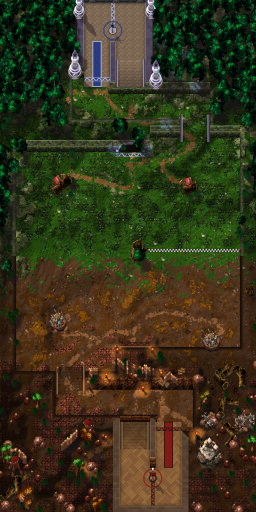
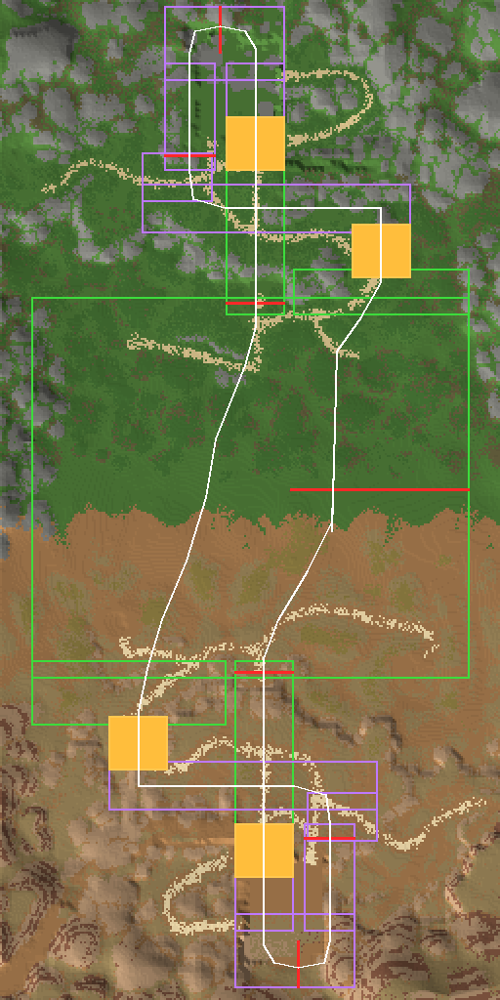
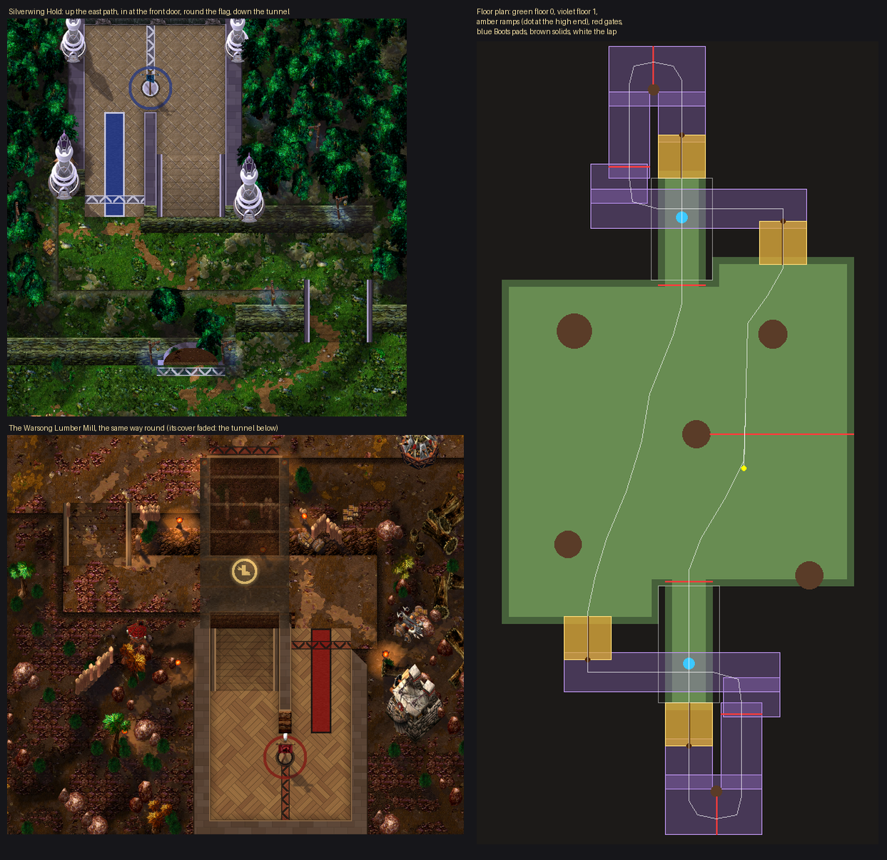

# Warsong Gulch (Battlegrounds Cup)

The Battlegrounds Cup's first course and the first on **two floors**, built on Codex's [LayeredTrack](../../LAYERED_TRACKS.md) ([ADR 0022](../../adr/0022-floors-and-boost-pads.md)), by Claude (rendering/UI owner), laid out on the real gulch measured from the owner's own World of Warcraft client. **Version 3** (2026-10-28, `claude/warsong-v3`) drives both bases the way a flag carrier runs the Horde's: up the outside ramp, in at the front door, round the flag, out down the tunnel. Three laps, a loop round mid.



**Status: built on `claude/warsong-v3`, not installed.** Version 2 is installed (Codex `5871f06`); version 3 replaces its geometry (trackVersion 3, so its scores start a new board) and its pictures. **NOT RUN in the client:** the look, the covers and their fades, the arrow, the gate glow, the drive, a two-player race.

## Why version 3

The owner drove version 2 and corrected its Horde side with screenshots of the real Lumber Mill (its outside ramp, graveyard, lobby, flag room, balcony and tunnel): **"Not entirely correct - see the images for how the horde side looks. outside ramp goes into lobby into flag room into tunnel down to mid".** Version 2 had gone in by the Horde's tunnel and out by a side door and a slope.

What the game files show:

- **The Lumber Mill** (the building `ctforc_a.wmo`, its parts named by the client): the flag room (`Flagroom`) with the flag in a niche on its south wall; the lobby (`middleinterior`) north-east of it, its ramp up to the upper floor; the front door (`lowerhallway`) north out of the lobby onto the plateau, the graveyard's stones beside it; the tunnel (`tunnel`) from the flag room's north-west corner straight north under the plateau, down 24 yards to its mouth on the field.
- **The only way onto the Horde's plateau but the tunnel is the west path,** the outside ramp: walking the client's walkable surfaces from the field (the terrain and the buildings' collision, 0.5-yard cells), every way to the graveyard or the front door climbs it, then runs east along the plateau over the tunnel. The Alliance's outside ramp is the east path: the gulch turns into itself half a circle about its middle, the flags into each other exactly.

So the lap could either keep the Alliance side as it was (in by its tunnel, out by its front door and east path), crossing itself at mid on the way to the Horde's west path, or run both bases the same way. Shown both, the owner chose **both bases the same way**.

| | Version 2 | Version 3 |
|---|---|---|
| **The Horde's base** | In by the tunnel; out by a side door in the west wall and a slope below the west tower | Up the west path onto the plateau, east over the tunnel to the front yard by the graveyard, in at the front door, down the lobby, round the flag, out down the tunnel |
| **The Alliance's base** | In by the tunnel; out by the front door and the east path | Up the east path, west over the tunnel, in at the front door, up the lobby, round the flag, out down the tunnel: the same rooms, driven the other way |
| **Floors** | Two at Silverwing Hold only | Two at both bases: each plateau crosses its tunnel; each base stands on floor 1 and its tunnel climbs to it |
| **Mid** | An open field, the finish across it | Mid's stumps (solid), the lap passing them on either side; the finish from the stumps to the field's east wall; the grid east of mid |
| **The arrow** | Aims where the kart can drive straight | The same, with 3 units to spare either side (a line that only grazed a corner was taken as clear) |
| **The covers** | Fade on the ground only | Also on a ramp toward the tunnel: driving down a climb, the cover ahead fades before the kart drops below it |

## Why version 2

The owner drove version 1 and wrote: "it was an honorable attempt, you did good - but it's not really driveable - I mean you can drive, and try to follow the arrow, but it's not really intuitive unfortunately. I think you should inspect the actual warsong gulch in the game files or something to figure this out. Not only is the map difficult to navigate the way you've made it, the way you've made it is good - close - but not close enough unfortunately."

Asked what confused him, he named all four:

| What confused him | Version 2 (and 3) |
|---|---|
| **The arrow pointed through walls** | The arrow follows the reviewed route, aiming at the farthest point up to 110 units along it that the kart can drive to in a straight line, so it bends round corners with the way (`Presentation.guideHeading`, `Courses.route`). |
| **He could not see under the roofs** | No roof stands over a base: both are drawn open, their floors in sight. The only covers are the ground over each tunnel, which start to fade 32 units before the tunnel. |
| **Too many rooms and doors** | Each base is one way through: one way in, the flag room, one way out. No optional way in. |
| **Unclear checkpoints** | Seven gates at obvious places (each base's front door, its flag, its tunnel's mouth; mid), each painted as a threshold with chevrons in its side's colours; the next one is drawn wide and pulses. |

## How it was made

`scripts/wow_map_survey.py` measures the battleground (map `PVPZone03`) from the owner's client files, read without modification by `scripts/wowcasc.py` (`--product` picks the client's installed product): each ground texture's weight and the terrain's height every four units, and every doodad's and building's place, turn and size. The numbers are in `scripts/warsong_gulch_survey.json`; no client file is copied. The course's world is the battleground's own ground at three units to the yard (a placement at (px, pz) yards stands at X = (px − 15430) × 3, Y = (16182 − pz) × 3).

The lap was walked on the client's own walkable surfaces (the terrain and the buildings' collision, 0.5-yard cells), and the bases' floors read from their buildings' parts. The rooms follow those walks and the walkable ground round them, widened for karts: a tunnel 13 yards wide in the game is 120 units here (40 yards). The huts, mid's stumps, the tunnels' mouths, the bases, the outside ramps, the paths and the scenery keep their places. The Lumber Mill's floors are Silverwing Hold's turned half a circle (`mirror()` in the layout) about the flags' middle, set on the Horde's tunnel; the real paths run where they do.



*The tracing: the client's ground textures as flat colours and its relief (the paths are the light trails), with the version 3 rooms (floor 0 green, floor 1 violet), ramps (amber), gates (red) and lap (white).*

## The course



**One lap,** from the grid east of mid:

1. **North up the field's east side,** west of the Alliance's east hut, to the foot of the east path in the field's north-east corner.
2. **Up the east path** (a ramp) onto the plateau, floor 1, and **west along it**, right over the Alliance tunnel, to the front yard.
3. **In at the front door:** gate *Alliance front door*. **Up the lobby** on its blue runner into the flag room.
4. **Round the flag:** the Alliance flag stands on its dais at the end of the wall between the lobby and the tunnel's top. Round it to the east: gate *Alliance flag*, from the flag to the north wall.
5. **Down the tunnel's climb** (floor 0) and the tunnel under the plateau (its cover fades ahead; the Boots glow under the plateau), **out of its arch** in the middle of the field's north cliff: gate *Alliance tunnel*.
6. **South-west down the field's west side,** west of mid's stumps and east of the Horde's west hut, to the foot of the west path in the field's south-west corner.
7. **Up the west path** onto the Horde's plateau and **east along it** over the Horde tunnel to the front yard, the graveyard's stones beside it; **in at the front door:** gate *Horde front door*. **Down the lobby** on its red runner.
8. **Round the flag** to the west: gate *Horde flag*, from the south wall to the flag.
9. **Down the climb** and the tunnel under the plateau (the Boots), **out of its mouth** in the middle of the field's south wall: gate *Horde tunnel*.
10. **North-east to the finish:** gate *Mid*, a chequered band from mid's stumps to the field's east wall.

| Measure | Value |
|---|---|
| World | 1024 × 2048 units (one texel per unit), the gulch at three units to the yard |
| Floors | 0: the field and its two corners, the two tunnels (5 rooms); 1: at each base its plateau, front yard, lobby, flag room and tunnel top (10 rooms) |
| Ramps | 4: each base's outside ramp (the east path, the west path) and its tunnel's climb |
| Gates | 7: *Alliance front door*, *Alliance flag* (floor 1), *Alliance tunnel*, *Horde front door*, *Horde flag* (floor 1), *Horde tunnel*, *Mid* (the finish) |
| Boots | 2, one in each tunnel under its plateau: radius 14, 78 ticks of boost |
| Solids | 7 round: the two flags (radius 14, each capping its wall), mid's stumps (35) and the four huts at the client's places |
| Covers | 2: the ground over each tunnel |
| A lap | about 4,900 units along the reviewed route |

## How it plays

`LayeredTrack.new` builds it from the generated `Battlegrounds.lua`; the rules are Codex's ([LAYERED_TRACKS](../../LAYERED_TRACKS.md)).

- **Two floors at both bases.** Each base stands on floor 1 with its plateau, which crosses over its tunnel (floor 0); a kart reaches floor 1 only up the outside ramp and leaves it only down the tunnel's climb.
- **The flags.** Each flag is a round solid at the end of the wall between its base's lobby and tunnel top; nothing passes between the flag and the wall, and its gate runs from the flag to the far wall, so rounding the flag the lap's way takes it and nothing else does.
- **Mid's stumps** stand solid in the middle of the field: the lap passes them on the east going north and on the west going south, and the finish runs from them to the east wall, so the run south never crosses it.
- **The Boots.** Driving into a pad on its floor gives a tier-2 boost once; leaving re-arms it.
- **Full grip everywhere,** Physics 13 (floors and pads), its own board (trackVersion 3). Collision comes from the generated data, never from a pixel.

## Rendering

All of it reads the simulation's copied state and writes none of it.

- **Two pictures, one world.** The painter makes the battleground from above (UPPER) and, under each cover, the tunnel beneath (LOWER). `Background.tga` is UPPER with LOWER under the covers; `Roofs.tga` is UPPER within the covers' footprints, clear elsewhere: cover and ground (and the plateau over the tunnel) are one picture, so they always meet. The Alliance tunnel's arch is clear in `Roofs.tga`: a kart in its mouth is seen through it.
- **Two covers.** Each is one pooled texture (of four), cropped from `Roofs.tga` as the camera moves, drawn over the karts on the ground and under the karts on floor 1 or a ramp. It starts to fade 32 units before its tunnel and is down to a quarter 24 units in (`Presentation.roofAlpha`), for a kart on the ground or on a ramp (driving down a climb, the cover ahead fades before the kart drops below it); it stays whole under a kart on floor 1 off the ramps (`Presentation.onRamp`). A friend in a tunnel the player is not in is hidden by its cover. If `Roofs.tga` does not load the course is refused, as before.
- **The guiding arrow** follows the reviewed route (`Courses.route`: its points and, per gate, the point it drives to as it crosses that gate, `routeGates` in `Battlegrounds.lua`), looked for between the previous gate's crossing and the next's: up the west path it points east along the plateau, not across its edge at the front door. It aims at the farthest point up to 110 units along the route that the kart could drive to in a straight line on its floor, with 3 units to spare either side, so round a bend it points down the way first. From every step of the reviewed lap, a straight run along the arrow to its point meets no wall (`test_warsong`).
- **The next gate** (`UI.glowGate`): its marker is drawn ten units wide and pulses between 0.55 and 1 opacity (`Presentation.gateGlow`). No new texture: the gate markers are the existing pool. Budget unchanged: 91 frames, 96 textures, 151 font strings.

## Look

- **The ground is the gulch's own.** Every texel takes the Warcraft III tile standing for one of the client's eleven ground textures (Kalidar ferns as Ashenvale grass, its rock as Ashenvale rock, the roads as Lordaeron dirt and Barrens desert, the Barrens' dirt, grey grass and rock as theirs), picked by the measured weights against smooth noise, so each keeps its share with a ragged edge; the paths drawn bolder than measured. The measured relief shades it all.
- **Floors and edges.** Outdoor floors keep the ground; beside them a band of the side's rock, dark at the drop, the ground beyond darkening with distance; where the camera sees a floor's north edge, a cliff face in the side's strata (each plateau's north edge rises over the field below it). Each base's floors lie between thick walls (Silverwing Hold's violet stone, the Mill's timber), their north walls' faces in view.
- **Silverwing Hold:** pale square tiles, a blue runner up the lobby, the tunnel's climb with treads and kerbs, four Silvermoon towers (their teal and gold made violet and silver) at its corners, the Human banner (Alliance blue) on a stone dais ringed in blue.
- **The Warsong Lumber Mill:** plank floors, a red runner down the lobby, its climb with treads and kerbs, the orc war mill east of the lobby, its watch towers (one below the plateau), the Orc banner (Horde red) on its dais; the graveyard's stones by the front yard.
- **The tunnels:** dark dirt between timber frames every 48 units, timber-lined walls; the Alliance's arch in the cliff with blue lanterns either side, the Horde's timber lintel with braziers.
- **Mid:** a hollow Ashenvale stump, the stumps the client's map stands there.
- **The client's scenery** where its map has it, as the Warcraft III model that stands for each kind: trees, bushes, stumps, logs, palisade stakes, lanterns and braziers (with their pools of light), catapults, barrels, crates, tents and watch towers; any that would stand on a floor in view, across a cover's edge or in a base's walls is left out. The client draws the woods on the Alliance's hills as one canopy: there, Ashenvale trees every 44 units; on the Horde's hills, dry bushes and rocks.
- **Marks on the floor:** the gates' thresholds (white and blue for the Alliance, red and black for the Horde, chevrons pointing the way), the flags' daises, the Boots, the chequered finish.

## Files

| File | What |
|---|---|
| `addon/AzerothKart/Battlegrounds.lua` | The course's data (generated): rooms with their floor, ramps, gates, Boots, spawn, solids, laps, the covers with the boxes below each, the reviewed route and `routeGates`. |
| `addon/AzerothKart/Assets/Tracks/WarsongGulch/Background.tga` | UPPER with LOWER under the covers: 1024×2048 BGRA32, opaque; 8,388,626 bytes. |
| `addon/AzerothKart/Assets/Tracks/WarsongGulch/Roofs.tga` | The covers: 1024×2048 BGRA32 with alpha; 8,388,626 bytes. |
| `addon/AzerothKart/Assets/Tracks/WarsongGulch/Preview.tga` | UPPER, reduced 4× (256×512), for the track screen; 524,306 bytes. |
| `addon/AzerothKart/Assets/UI/GuideArrow.tga` | The arrow's 16 headings (unchanged; original). |
| `scripts/warsong_gulch_survey.json` | The survey's numbers (ground weights, relief, placements). |
| [`warsong_gulch-overview.png`](warsong_gulch-overview.png) | The preview as PNG, for review. |
| [`warsong_gulch-sources.txt`](warsong_gulch-sources.txt) | Every Warcraft III model and texture the pictures use, with placement counts. |
| [`warsong_gulch-review.png`](warsong_gulch-review.png) | Silverwing Hold, the Lumber Mill with its tunnel seen through the faded cover, and the floor plan. |
| [`warsong_gulch-route-sketch.png`](warsong_gulch-route-sketch.png) | The tracing: the survey's ground and relief with the rooms, gates and lap; a design reference, not shipped. |

## Rebuilding

The survey (once, with the client; its output is checked in):

```
python scripts/wowcasc.py "%WOW%" extract WOW <FileDataIDs of world/maps/pvpzone03/*> --product wow_classic_beta
python scripts/wow_map_survey.py WOW community-listfile.csv scripts/warsong_gulch_survey.json
```

The pictures need these Warcraft III files, then build:

```
python scripts/wc3casc.py %W3% extract "^war3\.w3mod:(buildings/(orc/(trollburrow|warmill|watchtower)|other/(furbolghut2?|tent|barrelsunit))/|units/orc/catapult/|doodads/(ashenvale/(plants/ashenbush0|props/(ashenhollowstump|ashenlogstraight))|barrens/rocks/barrens_rocks|lordaeronsummer/(props/(bannerhuman|bannerorc|brazier|lanternpost)|terrain/crates)|silvermoon/structures/silvermoontowerdoodadsmedium|terrain/(ashentree|barrenstree))/|_de\.w3mod:doodads/lordaeronsummer/structures/palisade/)" WC3
python scripts/wc3casc.py %W3% extract "^war3\.w3mod:(terrainart/(ashenvale|barrens|ruins|cityscape|lordaeronsummer)/|replaceabletextures/(ashenvaletree|barrenstree)/|textures/)" WC3
python scripts/build_battlegrounds.py --wc3 WC3 --preview
python scripts/build_battlegrounds.py --wc3 WC3 --check
```

`--geometry-only` writes only `Battlegrounds.lua`; `--schematic OUT.png` (with Pillow) draws a floor plan.

- **`scripts/battleground_layouts.py`:** the layout (rooms, ramps, gates, flags, Boots, covers, route; the Lumber Mill's floors are Silverwing Hold's turned by `mirror()`), the painting data (the client's ground textures as Warcraft III tiles, each side's styles, the tunnels' mouths) and the scenery: by hand (mid's stumps, the huts, the banners, the towers, the war mill, the mouths' lamps) and from the survey (`_dressing`, `_woods`; optional, left out where it may not stand).
- **`scripts/build_battlegrounds.py`:** the geometry and its checks, then the Lua. With mid's stumps among the solids, `geometry` lays the finish across their middle, from the field's wall (the gate's first end) to them. `validate` checks LayeredTrack's authoring rules, the dungeons' rules on each floor (no invisible wall, rooms that do not meet stay apart, gates from wall to wall) and the ramp rule (a room meets a ramp only where its own floor leaves it), walks the route through the gates in order and records where it crosses each (`routeGates`).
- **`scripts/battleground_paint.py`:** UPPER and LOWER, then the outputs. It stops on a model that is not solid where the karts drive in view or across a cover's edge, unless it is optional scenery, which it leaves out.

## Provenance and rights

**Pictures:** Blizzard Entertainment's Warcraft III: Reforged, build 3.0.1.24371, from the owner's own install, read without modification by `scripts/wc3casc.py`, used under [ADR 0009](../../adr/0009-warcraft-iii-asset-reuse.md): [the sources list](warsong_gulch-sources.txt). Modifications: models posed and rendered as sprites with the project's light, shadows and lean (team colours; the Silvermoon towers recoloured violet and silver; the Barrens' bushes tinted dry); terrain atlases halved and shaded, picked and mixed by the generator; everything else painted by the generator (cliff and wall faces from the cliff textures, walls, parquets, runners, timber, arches, lintels, thresholds, daises, the Boots, the finish, lights) and composited.

**Layout and ground pattern:** measured from World of Warcraft's Warsong Gulch (Blizzard Entertainment) in the owner's own client, read without modification by `scripts/wowcasc.py`: numbers only (placements, heights, texture weights), no World of Warcraft file or picture is stored or shipped. This is a tracing of the battleground's layout, like the cities' from the owner's screenshots; it is recorded here for the release review.

**Author:** Blizzard Entertainment. **Redistribution rights are not established** and stay open for release review. The arrow is original, drawn by `battleground_paint.py`.
