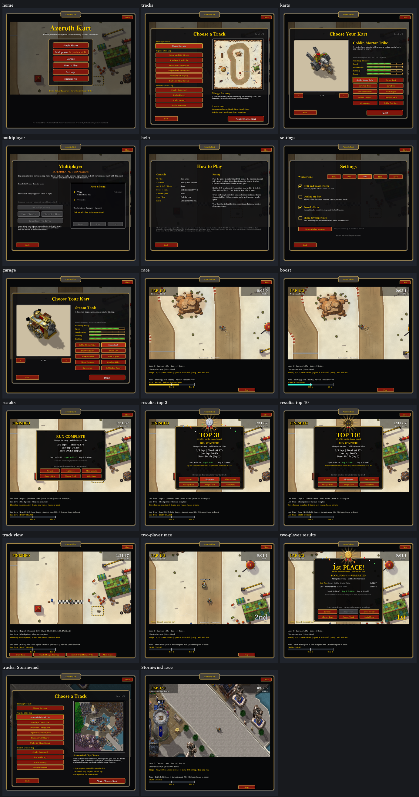
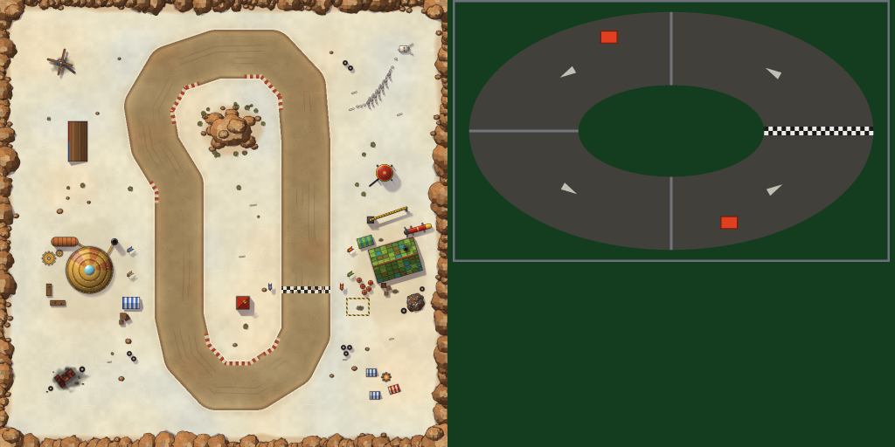
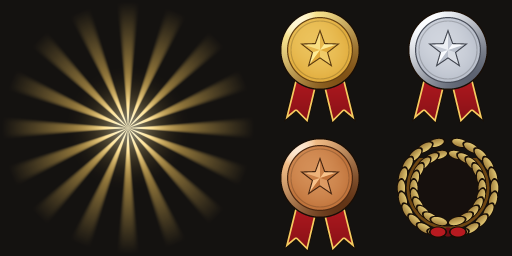

# Front end: menus, race HUD and results

**Status (2026-10-22):** reviewed Claude UI `1b2d3d5` is integrated with Codex backend `192c6de` by merge `6cd611a` on `codex/ui-backend-integration`. Claude's isolated preference fix `4ffe184` is retained as `9b22f12`; city merge f9f2af0 now includes reviewed Stormwind from78d97a1, followed by the protected background-load transaction. The implemented interfaces are in [API_CONTRACTS](../../API_CONTRACTS.md#implemented-front-end-menus-race-hud-and-results). Its appearance and behaviour in WoW Forever are **NOT RUN**; see [the client check](#client-check-not-run).

The owner asked for "the ready to ship UI": clear Single Player and Multiplayer choices, and selecting maps and karts. He chose:

- the client's own **Classic WoW dialogs** style;
- a **coming-soon** multiplayer lobby until two-player racing works;
- **remembered** track, kart and settings.



`scripts/preview_ui.py` made this review picture. It runs the addon's own Lua against a recording mock, solves every anchor as the client does, and draws the addon's TGAs. The client's dialog art, button art and fonts are drawn as stand-ins (Bitstream Charter and FreeSerif), so it is a layout picture, not a screenshot.

## Flow

```
open window ─► Main menu ─► Single Player ─► Choose a Track ─► Choose Your Kart ─► Race! ─► 3-2-1-GO ─► race ─► Results
                 │                                                                                                 │
                 ├─ Multiplayer: lobby preview, coming soon    Restart · Highscores · Close results · Change Kart · Change Track · Main Menu
                 ├─ Garage: choose a kart                                                                          │
                 ├─ How to Play                                       track view: Start Race · Track · Kart · Main Menu
                 └─ Settings
```

- Opening the window shows the main menu. If a run's results are still up, it shows them instead, as before.
- A menu never covers a live run, and no screen starts a race by itself. Only **Race!**, **Start Race** and **Restart** call `UI.Start`.
- Combat, Stop, Escape, Enter, Close and focus loss keep Codex's behaviour. Escape still ends a run and, as recorded in [the client evidence](../../evidence/2026-10-20-menu-integration-client.md), may also open the Game Menu, so the window is deliberately not an Escape-closable dialog.

## Screens

| Screen | Offers |
|---|---|
| Main menu | The "Azeroth Kart" title, then **Single Player**, **Multiplayer (soon)**, **Garage**, **How to Play** and **Settings**, with the current track and kart named underneath |
| Choose a Track | Mirage Raceway and Test Oval, each with a preview picture, a short description and its facts (3 laps, 4 gates, direction, off-road). Choosing one applies it at once; **Next: Choose Kart** continues |
| Choose Your Kart | A turntable that spins the chosen kart's own 64-heading sheet, arrows and a grid of all ten karts (five rows of two), the kart's description and model credit, its handling profile's name and four gold-framed **stat bars**, Speed, Acceleration, Turning and Braking, filled from the profile's actual values ([below](#new-art-kart-stat-bars); `claude/kart-stat-bars`). **Race!** starts the countdown |
| Garage | The same kart choice from the main menu, with **Done** instead of Race! |
| Multiplayer | **COMING SOON**. Disabled **Host a Race** and **Join a Race**, a disabled lobby preview (you, an open slot, track, Ready/Start/Leave), and how to help with today's connection test (`/akart net help`) |
| How to Play | The controls and the racing rules, plus the model credits |
| Settings | Window size (80–125%; sizes that would not fit the screen are disabled), drift and boost effects, **Outline my kart** (a bright yellow line round your own kart; [outlines](../karts/outlines.md), since 2026-10-23), sound effects, developer info (the timing line and Print Probe), and reset window position. The window can be dragged by its title bar |
| Race | Big **LAP x/3** and the next gate at top left. The clock in tenths and the best lap at top right. "Controls active - Esc to release" at the bottom. A large gold 3-2-1-GO. **Stop** sits away from where Start was, so a double click cannot start and stop. In a two-player race, the place ("1st"/"2nd", "of 2") at bottom right and the friend's name over their kart ([race screens](#race-screens-and-score-celebrations), `claude/race-screens`) |
| Results | A dark dialog with the result title, track and kart, total/last/best times and every lap time, the fastest in green. **Restart**, **Highscores** (the run's board at the player's page) and **Close results**, then **Change Kart**, **Change Track** and **Main Menu**. A top-ten best on the shared board, or a two-player place, adds a banner, a medal or wreath on a sunburst and confetti; a two-player race lists both racers ([race screens](#race-screens-and-score-celebrations)) |
| Track view (after Close results) | The frozen run and its HUD, with **Start Race**, **Track**, **Kart** and **Main Menu** on the bar |

The UI's own HUD lines keep their rows and text: laps, checkpoints, status, drift feedback and the meter. They gain colours: white detail, gold status. The timing line shows only with developer info.

## Look: the client's own dialogs

Every element below is defined in the build-70450 interface source (the [pinned mirror](https://github.com/Gethe/wow-ui-source/tree/172a387e3ab85b26e6640d3058d5ec1e6ccd4c63), Camelot loads the Mainline family). The addon references these by name or path and ships none of them. Each has a fallback: a missing template becomes a plain panel button or frame, and a missing font object becomes `GameFontNormal`.

| Element | Client source |
|---|---|
| Window, results | `BACKDROP_DARK_DIALOG_32_32`: `UI-DialogBox-Background-Dark` with the classic `UI-DialogBox-Border` (`Blizzard_SharedXML/Backdrop.lua`) |
| Menu dialogs | `BACKDROP_DIALOG_32_32`, as used by the shared `DialogBoxFrame` |
| Title banner | `DialogHeaderTemplate` (`Shared/Dialog/DialogTemplates.xml`) |
| Main menu buttons, Race!, Next | `MainMenuFrameButtonTemplate`, the Game Menu's red button (`Mainline/Frame/MainMenuFrameTemplates.xml`) |
| Other buttons, check boxes | `UIPanelButtonTemplate`, `UICheckButtonTemplate` |
| Cards (previews, lobby) | The tooltip border already used by the window, on a flat colour |
| Fonts | `Fancy48Font` and `Fancy32Font` (Morpheus) for the title and headings, `Game72Font` for the countdown, `GameFont*` for everything else (`Blizzard_Fonts_Shared`) |
| Sounds | `SOUNDKIT` `IG_MAINMENU_OPEN`/`OPTION`/`CHECKBOX_*` for menus, `UI_BATTLEGROUND_COUNTDOWN_TIMER`/`FINISHED` for 3-2-1-GO, and `LFG_REWARDS` once per finished run |

## New art: track previews

`addon/AzerothKart/Assets/UI/TrackPreviews.tga` is a 1024×512 opaque BGRA32 atlas (2 MiB raw), loaded on the first visit to the track screen. `scripts/build_ui_art.py` builds it:

- **Mirage cell:** scenery v1's own `Background.tga`, halved by an exact 2×2 box filter.
- **Test Oval cell:** a 500×300 painting of the oval from `Track.lua`'s geometry in the race's own colours, with a chequered start line and four counterclockwise arrows.

Both cells are original project art derived from the repository's own scenery and geometry; no external image is an input. The output is byte-identical on every platform.



```
python scripts/build_ui_art.py            # write the TGA
python scripts/build_ui_art.py --check    # verify the bytes
python scripts/build_ui_art.py --preview  # also docs/art/ui/track-previews.png
python scripts/preview_ui.py              # this page's layout picture (needs pinned Lupa and Pillow)
```

## New art: kart stat bars

The owner (2026-10-26) sent a Crash Team Racing-style picture of three segmented green bars and asked for "more mario kart/crash team racing way of seeing the different kart attributes ... in wow style obviously and use the actual ingame addon kart attributes as guidance for how much each bar should be filled". Asked which bars, he chose four: **Speed, Acceleration, Turning and Braking**, every real difference between Physics' handling profiles (proposed on `claude/kart-stat-bars`).


- **Art:** `addon/AzerothKart/Assets/UI/StatBars.tga`, 512×64 BGRA32 with alpha (128 KiB), painted by `scripts/build_stat_bars.py`. Row 0 is the empty bar, row 1 the full one: a gold plate, bright along its top and bronze at its foot, with a dark outline and rounded ends, and six recessed windows, dark when empty and a glossy green when full, in the style of the client's gold-trimmed frames and green health bars. Each is 480×32 texels for a 240×16 bar. Original art: no picture from another game is an input, and the bytes are the same on every platform.
- **Drawing:** each bar is two textures, the empty bar and the full bar over it, cropped from the left (`SetTexCoord`) to the kart's share, so it fills window by window and a share between two windows shows part of one. The plate is identical in both rows, so the crop never shows. The picture loads once, on the first visit to the kart screen; if it fails, the bars stay hidden and the profile line tells the tradeoffs in words, as before.
- **The scale** (`Menu.statFill`): the values come from `Physics.GetHandling` (read only) against the Balanced profile's. Balanced fills four windows of six; each 4% more or less is one window more or fewer, never under half a window or over the bar. Physics12's profiles give:

  | Profile | Speed (top speed) | Acceleration | Turning (steer rate) | Braking |
  |---|---|---|---|---|
  | Balanced (Goblin Mortar Trike, Dwarf Car, Glaive Thrower, Goblin Pod Racer) | 4 | 4 | 4 | 4 |
  | Heavy (Steam Tank, Orc Demolisher, Meat Wagon): +4% speed, −8% acceleration and turning, +8% braking | 5 | 2 | 2 | 6 |
  | Agile (Dwarven Biker, Gryphon Rider, Gyrocopter): −4% speed, +8% acceleration and turning, −8% braking | 3 | 6 | 6 | 2 |

  If Codex retunes a profile, the bars follow it with no change here.

```
python scripts/build_stat_bars.py            # write the TGA
python scripts/build_stat_bars.py --check    # verify the bytes
python scripts/build_stat_bars.py --preview  # also docs/art/ui/stat-bars.png
```

## Race screens and score celebrations

The owner (2026-10-26): "feel free to start on screen side of multiplayer such as race positions, name tags, and results. I also want a bigger celebration when you get a top 10 and top 3 score, take a look at that whole window and flow." Proposed on `claude/race-screens`; the contract notes are in [API_CONTRACTS](../../API_CONTRACTS.md#proposed-race-screens-and-score-celebrations-claude-claude-race-screens-2026-10-26).


- **The results window's celebrations.** When a run saves a new personal best high on the shared score board, the results grow a banner over UI's title:
  - **NEW #1!** (gold medal), or **FIRST ON THE BOARD!** when nobody else is on it yet;
  - **TOP 3!** with a silver (#2) or bronze (#3) medal;
  - **TOP 10!** with a golden laurel wreath, the rank written in it;
  - under the banner, the place: "#2 of 14 on the shared board".

  The medal or wreath sits over the dialog's top edge on a slowly turning gold sunburst; it pops in (40% to 115% to full size in a third of a second) while the banner fades in and a dozen pieces of confetti (eight for the top ten) fall through the window for under three seconds. A sound plays in place of the finish fanfare: the epic-loot toast for #1 and the top three, the quest-complete chime for the top ten. Reopening the results shows the celebration still, without the sound or the confetti. A best off the top ten, or on this computer's own board, keeps the plain window with the save notice in gold.
- **The flow.** The results' middle row is now **Restart · Highscores · Close results**. **Highscores** opens the run's own board at the page with the player's row; the board shows the player's own row in gold. After a top-ten celebration the button is lit, inviting the look.
- **A two-player race:**
  - **the place** in the bottom-right corner while racing, large: "1st" in gold or "2nd" in silver, "of 2" under it, from each racer's own progress (laps, gates and how far on toward the next, where their kart is drawn);
  - **the name tag**: the friend's name over their kart, or held inside the canvas edge toward it with the distance ("Amber Stone (420 away)"), faded when their signal goes stale;
  - **the results**: the racers in their places with their karts and times ("racing, lap 3/3", "left the race" or "connection lost" until they finish), a banner (**1st PLACE!** with the gold medal, sunburst, confetti and sound; **2nd PLACE** with the silver; **FINISHED!** while the friend still races, then the place as soon as their finish arrives), and the gap: "Amber Stone finished 1.65s behind you". The places are each racer's own reports: UI's "LOCAL FINISH — UNVERIFIED" title and "No agreed winner or standings" hint stay, and a note says so.
- **Art:** `addon/AzerothKart/Assets/UI/Celebration.tga`, a 512×256 BGRA32 atlas with alpha (512 KiB), painted by `scripts/build_celebration_art.py`: the sunburst (16 soft rays round a glow), the gold, silver and bronze medals (a bevelled disc with a faceted star, on two crimson ribbon tails edged in gold) and the laurel wreath round a dark disc with a crimson bow. Original art; the bytes are the same on every platform. It loads once, at the first celebration; if it fails, the banner shows alone and the load is not retried. The confetti is plain coloured squares.



```
python scripts/build_celebration_art.py            # write the TGA
python scripts/build_celebration_art.py --check    # verify the bytes
python scripts/build_celebration_art.py --preview  # also docs/art/ui/celebration.png
python scripts/preview_ui.py                       # the layout pictures, race-screens-review.png too
```

## Saved preferences

`AzerothKartDB.preferences` (account-wide) is a version-1 record, read defensively and written on deliberate successful choices or settings changes, never per tick:

| Field | Values | Default |
|---|---|---|
| `track` | `"test_oval"` or `"mirage_raceway"` | none: Test Oval |
| `kart` | a `Presentation.KART_SPRITES` id | none: the trike |
| `effects`, `sound` | booleans | true |
| `devInfo` | boolean | false |
| `outline` | boolean (since 2026-10-23) | absent: off |
| `scale` | 0.8, 0.9, 1, 1.1 or 1.25 | 1 |

Rules:

- Unknown values fall back to defaults, and other AzerothKartDB fields are never touched.
- A save keeps fields this version does not know. A record with a newer `version` is read but never overwritten.
- The saved kart is applied when the window is created. The saved track is applied the first time the window opens out of combat, because the Mirage loader needs a shown window and selection is refused in combat. Codex approved this first-open restoration through the existing guarded selector; it never starts a race.
- An untouched saved choice that fails to load keeps the default for the session and is not forgotten. A successful deliberate choice, including clicking the already-current fallback, replaces that preference through `Menu.Chose`; a deliberate track choice also supersedes any deferred restore. UI's selection transactions are unchanged. A newer-version saved record remains untouched even when the current in-memory choice changes.
- Choices made with the bar's quick **Track** and **Kart** buttons are remembered too, including track changes before any deferred restore has run.
- A saved size that no longer fits the screen shows at the largest size that does.

## Boundaries

`Menu.lua` is presentation only. It calls `UI.Start`, `UI.SelectTrack`, `UI.SelectKart`, `UI.DismissSummary` and the new `UI.SetEffectsEnabled`, and reads the state it shows. `UI.lua` gained only notifications:

- `refreshHud` → `Menu.Sync`;
- `render` → `Menu.RefreshRaceHud`;
- `refreshCountdown` → `Menu.OnCue`;
- `UI.SelectKart` → `Menu.OnKartChanged`;
- the window's `OnShow` → `Menu.OnWindowShown`;
- `UI.Create` ends with `pcall(Menu.Create)`.

If the front end fails to build, it reports once in chat and the window keeps its basic bar (Start, Stop, Track, Kart, Print Probe).

The multiplayer screen maps a copied PeerSession view to copy and enabled controls (`Menu.lobbyPresentation`). With no session bridge registered (`Menu.SetSessionBridge`), everything stays disabled and marked Coming soon. No session command is wired. The combined source contains Codex's adapter and start-clock contracts, but connecting the menu to them and the future live-race controller remains pending ([UI_FLOW_OWNERSHIP](../../UI_FLOW_OWNERSHIP.md)).

## Budget

Explicit UI counts were65/160/79 for the original Menu. Current integrated city screen/gates plus one staging background use **71 frames, 165 textures and 80 font strings**, and **75 frames** with the four Warcraft III karts' list buttons (`claude/kart-roster-wc3`):

- **Frames:** the menu screens and their buttons, the header, the drag handle, a close watcher, the race overlay and the results buttons.
- **Font strings:** the old title line is replaced.
- **Creation:** everything is created once with the window; nothing is created per tick or frame.
- **Per frame:** the race HUD compares numbers and rewrites its text only when it can change, about ten times a second while the clock runs. The shown kart/garage turntable has its own visual spin callback while the race simulation is inactive; it never advances physics or the race clock.
- **Stat bars** (`claude/kart-stat-bars`): the kart screen's four bars add **8 textures and 4 font strings**, created once with the window, bringing the integrated production pool from 89/69/136 to **89 frames, 77 textures and 140 font strings**. Choosing a kart only re-crops them.
- **Race screens** (`claude/race-screens`): the HUD's place (2 font strings), the name tag (1), and in the results a Highscores button (1 frame), the sunburst, a medal and 12 confetti pieces (14 textures), the banner, its line, the wreath's rank and the racers' two rows (7 font strings): **90 frames, 91 textures and 150 font strings**, all created with the window. The HUD's place compares numbers every frame and rewrites its text only when the place changes; the results' motion and their 5 Hz refresh move and re-text pooled pieces only.
- **Texture memory:** the preview atlas adds 2 MiB when the track screen is first opened; the stat bars' atlas 128 KiB when the kart screen is first opened; the celebration atlas 512 KiB at the first celebration. The turntable reuses the kart sheets the race already loads. The two scenery slots can retain Mirage and Stormwind simultaneously; the latter adds16MiB raw pixels. Native memory/performance remains unmeasured.

## Tests (offline)

`tests/test_menu.lua` runs the addon against a widget mock that, like the client, passes Show/Hide on to child frames. It covers:

- the main menu, one dialog at a time, and an unchanged run/track/kart while browsing;
- the full Single Player flow, including a refused start;
- every results path, the track view and the lap list;
- the garage and the turntable;
- the stat bars: `Menu.statFill`'s scale, each profile's four bars from `Physics.GetHandling` (Heavy 5, 2, 2, 6; Agile 3, 6, 6, 2; Balanced 4 each), the atlas rows and crops, no new objects when choosing karts, and the words in their place when the picture cannot load (`claude/kart-stat-bars`);
- the celebrations (`claude/race-screens`): `Menu.scorePlacement` on stand-in boards (#1 of several, alone, #3, #7, #11, a local board), the banner, place line, medal or wreath (its crop, the rank in the wreath) and sunburst for each, the dialog's two sizes, the sound in place of the fanfare, the medal's pop, falling and vanishing confetti, the turning sunburst, a still reopening, the gold notice for a best off the top ten, a refused picture (the banner alone, no retry) and the Highscores button opening the run's board at the player's page with their row in gold;
- the two-player screens: the HUD's place (1st, 2nd behind a friend further on or finished, hidden outside a live race), the results' rows and banners while the friend races, finishes behind or ahead, or leaves, and a stopped run; no objects created;
- settings and their effects, including no effects while switched off;
- saving, restoring and failed restores; explicit already-current fallback choices after a deferred or failed restore; quick-bar precedence before restoration; unknown and newer records; sizes that do not fit;
- a newer-version failed-load fixture: explicit fallback choices update in-memory preferences but preserve the original saved table/unknown field, stopped vehicle/race/clock/lap/checkpoint references, held input and inactive state;
- the coming-soon lobby and a mapped session view;
- sounds, and Alt+Z versus a real close;
- the combat track restore;
- the fallback when the front end cannot build, and missing templates.

`tests/test_ui.lua` retains Codex's lifecycle/capture/race assertions while combining both sides' module lists, counts, results-panel size and the Lua 5.4 `unpack` compatibility change. Both TOCs load 24 modules. The added preference/protected-state fixture passed `python scripts/test_lua.py --runtime lua51 --tests menu`; the shared [progress ledger](../../PROGRESS.md) records the integration checkpoint's complete executed checks. Offline results do not establish native templates, layout, input or persistence behavior.

## Client check (NOT RUN)

Fully restart the client after installing: `Menu.lua` and `TrackPreviews.tga` are new files. Then:

1. `/akart` shows the main menu over the dimmed track: the title banner, the "Azeroth Kart" title in Morpheus, and five red Game Menu buttons. Nothing reads "Lua error".
2. **Single Player**: all three ready tracks show their preview pictures; choosing one changes the track behind the dialog. **Next**: the kart spins on the turntable, the arrows and grid change it, and each kart shows its credit.
3. **Race!**: the menu disappears, a big gold 3-2-1-GO plays with beeps, and the top corners show LAP 1/3 and the clock. Only **Stop** shows on the bar.
4. Finish three laps: the results dialog lists each lap with the fastest in green, and a fanfare plays once. Try **Change Kart**, **Change Track**, **Main Menu**, **Restart** and **Close results**.
5. **Multiplayer** shows Coming soon with every control disabled. **How to Play** and **Settings** are readable. Settings sizes apply at once, and sizes too big for the screen are greyed out.
6. Drag the window by its title, `/reload`, and reopen. The track, kart and settings are remembered; the position may reset.
7. Press Alt+Z twice while in Settings: the window comes back on Settings. Escape during a race still ends the run (and may open the Game Menu).
8. Turn on developer info, then type `/akart probe` or click Print Probe: the counts are 75/165/80 with the ten karts (71/165/80 before them).

Open questions for the client:

- whether `MainMenuFrameButtonTemplate` widens itself to fit "Multiplayer (soon)";
- whether the classic dialog border's corners meet the Close button cleanly;
- whether `Fancy48Font` is loaded in-game on Forever.
