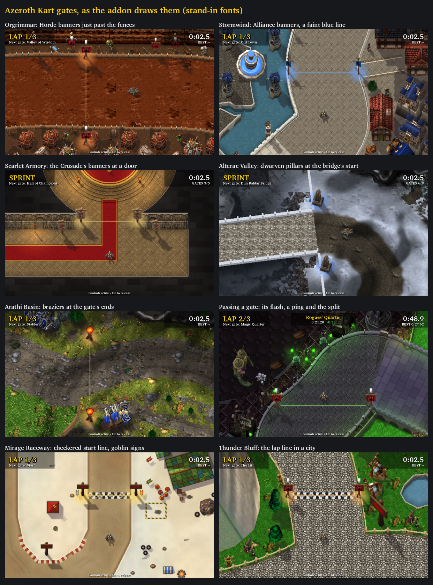

# Gates in the world

**Codex review (2026-10-29):** approved latest ef0bb58, including Alterac
v2 bridge placement/dwarven posts. Solo splits now capture the exact fixed
step; multiplayer has name-only feedback until exact copied pass events are
available. Native appearance/sound remain NOT RUN.

**Status (2026-10-29):** proposed by Claude on `claude/immersive-gates` (from `claude/menu-launch`).
Offline checks below; in WoW Forever **NOT RUN** ([client check](#client-check-not-run)).

The owner asked for gates "more immersive than the current.. lines". Of the mockups he liked the
direction and asked: **"make the banners, posts etc just a bit more outside the track, just pence
fence, and make the lines more subtle, dont want players to think they need to avoid them heh"**, read
as: posts just past the fence. Shown Alterac Valley's bridge gate, he asked: **"put this gate at the start
of the bridge so that the pillars have something to stand on (in the snow), and make the pillar dwarven
and the line blue"**: that gate moved to the bridge's mouth (Alterac's version 2, [its sheet](../tracks/alterac-valley.md)),
and all Alterac's gates have dwarven posts and a blue light.



Rendered by the addon's own Lua through `scripts/preview_ui.py`'s mock (stand-in fonts): a layout
picture, not a screenshot.

## What a gate looks like

- **Its line stays exact and goes quiet.** Each gate keeps its line from wall to wall (Codex's
  `Track.gates`, unchanged), drawn as a soft, faint stroke: a bright middle fading to nothing across its
  five units. The next gate's line has its course's light and pulses gently; later gates are a faint
  white; a gate just passed flashes and is gone in half a second.
- **A post just past the fence at each end.** A Warcraft III standing model, by course:

  | Kit | Model | Courses | Light |
  |---|---|---|---|
  | `alliance` | the Alliance's banner, blue | Stormwind, Ironforge, Darnassus | blue (Ironforge: the forges' orange) |
  | `horde` | the Horde's banner, red | Orgrimmar, Thunder Bluff, Undercity | orange (Undercity: green) |
  | `scarlet` | the Scarlet Crusade's standing banners | the four Scarlet sprints | holy gold |
  | `goblin` | the goblin racing arrow post | Mirage Raceway | gold |
  | `brazier` | a Lordaeron brazier | Warsong Gulch, Arathi Basin | fire |
  | `dwarven` | a carved stone obelisk banded in bronze (Reforged's Northrend obelisk), for Dun Baldar's dwarves | Alterac Valley | a deep blue (a pale one vanishes on snow) |

  A post stands 12 units past its end of the gate, past the wall that end meets. The camera leans
  heights north, so a post on a gate's south side would lean back over the road: there it moves out by
  its height's lean as well, and its top too stays past the fence. Where that would stand a post on a
  building or over a drop, the course's style names its ground instead (`stands`): on Alterac Valley,
  Icewing Bunker's west post beside the bunker, Dun Baldar's south post beside its watchtower, and the
  bridge gate's two on the snow either side of the bridge's mouth. Posts are pictures, not solids (the
  bridge's two stand on open snow, where a kart running wide could pass through them).
  On the battlegrounds a gate runs from cliff to cliff across open ground, so its posts stand at the
  cliffs, often off screen while you drive the road; the line carries the gate there.
- **The next gate's posts stand in pools of its light.**
- **The lap line** (a course's last gate, or a sprint's finish) is also a checkered band, ten units
  across, at half opacity: a start/finish line everyone knows to drive over.
- **Passing a gate** shows its name and the run's time there at the top of the track for 1.6 seconds,
  with the difference from the last lap at the same gate (a sprint: the last finished run on the track)
  in green when faster, red when slower, and plays the map's ping (`SOUNDKIT.MAP_PING`, in the pinned
  interface source). A lap's last gate shows the lap's time; the race's finish leaves it to the results.

Every gate of every course (75) was looked at in the preview with its kart just short of it: posts
past the fences, over canal walls, at the lava's rim and in doorways; Alterac's eight again, both ends
of each, after the dwarven posts and the bridge's move.

## How it is drawn

- **`GateKit.tga`** (512 × 512, 1 MiB; `scripts/build_gate_kit.py --wc3 WC3`): the six posts, each
  rendered by the scenery's own renderer (`wc3render`: the karts' camera, heights leaning north at 0.6,
  a shadow to the south-east, one texel a world unit) so it stands in the picture like its scenery; a
  soft glow; the soft line and the checks, horizontal and vertical. `Presentation.GATE_KIT` names each
  post's rectangle, foot and height; `--check` compares it and the picture's bytes.
- **Presentation (pure):** `GATE_KIT`, `GATE_STYLES` (each course's post and light, and any `stands`),
  `GATE_POST_OUTSET` and `GATE_LEAN`, `gatePosts(gate, post, style)` (the two ground points), `atlasCrop`,
  `postCrop` and `finishCrop` (screen
  rectangles and texture crops, cut at the canvas' edges), `GATE_LINE`, `GATE_FLASH` and
  `gateLineAlpha` (the line's opacity by state).
- **UI (visual):** `drawTrack` creates the band, two pools and sixteen posts with the window;
  `layoutGates` lays a course out (its style, each line's cell, the posts' points), loading the kit once
  with the first course that has a style; `placeGatePieces` places them as the camera moves;
  `refreshGateLooks` and `animateGates` set each line's colour and opacity, the next gate's pulse
  (`placeGuide` keeps Warsong's wide marker), the pools' and the flashes, writing only on a change.
  A refused kit leaves plain faint lines and no posts, and is not retried.
- **Menu (race overlay):** the toast (a plate and two labels), `Menu.splitText`, `Menu.GATE_TOAST`,
  `Menu.sprintSplits` and the `gate` sound. The splits are kept in memory only: nothing is saved or sent.

Nothing changes where a gate is, what counts as passing it, the race, physics, sessions or scores.

## Rebuilding the kit

From the owner's Warcraft III: Reforged install (read only), into an empty folder `WC3`:

```
python scripts/wc3casc.py "INSTALL" models '^war3\.w3mod:(doodads/lordaeronsummer/props/(bannerhuman/bannerhuman0|bannerorc/bannerorc0|brazier/brazier)|_de\.w3mod:doodads/(cityscape/props/scarletcrusadestandingbanners/scarletcrusadestandingbanners0|lordaeronsummer/props/goblinracingarrowpost/goblinracingarrowpost0|northrend/props/northrendobilisk/northrendobilisk))\.mdx$' WC3
python scripts/build_gate_kit.py --wc3 WC3 --check
```

The first extracts exactly the six models and the textures they name (a few seconds); the second
renders the posts and compares the picture's bytes and `Presentation.GATE_KIT` (about ten seconds).

## Budget

The window's pool grows by **19 textures** (the band, two pools, sixteen posts) and the race overlay by
a texture and two font strings: **121 frames, 233 textures, 232 font strings**, all created with the
window. Per frame: the posts are re-cropped as the camera moves (as the gate lines already were); the
next gate's pulse and the pools' alpha and any flash are written when they change.

## Tests (offline)

- `test_presentation`: each post's rectangle and foot in the atlas; every production course styled with
  a post of the kit; the posts 12 past each end, the south one by its lean too; the crops, whole and cut
  at the canvas' edge; the checks' squares; the line's opacity by state.
- `test_ui`: on Orgrimmar the kit loads once onto every piece; each line's cell by its direction, the
  next gate in its light and the rest faint white; each post where its crop says; the pools at the next
  gate's posts; the band on the last gate; a gate passed flashes and is gone in half a second, the
  pools move on and the next line pulses; switching courses gives each its own posts and allocates
  nothing; a refused kit leaves plain lines, no posts, pools or band, and is not retried. The lap
  fixture's line colours follow the new looks (flash-aware).
- `test_menu`: `Menu.splitText`; the first gate's toast and ping; the toast's going; a lap's last gate
  with the lap's time; faster in green, slower in red; no objects created.

Run on 2026-10-29, in the cloud and on the developer machine: every Lua module (53) PASS under Lua 5.1
on both; `presentation`, `ui` and `menu` under Lua 5.4 PASS (cloud); `preview_ui.py --check` 0 faults
(on the developer machine with the client's own fonts); the kit's `--check` PASS on both, the
developer machine's from a fresh extraction with the commands above (`3ab00ea7…04e9`).

## Client check (NOT RUN)

Fully restart the client after installing (a new picture). Then on a few courses:

1. The next gate's line is a faint glow in the course's light, later gates barely there; nothing reads
   as an obstacle.
2. Banners, signs, braziers or torches stand just past the fences at each gate's ends, and the next
   gate's stand in light.
3. Passing a gate: its line flashes and goes, a ping, and the toast with the time (from the second lap
   with the difference).
4. The lap line's checkered band.
5. `/akart probe` with developer info: 121/233/232.
