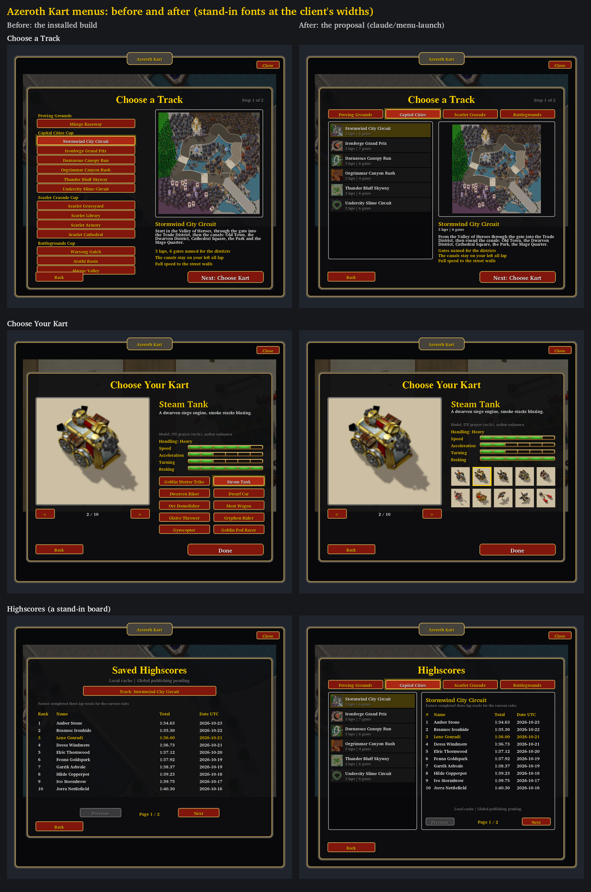
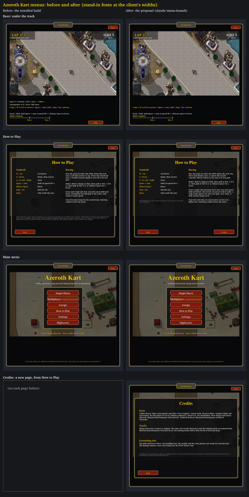

# Menus for launch: audit and proposal

**Status (2026-10-29):** proposed by Claude on `claude/menu-launch`, based on Codex's installed
`codex/alterac-integration` (`fcd1273`). Everything below is checked offline only; in WoW Forever it is
**NOT RUN** ([client check](#client-check-not-run)). The owner picks what goes into the launch; Codex
reviews and integrates. The minimap icon is parked, as the owner asked.

These pictures come from `scripts/preview_ui.py` (stand-in fonts measured at the client's widths, see
below); they are layout pictures, not screenshots. The highscores board in them is a stand-in board.

## What went wrong

The owner's screenshot of the installed build: on **Choose a Track**, Alterac Valley's button sits under
**Back**, and Arathi Basin's description runs into its facts. Three things let it through:

1. **The list had no limit.** Each course added a button to a dialog of fixed height. The fourteenth
   course, Alterac Valley (added by Claude's Alterac sprint), ran past the bottom.
2. **Nothing checked where things land.** The tests count widgets and check behaviour. The preview picture
   drew the screen, but its stand-in font measured about 13% narrower than the client's Friz Quadrata, so
   copy wrapped onto fewer lines than in game; and the track screen's picture was not looked at again after
   Alterac's row was added.
3. **Copy had no measured limits.** Blurbs and facts were any length.

## The check that now catches it

`python scripts/preview_ui.py --check` (about five seconds; writes nothing unless asked) visits every menu
screen with every track and every kart chosen, and the board of every track. It reports, per dialog: a
control or text overlapping another, text cut short by its line limit, text hidden under a card drawn above
it, and a control leaving its dialog. It exits 1 on any.

- Text is measured as the client draws it: Friz Quadrata at 1.13 times its nominal size, calibrated on the
  owner's screenshot. With that, both the client's font and the stand-in break every line of Arathi Basin's
  copy where the client did. `--client-fonts DIR` uses the client's own `frizqt__.ttf` and `morpheus.ttf`
  (extracted to `local-artifacts/`, never committed); the stand-ins give the same result.
- **Installed build: 19 faults** (Alterac Valley under Back with each track chosen; Arathi Basin's and
  Darnassus's copy overlapping). **Proposal: 0.**
- Proposed rule: run it before handing over any menu, HUD or copy change ([test plan](../../TEST_PLAN.md)).

## Audit, screen by screen

| Screen | Finding | Proposal | State |
|---|---|---|---|
| Choose a Track | One button per course; the 14th is already past the dialog, and every new map adds one | Cup tabs, a pooled list of nine rows a page (paged beyond) with thumbnails, laps and gates; the details card with "Your best" | Prototyped |
| Choose Your Kart, Garage | Ten name buttons fill the two-by-five grid; an eleventh kart has no room | Portrait grid, fifteen a page (paged beyond), icons made from each kart's own sheet, name in a tooltip | Prototyped |
| Highscores | One **Track** button steps through fourteen boards one click at a time | The same cup tabs and track list beside the board | Prototyped |
| Multiplayer | The lobby's **Track** button steps through fourteen tracks; the instructions read like a protocol | A track picker that opens inside the lobby (opening another screen leaves the session, so it must stay in the lobby); numbered steps | Proposed |
| Race, under the track | Four lines repeat the race HUD and read like a debug console | The lap and gate lines only with developer info (the staged grid keeps its instruction line); the status line, the drift line and the meter stay | Prototyped |
| How to Play | Out of date: only the Scarlet sprints, "Stormwind has full grip", "your best lap is kept for the current run"; no ice, deep snow or saved highscores. The credits paragraph misses most karts' and all the tracks' art | Rules rewritten; credits moved to a **Credits** page: every kart's model credit, the tracks' art, the Blizzard notice | Prototyped |
| Main menu | The tagline, "from the Shimmering Flats to Stormwind", is out of date | "Goblin-powered kart racing across Azeroth"; later a **Race Again** quick start (last track and kart) | Tagline prototyped; quick start proposed |
| Results | Works | Later: **Next Track** in the same cup | Proposed |
| Settings | Works | A "Show minimap button" box when the icon comes | Parked |

## The design

### Choose a Track

- **Cup tabs** along the top, in `Courses.CUPS` order, labelled by `Menu.CUP_LABELS` (a cup without one
  shows its own name). Up to `Menu.CUP_TABS` (5) fit one row; a sixth cup needs a second row or tab
  paging (not built).
- **The list:** the shown cup's tracks, then its coming-soon courses (greyed, "Soon"), `Menu.TRACK_ROWS`
  (9) a page, with **<** and **>** and "Page 1 of 2" only when a cup holds more. Each row: a 36-pixel
  thumbnail, the name, and "3 laps | 6 gates" or "Sprint | 8 gates". The chosen track's row is gold. The
  list opens on the chosen track's cup and page.
- **The rows are pooled:** nine rows show any cup's page, so adding tracks or cups adds pages, never
  widgets or height.
- **Details:** the preview (280 pixels for a 320 cell, `Menu.PREVIEW_SIZE`), the name, the summary with
  "Your best: 1:31.92" when the player has a time (one board read on a deliberate refresh), a blurb of at
  most three lines and three one-line facts. `--check` enforces those limits; the copy was rewritten to fit
  and keeps every reviewed keyword.

### Choose Your Kart and the Garage

- The turntable, name, description, credit and handling bars stay. The ten name buttons become **portrait
  tiles**: five a row, `Menu.KART_TILES` (15) a page, paged beyond, pooled like the track rows.
- Each tile shows the kart from its own sheet at the turntable's starting angle, on the stage's sand
  colour, framed dark, or gold for the chosen kart. The name shows in a tooltip, and on the tile itself if
  the icon picture cannot load.

### Highscores

- The same tabs and track list (a second pooled list) on the left; the board on the right: the track's
  name, its rule line, ten rows, the scope line and the pages. It opens on the driving track's board (or
  the results' run). Choosing a board never selects a driving track; each open, pick or page reads the
  board once.

### Under the track

- Developer info off: the status line (controls, refusals), the drift and surface line and the drift meter.
  Developer info on: also the lap, gate and timing lines. On a staged two-player grid the gate line stays,
  because it carries "Hold W/Up for GO".

### How to Play and Credits

- Rules: gates and sprints (the Scarlet Crusade and Alterac Valley), the drift tiers, grass, rough salt and
  deep snow, paved cities, ice (steer early; no drift charge on it), saved highscores, combat.
- **Credits**, from How to Play: every kart's model credit as the [asset ledger](../ASSET_SOURCES.md)
  records it, the tracks' art (Mirage original; the rest painted from Blizzard's Warcraft III art, the
  battlegrounds following their World of Warcraft maps), the made-for-the-game pictures, the client's own
  dialogs, fonts and sounds, and the fan-made/trademark notice. A test checks every kart in the roster is
  named there. How the owner wants to be credited is his call.

## Not built yet (for the owner to choose)

- **Lobby track picker:** a pop-up list inside the multiplayer screen, setting only `Menu.lobbyTrackId`
  (which the existing Host and rematch actions already send). Opening another screen from the lobby leaves
  the session (`Menu.Show`), so it cannot reuse the track screen without a session change from Codex.
- **Race Again** on the main menu: the remembered track and kart straight to the countdown, the same call as
  **Race!**.
- **Next Track** on the results: the next track in the same cup, to Choose Your Kart or straight to the
  countdown.
- **Multiplayer copy** as numbered steps (both enter the same fresh code; guest listens, host invites;
  both Ready; host Start), keeping "experimental".
- **Minimap icon:** parked.

## Contract and budget

Scope: `Menu.lua` and `tests/test_menu.lua` (Claude); `tests/test_ui.lua` budget constants and its Test
Oval list check (shared, visual counts only); `scripts/preview_ui.py`; two new build scripts and their
atlases. No simulation, race, session, score or saved-data behaviour changes.

- **Removed:** `Menu.view.trackButtons`, `soonButtons`, `kartButtons`, `highscoreTrack`;
  `Menu.highscoreTrackIndex`.
- **Added:** `Menu.TrackRow(id)` (turns the shown list to a track's cup and page; its row) and
  `Menu.KartTile(id)`; `Menu.view.trackList`, `boardList`, `kartTiles`; `Menu.boardTrackId` and
  `Menu.boardRequest` (the board shown, and the results' request); `Menu.cupRows`, `Menu.trackSummary`;
  `Menu.TRACK_ROWS`, `CUP_TABS`, `CUP_LABELS`, `TRACK_THUMBS`, `KART_ICONS`, `KART_TILES`,
  `PREVIEW_SIZE`, `CREDITS`. Each `Menu.TRACKS` entry gains `laps` and `gates`; a test checks them
  against every built course.
- **Objects:** 93/99/151 → **121 frames, 213 textures, 230 font strings**, all created once with the
  window, and now the same for any number of tracks, cups and karts (before, each track and each kart
  added a frame). Two lists of four tabs, a card, two page buttons, nine rows (a button, three textures,
  three labels) and a page label; fifteen tiles (a button, four textures, a label); the board's card;
  the Credits page.
- **Texture memory:** `TrackThumbs.tga` 1 MiB when a track list first shows; `KartIcons.tga` 2 MiB
  when the kart screen first opens. Each loads once; a refused load is not retried.

## New pictures (made from the game's own, no new art)

- `Assets/UI/KartIcons.tga` (1024×512, 128-texel cells, eight a row, room for 32 karts) by
  `scripts/build_kart_icons.py`: each kart's own sheet's frame for a heading of 315°, centred and, when
  far from 104 texels across, scaled to it. Its pixels are the sheets', so each cell keeps its sheet's
  source, terms and credit.
- `Assets/UI/TrackThumbs.tga` (512×512, 64-texel cells, eight a row, room for 64 tracks) by
  `scripts/build_track_thumbs.py`: the middle square of each track's preview, averaged down in whole
  blocks. Each cell keeps its preview's source and terms.
- Both scripts have `--check` (exact bytes) and `--preview OUT.png`.

## Tests run (offline)

- `python scripts/test_lua.py --runtime lua51 --tests <each>`: all 53 test files pass.
- `python scripts/test_lua.py --runtime lua54 --tests menu ui`: pass.
- `python scripts/preview_ui.py --check`, and with `--client-fonts`: 0 faults (the installed build: 19).
- `python scripts/build_kart_icons.py --check`, `python scripts/build_track_thumbs.py --check`: pass.
- New in `test_menu`: the summaries against every built course; a row per track in its cup; thumbnail
  and icon cells; pooled rows and tiles (no new objects when turning cups, pages or karts); a refused icon
  atlas showing names, not retried; coming-soon rows disabled and inert; boards picked from the list
  (never selecting a driving track); the lines under the track with and without developer info and on a
  staged grid; How to Play to Credits and back, every kart credited.

## Client check (NOT RUN)

Fully restart the client after installing (two new pictures). Then:

1. **Single Player:** four cup tabs; each cup's rows with thumbnails; Battlegrounds lists Warsong Gulch,
   Arathi Basin and Alterac Valley inside the list, clear of **Back**; Arathi's copy reads in separate
   lines.
2. **Next:** the kart portraits show each kart; the mouse over one names it; a click chooses it and
   frames it in gold.
3. **Highscores:** tabs, list and board; a long name ends in "..."; the dates fit.
4. A race: under the track only the gold status line, the drift line and the meter; with developer info,
   the lap, gate and timing lines too.
5. **How to Play → Credits → Back.**
6. `/akart probe` with developer info: 121/213/230.
