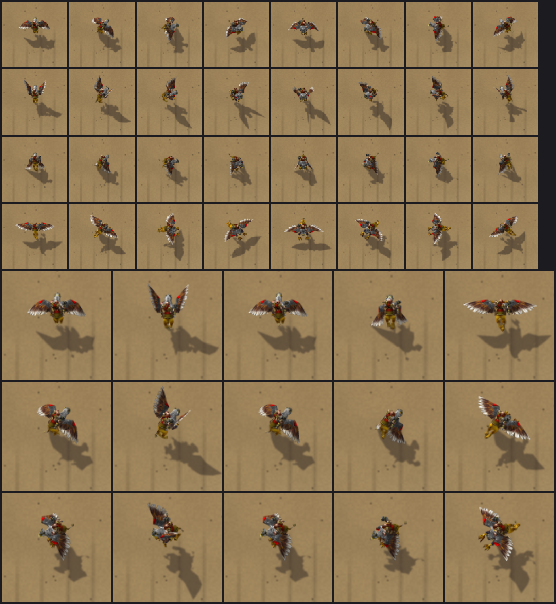
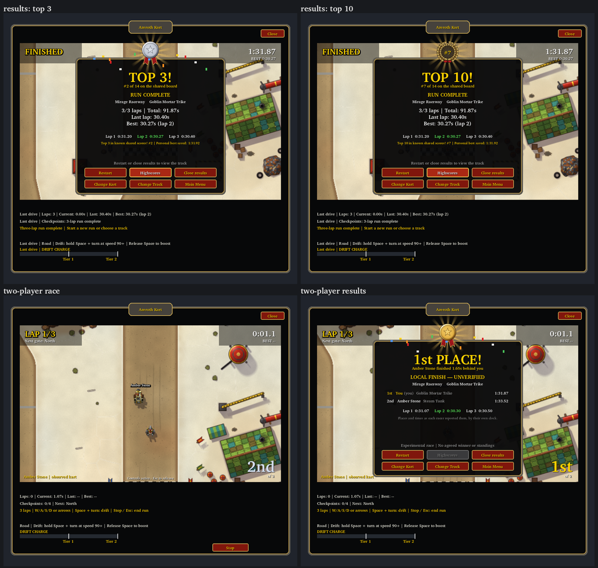
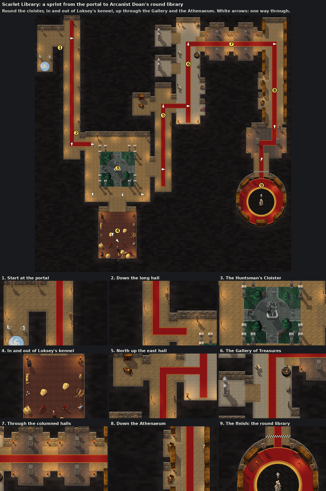
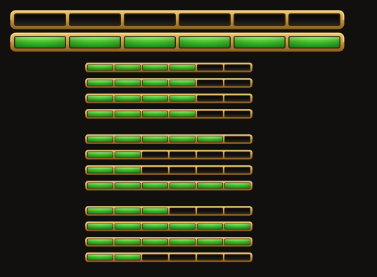
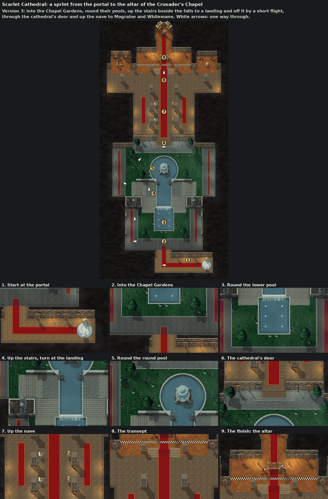
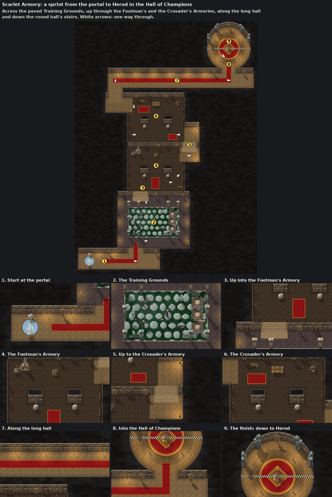
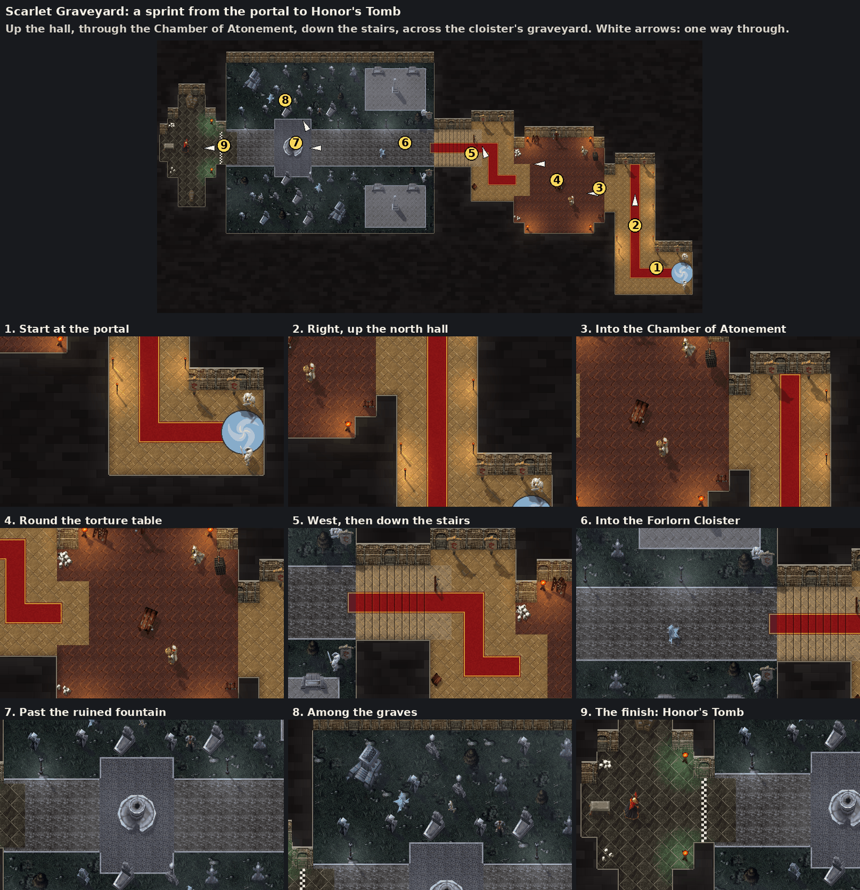

# Claude handoff — Warsong Gulch version 2: the real gulch (reservation, in progress)

Reserved 2026-10-28 by Claude (rendering/UI/sprites owner).

**Base:** Codex's `codex/warsong-registration` `47777d0` (installed runtime `9b7d6df`: approved Claude `79792cd` with Warsong registered as race code C, score code W, Physics 13). **Branch:** `claude/warsong-v2`, from it, no merge commit. Nothing is installed.

**Owner instructions:** after driving the installed Warsong: "it's not really driveable - I mean you can drive, and try to follow the arrow, but it's not really intuitive unfortunately. I think you should inspect the actual warsong gulch in the game files or something to figure this out. Not only is the map difficult to navigate the way you've made it, the way you've made it is good - close - but not close enough unfortunately. Can you try to inspect the actual warsong gulch and try again?" Shown the real gulch read from his client (terrain, both bases' geometry, the minimap) with a lap traced through it, he chose to leave each base **by the front, as traced** (Alliance: lobby, front door, down the east path; Horde: the west side door, over the rise by the west tower, down to the field), and named all four problems: the arrow pointing through walls, not seeing under the roofs, too many rooms and doors, unclear checkpoints.

**Task:** Warsong version 2: the layout rebuilt from the real map (PVPZone03's terrain, holes and WMO collision, the CTF bases, the minimap), each base as it really is (no mirror); an arrow that follows the racing line; the next checkpoint marked in the world and every checkpoint painted; roofs that fade as the kart approaches what they cover; wide passages and few doors. A new geometry version (2), so its board starts fresh.

**Reserved files and regions:**

- `scripts/battleground_layouts.py`, `scripts/build_battlegrounds.py`, `scripts/battleground_paint.py`; `scripts/wowcasc.py` (a `--product` option: the install now lists `wow_classic_era` first); a new `scripts/wow_map_survey.py` (the real map's survey) if it is kept;
- the generated `addon/AzerothKart/Battlegrounds.lua`, `Assets/Tracks/WarsongGulch/`, `Assets/UI/GuideArrow.tga`, `docs/art/tracks/warsong_gulch-*`;
- `addon/AzerothKart/Presentation.lua`: the roof fade, the guiding arrow's heading, the next gate's marker (additive or within Claude's Warsong helpers);
- `addon/AzerothKart/Courses.lua`: Warsong's entry (status copy) and presentation accessors beside `Courses.roofs`;
- `addon/AzerothKart/UI.lua`: Claude's regions only (`UI.Create`'s visual part, `layoutRoofs`, `placeRoofs`, `placeGuide`, the visual body of `render`); `UI.SelectTrack`'s roof-loading hook stays as reviewed;
- `addon/AzerothKart/Menu.lua`: Warsong's track-screen copy;
- tests: `tests/test_warsong.lua`, `tests/test_presentation.lua`, Warsong's blocks and the budget lines of `tests/test_ui.lua` and `tests/test_menu.lua`;
- the score catalogue's Warsong version (`services/leaderboard/catalog.json`, regenerated by Codex's `scripts/export_score_catalog.py`) and any protocol test pinned to Warsong version 1: flagged for Codex, changed only as the version bump requires;
- docs: the Warsong sheet, `docs/TRACKS.md`, `docs/API_CONTRACTS.md` (Claude's Warsong section), `docs/ASSETS.md`, `docs/art/ASSET_SOURCES.md`, `CHANGELOG.md`, `docs/TEST_PLAN.md`, `tests/MANUAL_CLIENT_CHECKLIST.md`, `docs/INDEX.md`, this handoff.

No change to LayeredTrack, Dungeon, Physics, Checkpoints, the protocols, sessions or scores' code. `docs/PROGRESS.md` stays with the integrator.

# Previous: Warsong Gulch: Codex's review fixes

Prepared 2026-10-27 at about 17:50 CET by Claude (rendering/UI/sprites owner).

**Base:** `claude/warsong-layout` `bf94d2b` (below). **Branch:** the same, with these commits:

- `d832966`: the two fixes, the dust's layer, tests and docs;
- `8e2cee1`: the checks the review asked for (reopening, Ready, both floors);
- this handoff.

Nothing is installed; Warsong stays listed as coming soon. The developer machine's checkout has `claude/warsong-layout` at this handoff.

## Owner instructions

The owner relayed Codex's review of `bf94d2b` (`docs/reviews/2026-10-27-warsong-layout.md` on `codex/warsong-review` `2c32f13`, not on this branch): the layout is sound, but two bugs need fixing before enabling Warsong:

1. "Missing roof textures don't prevent starting. Players could encounter upper-floor collision without visible floor artwork."
2. "Opponent draw layers aren't restored after leaving Warsong. Switching to a flat map can leave the friend's kart incorrectly ordered against other sprites and effects."

After those, Warsong needs Codex's registration and mixed-version leaderboard support within the existing packet budget.

## Fixed

- **The roof picture is required scenery.** `loadRoofs` (taken out of `layoutRoofs`) loads it once per picture. `UI.SelectTrack` now checks it after the background's staging load and before anything of the course shows: refused, the course is refused like a missing background ("Warsong Gulch roofs unavailable | Choose another track; previous selection retained"), the shown course and picture untouched; the multiplayer Ready, which selects through `SelectTrack`, refuses with "track_unavailable". `UI.Start` also refuses a course whose `roofs` are not loaded ("Track scenery unavailable…"). Choosing the course again or reopening the window retries the load. The arrow stays optional.
- **The friend's kart's layer.** `layoutRoofs` no longer clears the friend's recorded sublevel: on a flat course it sets the texture back to `OVERLAY` 0, as created, and keeps the record true. A two-floor course still sets it as the friend draws.
- **Found while fixing: the dust.** The kart's dust and wind puffs (`ARTWORK` 6) were hidden under the roofs on floor 1. They now follow the kart's draw set: `OVERLAY` 0 on floor 1 or a ramp (sharing the outer back flame's sublevel), `ARTWORK` 6 everywhere else, as before. Puffs already in the air switch with the kart when it changes floor.

## Scope (changed)

- `addon/AzerothKart/UI.lua`: `SMOKE_GROUND` and the `smoke` field of `KART_LAYERS`, `setKartLayers`, `createEffects` (the smoke pool's record), new `loadRoofs` and `roofsLoaded`, `layoutRoofs`. **In shared or Codex-owned functions, at the review's request:** `UI.SelectTrack`'s loading hook (the early return also requires loaded roofs; `roofsLoaded` after the background's staging load and, when the background is already shown, in its place) and one condition in `UI.Start`'s scenery refusal. Nothing else in `SelectTrack`'s transaction or in `UI.Start` changed.
- `tests/test_ui.lua`, and the docs: the Warsong sheet, `API_CONTRACTS.md`'s proposed section, `TEST_PLAN.md`, `CHANGELOG.md`, the client checklist, this handoff.

## Tests

| Command | Cloud | Developer machine |
|---|---|---|
| `python scripts/test_lua.py --runtime lua51` | PASS, 46 modules | PASS, 46 modules (107 s) |
| `python scripts/test_lua.py --runtime lua54 --tests ui menu warsong presentation` | PASS | — |
| `python scripts/validate_project.py` | only the 2 pre-existing `PROGRESS.md` links | — |
| `git diff --check` | clean | — |

New in `test_ui`: a refused roof picture (false, nil, a throw) refuses Warsong with Mirage still shown and selected; Start refuses while the roofs are not loaded; choosing again or reopening retries, and once they load Warsong starts; Ready refuses an offered Warsong whose roofs do not load and selects it once they do; a friend on floor 1 draws at 3 and on the ground at -5, and from either, Mirage puts it back at 0, where it stays when shown again; the dust's layers on the ground, the plateau, a ramp and Mirage. Each check fails with its fix reverted (five reversions tried in the cloud). The pictures and data did not change; their byte check stands from `bf94d2b`. Client: NOT RUN ([the checklist](../../tests/MANUAL_CLIENT_CHECKLIST.md#deferred-warsong-gulch-check-proposed-claudewarsong-layout) gains the friend after Warsong and the dust on the plateau).

## PROGRESS ledger entry for the integrator (Warsong review fixes)

> **2026-10-27 — Warsong review fixes (Claude, `claude/warsong-layout` `8e2cee1`, after Codex's review of `bf94d2b`).** A roof picture that does not load now refuses Warsong at selection (rollback kept; the multiplayer Ready refuses with "track_unavailable") and at Start; the friend's kart returns to sublevel 0 on a flat course after Warsong; the kart's dust and wind puffs draw over the roofs on floor 1. One-condition additions to `UI.SelectTrack`'s loading hook and `UI.Start`'s scenery refusal. `test_ui` covers refused/throwing loads, retry, reopening, Ready and both floors' friend; each check fails with its fix reverted. Lua 5.1 suite PASS on both machines; Lua 5.4 focused PASS. Client: NOT RUN.

## Needs Codex

Review these fixes, then the registration the review describes (IDs, mixed Physics 12/13 scores within the 158-byte budget). Everything under "Needs Codex" below still holds, the ramp rule included.

## Push (the owner's)

```
git -C "C:\Users\bakke\Downloads\Forever_Addons\AzerothKart_Codex_Project_Pack\AzerothKart-Claude" push -u origin claude/scarlet-v3 claude/race-screens claude/gryphon-wings claude/warsong-plan claude/warsong-layout
```

# Previous: Warsong Gulch: layout, art and rendering

Prepared 2026-10-27 at about 15:40 CET by Claude (rendering/UI/sprites owner).

**Base:** Codex's `codex/layered-track-foundation` `5c481d4` (floors and Boots pads, `60a9d77`; it carries every Claude branch to `claude/warsong-plan`). **Branch:** `claude/warsong-layout`, the name Codex's handoff proposed (branched from `5c481d4` rather than merged into `1d776cb`: the same content, no merge commit), with these commits:

- `28c86bc`: the reservation;
- `51304df`: Warsong Gulch: the layout and its generator, the pictures, the roofs, the arrow, the menu, tests and docs;
- this handoff.

Nothing is installed. Warsong is listed as coming soon: it cannot be selected, raced or scored until Codex registers it. On the developer machine, Claude's checkout (`AzerothKart-Claude`) now has `claude/warsong-layout` checked out (it had `claude/warsong-plan`); its untracked `Claude outputs/` is untouched.

## Owner instructions

Codex reported the floors and pads done: "Claude can now begin Warsong's layout and rendering". Asked, the owner chose: **two doors** in each flag room ("Two doors: drive through"); the banana and the roof as an **"Optional way in"**; the grid **"Mid (Recommended)"**, facing the Alliance base. Earlier: a fixed three-lap loop (in by each tunnel, round the flag, out by the ramp), the guiding arrow on Warsong only, a Boots pad in each tunnel. Drop-downs and a start in each base are outside the contract and not built.

The standing instructions hold: no merge into `main`; no claim of in-game verification without the actual client; the owner pushes and runs the client checks; Codex prepares coordinated installs and registers the course.

## Scope (reserved and changed)

The reservation (`28c86bc`) held, with the additions marked below.

- **New:** `scripts/battleground_layouts.py`, `scripts/build_battlegrounds.py`, `scripts/battleground_paint.py`; the generated `addon/AzerothKart/Battlegrounds.lua`; `Assets/Tracks/WarsongGulch/{Background,Roofs,Preview}.tga`; `Assets/UI/GuideArrow.tga`; `tests/test_warsong.lua`; `docs/art/tracks/warsong_gulch-{overview.png,review.png,sources.txt}`.
- **`Courses.lua`:** the Battlegrounds Cup; Warsong (`soon=true`, `geometry="layered"`, `roofs`, `guideArrow`); the `layered` case in `Courses.build`; `Courses.roofs`.
- **`Presentation.lua` (additive):** `drawnHigh`, `ROOF_FADED`, `ROOF_FADE_DEPTH`, `roofAlpha`, `roofCrop`, `GUIDE_ARROW`, `guideHeading`, `arrowFrame`, `arrowCoords`.
- **`UI.lua`, Claude's regions only:** new locals `KART_LAYERS`, `ROOF_SUBLEVEL`, `MAX_ROOFS`, `setKartLayers`, `layoutRoofs`, `placeRoofs`, `placeGuide`; `renderEffects` (the flames' sublevels from the draw set); `layoutTrack` (calls `layoutRoofs`); the visual body of `render`; `renderOpponent` (the friend's sublevel by floor, after Codex's level code); `UI.Create`'s visual part (four roof textures after the background staging, the kart's first draw set, the arrow after the friend's kart). `step`, `UI.Start/Stop/OnUpdate/HandleEvent`, `UI.SelectTrack`'s transaction, `pollLive`, `applyLiveView`, `finishLive`, `keyEvent`, `UI.MultiplayerAction` and `refreshSummary` are untouched.
- **`Menu.lua`:** the track list's spacing for four cups (headings 24, rows 32); Warsong's copy in `Menu.TRACKS` and its preview cell; `Menu.trackRows` lists a course still `soon` only as coming soon. *Addition:* the Highscores Track button skips a course still `soon`, so the ready copy shows no empty board.
- **Both TOCs:** `Battlegrounds.lua` after `ScarletCrusade.lua`, before `Courses.lua`. **`tests/run.lua`:** `test_warsong`. **`scripts/validate_project.py`:** the load order and the new files.
- **Tests:** `test_ui` (the harness loads LayeredTrack and Battlegrounds; the budget and draw-layer counts; *addition:* a Warsong rendering test) and `test_menu` (the budget, the fourth cup; *addition:* the copy and the Highscores cycle). *Additions:* a block in `test_presentation`; four cups in `test_circuit` and `test_dungeon`.
- **Docs:** `docs/art/tracks/warsong-gulch.md` (the plan rewritten as the track sheet), `docs/TRACKS.md`, `docs/API_CONTRACTS.md` (a proposed section after the floors proposal), `docs/ASSETS.md`, `docs/art/ASSET_SOURCES.md`, `CHANGELOG.md`, `docs/TEST_PLAN.md`, `tests/MANUAL_CLIENT_CHECKLIST.md`, this handoff; *addition:* the Battlegrounds line in `docs/INDEX.md`.

No change to LayeredTrack, Dungeon, Physics, Checkpoints, RaceGrid, the protocols, sessions, scores or any other Codex-owned file. `docs/PROGRESS.md` stays with the integrator (entry below).

## Delivered

[The Warsong Gulch sheet](../art/tracks/warsong-gulch.md) has it all; [the proposed contract](../API_CONTRACTS.md#two-floor-presentation-warsong-gulch) has the interfaces.

- **The course:** 1024 × 2048, point-symmetric. From mid into Silverwing Hold by its tunnel (the Boots near its end), through the flag room past the flag (in by the east door, out by the west), up the front ramp onto the plateau over the tunnel, down the ramp to the gully; then the same through the Warsong Lumber Mill; the finish at mid. 25 rooms (19 on the ground, 6 on floor 1), 8 ramps, 7 gates on the ground, 2 Boots pads, 15 solids, about 5,700 units a lap. At each base the tunnel's side door, the banana, the terrace and the connector are the optional way in.
- **The pictures:** the ground and a world-aligned roof picture with alpha, from the owner's Warcraft III install (Ashenvale and the night elves north, the Barrens and the orcs south), and the arrow sheet (original).
- **Rendering:** four pooled roof overlays (each base's hill and roof) cropped as the camera moves, over karts on the ground and under karts on floor 1 or a ramp, fading to a quarter over the player below; the friend drawn by reported floor; the Warsong-only arrow toward the next gate. Budget 91/96/151.
- **The generator** checks LayeredTrack's authoring rules, the dungeon rules on each floor, a new ramp rule, the props, and walks the route through the gates on the right floors.

## Needs Codex

1. **Review** the geometry, the route and the shared grid at mid (`Battlegrounds.lua`, `validate` in `build_battlegrounds.py`, `tests/test_warsong.lua`). One choice to look at: the *Mid* finish spans the field's west half, from the west wall to the stumps; the run back from the Horde ramp comes up that side, and a kart passing east of the stumps must turn back to it (the arrow shows it).
2. **Registration**, per [LAYERED_TRACKS](../LAYERED_TRACKS.md#remaining-warsong-integration): course, invite and score IDs; score sharing and saved boards for a Physics 13 course beside the Physics 12 ones; the session's `trackPhysics`; then `soon=true` removed from Warsong's `Courses.lua` entry. The menu's copy and preview are ready and the track list keeps its rows.
3. **The proposed LayeredTrack rule** ([API_CONTRACTS](../API_CONTRACTS.md#two-floor-presentation-warsong-gulch)): a room may meet a ramp's corridor only at the end its own floor leaves by. `LayeredTrack.new` accepts a wrong-floor room at a ramp's end today; Claude's generator refuses it.
4. **Pre-existing, not from this branch** (found on `5c481d4` as well): under Lua 5.4 the full runner stops at `tests/test_score_sharing.lua:16` (global `unpack`), and `test_multiplayer_integration` fails under 5.4; `validate_project.py` reports the 2 historical Windows-path links in `PROGRESS.md`.

## Tests

| Command | Cloud | Developer machine |
|---|---|---|
| `python scripts/test_lua.py --runtime lua51` | PASS, 46 modules, 85 files parsed | PASS, 46 modules (97 s) |
| `python scripts/test_lua.py --runtime lua51 --tests warsong presentation menu ui circuit dungeon` | PASS | PASS |
| `python scripts/test_lua.py --runtime lua54 --tests warsong presentation menu ui circuit dungeon` | PASS | — |
| `python scripts/test_lua.py --runtime lua54` | stops at the pre-existing `test_score_sharing` failure | — |
| `python scripts/build_battlegrounds.py --wc3 WC3 --check` | CHECK PASS: the Lua, the three pictures, the arrow | CHECK PASS, the same hashes, from a fresh extraction with the sheet's commands and no sprite cache to start (120 s) |
| `python scripts/validate_project.py` | only the 2 pre-existing `PROGRESS.md` links | the same |
| `git diff --check` | clean | — |

Hashes (sha256): `Background.tga` `b0004a34…aa28b`, `Roofs.tga` `de96d90a…755d9`, `Preview.tga` `5b2330f6…09119`, `GuideArrow.tga` `d1e82f1a…cc8e`. A crude offline autopilot (not in the suite) drove three laps on Codex's Physics in about 36 s each.

## Client checks: NOT RUN

[The Warsong checklist](../../tests/MANUAL_CLIENT_CHECKLIST.md#deferred-warsong-gulch-check-proposed-claudewarsong-layout): the track list's fourth cup after an install now; the roofs, fades, arrow, floors and drive once Codex registers it.

## PROGRESS ledger entry for the integrator (Warsong layout)

> **2026-10-27 — Warsong Gulch built on two floors, listed as coming soon (Claude, `claude/warsong-layout` `51304df` on Codex's `5c481d4`).** The Battlegrounds Cup's first course on LayeredTrack: a three-lap loop from mid through both bases (in by each tunnel, through the flag room by two doors, up onto the plateau and down the ramp), the banana and terrace as an optional way in, a Boots pad in each tunnel; 25 rooms on two floors, 8 ramps, 7 ground gates, 15 solids. Ground and roof pictures from the owner's Warcraft III install; four pooled roof overlays over karts below and under karts above, fading over the player below; the friend drawn by reported floor; a Warsong-only guiding arrow. Listed as coming soon until Codex's review and registration (IDs, Physics 12/13 boards). A ramp-adjacency rule proposed for `LayeredTrack.new`. Lua 5.1 suite PASS (cloud and developer machine); `build_battlegrounds.py --check` PASS on both with identical hashes; Lua 5.4 focused PASS; validator: only the 2 historical `PROGRESS.md` links. Client: NOT RUN.

## Push (the owner's)

```
git -C "C:\Users\bakke\Downloads\Forever_Addons\AzerothKart_Codex_Project_Pack\AzerothKart-Claude" push -u origin claude/scarlet-v3 claude/race-screens claude/gryphon-wings claude/warsong-plan claude/warsong-layout
```

## Next

Codex's review and registration; then a coordinated install, the owner's drive, and tuning from it (the flag rooms' doors, the roofs' fade, the arrow's size and reach). Other battlegrounds wait for his word.

# Previous: Warsong Gulch layout reservation

Reserved 2026-10-27 by Claude as `28c86bc`, on Codex's `5c481d4`: the scope above, before the additions marked there.

# Previous: Warsong Gulch plan and the floors request

Prepared 2026-10-27 by Claude (rendering/UI/sprites owner).

**Base:** `claude/gryphon-wings` `e3c82ad` (on `claude/race-screens`, `claude/scarlet-v3` and Codex's installed `caab661`). **Branch:** `claude/warsong-plan`, with these commits:

- `19465b3`: the reservation;
- `e277d46`: the plan and the proposal;
- this handoff.

Documentation only: no code, art or test changed. Nothing is installed.

## Owner instructions

"Battlegrounds Cup - let's try Warsong Gulch first. It's going to be groundbreaking if we can make it work. The challenge is the two tunnels, and possibly floors. I'm not sure how the route/track should go or if it should be open. If open we would need clearer checkpoints and possibly a guiding arrow to the next checkpoint. What do you think?" He sent the in-game world map with his callouts and eleven screenshots of both bases.

I proposed a fixed three-lap loop (sketched over his map), tunnels as corridors under fading roofs, and the floors as the real limit. Asked, he chose:

- **the race:** a fixed loop: at each base, in by the tunnel, round the flag, out by the ramp; three laps;
- **floors:** "Wait for floors": ask Codex for two-level driving first, then build Warsong with the banana and roof drivable;
- **the guiding arrow:** Warsong only;
- **the Boots:** a boost pad in each tunnel, proposed to Codex.

The standing instructions hold: no merge into `main`; no claim of in-game verification without the actual client; the owner pushes and runs the client checks; Codex prepares coordinated installs.

## Scope (reserved and changed)

The reservation (`19465b3`) held, plus a line in `docs/INDEX.md`.

- New: `docs/adr/0022-floors-and-boost-pads.md` (proposed), `docs/art/tracks/warsong-gulch.md` and its `warsong_gulch-route-sketch.png` (drawn over the owner's world-map screenshot; a design reference, not shipped).
- Edited: `docs/API_CONTRACTS.md` (a proposed section before the dungeon sprints), `docs/TRACKS.md` (a planned section), `docs/INDEX.md` (one line after the Scarlet cup), `scripts/validate_project.py` (the three new files).

## Delivered

- **[ADR 0022](../adr/0022-floors-and-boost-pads.md), proposed for Codex:**
  - *floors:* levels on areas, walls and solids; ramps with a low and a high end; the kart's level in Physics' state, changed only by ramps; collision and gates by level; optional drop-downs; and how a friend's level reaches the other client;
  - *boost pads:* `track.pads`; entering one sets `boostTicks = max(boostTicks, pad.boostTicks)`, re-armed on leaving;
  - *my side:* roof overlays drawn over karts below and fading while the player is under one; the pads' marks; the guiding arrow, which needs nothing from Codex.
- **[The contract proposal](../API_CONTRACTS.md#proposed-floors-and-boost-pads-claude-claudewarsong-plan-2026-10-27-for-codex):** the data fields and the optional `level` arguments to `isDrivable`, `surfaceAt` and `resolveMovement` (which also returns the level).
- **[The Warsong Gulch plan](../art/tracks/warsong-gulch.md):** the request, his decisions, the six checkpoints (Alliance flag, Alliance ramp, Horde tunnel, Horde flag, Horde ramp, finish at the Alliance tunnel), what needs floors, the rendering and Warcraft III art plan, and what to settle when building (the flag rooms' doors, drop-downs, the start).

## Needs Codex

- **A decision on floors** (ADR 0022, section 1). The owner chose this order: floors first, then Warsong. Any shape that gives levels, ramps between them and level-aware collision and gates will do; the ADR's is a starting point.
- **A decision on boost pads** (section 3).
- On acceptance, the final data fields and function signatures, so the track generator and the rendering can follow them.

## Tests

| Command | Cloud |
|---|---|
| `python scripts/validate_project.py` | Only the 2 pre-existing Windows-path links in `PROGRESS.md` fail |
| `git diff --check` | clean |

No code changed, so no Lua suite was needed.

## PROGRESS ledger entry for the integrator (Warsong plan)

> **2026-10-27 — Warsong Gulch plan; floors and boost pads proposed (Claude, `claude/warsong-plan` `e277d46` on `claude/gryphon-wings` `e3c82ad`).** The owner's Battlegrounds Cup starts with Warsong Gulch. His choices: a fixed three-lap loop (in by each base's tunnel, round its flag, out by its ramp), the guiding arrow on Warsong only, the tunnels' Boots as boost pads, and floors first so the banana and roofs are drivable. ADR 0022 (proposed) asks Codex for floors (levels, ramps, a kart level, level-aware collision and gates) and boost pads; the Warsong plan and route sketch are in `docs/art/tracks/warsong-gulch.md`. Documentation only; validator: only the 2 pre-existing `PROGRESS.md` links fail.

## Push (the owner's)

```
git -C "C:\Users\bakke\Downloads\Forever_Addons\AzerothKart_Codex_Project_Pack\AzerothKart-Claude" push -u origin claude/scarlet-v3 claude/race-screens claude/gryphon-wings claude/warsong-plan
```

## Next

Codex's answer on floors and boost pads. Then Warsong itself: the layout from the owner's screenshots, Warcraft III art for both halves, the roof overlays, the guiding arrow and the pads' marks.

# Previous: the Gryphon Rider's wingbeat

Prepared 2026-10-26 at about 17:20 CET by Claude (rendering/UI/sprites owner).

**Base:** `claude/race-screens` `8511d8c` (on `claude/scarlet-v3` and Codex's installed `caab661`). **Branch:** `claude/gryphon-wings`, with these commits:

- `cb9b657`: the reservation;
- `f7ca53f`: the wingbeat;
- this handoff.

It descends from `claude/race-screens`, so integrating it brings the race screens and Scarlet v3 too. Nothing is installed.

## Owner instructions

After my note on moving parts (the flyers first, the gryphon's wings the most visible), he chose: "Sure let's start with the griphon. I want flapping during normal speed and gliding during boost."

The standing instructions hold: no merge into `main`; no claim of in-game verification without the actual client; the owner pushes and runs the client checks; Codex prepares coordinated installs.

## Scope (reserved and changed)

The reservation (`cb9b657`) held.

- **`scripts/build_wc3_kart.py`:** `posed_triangles` takes a frame time; new `bone_height`, `phases`, `layout`, `render_phase`, `phase_count`, `check_phases`, `ground_tile` and `wings_review`; `build`, `window_bounds`, `validate` and `run` handle phases; the CLI's `--phase N` checks one phase. The gryphon's entry gains its `wings` and a 58-unit window round (4.5, 0), its coverage floor 0.025. Every other sheet is byte for byte unchanged (the trike's and the Meat Wagon's checks pass).
- **`scripts/build_kart_outlines.py`:** `grid`; `build`, `validate` and `review` read the sheet's size.
- **Assets:** `Assets/Karts/GryphonRider.tga` (2048×2048, 16,777,234 bytes, sha256 `d8a1389f…454e`) and `Assets/Karts/Outlines/GryphonRider.tga` (1024×1024, sha256 `33860c4c…`), same paths.
- **`Presentation.lua`:** the gryphon's entry (`winged`: size, columns, `phases`, `wings`; quad, pivot, its boost `trails`), `kartFrameCoords(sprite, frame, phase)` (optional), new `wingPhase`.
- **`UI.lua`:** the visual body of `render` (the kart's and outline's crop with the pose) and `renderOpponent`/`opponentSprite` (the friend's). Nothing else.
- **`Menu.lua`:** `spin`, `showStage` and `Menu.STAGE_GLIDE` (the turntable) only.
- **Tests:** `tests/test_presentation.lua` (sheet and outline validation per pose, the gryphon's floor, `wingPhase`, crops); `tests/test_menu.lua` (one new block). `tests/test_ui.lua` is untouched, as reserved for Codex's rematch task.
- **Docs:** `docs/art/karts/roster.md` (a wingbeat section and its review picture `gryphon-rider-wings-review.png`; the regenerated `gryphon-rider-review.png` and `kart-outlines-review.png`), `docs/API_CONTRACTS.md` (a proposed section and the signature list), `docs/ASSETS.md`, `docs/art/ASSET_SOURCES.md`, `docs/art/ui/front-end.md`, `CHANGELOG.md`, `docs/TEST_PLAN.md`, `tests/MANUAL_CLIENT_CHECKLIST.md`, `scripts/validate_project.py` (the new review picture), this handoff.

No change to SessionTransport, LiveRace, LiveProtocol, PeerSession, Physics, Race or any other Codex-owned file, nor to the results and lobby sections of `Menu.lua` or the live callbacks of `UI.lua` that Codex reserved for `codex/multiplayer-rematch`. `docs/PROGRESS.md` was not edited; the entry is [below](#progress-ledger-entry-for-the-integrator-gryphon-wings).

## Delivered



- **The wings beat while it flies:** rest (level), top (raised in a V), rest, bottom (swept down), one beat every 0.667 s, the model's own `Walk` timing, ten frames a step at 60 Hz. The beat runs on the run's own clock: from the countdown until the run ends.
- **It glides while boosting:** the model's soaring loop (`Walk - 2`), wings spread wide and legs trailing, its body at the rest pose's height so it does not jump. The boost's wind trails leave the glide's wingtips, (4, ±20.2, 13.5).
- **Every pose casts its own shadow**, rendered from the model like the rest of the sheet; all four keep Stand's scale, centre and hover.
- **Where it shows:** the player's kart and its outline; a friend's gryphon in a two-player race (beating on the copied race clock half a beat apart, gliding on their reported `boosting`; the rest pose on the grid); the garage turntable (four seconds of beats, two of glide, once round). With no run (stopped, results, track view) it shows the rest pose, as before.
- **Nothing else changes:** the 17×31 body, handling, effects timing, the other nine karts and the object counts (90/91/150).

## Decisions for review

1. **Three flying poses, played as a four-step beat** (rest, top, rest, bottom). The model's own loop passes through level on both strokes; four poses of 64 headings fill a 2048×2048 sheet, the largest size the addon already uses (the city backgrounds). More beat poses would need 4096×2048 (32 MiB) or fewer headings.
2. **"Normal speed" is any time it is not boosting,** standstill included: a hovering gryphon has to beat its wings. The beat keeps the model's timing whatever the speed.
3. **A larger frame window.** The raised wings and their shadow need 58 units round (4.5, 0), from 41 round (2.6, 0); the frames keep 128 texels, so the gryphon is drawn from about 2.2 texels a world unit instead of 3.1 (still above a screen pixel at the race camera), and the garage, which fits the quad, shows it about a fifth smaller.
4. **Memory:** the gryphon's sheet is 16 MiB raw instead of 4, and its outline 4 MiB instead of 1, loaded only when the gryphon is chosen or a friend races it.
5. **Clocks:** the player's beat follows the simulation tick (with the render's interpolation), so it is repeatable and stops with the run; the friend's follows the live view's `elapsedMS`; the garage its own. All read copied state only; `boostTicks` and `remote.boosting` decide the glide.

## Needs Codex

- **Review and integration** after the race screens, which this branch carries. `Presentation` gains an optional argument and a pure function; `UI.lua` changes only the crop in `render`, `renderOpponent` and `opponentSprite`.
- **Install:** `GryphonRider.tga` and its outline keep their paths but change size: both clients need a full restart. The package grows by about 15 MiB.
- **The budget** is unchanged (90/91/150): only crops change.

## Tests

| Command | Cloud | The owner's machine |
|---|---|---|
| `python scripts/build_wc3_kart.py --source …/gryphon-rider --vehicle gryphon_rider --preview` | Wrote the sheet (`d8a1389f…454e`, 2 min 41 s) and both review pictures | not run |
| `… --vehicle gryphon_rider --check --phase N` | not run | PASS for all four phases (0; 1 and 2; 3), 42 s a phase, the same sha256 |
| `python scripts/build_wc3_kart.py --source …/goblin-mortar-trike --vehicle goblin_mortar_trike --check` | PASS (unchanged bytes after the builder change) | PASS |
| `python scripts/build_wc3_kart.py --wc3 … --vehicle meat_wagon --check` | PASS | not run |
| `python scripts/build_kart_outlines.py --check` | Wrote; only the gryphon's changed | PASS, all ten |
| `python scripts/test_lua.py --runtime lua51` | PASS, full suite | PASS, full suite (48 s) |
| `python scripts/test_lua.py --runtime lua54 --tests presentation menu ui multiplayer_integration` | PASS | not run |
| `python scripts/validate_project.py` | Only the 2 pre-existing Windows-path links in `PROGRESS.md` fail | the same |
| `git diff --check` | clean | |

An animated preview of the beat and the glide at about twice race size (made from the sheet, not a screenshot) went to the owner with this report; it is not committed.

**NOT RUN in the client:** the beat's look and speed at race size, the glide, the outline, a friend's gryphon, and any hitch from the 16 MiB sheet. The owner runs [the checklist](../../tests/MANUAL_CLIENT_CHECKLIST.md#deferred-gryphon-rider-wingbeat-check-proposed-claudegryphon-wings).

## PROGRESS ledger entry for the integrator (gryphon wings)

> **2026-10-26 — Gryphon Rider wingbeat (Claude, `claude/gryphon-wings` `f7ca53f` on `claude/race-screens` `8511d8c`).** The owner: "flapping during normal speed and gliding during boost". `GryphonRider.tga` holds four poses of 64 headings from the model's own `Walk` (rest, beat top, beat bottom) and `Walk - 2` (glide) loops, 2048×2048 with a 58-unit window; outline 1024×1024. The run beats rest/top/rest/bottom every 0.667 s on its own clock and glides while `boostTicks > 0`; rest pose with no run; the outline follows; a friend's gryphon beats on the copied clock and glides on `remote.boosting`; the garage beats four seconds and glides two. `kartFrameCoords(sprite, frame, phase?)`, new pure `wingPhase`; counts unchanged 90/91/150. Gryphon phases check PASS on the owner's machine (same sha256), other sheets unchanged (trike PASS on both), outlines PASS on both, Lua 5.1 full suite PASS on both, Lua 5.4 presentation/menu/ui/multiplayer_integration PASS (cloud); validator: only the 2 pre-existing `PROGRESS.md` links fail. NOT RUN: client.

## Push (the owner's)

```
git -C "C:\Users\bakke\Downloads\Forever_Addons\AzerothKart_Codex_Project_Pack\AzerothKart-Claude" push -u origin claude/scarlet-v3 claude/race-screens claude/gryphon-wings
```

## Next

The owner's verdict on the beat in the client (its speed, whether the swept-down pose reads as flapping or flicker, the glide). Then more moving parts as he chooses: the Gyrocopter's spinning rotor is the cheapest (one small overlay for every heading), the big-wheeled karts' rolling wheels next.

# Previous: race screens and score celebrations

Prepared 2026-10-26 at about 16:15 CET by Claude (rendering/UI/sprites owner).

**Base:** `claude/scarlet-v3` `a4fe2d5` (on Codex's installed `codex/scarlet-stats-review` `caab661`). **Branch:** `claude/race-screens`, with these commits:

- `c4865ae`: the reservation;
- `117e5c1`: the race screens and the celebrations;
- this handoff.

It descends from `claude/scarlet-v3`, so integrating it brings Scarlet v3 too. Nothing is installed.

## Owner instructions

> "After fixing these - feel free to start on screen side of multiplayer such as race positions, name tags, and results. I also want a bigger celebration when you get a top 10 and top 3 score, take a look at that whole window and flow."

The standing instructions hold: no merge into `main`; no claim of in-game verification without the actual client; the owner pushes and runs the client checks; Codex prepares coordinated installs.

## Scope (reserved and changed)

The reservation (`c4865ae`) held, with two additions:

- `tests/test_ui.lua` gained more than the budget: additive name-tag assertions placed after Codex's live-observation assertions, and a mock `SetAlpha` that records the alpha. None of Codex's assertions changed.
- `scripts/preview_ui.py` (four new scenes and `--race-out`) and the review pictures `docs/art/ui/front-end-review.png` and `docs/art/ui/race-screens-review.png`: Claude's layout tooling, not listed in the reservation.

What changed:

- **`addon/AzerothKart/Presentation.lua`:** `raceProgress`, `ahead`, `standings` and `ordinal`, appended (pure, additive).
- **`addon/AzerothKart/UI.lua`:** `UI.Create` makes `UI.opponentTag` (one font string, hidden). `renderOpponent` keeps the drawn pose in `UI.opponentWorldX/Y`, hides the tag wherever it hides the kart, and places, captions and fades the tag. `pollLive`, `applyLiveView`, `finishLive`, `step`, `UI.Start/Stop/OnUpdate/HandleEvent`, `keyEvent` and `UI.MultiplayerAction` are untouched, and so is `UI.opponentLabel`'s text.
- **`addon/AzerothKart/Menu.lua`:** `FONT.position`/`FONT.banner`, `SOUNDS.top3`/`SOUNDS.top10`, `Menu.CELEBRATION_PATH`/`CELEBRATION_COORDS`, `Menu.CONFETTI`, `Menu.scorePlacement`, `Menu.PlayerName`, `Menu.liveRacers`, `Menu.ShowBoard`; the race overlay's place; the results (`arrangeResults`, `layoutResults`, `refreshStandings`, `celebrate`, `Menu.OnResults`, `Menu.AnimateResults`); the Highscores screen (the player's own row in gold, opening at the player's page).
- **New art:** `scripts/build_celebration_art.py`, `addon/AzerothKart/Assets/UI/Celebration.tga` (512×256 with alpha, 524,306 bytes, sha256 `2296c4ac…92fd`), `docs/art/ui/celebration.png`.
- **Tests:** `tests/test_presentation.lua` (one new block); `tests/test_menu.lua` (three new blocks, a recording `SetTextColor`, two more SOUNDKIT entries, the budget); `tests/test_ui.lua` (above).
- **Docs:** `docs/art/ui/front-end.md`, `docs/API_CONTRACTS.md` (a proposed section and the counts line), `docs/UI_UX.md`, `CHANGELOG.md`, `docs/TEST_PLAN.md`, `tests/MANUAL_CLIENT_CHECKLIST.md`, `docs/ASSETS.md`, `docs/art/ASSET_SOURCES.md`, `scripts/validate_project.py` (the four new files).

No change to SessionTransport, LiveRace, LiveProtocol, PeerSession, SoloRecords, Highscores, ScoreSync, ScoreSharing, Physics, Race or any other Codex-owned file: they are read through their copied views. `docs/PROGRESS.md` was not edited; the entry is [below](#progress-ledger-entry-for-the-integrator-race-screens).

## Delivered



- **Top-ten celebrations.** A saved new personal best that ranks in the shared board's top ten grows the results: a banner (**NEW #1!**, **FIRST ON THE BOARD!** when alone, **TOP 3!**, **TOP 10!**) and its place ("#2 of 14 on the shared board"); a gold, silver or bronze medal, or a laurel wreath with the rank in it, popping in over the dialog's top edge on a slowly turning sunburst; a dozen pieces of confetti (eight for the top ten) for under three seconds; and the epic-loot toast (#1, top three) or the quest-complete chime (top ten) in place of the finish fanfare. Reopening the results shows the celebration still and silent. A best off the top ten keeps the plain window with its notice in gold.
- **The flow.** The results' rows are **Restart · Highscores · Close results**, then **Change Kart · Change Track · Main Menu**. **Highscores** opens the run's own board at the page with the player's row, which the board now shows in gold; after a celebration the button is lit.
- **Two-player races:**
  - the place, large at bottom right ("1st" gold, "2nd" silver, "of 2"), shown once the race runs (not on the grid);
  - the friend's name over their kart, or held inside the canvas edge toward it with the distance ("Amber Stone (420 away)"), faded when their signal is stale;
  - the results list both racers in their places with their karts and times or state ("racing, lap 3/3", "left the race", "connection lost"), with **1st PLACE!** (the gold medal, sunburst, confetti, toast), **2nd PLACE** (the silver medal) or **FINISHED!** while the friend races, and the gap ("Amber Stone finished 1.65s behind you"). They refresh five times a second until the places are settled. UI's "LOCAL FINISH — UNVERIFIED" title and "No agreed winner or standings" hint stay, and a note says whose times these are.
- **Budget:** 1 frame, 14 textures and 10 font strings more, all created with the window: **90/91/150**. Nothing is created while driving or showing results; the HUD's place rewrites its text only when the place changes.

## Decisions for review

1. **Places are estimates from each racer's own reports.** A racer's progress is the gates passed over their completed laps and this one, plus the straight-line fraction from the previous gate toward the next (capped below the next gate), at the friend's drawn pose. Finished racers come first by their own finishing tick (tick 0 at each machine's GO), then racing racers by progress, then racers out of the race. Nothing is verified, agreed or sent.
2. **Policy point for Codex.** Codex's live display deliberately claimed no race position, and its off-screen label still "does not invent a behind/ahead race position". At the owner's request the HUD and results now show places, labelled as reported: UI's title and hint stay, and the results add "Places and times as each racer reported them, by their own clock." If Codex prefers stronger copy (an "est." on the HUD, say), it is Menu copy only.
3. **Which bests celebrate:** every saved new personal best in the shared board's top ten, including a better time at the same rank, not only on entering a tier as ScoreSharing's chat notice does (entering the top three or ten, or a new #1). The owner's words were "when you get a top 10 and top 3 score". A board of this computer's own times (score sharing not running) never celebrates, since every best would be #1 there; its notice turns gold instead.
4. **Finding the run's place without a second name read** (Codex's `nameReads==1`): the newest row with the run's total. A different racer's row with the same total and a later date could be taken for the player's; the proposal in [API_CONTRACTS](../API_CONTRACTS.md#proposed-race-screens-and-score-celebrations-claude-clauderace-screens-2026-10-26) removes the guess: `SoloRecords.Finish`'s result carries the `Highscores.FinishPlacement` table that `ScoreSharing.Publish` already computes.
5. **Sounds and fonts:** `UI_EPICLOOT_TOAST` (31578) for #1, the top three and a won race; `IG_QUEST_LIST_COMPLETE` (878) for the top ten; `LFG_REWARDS` (17316) still plays for every other finish, once. `Game42Font`/`Game36Font` for the banner and `Game48Font` for the place, each with a fallback. All are in build 70450's interface source; on Forever they are NOT RUN.
6. **Original art:** the medals, wreath and sunburst are painted from numbers; no Mario Kart, Crash Team Racing or other game's picture is an input (AGENTS).

## Needs Codex

- **Review and integration** after Scarlet v3, which this branch carries. `UI.lua` changes only in `UI.Create` (one font string) and `renderOpponent`; `Presentation.lua` is additive.
- **The policy point** (decision 2) and, optionally, **the placement field** (decision 4).
- **The budget:** 90/91/150; please carry it into your production-maps and integration notes.
- **Install:** `Assets/UI/Celebration.tga` is a new path: both clients need a full restart.
- **`codex/multiplayer-rematch`** (created at `caab661`; no commits seen on the owner's machine): a rematch control would sit in the results' button rows, where this branch moved Restart and Close results and added Highscores (greyed out in a two-player race, so a rematch could take its place there). Please coordinate before either of us edits the results section again.

## Tests

| Command | Cloud | The owner's machine |
|---|---|---|
| `python scripts/test_lua.py --runtime lua51` | PASS, full suite | PASS, full suite (79 s; the pool line reads 90/91/150) |
| `python scripts/test_lua.py --runtime lua54 --tests presentation menu ui multiplayer_integration` | PASS | not run |
| `python scripts/build_celebration_art.py --check` | PASS | PASS, the same sha256 |
| `python scripts/export_score_catalog.py --check` | PASS, 11 boards | PASS |
| `python scripts/validate_project.py` | Only the 2 pre-existing Windows-path links in `PROGRESS.md` fail | the same |
| `python scripts/preview_ui.py` | Wrote both review pictures (the front end's 17 screens; the four race-screen scenes), byte for byte the same on a rerun; layout pictures with stand-in fonts, not screenshots | not run |
| `git diff --check` | clean | |

**NOT RUN in the client:** the celebrations' look, motion and sounds, the Highscores button, and a two-player race's place, name tag and results. The owner runs [the checklist](../../tests/MANUAL_CLIENT_CHECKLIST.md#deferred-race-screens-and-celebrations-check-proposed-clauderace-screens).

## PROGRESS ledger entry for the integrator (race screens)

> **2026-10-26 — Race screens and score celebrations (Claude, `claude/race-screens` `117e5c1` on `claude/scarlet-v3` `a4fe2d5`).** The owner's "race positions, name tags, and results" and "a bigger celebration when you get a top 10 and top 3 score". Results: a saved new best in the shared board's top ten grows a banner (NEW #1!/FIRST ON THE BOARD!/TOP 3!/TOP 10!) with its place, a gold/silver/bronze medal or a wreath on a turning sunburst, confetti and a toast/chime in place of the fanfare; a Highscores button opens the run's board at the player's page (own row gold). Two-player races: the place in the HUD and the friend's name tag from each racer's own reports; results with both racers, 1st/2nd PLACE and the gap; UI's unverified title and "No agreed winner" hint kept. New original atlas `Assets/UI/Celebration.tga` (`scripts/build_celebration_art.py`). Pool 90/91/150. Lua 5.1 full suite PASS on both machines; Lua 5.4 presentation/menu/ui/multiplayer_integration PASS (cloud); atlas check and catalogue PASS on both; validator: only the 2 pre-existing `PROGRESS.md` links fail. NOT RUN: client.

## Push (the owner's)

```
git -C "C:\Users\bakke\Downloads\Forever_Addons\AzerothKart_Codex_Project_Pack\AzerothKart-Claude" push -u origin claude/scarlet-v3 claude/race-screens
```

## Next

The owner looks at Scarlet v3 and the race screens after Codex's review and install, with the two checklists. Then, as he directs: the multiplayer lobby's look, or results for more than two racers once Codex's capacity work allows it (`Presentation.standings` already orders any number).

# Previous: Scarlet v3: an open courtyard, the grass at full speed, the Cathedral's landings

Prepared 2026-10-26 at about 16:00 CET by Claude (rendering/UI/sprites owner).

**Base:** Codex's `codex/scarlet-stats-review` `caab661`, the installed and published combined build (runtime `da292f6`: Scarlet v2 and the kart stat bars). **Branch:** `claude/scarlet-v3`, with these commits:

- `100fa0a`: the reservation;
- `86efbca`: Scarlet v3;
- this handoff.

It descends from Codex's integration branch, so it fast-forwards it. Nothing is installed.

## Owner instructions

After driving the installed Scarlet v2 he sent a screenshot of his kart stopped in the Library's courtyard, between the fountain and the south-east tree, and wrote:

> "cant even fit through here dawg. and yeah - the same terrain should have the same effects across maps - at least maps in the same "cup". We are inside a monastery, so the grass is short you could say - meaning driving over it should be perfectly fine. Everything else looks fine, except maybe the cathedral stairs turning at a landing, im assuming I understand what you mean, but yeah if it makes the map a bit more difficult - go for it. After fixing these - feel free to start on screen side of multiplayer such as race positions, name tags, and results. I also want a bigger celebration when you get a top 10 and top 3 score, take a look at that whole window and flow."

This branch covers the first three; the multiplayer screens and the celebration follow on their own branch. The standing instructions hold: no merge into `main`; no claim of in-game verification without the actual client; the owner pushes and runs the client checks; Codex prepares coordinated installs.

## Scope (reserved and changed)

The reservation (`100fa0a`) held.

- **Scripts:** `scripts/dungeon_layouts.py` (the Graveyard's, Library's and Cathedral's sections; the Armory's is unchanged), `scripts/build_dungeon_tracks.py` (`validate_geometry`: water may lie between rooms if it borders one).
- **Generated:** `addon/AzerothKart/ScarletCrusade.lua`, the Library's and the Cathedral's `Background.tga`/`Preview.tga`, overviews and review images, the Library's sources list, `services/leaderboard/catalog.json` (the Library and the Cathedral at `trackVersion` 3; eleven boards). The Graveyard's and the Armory's pictures are byte for byte unchanged.
- **Shared data:** `Courses.lua` (three status lines), `Menu.lua` (the three courses' `Menu.TRACKS` copy).
- **Tests:** the three Scarlet sections of `tests/test_dungeon.lua`.
- **Docs:** the three track sheets, ADR 0020 (a sixth addendum), `TRACKS.md`, `TEST_PLAN.md`, `CHANGELOG.md`, `tests/MANUAL_CLIENT_CHECKLIST.md`, this handoff.

No change to `Dungeon.lua`, `UI.lua`, `Presentation.lua`, Physics, scores, networking or any other Codex-owned file. `docs/PROGRESS.md` was not edited; the entry is [below](#progress-ledger-entry-for-the-integrator-scarlet-v3).

## Delivered



- **All Scarlet grass at full speed.** The Library's courtyard and the Graveyard's cloister are `road`, like the Armory's yard and the Cathedral's gardens: no Scarlet room slows the karts. ADR 0020's sixth addendum supersedes the fifth's "grass slows where a clear edge marks it".
- **Scarlet Library, version 3** ([sheet](../art/tracks/scarlet-library.md#version-3-an-open-courtyard-at-full-speed)): the courtyard was closed. The four trees' round crowns reached within a kart's width of the fountain and of the bushes and columns, so a kart could drive in from any side but never past the fountain. Now:
  - the trees are a little smaller and stand in the courtyard's corners, among the arcade's columns;
  - a clear ring runs round the fountain, at least 48 units wide for the kart's centre at its narrowest, and the four ways in from the arcade are 84 units and wider (measured on the generated collision data);
  - one bush and three hounds stay at the trees' feet, out of the way; the huntsman who stood on the lawn is gone;
  - the reviewed route now crosses the courtyard, round the fountain's north side.
- **Scarlet Cathedral, version 3** ([sheet](../art/tracks/scarlet-cathedral.md#version-3-the-stairs-turn-at-a-landing), [review image](../art/tracks/scarlet_cathedral-review.png)): the stairs turn at a landing, as on the battle map.
  - Each long flight climbs north beside the falls to a landing of grey flags, walled on the north by a low parapet of dressed stone over the round pool; a short flight turns outward (west on the west stairs, east on the east) onto the upper lawn. The lanes are 80 units wide for the kart's centre (60 at a long flight's foot, beside the lower pool): two turns to take briskly, not flat out.
  - The upper garden now starts behind the parapets, its lawns running down either side to the short flights; the champions' plinths stand south of the short flights.
  - The round pool moves north and shrinks (115 in radius about (512, 865), from 140 about (512, 830)); the falls run on up to it; the lions sit on its rim. The two trees where the short flights land moved behind the parapets; the bushes stand by the walks.
- **Scarlet Graveyard:** the lawn no longer slows; nothing else changes, its picture included, and it stays **version 2** (decision 1).
- **Copy:** "Full speed on the grass; graves block" (Graveyard), "Full speed across the cloister's lawn" (Library), "Up the stairs and turn at the landing" (Cathedral) in the status lines; the track-screen facts likewise.

## Decisions for review

1. **The Graveyard keeps version 2.** Only its lawn's surface changes. Its stone path runs straight across the cloister, round the court's fountain on stone, and the graves fill the lawns, so the lawn was never the faster way and the times on its board stay comparable. Codex's `test_score_sharing.lua` also pins that board at version 2 ("catch-up uses the reviewed drive-fix geometry versions"), and the test is Codex's. If Codex prefers a bump anyway, it is the `"version"` in `SCARLET_GRAVEYARD`, a regeneration, the catalogue and that test's expectation.
2. **Codex's production grazing regression follows the moved pool.** In `tests/test_dungeon.lua` the Cathedral's "normal-step grazing" check now grazes the top of the version-3 pool's reach (y 997.99 instead of 987.99; centre (512, 865), clearance 133 instead of (512, 830), 158). Same intent and tolerances; please confirm.
3. **The parapets are plinths** (no new painter code): narrow raised blocks whose dressed rim covers their tops, their faces 24 units tall. A kart on a landing stops at the parapet by its inset, as at any wall.
4. **The Library's courtyard is now the short way** round the cloister (about 5,280 units along the route instead of 5,600). No gate changes; the walks stay open. The owner drove into it; a race through it seemed the point.

## Needs Codex

- **Review and integration** on top of the installed `codex/scarlet-stats-review`. Data, pictures, copy and tests only; the runtime code is untouched.
- **Install:** the Library's and the Cathedral's pictures change at the same paths: a full client restart.
- **PRODUCTION_MAPS / INTEGRATION_STATUS** list the courses' versions; they are Codex's and are left as they are.

## Tests

| Command | Cloud | The owner's machine |
|---|---|---|
| `python scripts/build_dungeon_tracks.py --wc3 WC3 --check` | PASS, all four dungeons (3 min, fresh sprites) | PASS, each dungeon in turn (the device's own sprite cache, 5 new sprites); the same sha256 for all eight pictures |
| `python scripts/test_lua.py --runtime lua51` | PASS, full suite | PASS, full suite |
| `python scripts/test_lua.py --runtime lua54 --tests dungeon menu circuit` | PASS | not run |
| `python scripts/export_score_catalog.py --check` | PASS, 11 boards | PASS |
| `python scripts/validate_project.py` | Only the 2 pre-existing Windows-path links in `PROGRESS.md` fail | not run |
| `git diff --check` | clean | |

The pictures' sha256: Library `02ad8b5d…` (preview `34a784df…`), Cathedral `dfcf9f89…` (preview `c5655012…`); the Graveyard `753cc171…` and the Armory `ec27ff52…` unchanged. The clearance figures (the ring's 48, the ways in 84 and wider, the stairs' 60 and 80) come from a distance transform of the generated collision data, a review aid not committed.

**NOT RUN in the client:** the drive, the open courtyard, the landings and the pictures. The owner runs [the checklist](../../tests/MANUAL_CLIENT_CHECKLIST.md#deferred-scarlet-v3-check-proposed-claudescarlet-v3).

## PROGRESS ledger entry for the integrator (Scarlet v3)

> **2026-10-26 — Scarlet v3 (Claude, `claude/scarlet-v3` `86efbca` on Codex `caab661`).** After the owner's second drive ("cant even fit through here"; "the same terrain should have the same effects across maps"): no Scarlet room is rough any more (the Library's courtyard and the Graveyard's cloister become `road`; ADR 0020 sixth addendum). Library v3: the courtyard opened (smaller trees in the corners; a clear ring round the fountain, 48+ units for the kart's centre; four clear ways in), route across it. Cathedral v3: each long flight climbs to a landing walled by a low parapet (a plinth) and a short flight turns outward onto the upper lawn; the round pool moves north and shrinks. Graveyard surface only, still version 2. Catalogue: Library and Cathedral at version 3. Dungeon checks PASS on both machines (same sha256), Lua 5.1 full suite PASS on both, Lua 5.4 dungeon/menu/circuit PASS (cloud), catalogue PASS on both; validator: only the 2 pre-existing `PROGRESS.md` links fail. NOT RUN: client.

## Push (the owner's)

```
git -C "C:\Users\bakke\Downloads\Forever_Addons\AzerothKart_Codex_Project_Pack\AzerothKart-Claude" push -u origin claude/scarlet-v3
```

## Next

The multiplayer screens (race positions, name tags, results) and the bigger top-10/top-3 celebration, on `claude/race-screens` from this branch.

# Previous: kart stat bars

Prepared 2026-10-26 by Claude (rendering/UI/sprites owner).

**Base:** `claude/scarlet-fixes` `8889aa4` (on Codex's installed `codex/scarlet-integration` `98f433e`), so the two Claude branches stack and their handoff and changelog entries do not conflict. **Branch:** `claude/kart-stat-bars`, with these commits:

- `d1eedae`: the reservation;
- `dd6090d`: the stat bars;
- this handoff.

Integrating it brings the Scarlet fixes too; it descends from them. Nothing is installed.

## Owner instructions

He sent a Crash Team Racing-style picture of three segmented green bars (SPEED, ACCELERATION, TURN) and wrote: "I also want to introduce more mario kart/crash team racing way of seeing the different kart attributes. Currently it looks like image 1. Make the kart attributes look more like this but in wow style obviously and use the actual ingame addon kart attributes as guidance for how much each bar should be filled." Asked which bars, he chose **four: Speed, Acceleration, Turning and Braking**, every real difference between Physics' handling profiles (with three, Heavy would look strictly weaker).

## Scope (reserved and changed)

The reservation (`d1eedae`) held.

- **`addon/AzerothKart/Menu.lua`:** new `Menu.STATS_PATH`, `Menu.KART_STATS`, `Menu.STAT_*` and the pure `Menu.statFill`; a `showStats` helper; in `buildKarts` the handling line becomes the profile's name in gold over four bars, and the kart buttons move from y −262 to −330. The unused `GREEN` colour is gone. No command, lifecycle, preference or session code changed.
- **New art:** `scripts/build_stat_bars.py`, `addon/AzerothKart/Assets/UI/StatBars.tga` (512×64, 131,090 bytes, sha256 `f1528efd…6131`), `docs/art/ui/stat-bars.png`.
- **Tests:** `tests/test_menu.lua` (two new blocks; the budget 89/77/140); `tests/test_ui.lua` (only `MENU_TEXTURES`/`MENU_FONTS`, 9/120 to 17/124, the production budget assertion and its printed line).
- **Shared/docs:** `scripts/validate_project.py` (the three new files), `docs/API_CONTRACTS.md` (a proposed note under the kart-handling section, and the counts line), `docs/art/ui/front-end.md` (the kart screen row, a "New art: kart stat bars" section, the budget, the tests) and its regenerated review picture, `docs/ASSETS.md`, `docs/art/ASSET_SOURCES.md`, `CHANGELOG.md`, `docs/TEST_PLAN.md`, `tests/MANUAL_CLIENT_CHECKLIST.md`.

Physics, `UI.lua` and every Codex-owned file are untouched; Physics is read only through `Physics.GetHandling`, as before.

## Delivered



- **The look:** under the kart's credit, "Handling: Heavy" (Balanced, Agile) in gold, then four rows: a gold label and a 240×16 bar. Each bar is a gold plate, bright along its top and bronze at its foot, with a dark outline, rounded ends and six recessed windows, dark when empty and a glossy green when full: the client's gold trim and health-bar green, not the reference's art. Same in the kart choice and the garage.
- **The values:** `Physics.GetHandling(kartId)` against `GetHandling(nil)` (the balanced profile, as the contract says). Balanced fills four windows of six; each 4% more or less is one window more or fewer, clamped between half a window and the full bar:

  | Profile | Speed | Acceleration | Turning | Braking |
  |---|---|---|---|---|
  | Balanced | 4 | 4 | 4 | 4 |
  | Heavy (+4% speed, −8% acceleration and turning, +8% braking) | 5 | 2 | 2 | 6 |
  | Agile (−4% speed, +8% acceleration and turning, −8% braking) | 3 | 6 | 6 | 2 |

  A retuned profile moves the bars with no Menu change.
- **Drawing:** each bar is the empty row with the full row over it, cropped from the left (`SetTexCoord`) to the share, so part of a window can fill. The atlas loads once, on the first visit to the kart screen; if it fails, the bars stay hidden, the line shows the old tradeoff sentence, and the load is not retried.

## Decisions for review

1. **Four bars, not three** (the owner's choice): Braking is the fourth real difference, and with it Heavy and Agile trade evenly.
2. **The scale.** 4% per window keeps the real proportions: speed differs half as much as the others, so its bar moves one window where the others move two. A scale stretching every stat to the full range would exaggerate speed's 4%.
3. **Turning is `steerRate`.** The profiles' `steeringRiseRate`, `maxSlipAngle` and `slipRecoverRate` move with it or are drift details; they are not shown.
4. **Original art,** painted from numbers; no Mario Kart or Crash Team Racing picture is an input (AGENTS forbids ripped art).

## Needs Codex

- **Review and integration** after the Scarlet fixes. The object budget rises by 8 textures and 4 font strings, all created once with the window: `test_menu` and `test_ui` assert **89/77/140**; please carry it into your production-maps and integration notes.
- **Install:** `Assets/UI/StatBars.tga` is a new path: both clients need a full restart.

## Tests

| Command | Cloud | The owner's machine |
|---|---|---|
| `python scripts/test_lua.py --runtime lua51` | PASS, full suite | PASS, full suite (the pool line reads 89/77/140) |
| `python scripts/test_lua.py --runtime lua54 --tests menu ui` | PASS | not run |
| `python scripts/build_stat_bars.py --check` | PASS | PASS, the same sha256 |
| `python scripts/validate_project.py` | Only the 2 pre-existing Windows-path links in `PROGRESS.md` fail | the same |
| `python scripts/preview_ui.py` | Wrote the front end's review picture; the kart screen and garage show the bars (a layout picture with stand-in fonts, not a screenshot) | not run |
| `git diff --check` | clean | |

**NOT RUN in the client:** the bars' look, their load and the new layout. The owner runs [the checklist](../../tests/MANUAL_CLIENT_CHECKLIST.md#deferred-kart-stat-bars-check-proposed-claudekart-stat-bars).

## PROGRESS ledger entry for the integrator (kart stat bars)

> **2026-10-26 — Kart stat bars (Claude, `claude/kart-stat-bars` `dd6090d` on `claude/scarlet-fixes` `8889aa4`).** The kart screen and garage show the handling profile as four gold-framed bars (Speed, Acceleration, Turning, Braking) from `Physics.GetHandling`, four windows of six at the balanced profile, one per 4% (Heavy 5,2,2,6; Agile 3,6,6,2). New original atlas `Assets/UI/StatBars.tga` (`scripts/build_stat_bars.py`); text fallback if it cannot load. Pool 89/77/140 (+8 textures, +4 font strings). Lua 5.1 full suite PASS on both machines; Lua 5.4 menu/ui PASS (cloud); atlas check PASS on both; validator: only the 2 pre-existing `PROGRESS.md` links fail. NOT RUN: client.

## Push (the owner's)

```
git -C "C:\Users\bakke\Downloads\Forever_Addons\AzerothKart_Codex_Project_Pack\AzerothKart-Claude" push -u origin claude/scarlet-fixes claude/kart-stat-bars
```

## Next

The owner looks at the bars after Codex's review and install, with [the checklist](../../tests/MANUAL_CLIENT_CHECKLIST.md#deferred-kart-stat-bars-check-proposed-claudekart-stat-bars).

# Previous: Scarlet fixes from the owner's first drive

Prepared 2026-10-26 at about 11:45 CET (Europe/Oslo) by Claude (rendering/UI/sprites owner).

**Base:** Codex's `codex/scarlet-integration` `98f433e`, the installed combined build (runtime `9c80746`, with Codex's swept round-solid collision and the L/A/C score codes). `98f433e` is Codex's docs-only install record on top of the published `4d725a3`; it is on the owner's machine and not yet pushed.

**Branch:** `claude/scarlet-fixes`, with these commits:

- `9dd33d2`: the reservation;
- `6311b45`: the fixes;
- this handoff.

It descends from Codex's integration branch, so it fast-forwards it. Nothing in it is installed.

## Owner instructions

After driving the installed Scarlet Cup he sent five images: the Library's courtyard in the client (a huntsman standing on the cross path's west end), the Armory's Training Grounds in the client (the HUD reading "Grass | Slowing on grass"), a World of Warcraft screenshot of the Training Grounds, the Cathedral's upper garden in the client, and a battle-map close-up of the Chapel Gardens' falls (the stairs beside them the only way up, the statues on raised platforms). He wrote:

> "Grass needs to be drivable if it doesnt have a clear edge/fence + remove the guy standing in the road on image 1. Remove the gate at houndmaster locksley - fun, but counterintuitive, the room is nice but not part of the checkpoints. Make image 2(armory courtyard/training grounds) look more(exactly) like image 3. should be able to drive through this without being slowed. Remove slow from grass in cathedral as well. There are also seemingly some invisible walls. as you can see in image 5 - the stairs are the only path up to the cathedral"

The standing instructions hold: no merge into `main`; no claim of in-game verification without the actual client; the simulation-control functions in `UI.lua` stay untouched; the owner pushes and runs the client checks, and Codex prepares coordinated installs.

## Scope (reserved and changed)

The reservation (`9dd33d2`) held, with three small additions in Claude's own art pipeline and provenance docs: `scripts/city_meshes.py` (two new procedural meshes; the Great Forge's are untouched), `docs/ASSETS.md` and `docs/art/ASSET_SOURCES.md`.

- **Scripts:** `scripts/dungeon_layouts.py` (the Library, Armory and Cathedral sections; the Graveyard's is unchanged), `scripts/dungeon_paint.py` (plinths, flagstone paving, water at the floor's level), `scripts/build_dungeon_tracks.py` (models that block as drawn; a solid may stand on the floor by one side's middle), `scripts/city_meshes.py` (`training_dummy`, `sack_dummy`).
- **Generated:** `addon/AzerothKart/ScarletCrusade.lua` (the three courses at version 2; the Graveyard's entry unchanged) and the Library's, Armory's and Cathedral's `Background.tga`/`Preview.tga`, overviews, sources lists and review images. The Graveyard's pictures are byte for byte unchanged. `services/leaderboard/catalog.json`: the three courses' `trackVersion` 2, still eleven boards.
- **Shared data:** `Courses.lua` (the Library's and the Cathedral's status lines) and `Menu.lua` (the three courses' `Menu.TRACKS` copy).
- **Tests:** the Library, Armory and Cathedral sections of `tests/test_dungeon.lua`.
- **Docs:** the three track sheets, ADR 0020 (a fifth addendum), `TRACKS.md`, `TEST_PLAN.md`, `ASSETS.md`, `art/ASSET_SOURCES.md`, `CHANGELOG.md`, `tests/MANUAL_CLIENT_CHECKLIST.md`, this handoff.

There is no change to `Dungeon.lua`, `UI.lua`, `Presentation.lua`, Physics, `Race`, `SoloRecords`, `Highscores`, `ScoreSync`, `ScoreSharing`, networking or any other Codex-owned file. `docs/PROGRESS.md` was not edited; the entry is [below](#progress-ledger-entry-for-the-integrator-scarlet-fixes).

## Delivered



- **Scarlet Library** ([sheet](../art/tracks/scarlet-library.md#version-2-after-the-owners-first-drive), [review image](../art/tracks/scarlet_library-review.png)), version 2:
  - four gates: *Huntsman's Cloister*, *Gallery of Treasures*, *Athenaeum*, *Arcanist Doan*; Loksey's kennel stays as a side room with no gate, and the route no longer goes in;
  - the huntsman on the courtyard's cross path is gone (the other huntsman and the hounds stand on the lawns);
  - the courtyard's trees and bushes block where their crowns are drawn;
  - its lawns keep slowing: kerbed paths edge them (see decision 1).
- **Scarlet Armory** ([sheet](../art/tracks/scarlet-armory.md#version-2-the-training-grounds-as-the-owners-screenshot), [review image](../art/tracks/scarlet_armory-review.png)), version 2: the Training Grounds as his screenshot shows them, at full speed:
  - the yard is `road`: nothing in the Armory slows the karts;
  - large pale octagonal flags in staggered rows fill the yard, the grass between them, each flag its own size, cut and shade, bevelled;
  - four wooden training dummies (a post bound with iron, a beam through it for arms) and two padded ones, procedural (Warcraft III has no dummy), in place of version 1's scarecrows;
  - three archery targets down the east side, each before a plank backstop (Reforged's plank board), hay at their feet;
  - a bush and a bed of flowers in the south-west and north-east corners;
  - everything in the yard blocks where it is drawn; the reviewed route runs straight through it, between the dummies.
- **Scarlet Cathedral** ([sheet](../art/tracks/scarlet-cathedral.md#version-2-after-the-owners-first-drive)), version 2:
  - the gardens' lawns are `road`: nothing in the Cathedral slows the karts;
  - the statue platforms are raised **plinths**, not floor: cobbled tops in a dressed rim, a face toward the lower garden, a champion's statue and a Scarlet standard on each. The lower garden ends at their faces and the upper garden starts behind them, so the two stairs beside the falls are the only way up;
  - the invisible walls: version 1's trees stopped the karts at a 14-unit box round the trunk, hidden under a crown about 56 units across and drawn north of the trunk, so a kart drove onto the leaves and stopped at nothing it could see. The eight trees and two bushes are now round solids the size of their drawn crowns, and the nave's, transept's and chancel's pillars block where they are drawn. The lower garden keeps two trees, clear of the way to the stairs; the upper garden's bushes stand nearer its walks.

## Decisions for review

1. **"Grass ... without a clear edge/fence."** Read as a rule: a lawn slows only where a clear edge marks it. The Armory's yard and the Cathedral's gardens become `road` (he named both). The Library's courtyard lawns and the Graveyard's cloister keep slowing: their kerbed paths are the clear edge, and the paths run where the karts go. He did not name either, but if he wants them at full speed too it is a one-word change per room (and a version bump). The Graveyard is untouched, so its version-2 scores stand.
2. **The stairs climb straight up.** The battle map shows each long flight rising to a landing and a short flight turning outward. In the world the round pool's rim comes close to where the landings would be, so the stairs run straight up into the upper garden. The plinths, not the turn, make them the only way up.
3. **Blocking as drawn** (`blocks`, ADR 0020's fifth addendum) is applied where a model's drawn body spreads well past its base: trees and bushes (round), the Cathedral's great pillars and the Armory yard's props (boxes). Slender models (arcade columns, soldiers) keep a box at their feet, so a kart driving behind one is drawn over its top; boxing their whole drawn height would close the walks behind the columns. The Library's fountain statue keeps its basin's box. Those remaining overlaps are listed by the audit in the [prop audit notes](#where-a-kart-can-still-overlap-a-drawn-model).
4. **Procedural dummies.** Warcraft III has no training dummy; the scarecrows did not read as one. They are built like the Great Forge's anvil and pumps, from prisms and blocks, painted with Reforged's hitching post wood and flat iron and cloth colours.
5. **Targets face the camera.** The screenshot's targets face west across the yard; seen from above they would be thin edges, so they face south, each with its backstop behind it, as version 1's faced.
6. **Water at the floor's level.** With the gardens no longer meeting, the falls lie beyond any room; the painter now treats a pool as floor for its walls and moonlight, so no wall face rises from the water's edge.
7. **Versions.** The Library, Armory and Cathedral are geometry version 2: their score boards start fresh, and version 1's saved records stay as they are. The score catalogue carries the new versions.

### Where a kart can still overlap a drawn model

`blocks` covers the cases above. Measured with the audit (body texels within 6 units of where the kart centre can be), what remains is slender or off the way: in the Cathedral the soldiers along the nave, Mograine, Whitemane and Fairbanks beyond the finish, the side chapels' cleric, table and footman; in the Library the arcade columns, pillars, the fountain's statue, the gallery's statues, the hounds and Loksey; in the Armory the arcade columns, the forge, Herod and the footmen. If the owner meets one of these as an invisible wall, the same `blocks` mark fixes it.

## Needs Codex

- **Review and integration.** The branch fast-forwards `codex/scarlet-integration` (`98f433e`). Runtime changes are generated data (`ScarletCrusade.lua`), three pictures each, two status lines and menu copy. `Dungeon.lua` is unchanged; the Cathedral now has eleven round solids (the pool, eight trees, two bushes), the Library twelve and the Armory two, all through the integrated swept-disc path.
- **Your docs:** `docs/PRODUCTION_MAPS.md` lists the three courses at geometry version 1; they become 2. `docs/INTEGRATION_STATUS.md` and the ledger entry below are yours to record.
- **Install:** the three pictures keep their paths but changed, so a full client restart is the safe advice. Both peers need the same build for score catch-up on the three new contexts.

## Tests

| Command | Cloud | The owner's machine |
|---|---|---|
| `python scripts/build_dungeon_tracks.py --wc3 WC3 --check` | PASS, all four dungeons and the data | PASS, each dungeon in its own call; 147 sprites rendered fresh into an empty cache from the machine's own extraction, the Armory's models re-extracted by its sheet's updated command |
| `python scripts/test_lua.py --runtime lua51` | PASS, full suite (43 modules, 80 files parsed) | PASS, full suite |
| `python scripts/test_lua.py --runtime lua54 --tests dungeon menu circuit` | PASS | not run |
| `python -m unittest discover -s tests -p "test_*.py"` | 24 OK | 23 OK, and the known SQLite 3.37.2 `not authorized` error in `test_leaderboard_store` |
| `python scripts/export_score_catalog.py --check` | PASS, eleven boards | PASS, eleven boards |
| `python scripts/validate_project.py` | Only the 2 pre-existing Windows-path links in `PROGRESS.md` fail | the same |
| `git diff --check` | clean | |

**NOT RUN in the client:** the three courses' version 2: the drive, the yard's look, the plinths and the stairs, the trees and pillars as obstacles, the pictures' load. The owner runs [the checklist](../../tests/MANUAL_CLIENT_CHECKLIST.md#deferred-scarlet-fixes-check-proposed-claudescarlet-fixes); Claude does not control the client.

## PROGRESS ledger entry for the integrator (Scarlet fixes)

> **2026-10-26 — Scarlet fixes from the owner's first drive (Claude, `claude/scarlet-fixes` `6311b45` on `codex/scarlet-integration` `98f433e`).** Library v2: four gates (no gate in Loksey's kennel, which stays a side room), the huntsman on the courtyard's path removed. Armory v2: the Training Grounds paved with octagonal flags, procedural training dummies, targets before plank backstops, flowers and bushes, no slowdown. Cathedral v2: no slowdown on the lawns, raised plinths so only the stairs lead up, trees and bushes as round solids the size of their crowns and pillars blocking as drawn (the invisible walls). Generator: `blocks`, `plinths`, flagstone paving. Graveyard and all Codex-owned runtime unchanged.
> - Cloud and owner's machine: `build_dungeon_tracks.py --check` PASS (machine: 147 fresh sprites); Lua 5.1 full suite PASS on both; Lua 5.4 dungeon/menu/circuit PASS (cloud); Python 24 OK (cloud), 23 OK plus the known SQLite error (machine); catalogue PASS (eleven boards); validator: only the 2 pre-existing `PROGRESS.md` links fail.
> - NOT RUN: the client checks.

## Push (the owner's)

Claude does not push. To publish the branch:

```
git -C "C:\Users\bakke\Downloads\Forever_Addons\AzerothKart_Codex_Project_Pack\AzerothKart-Claude" push -u origin claude/scarlet-fixes
```

It carries Codex's unpublished `98f433e` with it.

## Next

1. The owner drives the three courses' version 2 after Codex's review and install, with [the checklist](../../tests/MANUAL_CLIENT_CHECKLIST.md#deferred-scarlet-fixes-check-proposed-claudescarlet-fixes).
2. If he wants the Library's or the Graveyard's lawns at full speed too, or meets one of the remaining overlaps above as an invisible wall, both are small layout changes.

# Previous: Scarlet Cathedral

Prepared 2026-10-26 at about 09:40 CET (Europe/Oslo) by Claude (rendering/UI/sprites owner).

**Base:** `claude/scarlet-armory` `559cc4f`. Thunder Bluff and the Graveyard are integrated on Codex's `codex/claude-courses-integration` and installed. The Library, the drive fixes and the Armory are not integrated yet, so this branch carries them. Codex's newest work (`codex/score-peer-discovery` `890c351`, score discovery) touches none of these files.

**Branch:** `claude/scarlet-cathedral`, with these commits:

- `983f4e2`: the reservation;
- `71c1b0b`: Scarlet Cathedral;
- this handoff.

> **Do not install this branch on its own.** It descends from Claude's branches, not from Codex's integration, so its `ScoreSync` still expects seven courses and does not start with twelve selectable. Codex's integration already derives the counts and has the codes `T` and `G`; the Library needs `L`, the Armory `A` and the Cathedral `C`, as in [the patch below](#needs-codex-score-sync-learns-the-cathedral). Round solids also need Codex's review ([below](#needs-codex-review-of-round-solids)).

## Owner instructions

He sent four images:

- the Cathedral's in-game map;
- a battle map of the wing (Sanctum of Maps);
- a screenshot of the Chapel Gardens: the falls between two stairs, giant statues of champions on pillars either side, the cathedral beyond;
- a screenshot of the nave: a long red carpet to the altar, pillars, candelabras and the Crusade lining the way.

He wrote: "Scarlet Cathedral next." Asked two questions, he chose:

- **the finish "At the altar"**: a line across the chancel in front of the altar, where Mograine and Whitemane stand; the round room behind stays open to drive;
- **the pools as "Water you drive round"**: the pools and the waterfall block, so the karts pick a side. The round pool needs round obstacles in the dungeon geometry, proposed for Codex's review.

The standing instructions hold:

- no merge into `main`;
- no claim of in-game verification without the actual client;
- the simulation-control functions in `UI.lua` stay untouched;
- the owner pushes and runs the client checks, and Codex prepares coordinated installs.

## Scope (reserved and changed)

The reservation (`983f4e2`) held, with one exception: **the Armory's picture changed.** Herod takes a model of his own, Dagren the Orcslayer in crimson, because Renault Mograine, who stood in for him, now stands at the Cathedral's altar. The Armory's data and route are unchanged and it stays version 1, since it was never installed.

- **`addon/AzerothKart/Dungeon.lua`** (Claude's proposed module, not yet reviewed): round solids, `shape="disc"` on a solid. The diff is [below](#needs-codex-review-of-round-solids).
- **Scripts:**
  - `scripts/dungeon_layouts.py`: the Cathedral section (`SC_*`, `SCARLET_CATHEDRAL`) and Herod's model;
  - `scripts/dungeon_paint.py`: `pools` (water, rims, `waterfalls`, `jets`) and a wooden `parquet` floor;
  - `scripts/build_dungeon_tracks.py`: pools become solids of their own shape; round solids in `Floor`, the checks and the data; the invisible-wall rule counts water as a visible edge.

  The Graveyard's and the Library's data and pictures are byte for byte unchanged.
- **Generated:** `ScarletCrusade.lua` gains the Cathedral's entry, the others unchanged. New: `addon/AzerothKart/Assets/Tracks/ScarletCathedral/Background.tga` (1024×2048, 8,388,626 bytes) and `Preview.tga` (256×512, 524,306 bytes). Redrawn: the Armory's two pictures, overview, sources list and review image.
- **Shared:**
  - `Courses.lua`: the coming-soon "Scarlet Monastery" becomes Scarlet Cathedral (`scarlet_cathedral`), selectable; no course is `soon` now;
  - `services/leaderboard/catalog.json` (generated): twelve boards;
  - `scripts/validate_project.py`: the Cathedral's required files.
- **`Menu.lua`:** the Cathedral's track copy and its tall preview cell (160 × 320).
- **Tests:**
  - `tests/test_dungeon.lua`: a pond (round solids), the cup's four ready dungeons and Track cycle, and the Cathedral's catalogue entry, surfaces, pools, finish, route walk, launch and solids;
  - `tests/test_circuit.lua`: no course coming soon, and the Track cycle;
  - `tests/test_menu.lua`: the Track cycle, the cup's four rows, the tall preview, the Cathedral's sprint board.

  `test_ui.lua` is unchanged: the counts stay 90/167/136.
- **Docs:**
  - new: the [track sheet](../art/tracks/scarlet-cathedral.md), with its overview, review image and sources list;
  - updated: ADR 0020 (a fourth addendum), `API_CONTRACTS.md`, `TRACKS.md`, `README.md`, `ASSETS.md`, `INDEX.md`, `ASSET_SOURCES.md`, `CHANGELOG.md`, `TEST_PLAN.md`, `tests/MANUAL_CLIENT_CHECKLIST.md` and the Armory's track sheet (Herod).

There is no change to `Race`, `SoloRecords`, physics, input, timing, networking, `Circuit` or `UI.lua`. `ScoreSync` is changed only as a proposal. `docs/PROGRESS.md` was not edited; the entry is [below](#progress-ledger-entry-for-the-integrator-scarlet-cathedral).

## Delivered


Scarlet Cathedral, the fourth and last dungeon sprint. The [track sheet](../art/tracks/scarlet-cathedral.md) has the full record.

- **The way through**, from the wing's maps:
  1. The grid stands at the portal at the entrance hall's east end, between two Scarlet guards, facing west. A red runner leads west and north to the first gate, *Chapel Gardens*, in the garden gate.
  2. The lower garden: a lawn inside kerbed walks with red runners, its long pool in the middle (six jets), four trees, bushes, lanterns and benches.
  3. The second gate, *Upper Gardens*, spans the way up: the falls in the middle, stairs either side with a lion on each top post, and two cobbled platforms with giant statues of champions.
  4. The upper garden: a lawn round the round pool and its fountain, with trees, bushes, walks and lanterns; then the terrace and the steps to the cathedral's door, the third gate, *Crusader's Chapel*.
  5. Up the nave on its red carpet between two rows of great pillars, with candles, Scarlet clerics and footmen lining the way; across the transept with its two great pillars and its side chapels (a reading room; a guardroom of crates); up the chancel's steps.
  6. The finish, *High Altar*: the chequered line across the chancel's wooden floor before the altar, where Scarlet Commander Mograine and High Inquisitor Whitemane stand. Behind them, the hall north to Fairbanks' round chamber.
- **Size:**
  - 1024 × 2048 world units: the wing is twice as tall as it is wide;
  - 24 rooms and 46 solids, the three pools among them;
  - about 2,500 units from the portal to the finish along the reviewed route.
- **Water you drive round:** each pool is a solid of its shape, painted as water over exactly its footprint with a stone rim. The round pool is the first round solid; the lower pool and the falls are boxes.
- **The look:** the gardens under the Library's green-tinged night sky; Warcraft III's water, tinted, the falls spilling white, the jets' spray; Reforged's city fountain, Lordaeron's lions, sword statues and interior pillars; a wooden parquet in the chancel, the chapels, the hall and the round chamber; Reforged's Renault Mograine and Sally Whitemane at the altar.

## Decisions for review

1. **The course id.** The coming-soon "Scarlet Monastery" becomes `scarlet_cathedral`, "Scarlet Cathedral", as the wing is named and as the owner named it. No score was ever saved under the old id. Codex's integration lists `scarlet_monastery` as `soon` in `Courses.lua`, `test_dungeon` and `test_menu`, so expect those three to conflict.
2. **Round solids** (ADR 0020's fourth addendum). The owner chose water the karts drive round. Boxes cannot give a round pool without the karts stopping short of the painted water or running onto it. A round solid is handled by the walls' pass, not the swept boxes. A step ending within its reach moves to the nearest allowed point within the step's length and counts as a hit. Besides the point along the radius, the candidates include the two points where the reach meets the step's circle, so a grazing kart slides rather than sticks.
3. **The round pool is a full circle.** On the maps its head is a semicircle on square shoulders, between the stairs. A circle is what round solids give, and the stairs keep their place either side of the falls.
4. **A tall world, 1024 × 2048,** at about one unit per battle-map pixel, so the gardens keep their proportions. Halls and doors are widened to 120 and walks to 100. The entrance hall and the garden gate are much wider than drawn. Its preview is 160 × 320 in the track card.
5. **The finish before the altar,** as he chose. Mograine and Whitemane stand just behind the line and block. Fairbanks' chamber and its hall are drivable after the finish.
6. **One side chapel each side.** The maps show two small rooms on each side. Side rooms that close to the chancel would leave floor within 40 units beyond the finish line's ends, so the generator could not prove the line spans the chancel from wall to wall.
7. **The waterfall gate** (*Upper Gardens*) runs through the falls, as Herod stands on the Armory's finish; the generator's gate check allows it.
8. **Stand-ins:** Reforged's Renault Mograine and Sally Whitemane are themselves. Fairbanks is a Scarlet cleric. Herod in the Armory is now Dagren the Orcslayer recoloured crimson.
9. **Flat stairs,** as in the other dungeons.

## Needs Codex: review of round solids

`Dungeon.lua` is still Claude's proposal from the Graveyard ([ADR 0020](../adr/0020-dungeon-sprints.md)). This adds round solids to it:

- `shape="disc"` on a solid: the disc in the solid's square, which must be square;
- the kart centre keeps `wallInset` outside the rim;
- the swept box pass skips round solids; the walls' pass moves an end point within a round solid's reach to the nearest allowed point within the step's length (along the radius, or where the reach meets the step's circle), and counts a hit;
- `surfaceAt` is `"wall"` on the disc;
- an unknown solid shape, or a round solid that is not square, is refused.

Box solids, rooms and the existing dungeons behave as before. A dungeon with no round solid skips the new check entirely. `tests/test_dungeon.lua` checks a pond on Lua 5.1 and 5.4:

- its surfaces;
- a head-on stop at the reach, and a pass clear of it;
- a slide round it, and a centre inside it leaving along the radius;
- 2,000 random steps;
- refused shapes.

```diff
diff --git a/addon/AzerothKart/Dungeon.lua b/addon/AzerothKart/Dungeon.lua
index aec8945..5775662 100644
--- a/addon/AzerothKart/Dungeon.lua
+++ b/addon/AzerothKart/Dungeon.lua
@@ -8,15 +8,16 @@
 -- road to follow. The kart
 -- centre stays wallInset inside the union of the rooms (the walls stand a
 -- kart's half-diagonal clear of it) and outside every solid box (a grave, a
--- tomb, a pillar) grown by the same inset, as the test oval's crates are.
+-- tomb, a pillar) grown by the same inset, as the test oval's crates are,
+-- and outside every round solid (`shape="disc"`: a round pool) grown so.
 -- The gates, crossed in order, guard the doorways; the last is the finish.
 -- `laps` sets the run's length (a sprint: one run to the last gate).
 --
 -- Solids use Track's swept-box resolution: a kart slides along a face and
--- the contact counts as a hit. A step ending outside the floor moves back to
--- the nearest floor point no further from the start than the step was long,
--- so a kart slides along a wall (a round wall too: its nearest point is
--- along the radius). Where rooms meet, their floors overlap by at least
+-- the contact counts as a hit. A step ending outside the floor, or inside a
+-- round solid, moves back to the nearest allowed point no further from the
+-- start than the step was long, so a kart slides along a wall (a round wall
+-- too: its nearest point is along the radius) and round a round solid. Where rooms meet, their floors overlap by at least
 -- twice the inset (a doorway): the union of the inset rooms is then open
 -- from one to the other. Lookups use a 64-unit grid.
 local _, namespace = ...
@@ -77,7 +78,8 @@ end
 -- checkpointMaxStep (optional), laps (optional, 1-9),
 -- rooms={{x,y,width,height,surface,shape}...} (surface "road" or "rough";
 -- shape nil, "rect" or "disc", a disc's square with width == height),
--- solids={{id,x,y,width,height}...}, gates={{name,ax,ay,bx,by,nx,ny}...},
+-- solids={{id,x,y,width,height,shape}...} (shape as a room's: a round
+-- solid is the disc in its square), gates={{name,ax,ay,bx,by,nx,ny}...},
 -- spawn={x,y,heading}}. Bottom-left origin, as every track.
 function Dungeon.new(definition, crossesGate)
     assert(type(definition) == "table", "dungeon definition required")
@@ -116,11 +118,23 @@ function Dungeon.new(definition, crossesGate)
         rooms[index] = r
     end
     local solids = {}
+    local anyDisc = false
     for index,box in ipairs(track.solids) do
         assert(finite(box.x) and finite(box.y) and finite(box.width) and finite(box.height)
             and box.width >= 0 and box.height >= 0, "finite solid box required")
-        solids[index] = {x0=box.x, y0=box.y, x1=box.x+box.width, y1=box.y+box.height,
-            minX=box.x-inset, minY=box.y-inset, maxX=box.x+box.width+inset, maxY=box.y+box.height+inset}
+        assert(box.shape == nil or box.shape == "rect" or (box.shape == "disc" and box.width == box.height),
+            "a solid is a box, or a disc in its square")
+        local s = {x0=box.x, y0=box.y, x1=box.x+box.width, y1=box.y+box.height,
+            minX=box.x-inset, minY=box.y-inset, maxX=box.x+box.width+inset, maxY=box.y+box.height+inset,
+            disc=box.shape == "disc"}
+        if s.disc then
+            -- The kart centre keeps the inset outside the disc's rim.
+            s.cx, s.cy, s.radius = box.x+box.width/2, box.y+box.height/2, box.width/2
+            s.reach = s.radius+inset
+            s.reachSquared, s.radiusSquared = s.reach*s.reach, s.radius*s.radius
+            anyDisc = true
+        end
+        solids[index] = s
     end

     -- The grid: each cell lists the rooms and solids whose kart-centre
@@ -165,12 +179,33 @@ function Dungeon.new(definition, crossesGate)
         return false
     end

+    -- Inside one solid as the kart centre meets it: a box grown by the inset
+    -- (its faces allowed), or a round solid's disc grown so (its rim allowed).
+    local function insideSolid(box, x, y)
+        if box.disc then
+            local dx,dy = x-box.cx,y-box.cy
+            return dx*dx+dy*dy < box.reachSquared
+        end
+        return x > box.minX and x < box.maxX and y > box.minY and y < box.maxY
+    end
+
     local function inSolid(x, y)
+        local list = cellOf(solidCells,x,y)
+        if not list then return false end
+        for i=1,#list do
+            if insideSolid(solids[list[i]],x,y) then return true end
+        end
+        return false
+    end
+
+    -- Inside a round solid's reach (the swept boxes never end inside a box).
+    local function inDisc(x, y)
+        if not anyDisc then return false end
         local list = cellOf(solidCells,x,y)
         if not list then return false end
         for i=1,#list do
             local box = solids[list[i]]
-            if x > box.minX and x < box.maxX and y > box.minY and y < box.maxY then return true end
+            if box.disc and insideSolid(box,x,y) then return true end
         end
         return false
     end
@@ -231,9 +266,44 @@ function Dungeon.new(definition, crossesGate)
         return room.cx+dx*k,room.cy+dy*k
     end

+    -- Points just outside a round solid's reach nearest (x, y): along the
+    -- radius through it and, with a step bound, where the reach meets the
+    -- circle of the step's length round the start (a radial point can lie
+    -- a little beyond that bound when a kart only grazes the solid).
+    local OUTSIDE = 1e-6
+    local function discCandidates(box, px, py, x, y, startX, startY, maxStepSquared, bestX, bestY, best)
+        local reach = box.reach+OUTSIDE
+        local dx,dy = px-box.cx,py-box.cy
+        local length = math.sqrt(dx*dx+dy*dy)
+        if length > 0 then
+            bestX,bestY,best = candidate(box.cx+dx*reach/length,box.cy+dy*reach/length,
+                x,y,startX,startY,maxStepSquared,bestX,bestY,best)
+        end
+        if maxStepSquared and startX then
+            local ex,ey = startX-box.cx,startY-box.cy
+            local apart = math.sqrt(ex*ex+ey*ey)
+            local step = math.sqrt(maxStepSquared)*(1-1e-9)
+            if apart > 0 and apart <= reach+step and apart >= math.abs(reach-step) then
+                local along = (reach*reach-step*step+apart*apart)/(2*apart)
+                local across = reach*reach-along*along
+                if across >= 0 then
+                    across = math.sqrt(across)
+                    local ux,uy = ex/apart,ey/apart
+                    local mx,my = box.cx+ux*along,box.cy+uy*along
+                    bestX,bestY,best = candidate(mx-uy*across,my+ux*across,x,y,startX,startY,maxStepSquared,
+                        bestX,bestY,best)
+                    bestX,bestY,best = candidate(mx+uy*across,my-ux*across,x,y,startX,startY,maxStepSquared,
+                        bestX,bestY,best)
+                end
+            end
+        end
+        return bestX,bestY,best
+    end
+
     -- The nearest allowed floor point to (x, y): each room's nearest inset
-    -- point or, where that lies inside a grown solid, the solid's faces.
-    -- Searches the start cell's rooms, or every room when `anywhere`.
+    -- point or, where that lies inside a grown solid, the solid's faces (a
+    -- round solid's reach). Searches the start cell's rooms, or every room
+    -- when `anywhere`.
     local function nearestFloor(x, y, anywhere, startX, startY, maxStepSquared)
         local list = cellOf(roomCells,startX or x,startY or y)
         local count = anywhere and #rooms or (list and #list or 0)
@@ -244,11 +314,16 @@ function Dungeon.new(definition, crossesGate)
             if inSolid(px,py) then
                 for k=1,#solids do
                     local box = solids[k]
-                    if px > box.minX and px < box.maxX and py > box.minY and py < box.maxY then
-                        bestX,bestY,best = candidate(box.minX,py,x,y,startX,startY,maxStepSquared,bestX,bestY,best)
-                        bestX,bestY,best = candidate(box.maxX,py,x,y,startX,startY,maxStepSquared,bestX,bestY,best)
-                        bestX,bestY,best = candidate(px,box.minY,x,y,startX,startY,maxStepSquared,bestX,bestY,best)
-                        bestX,bestY,best = candidate(px,box.maxY,x,y,startX,startY,maxStepSquared,bestX,bestY,best)
+                    if insideSolid(box,px,py) then
+                        if box.disc then
+                            bestX,bestY,best = discCandidates(box,px,py,x,y,startX,startY,maxStepSquared,
+                                bestX,bestY,best)
+                        else
+                            bestX,bestY,best = candidate(box.minX,py,x,y,startX,startY,maxStepSquared,bestX,bestY,best)
+                            bestX,bestY,best = candidate(box.maxX,py,x,y,startX,startY,maxStepSquared,bestX,bestY,best)
+                            bestX,bestY,best = candidate(px,box.minY,x,y,startX,startY,maxStepSquared,bestX,bestY,best)
+                            bestX,bestY,best = candidate(px,box.maxY,x,y,startX,startY,maxStepSquared,bestX,bestY,best)
+                        end
                     end
                 end
             else
@@ -269,7 +344,12 @@ function Dungeon.new(definition, crossesGate)
         local list = cellOf(solidCells,x,y)
         for i=1,(list and #list or 0) do
             local box = solids[list[i]]
-            if x >= box.x0 and x <= box.x1 and y >= box.y0 and y <= box.y1 then return "wall" end
+            if box.disc then
+                local dx,dy = x-box.cx,y-box.cy
+                if dx*dx+dy*dy <= box.radiusSquared then return "wall" end
+            elseif x >= box.x0 and x <= box.x1 and y >= box.y0 and y <= box.y1 then
+                return "wall"
+            end
         end
         if not onFloor(x,y) then return "wall" end
         return ground(x,y) or "wall"
@@ -295,10 +375,11 @@ function Dungeon.new(definition, crossesGate)
         return spawnX,spawnY,true
     end

-    -- Swept centre movement with the perimeter and every nearby solid;
+    -- Swept centre movement with the perimeter and every nearby solid box;
     -- contacts remove only the remaining normal displacement (Physics
-    -- scrubs speed). Then the walls: an end point off the floor moves to the
-    -- nearest floor point within the step's length of its start.
+    -- scrubs speed). Then the walls and the round solids: an end point off
+    -- the floor, or inside a round solid's reach, moves to the nearest
+    -- allowed point within the step's length of its start.
     function track.resolveMovement(x, y, targetX, targetY)
         assert(finite(x) and finite(y) and finite(targetX) and finite(targetY),
             "finite track coordinates required")
@@ -328,8 +409,10 @@ function Dungeon.new(definition, crossesGate)
             end
             for i=1,count do
                 local box = solids[near and list[i] or i]
-                local time,planeX,planeY = sweepBox(x,y,dx,dy,box.minX,box.minY,box.maxX,box.maxY)
-                if time then best,blockX,blockY = earlier(best,blockX,blockY,time,planeX,planeY) end
+                if not box.disc then
+                    local time,planeX,planeY = sweepBox(x,y,dx,dy,box.minX,box.minY,box.maxX,box.maxY)
+                    if time then best,blockX,blockY = earlier(best,blockX,blockY,time,planeX,planeY) end
+                end
             end
             x,y = x+dx*best,y+dy*best
             if not blockX and not blockY then break end
@@ -338,7 +421,7 @@ function Dungeon.new(definition, crossesGate)
             if blockX then x,dx = blockX,0 end
             if blockY then y,dy = blockY,0 end
         end
-        if not onFloor(x,y) then
+        if not onFloor(x,y) or inDisc(x,y) then
             hit = true
             local stepX,stepY = targetX-startX,targetY-startY
             local stepSquared = stepX*stepX+stepY*stepY
```

## Needs Codex: score sync learns the Cathedral

**Problem:** as for the Armory, now with twelve courses. `Sync.new` returns `nil,"options"` and the sync never starts; `test_score_sharing` fails; local saving is unaffected.

**Proposed patch** (Codex's decision; not applied; these are Codex's files). It supersedes [the Armory's](#needs-codex-score-sync-learns-the-armory):

- codes `T` for `thunder_bluff_skyway`, `G` for `scarlet_graveyard`, `L` for `scarlet_library`, `A` for `scarlet_armory` and `C` for `scarlet_cathedral`;
- `BOARDS = #courseIds` in place of the literal 7;
- a HELLO with one board hash per course: fourteen fields, at most 157 bytes, under the 240-byte limit;
- `test_score_sync`'s ids gain the five courses;
- `test_score_sharing`'s module list gains `Dungeon` and `ScarletCrusade`.

On Codex's integration, which already derives the counts and has `T` and `G`, the change is the codes `L`, `A` and `C`.

**Tested:** `git apply --check` passes on `71c1b0b`. With the patch, the whole Lua 5.1 suite passes on a copy of `71c1b0b`, on both machines: 42 modules, `test_score_sync` and `test_score_sharing` included.

```diff
diff --git a/addon/AzerothKart/ScoreSync.lua b/addon/AzerothKart/ScoreSync.lua
index 14107ae..18cc127 100644
--- a/addon/AzerothKart/ScoreSync.lua
+++ b/addon/AzerothKart/ScoreSync.lua
@@ -6,8 +6,10 @@ local Sync = {PREFIX="AZKSCR1", MAX_BYTES=240, MAX_PEERS=32, SEND_INTERVAL=1,
     HELLO_INTERVAL=60, REQUEST_TIMEOUT=120, MAX_ROWS=50}
 AK.ScoreSync = Sync
 local courseIds={"test_oval","mirage_raceway","stormwind_city","ironforge_gp",
-    "darnassus_canopy","orgrimmar_canyon","undercity_slime"}
-local courseCodes={"O","M","S","I","D","R","U"}
+    "darnassus_canopy","orgrimmar_canyon","undercity_slime","thunder_bluff_skyway","scarlet_graveyard",
+    "scarlet_library","scarlet_armory","scarlet_cathedral"}
+local courseCodes={"O","M","S","I","D","R","U","T","G","L","A","C"}
+local BOARDS=#courseIds
 local courseToCode,codeToCourse={},{}
 for i,id in ipairs(courseIds) do courseToCode[id],codeToCourse[courseCodes[i]]=courseCodes[i],id end
 local kartIds={"goblin_mortar_trike","steam_tank","dwarven_biker","dwarf_car",
@@ -59,7 +61,7 @@ function Sync.encode(message)
         and integer(message.hash,0,4294967295) and integer(message.count,0,Sync.MAX_ROWS) then
         text=table.concat({"1 E",message.code,decimal(message.hash),decimal(message.count)}," ")
     elseif message.kind=="HELLO" and integer(message.physicsVersion,1,2147483647)
-        and integer(message.catalogHash,0,4294967295) and dense(message.hashes,7)==7 then
+        and integer(message.catalogHash,0,4294967295) and dense(message.hashes,BOARDS)==BOARDS then
         local parts={"1 H",decimal(message.physicsVersion),decimal(message.catalogHash)}
         for _,value in ipairs(message.hashes) do
             if not integer(value,0,4294967295) then return nil,"hash" end
@@ -106,10 +108,10 @@ function Sync.decode(payload)
         if codeToCourse[code] and stamp and n then return {kind="END",code=code,hash=stamp,count=n} end
     elseif tag=="H" then
         local p={};for field in rest:gmatch("[^ ]+") do p[#p+1]=field end
-        if #p~=9 or table.concat(p," ")~=rest then return nil,"hello" end
+        if #p~=BOARDS+2 or table.concat(p," ")~=rest then return nil,"hello" end
         local physics,catalog=number(p[1],1,2147483647),number(p[2],0,4294967295)
         local hashes={}
-        for i=1,7 do hashes[i]=number(p[i+2],0,4294967295);if not hashes[i] then return nil,"hello" end end
+        for i=1,BOARDS do hashes[i]=number(p[i+2],0,4294967295);if not hashes[i] then return nil,"hello" end end
         if physics and catalog then return {kind="HELLO",physicsVersion=physics,catalogHash=catalog,hashes=hashes} end
     end
     return nil,"message"
@@ -129,7 +131,7 @@ local function clock(s,now)
     s.now=now;return true
 end
 function Sync.new(options,now)
-    if not plain(options) or not H.NormalizeName(options.name) or dense(options.contexts,7)~=7 then return nil,"options" end
+    if not plain(options) or not H.NormalizeName(options.name) or dense(options.contexts,BOARDS)~=BOARDS then return nil,"options" end
     local store,writable=H.Load(options.store)
     if not writable then return nil,"store" end
     local s={name=H.NormalizeName(options.name),key=identity(options.name),contexts={},store=store,
diff --git a/tests/test_score_sharing.lua b/tests/test_score_sharing.lua
index c3baf88..ead3b9c 100644
--- a/tests/test_score_sharing.lua
+++ b/tests/test_score_sharing.lua
@@ -102,7 +102,7 @@ local function bus()
             return frame
         end
         using(client,function()
-            for _,module in ipairs({"Track","MirageRaceway","Circuit","CapitalCities","Courses",
+            for _,module in ipairs({"Track","MirageRaceway","Circuit","CapitalCities","Dungeon","ScarletCrusade","Courses",
                 "Physics","Highscores","SoloRecords","ScoreSync","ScoreDiscovery","ScoreSharing"}) do
                 assert(loadfile("addon/AzerothKart/"..module..".lua"))("AzerothKart",client.namespace)
             end
diff --git a/tests/test_score_sync.lua b/tests/test_score_sync.lua
index da12222..bc7b8b1 100644
--- a/tests/test_score_sync.lua
+++ b/tests/test_score_sync.lua
@@ -3,7 +3,8 @@ local AK={}
 local H=assert(loadfile("addon/AzerothKart/Highscores.lua"))("AzerothKart",AK)
 local S=assert(loadfile("addon/AzerothKart/ScoreSync.lua"))("AzerothKart",AK)
 local ids={"test_oval","mirage_raceway","stormwind_city","ironforge_gp",
-    "darnassus_canopy","orgrimmar_canyon","undercity_slime"}
+    "darnassus_canopy","orgrimmar_canyon","undercity_slime","thunder_bluff_skyway","scarlet_graveyard",
+    "scarlet_library","scarlet_armory","scarlet_cathedral"}
 local contexts={}
 for i,id in ipairs(ids) do contexts[i]={trackId=id,trackVersion=1,physicsVersion=11,
     lapCount=3,tickRate=60,rulesVersion=1} end
```

## Tests performed

The cloud ran Python 3.13 and Lupa 2.8. The developer machine's Linux shell ran Python 3.10.12 (SQLite 3.37.2) and Lupa 2.8.

| Command / check | Result |
|---|---|
| `python scripts/build_dungeon_tracks.py --wc3 … --check` at `71c1b0b` | **CHECK PASS** for `ScarletCrusade.lua` and all eight pictures, byte-identical on both machines. Cathedral Background `79a0f38e…6551`, Preview `ee3f9160…2ee7`. Armory (Herod redrawn) Background `99189852…45cc`, Preview `115acf90…b131`. The Graveyard's (`753cc171…40a9`, `61e8843e…9b08`) and the Library's (`028c17cb…fd84`, `3a17d94a…fa01`) are unchanged. |
| The same, from the sheets' own rebuild commands | **CHECK PASS** on the developer machine for all four dungeons. A fresh folder was extracted with exactly the four sheets' `wc3casc.py` commands, read from the sheets, against the owner's install. The sprite cache started empty, so all 148 sprites were rendered there. |
| `python scripts/test_lua.py --runtime lua51 --tests <the 41 other modules>` | **PASS** on both machines (`dungeon`, `circuit`, `menu`, `ui` included). |
| `… --tests score_sharing` | **FAIL** on both machines, as expected: the score-sync blocker above. |
| The whole Lua 5.1 suite with the score-sync patch | **PASS**, 42 modules, on both machines. |
| `… --runtime lua54 --tests dungeon circuit menu ui presentation track checkpoints laps race solo_records highscores` | **PASS** on both machines. |
| `python -m unittest discover -s tests -p "test_*.py"` | **24 OK** in the cloud. On the developer machine 23 pass; `test_failed_write_rolls_back_and_connection_remains_usable` errors with SQLite 3.37.2, as before. That store and its test are untouched by this branch. |
| `python scripts/export_score_catalog.py --check` | **CHECK PASS**, twelve boards, on both machines. |
| `python scripts/validate_project.py` | Only the 2 pre-existing Windows-path links in `PROGRESS.md` fail, on both machines. |
| `git diff --check`; the docs' link anchors | Clean. |
| Review | The whole wing with the way through, plus nine follow-camera views (533 × 320 world units): the portal, the garden gate, the lower pool, the falls, the round pool, the door, the nave, the transept and the finish ([image](../art/tracks/scarlet_cathedral-review.png)). The Armory's review image is redrawn with the new Herod. |

**NOT RUN:**

- the client: the drive, the pools' feel and the slide round the round pool, the walls, the HUD, the look in the follow camera, loading the 1024 × 2048 picture, performance;
- any install;
- multiplayer;
- score sync with real peers.

## Client check (owner; NOT RUN; after Codex's review and a coordinated install)

[The client checklist's new section](../../tests/MANUAL_CLIENT_CHECKLIST.md#deferred-scarlet-cathedral-check-proposed-claudescarlet-cathedral) covers:

- the cup's four ready sprints, nothing coming soon, and the Track button's cycle;
- loading the picture;
- finding the way past the four gates;
- the pools: stopping at the drawn rims, sliding round the round pool;
- the solids and the walls;
- the gardens, the falls and the finish before the altar;
- the sprint HUD, results and board;
- the frame rate;
- the Armory's new Herod.

**A full client restart is needed**, because the files are new.

## PROGRESS ledger entry for the integrator (Scarlet Cathedral)

> ### 2026-10-26 ~09:40 CET — Claude / `claude/scarlet-cathedral`, Scarlet Cathedral
>
> - The Scarlet Crusade Cup's fourth and last dungeon sprint, Scarlet Cathedral, takes the coming-soon Monastery's place (`scarlet_cathedral`) and is selectable, from the wing's maps:
>   - the portal and the Chapel Gardens, round their pools and up beside the falls;
>   - the cathedral's door, the nave and the transept;
>   - the finish before the altar, where Mograine and Whitemane stand, as the owner chose.
>
>   Four gates, 24 rooms (one round), 46 solids (three pools, one round), one run of about 2,500 units, in a 1024 × 2048 world. Every course is now ready.
> - Proposed for Codex's review: round solids (`shape="disc"` on a solid) in `Dungeon.lua`, ADR 0020 addendum. The generator turns pools into solids of their shape; the painter adds water and a wooden parquet.
> - The Armory's Herod is now Dagren the Orcslayer in crimson; its data is unchanged.
> - `build_dungeon_tracks.py --check` PASS for all four dungeons, byte-identical in the cloud and on the developer machine, including from fresh extractions by the sheets' commands. The Graveyard and the Library are unchanged.
> - The Lua 5.1 suite PASS except `test_score_sharing`: `ScoreSync` expects seven courses. Codex's patch, now with the Cathedral's code, is in the handoff, and the whole suite passes with it on both machines.
> - Lua 5.4 subset PASS; catalogue check PASS (twelve boards); validator: only the 2 pre-existing `PROGRESS.md` links fail.
> - **Blocker:** not installable until Codex's score-sync change lands, and round solids need review. **NOT RUN:** the client; install.

## Commits, push and workspace (Scarlet Cathedral)

| Item | Value |
|---|---|
| Worktree / branch | `AzerothKart-Claude` / `claude/scarlet-cathedral`, from `claude/scarlet-armory` `559cc4f`. |
| Commits | `983f4e2` (the reservation), `71c1b0b` (Scarlet Cathedral: round solids, layout, painter, generator, data, pictures, Herod, catalogue, menu, tests, docs), then this handoff. |
| Push | Owner only. Push the four unpublished branches; each contains the one before: `git -C "C:\Users\bakke\Downloads\Forever_Addons\AzerothKart_Codex_Project_Pack\AzerothKart-Claude" push -u origin claude/scarlet-library claude/drive-fixes claude/scarlet-armory claude/scarlet-cathedral` |
| Not done | No merge into `main` or any Codex branch; no tag, release, install or client input. Codex's files and worktrees were only read. |

**Workspace notes:**

- As before, commits are made in a cloud clone and moved as git bundles (`local-artifacts/bundles/`), so the hashes are identical on the developer machine.
- The developer machine's worktree moved from `claude/scarlet-armory` to `claude/scarlet-cathedral` with a plain checkout; the fast-forward ran normally. No lock or temporary files were left.
- The Cathedral's Warcraft III files were extracted on the developer machine into check folders outside the repository, with the sheets' commands. Extracted files stay outside Git.
- A temporary archive of candidate models (`local-artifacts/scc-wc3.tgz`), made in this session to carry them to the cloud, was removed once it had been used. Nothing else was deleted.
- The worktree is clean apart from the untracked `Claude outputs/` folder, where the review images are.

## Next

1. **The owner:**
   - look at the review image;
   - say whether the gardens, the pools and the finish feel right;
   - push the four branches.
2. **Codex:**
   - review round solids (ADR 0020's fourth addendum) with the earlier sprint rules and round rooms;
   - apply the score-sync change, or its own version of it;
   - integrate the Library, the drive fixes, the Armory and the Cathedral, regenerate the catalogue on the integrated tree, then make a coordinated install with a full client restart.
3. **The owner:** the client checks, above all the pools and the finish before the altar.
4. **Claude:** the Scarlet Crusade Cup is complete. Next is whatever the owner asks; the client run's findings come first.

# Previous: Scarlet Armory

Prepared 2026-10-26 at about 02:50 CET (Europe/Oslo) by Claude (rendering/UI/sprites owner).

**Base:** `claude/drive-fixes` `fb8b296`. Thunder Bluff and the Graveyard are integrated on Codex's `codex/claude-courses-integration` and installed. The Library and the drive fixes are not integrated yet, so this branch carries them. No Codex branch has moved since the drive fixes' handoff.

**Branch:** `claude/scarlet-armory`, with these commits:

- `0e35c44`: the reservation;
- `7d297df`: Scarlet Armory;
- this handoff.

> **Do not install this branch on its own.** It descends from Claude's branches, not from Codex's integration, so its `ScoreSync` still expects seven courses and does not start with eleven selectable. Codex's integration already derives the counts and has the codes `T` and `G`; the Library needs `L` and the Armory `A`, as in [the patch below](#needs-codex-score-sync-learns-the-armory).

## Owner instructions

He sent four images:

- the Armory's in-game map;
- a battle map of the wing (Sanctum of Maps);
- a screenshot of the Training Grounds: a grass yard with stepping stones, archery targets and training dummies inside an arcade;
- a screenshot of the Hall of Champions: a round hall, statues round its upper floor, a ring of stairs down to a red arena with a gold diamond.

He wrote: "Sweet. In the meantime let's get to work on Scarlet Armory. Image 3 is the training grounds area. Final room is the iconic round room with stairs leading down to herod (image 4). Same style. Free driving through the whole map. The Training grounds is the only outside you see on this map."

Asked where the finish line goes, he chose **"Down at Herod"**: the karts come in at the top of the Hall of Champions, drive down its ring of stairs and finish on a line across the hall's middle, beside Herod.

The standing instructions hold:

- no merge into `main`;
- no claim of in-game verification without the actual client;
- the simulation-control functions in `UI.lua` stay untouched;
- the owner pushes and runs the client checks, and Codex prepares coordinated installs.

## Scope (reserved and changed)

The reservation (`0e35c44`) held, with one addition: the gate check in `scripts/build_dungeon_tracks.py`, Claude's generator, which the reservation did not list.

- **Scripts:**
  - `scripts/dungeon_layouts.py`: the Armory section (`SA_*`, `SCARLET_ARMORY`);
  - `scripts/dungeon_paint.py`: stairs bands and a gold lozenge in `rings`, `stairs` as a list with an `axis`, `paint_stones`, and `paint_kerbs` taking the lawn's style name (`lawn`);
  - `scripts/build_dungeon_tracks.py`: the floor just past a gate is checked all along it, not only at its middle.

  The Graveyard's and the Library's data and pictures are byte for byte unchanged.
- **Generated:** `ScarletCrusade.lua` gains the Armory's entry, the others unchanged. New: `addon/AzerothKart/Assets/Tracks/ScarletArmory/Background.tga` (2048×2048, 16,777,234 bytes) and `Preview.tga` (512×512, 1,048,594 bytes).
- **Shared:**
  - `Courses.lua`: Scarlet Armory is selectable; only the Monastery stays `soon`;
  - `services/leaderboard/catalog.json` (generated): eleven boards;
  - `scripts/validate_project.py`: the Armory's required files.
- **`Menu.lua`:** the Armory's track copy and its square preview cell.
- **Tests:**
  - `tests/test_dungeon.lua`: the cup's ready courses and Track cycle, and the Armory's catalogue entry, surfaces, round hall, finish, route walk, launch and solids;
  - `tests/test_circuit.lua`: the coming-soon count and the Track cycle;
  - `tests/test_menu.lua`: the Track cycle, the Scarlet cup's rows, the square preview, the Armory's sprint board.

  `test_ui.lua` is unchanged: the counts stay 90/167/136.
- **Docs:**
  - new: the [track sheet](../art/tracks/scarlet-armory.md), with its overview, review image and sources list;
  - updated: ADR 0020 (a third addendum), `API_CONTRACTS.md`, `TRACKS.md`, `README.md`, `ASSETS.md`, `INDEX.md`, `ASSET_SOURCES.md`, `CHANGELOG.md`, `TEST_PLAN.md` and `tests/MANUAL_CLIENT_CHECKLIST.md`.

There is no change to `Dungeon.lua`, `Race`, `SoloRecords`, physics, input, timing, networking, `Circuit` or `UI.lua`. `ScoreSync` is changed only as a proposal. `docs/PROGRESS.md` was not edited; the entry is [below](#progress-ledger-entry-for-the-integrator-scarlet-armory).

## Delivered



Scarlet Armory, the third dungeon sprint. The [track sheet](../art/tracks/scarlet-armory.md) has the full record.

- **The way through**, from the wing's maps:
  1. The grid stands at the portal, between two Scarlet guards, facing east along the entrance hall. A red runner leads east and north to the first gate, *Training Grounds*, in its door.
  2. The Training Grounds: four roofed, kerbed stone walks round the one open yard. The yard has grass with stepping stones, the arcade's columns (open in the middle of each side), four archery targets, four training dummies, hay and a bush.
  3. Stairs up from the north walk, with the second gate, *Footman's Armory*, on them.
  4. The Footman's Armory, round its two great pillars, then out by its east side room. Stairs up from there, with the third gate, *Crusader's Armory*, on them, lead to the Crusader's side room.
  5. West through the Crusader's Armory, out of its north-west corner, north, then east along the long hall to the fourth gate, *Hall of Champions*, in its door.
  6. Down the round hall's ring of stairs to the finish, *Herod*: the chequered line across the hall's middle, through Herod in the arena. He blocks, so the karts cross either side of him.
- **Size:**
  - 2048 × 2048 world units;
  - 26 rooms (the yard is grass; the Hall of Champions is round) and 38 solids;
  - about 4,200 units from the portal to the finish along the reviewed route.
- **Free driving:** every room on the way is open to the karts, the armories' aisles and side rooms, the long hall's east end and the round hall's upper floor included. None is a dead end the way must enter.
- **The look:**
  - the yard under the Library's green-tinged night sky;
  - the armories: armour stands down the side walls, weapon racks face on along the north walls, a forge and an anvil, a table, a cart, crates, red mats and Scarlet footmen;
  - the Hall of Champions: four champions' statues and a Scarlet banner round its north, the ring of stairs down to a red arena with a gold ring and a quartered gold lozenge, candles, and Reforged's Renault Mograine as Herod.

## Decisions for review

1. **The way, from the two maps.** He drew no route this time. The way follows the wing's own order on its maps: the Training Grounds, the Footman's Armory, the Crusader's Armory and the Hall of Champions. The maps' octagonal pillars are two great square pillars in each armory. Halls are 120 to 130 units wide, as in the Library.
2. **The finish through Herod**, as he chose. Herod is solid on the line. The generator used to check the floor just past a gate only at its middle, which Herod covers; it now checks all along the gate (ADR 0020's third addendum). The runtime is unchanged.
3. **The Hall of Champions: 175 in radius, low in the world.** The camera stops at the world's edge, so at the finish the hall's north wall is the top of the screen. At 190 units the wall's face and the north statues ran off the 2048-unit picture; at 175, with its centre 27 units lower, they are drawn whole. The door and the long hall are unchanged.
4. **Herod's stand-in.** Reforged has no Herod. Renault Mograine's boss model, a crimson-armoured Scarlet hero, stands in for him.
5. **The yard is all grass.** The stepping stones are paint; the whole yard inside the walks slows the karts. Making the stones stone would take a room per stone. The client check asks whether they read as paint.
6. **Racks face on only against north walls.** Seen from above, a rack against a side wall is end on, a stick. So weapon racks stand face on along the north walls, and armour stands, whose armour shows in profile, line the side walls.
7. **Statues round the north only**, as the Library's shelves: on the south wall they would lean out over the floor.
8. **Flat stairs.** The stairs are painted on a flat floor, as in the Graveyard.

## Needs Codex: score sync learns the Armory

**Problem:** as for the Library, now with eleven courses. `Sync.new` returns `nil,"options"` and the sync never starts; `test_score_sharing` fails; local saving is unaffected.

**Proposed patch** (Codex's decision; not applied; these are Codex's files). It supersedes [the Library's](#needs-codex-score-sync-learns-the-library):

- codes `T` for `thunder_bluff_skyway`, `G` for `scarlet_graveyard`, `L` for `scarlet_library` and `A` for `scarlet_armory`;
- `BOARDS = #courseIds` in place of the literal 7;
- a HELLO with one board hash per course: thirteen fields, at most 146 bytes, under the 240-byte limit;
- `test_score_sync`'s ids gain the four courses;
- `test_score_sharing`'s module list gains `Dungeon` and `ScarletCrusade`.

On Codex's integration, which already derives the counts and has `T` and `G`, the change is the codes `L` and `A`.

**Tested:** `git apply --check` passes on `7d297df`. With the patch, the whole Lua 5.1 suite passes on a copy of `7d297df`, on both machines: 42 modules, `test_score_sync` and `test_score_sharing` included.

```diff
diff --git a/addon/AzerothKart/ScoreSync.lua b/addon/AzerothKart/ScoreSync.lua
index 14107ae..330c758 100644
--- a/addon/AzerothKart/ScoreSync.lua
+++ b/addon/AzerothKart/ScoreSync.lua
@@ -6,8 +6,10 @@ local Sync = {PREFIX="AZKSCR1", MAX_BYTES=240, MAX_PEERS=32, SEND_INTERVAL=1,
     HELLO_INTERVAL=60, REQUEST_TIMEOUT=120, MAX_ROWS=50}
 AK.ScoreSync = Sync
 local courseIds={"test_oval","mirage_raceway","stormwind_city","ironforge_gp",
-    "darnassus_canopy","orgrimmar_canyon","undercity_slime"}
-local courseCodes={"O","M","S","I","D","R","U"}
+    "darnassus_canopy","orgrimmar_canyon","undercity_slime","thunder_bluff_skyway","scarlet_graveyard",
+    "scarlet_library","scarlet_armory"}
+local courseCodes={"O","M","S","I","D","R","U","T","G","L","A"}
+local BOARDS=#courseIds
 local courseToCode,codeToCourse={},{}
 for i,id in ipairs(courseIds) do courseToCode[id],codeToCourse[courseCodes[i]]=courseCodes[i],id end
 local kartIds={"goblin_mortar_trike","steam_tank","dwarven_biker","dwarf_car",
@@ -59,7 +61,7 @@ function Sync.encode(message)
         and integer(message.hash,0,4294967295) and integer(message.count,0,Sync.MAX_ROWS) then
         text=table.concat({"1 E",message.code,decimal(message.hash),decimal(message.count)}," ")
     elseif message.kind=="HELLO" and integer(message.physicsVersion,1,2147483647)
-        and integer(message.catalogHash,0,4294967295) and dense(message.hashes,7)==7 then
+        and integer(message.catalogHash,0,4294967295) and dense(message.hashes,BOARDS)==BOARDS then
         local parts={"1 H",decimal(message.physicsVersion),decimal(message.catalogHash)}
         for _,value in ipairs(message.hashes) do
             if not integer(value,0,4294967295) then return nil,"hash" end
@@ -106,10 +108,10 @@ function Sync.decode(payload)
         if codeToCourse[code] and stamp and n then return {kind="END",code=code,hash=stamp,count=n} end
     elseif tag=="H" then
         local p={};for field in rest:gmatch("[^ ]+") do p[#p+1]=field end
-        if #p~=9 or table.concat(p," ")~=rest then return nil,"hello" end
+        if #p~=BOARDS+2 or table.concat(p," ")~=rest then return nil,"hello" end
         local physics,catalog=number(p[1],1,2147483647),number(p[2],0,4294967295)
         local hashes={}
-        for i=1,7 do hashes[i]=number(p[i+2],0,4294967295);if not hashes[i] then return nil,"hello" end end
+        for i=1,BOARDS do hashes[i]=number(p[i+2],0,4294967295);if not hashes[i] then return nil,"hello" end end
         if physics and catalog then return {kind="HELLO",physicsVersion=physics,catalogHash=catalog,hashes=hashes} end
     end
     return nil,"message"
@@ -129,7 +131,7 @@ local function clock(s,now)
     s.now=now;return true
 end
 function Sync.new(options,now)
-    if not plain(options) or not H.NormalizeName(options.name) or dense(options.contexts,7)~=7 then return nil,"options" end
+    if not plain(options) or not H.NormalizeName(options.name) or dense(options.contexts,BOARDS)~=BOARDS then return nil,"options" end
     local store,writable=H.Load(options.store)
     if not writable then return nil,"store" end
     local s={name=H.NormalizeName(options.name),key=identity(options.name),contexts={},store=store,
diff --git a/tests/test_score_sharing.lua b/tests/test_score_sharing.lua
index c3baf88..ead3b9c 100644
--- a/tests/test_score_sharing.lua
+++ b/tests/test_score_sharing.lua
@@ -102,7 +102,7 @@ local function bus()
             return frame
         end
         using(client,function()
-            for _,module in ipairs({"Track","MirageRaceway","Circuit","CapitalCities","Courses",
+            for _,module in ipairs({"Track","MirageRaceway","Circuit","CapitalCities","Dungeon","ScarletCrusade","Courses",
                 "Physics","Highscores","SoloRecords","ScoreSync","ScoreDiscovery","ScoreSharing"}) do
                 assert(loadfile("addon/AzerothKart/"..module..".lua"))("AzerothKart",client.namespace)
             end
diff --git a/tests/test_score_sync.lua b/tests/test_score_sync.lua
index da12222..eccb958 100644
--- a/tests/test_score_sync.lua
+++ b/tests/test_score_sync.lua
@@ -3,7 +3,8 @@ local AK={}
 local H=assert(loadfile("addon/AzerothKart/Highscores.lua"))("AzerothKart",AK)
 local S=assert(loadfile("addon/AzerothKart/ScoreSync.lua"))("AzerothKart",AK)
 local ids={"test_oval","mirage_raceway","stormwind_city","ironforge_gp",
-    "darnassus_canopy","orgrimmar_canyon","undercity_slime"}
+    "darnassus_canopy","orgrimmar_canyon","undercity_slime","thunder_bluff_skyway","scarlet_graveyard",
+    "scarlet_library","scarlet_armory"}
 local contexts={}
 for i,id in ipairs(ids) do contexts[i]={trackId=id,trackVersion=1,physicsVersion=11,
     lapCount=3,tickRate=60,rulesVersion=1} end
```

## Tests performed

The cloud ran Python 3.13 and Lupa 2.8. The developer machine's Linux shell ran Python 3.10.12 (SQLite 3.37.2) and Lupa 2.8.

| Command / check | Result |
|---|---|
| `python scripts/build_dungeon_tracks.py --wc3 … --check` at `7d297df` | **CHECK PASS** for `ScarletCrusade.lua` and all six pictures, byte-identical on both machines. Armory Background `6a2b0ced…a025`, Preview `9df589ba…d8cd`. The Graveyard's (`753cc171…40a9`, `61e8843e…9b08`) and the Library's (`028c17cb…fd84`, `3a17d94a…fa01`) are unchanged. |
| The same, from the sheets' own rebuild commands | **CHECK PASS** on the developer machine for all three dungeons. A fresh folder was extracted with exactly the Graveyard's, the Library's and the Armory's `wc3casc.py` commands, read from their sheets, against the owner's install. The sprite cache started empty, so all 129 sprites were rendered there. |
| `python scripts/test_lua.py --runtime lua51 --tests <the 41 other modules>` | **PASS** on both machines (`dungeon`, `circuit`, `menu`, `ui` included). |
| `… --tests score_sharing` | **FAIL** on both machines, as expected: the score-sync blocker above. |
| The whole Lua 5.1 suite with the score-sync patch | **PASS**, 42 modules, on both machines. |
| `… --runtime lua54 --tests dungeon circuit menu ui presentation track checkpoints laps race solo_records highscores` | **PASS** on both machines. |
| `python -m unittest discover -s tests -p "test_*.py"` | **24 OK** in the cloud. On the developer machine 23 pass; `test_failed_write_rolls_back_and_connection_remains_usable` errors with SQLite 3.37.2, as before. That store and its test are untouched by this branch. |
| `python scripts/export_score_catalog.py --check` | **CHECK PASS**, eleven boards, on both machines. |
| `python scripts/validate_project.py` | Only the 2 pre-existing Windows-path links in `PROGRESS.md` fail, on both machines. |
| `git diff --check`; the docs' link anchors | Clean. |
| Review | The whole floor with the way through, plus nine follow-camera views (533 × 320 world units): the portal, the Training Grounds, the stairs, both armories, the stairs between them, the long hall, the round hall's door and the finish ([image](../art/tracks/scarlet_armory-review.png)). |

**NOT RUN:**

- the client: the drive, the finish beside Herod, the walls and the round wall, the yard, the HUD, the look in the follow camera, loading the 2048 × 2048 picture, performance;
- any install;
- multiplayer;
- score sync with real peers.

## Client check (owner; NOT RUN; after Codex's review and a coordinated install)

[The client checklist's new section](../../tests/MANUAL_CLIENT_CHECKLIST.md#deferred-scarlet-armory-check-proposed-claudescarlet-armory) covers:

- the cup's three ready sprints and the Track button's cycle;
- loading the picture;
- finding the way past the five gates;
- the yard's grass and stepping stones;
- the solids and the walls;
- the Hall of Champions: its stairs, its wall and the finish beside Herod;
- the sprint HUD, results and board;
- the frame rate.

**A full client restart is needed**, because the files are new.

## PROGRESS ledger entry for the integrator (Scarlet Armory)

> ### 2026-10-26 ~02:50 CET — Claude / `claude/scarlet-armory`, Scarlet Armory
>
> - The Scarlet Crusade Cup's third dungeon sprint, Scarlet Armory, is selectable, from the wing's maps:
>   - the portal and the Training Grounds, the one open yard;
>   - the Footman's and the Crusader's Armories;
>   - the long hall;
>   - the round Hall of Champions, down its stairs to the finish beside Herod, as the owner chose.
>
>   Five gates, 26 rooms (one round), 38 solids, one run of about 4,200 units.
> - The generator checks the floor past a gate all along it, so Herod can stand on the finish; the painter adds round stairs, a lozenge, north-climbing stairs and stepping stones. The Graveyard's and the Library's outputs are byte-identical.
> - `build_dungeon_tracks.py --check` PASS for all three dungeons, byte-identical in the cloud and on the developer machine, including from fresh extractions by the sheets' commands.
> - The Lua 5.1 suite PASS except `test_score_sharing`: `ScoreSync` expects seven courses. Codex's patch, now with the Armory's code, is in the handoff, and the whole suite passes with it on both machines.
> - Lua 5.4 subset PASS; catalogue check PASS (eleven boards); validator: only the 2 pre-existing `PROGRESS.md` links fail.
> - **Blocker:** not installable until Codex's score-sync change lands. **NOT RUN:** the client; install.

## Commits, push and workspace (Scarlet Armory)

| Item | Value |
|---|---|
| Worktree / branch | `AzerothKart-Claude` / `claude/scarlet-armory`, from `claude/drive-fixes` `fb8b296`. |
| Commits | `0e35c44` (the reservation), `7d297df` (Scarlet Armory: layout, painter, generator check, data, pictures, catalogue, menu, tests, docs), then this handoff. |
| Push | Owner only. Push the three unpublished branches; each contains the one before: `git -C "C:\Users\bakke\Downloads\Forever_Addons\AzerothKart_Codex_Project_Pack\AzerothKart-Claude" push -u origin claude/scarlet-library claude/drive-fixes claude/scarlet-armory` |
| Not done | No merge into `main` or any Codex branch; no tag, release, install or client input. Codex's files and worktrees were only read. |

**Workspace notes:**

- As before, commits are made in a cloud clone and moved as git bundles (`local-artifacts/bundles/`), so the hashes are identical on the developer machine.
- The developer machine's worktree moved from `claude/drive-fixes` to `claude/scarlet-armory` with a plain checkout; the fast-forward ran normally. No lock or temporary files were left.
- The Armory's Warcraft III files were extracted on the developer machine into a check folder outside the repository, with the three sheets' commands. Extracted files stay outside Git.
- The worktree is clean apart from the untracked `Claude outputs/` folder, where the review images are.

## Next

1. **The owner:**
   - look at the review image;
   - say whether the way through, the yard and the Hall of Champions feel right;
   - push the three branches.
2. **Codex:** review and integrate the Library, the drive fixes and the Armory, with the score codes `L` and `A`. Regenerate the catalogue on the integrated tree, then make a coordinated install with a full client restart.
3. **The owner:** the client checks, above all the finish beside Herod and the round hall's stairs.
4. **Claude:** the Scarlet Monastery (the Cathedral), the cup's last course. It needs the owner's map of the wing, or his route, and his choice of the finish.

# Previous: fixes from the owner's client run

Prepared 2026-10-26 at about 00:40 CET (Europe/Oslo) by Claude (rendering/UI/sprites owner).

**Base:** `claude/scarlet-library` `8b09309`. Thunder Bluff and the Graveyard are integrated on Codex's `codex/claude-courses-integration` (`b98296c`) and installed (runtime `c9ebf03`). The Library is not integrated yet, so this branch carries it.

**Branch:** `claude/drive-fixes`, with these commits:

- `acb78fa`: the reservation;
- `ad868c2`: the fixes;
- this handoff.

> **Do not install this branch on its own.** It descends from Claude's branches, not from Codex's integration, so its `ScoreSync` still expects seven courses and does not start with ten selectable. Codex's integration already derives the counts and has the codes `T` and `G`; the Library needs `L`, as in [the Library's patch](#needs-codex-score-sync-learns-the-library).

## Owner instructions

He drove the installed build and sent five screenshots from his client. He wrote: "Codex is working on it. fix invisible wall at infront of kart on image 1 and 2. remove object under kart on image 3 and 4. image 5 shows the startline of thunderbluff - arrow is not in the picture, so it's literally impossible and pretty unexpected having to take a left turn at the start."

- **Images 1 and 2:** Scarlet Graveyard, gates 1/3, the kart stopped at the Chamber of Atonement's west side, beside the skull piles.
- **Images 3 and 4:** Scarlet Graveyard, gates 2/3: the kart over an object at the head of the stairs, and over a ghost on the cloister's path.
- **Image 5:** Thunder Bluff Skyway at GO, on the road in from the lift.

The standing instructions hold:

- no merge into `main`;
- no claim of in-game verification without the actual client;
- the simulation-control functions in `UI.lua` stay untouched;
- the owner pushes and runs the client checks, and Codex prepares coordinated installs.

## What was wrong

- **The invisible wall** (images 1 and 2). The chamber's west wing (x 1340 to 1680) ran right up to the west hall (x 1180 to 1340). The picture painted one floor across the join. Each room's kart floor is its rectangle less 18 units, so the karts' floors stopped 36 units apart there, joined only through the west door (y 440 to 560). North and south of the door a kart stopped in what looked like open floor. The chamber's east side has 40 units of wall between the wing and the hall; the west side had none.
- **Objects under the kart** (images 3 and 4). The armour rack at (1190, 650) stood on the stairs' floor and the ghost at (840, 600) on the path, and neither was solid. The generator had no rule against it: 17 of the Graveyard's props drew their bodies more than 3 units onto the karts' floor, and 71 of the Library's.
- **Thunder Bluff's start** (image 5). The follow camera (800 × 480 at 1.5 pixels a unit, 60 units' look-ahead) showed world y 577 to 897 at GO. The start sign's base stood at y 870 and its board above it, up to y 948, so only the post's foot was in view. The road from the lift and the loop's south side make one straight road east, which is the wrong way; the course turned left about 100 units ahead. The board came into view only after the kart had gained 50 units northward, which at its heading meant passing the junction. The other cities' junctions lie further from their grids; none of their starts has been reported.

## Scope (reserved and changed)

The reservation (`acb78fa`) held:

- **Scripts:**
  - `scripts/dungeon_layouts.py`: the Graveyard's chamber wing and props, version 2; the Library's props;
  - `scripts/build_dungeon_tracks.py`: `painted_floor`, `hidden_walls` and their check in `validate_geometry`;
  - `scripts/dungeon_paint.py`: `check_props`, run before the models are painted;
  - `scripts/city_layouts.py`: Thunder Bluff's grid (`along_loop`) and version 2, and comments.
- **Generated:**
  - `ScarletCrusade.lua`, the two dungeons' pictures, overviews and sources lists;
  - Thunder Bluff's entry in `CapitalCities.lua` (version and spawn only);
  - `services/leaderboard/catalog.json`;
  - the three review images.
- **Tests:** `tests/test_dungeon.lua` (the chamber's door, the Library's lawn point); `tests/test_circuit.lua` (Thunder Bluff's version and grid).
- **Docs:** the three track sheets, ADR 0020 (a second addendum), `API_CONTRACTS.md`, `TRACKS.md`, `TEST_PLAN.md`, `CHANGELOG.md`, `README.md`, `ASSET_SOURCES.md`, `tests/MANUAL_CLIENT_CHECKLIST.md` and this handoff.

There is no change to `Dungeon.lua`, `Circuit.lua`, `Race`, `SoloRecords`, physics, input, timing, networking, `UI.lua`, `Menu.lua`, `Courses.lua` or any Codex-owned file. `docs/PROGRESS.md` was not edited; the entry is [below](#progress-ledger-entry-for-the-integrator-drive-fixes).

## Delivered

- **Scarlet Graveyard version 2:**
  - The chamber's west wing starts at x 1360, so 20 units of wall stand either side of the west door, painted with a face north of the door. The door is the way west, as on the chamber's east side. The karts' collision there is as before; the picture now shows it.
  - The armour rack stands in the corner at the head of the stairs, off the steps. The ghost on the path is gone.
  - The two ghosts on the lawns, the sitting corpse and the four stone benches are solid: 59 solids, from 52.
  - Moved back against the walls: the skull piles (two to the wing's new corners), the banners by the stairs, the iron maiden, the weapons, the tomb's skull piles and a brazier.
  - A torch now hangs on the west hall's new east wall.
  - The route, the gates and the spawn are unchanged.
- **Scarlet Library** (still version 1, never installed):
  - solid: the courtyard's eight bushes, the kennel's two cages, its rib cage by the east wall, a heap of hay and two bales, and four candle stands round Doan (65 solids, from 47);
  - gone: the courtyard's six flowers, the hay and rib cage by Loksey, the south walk's two torches (they leaned out over the floor), and the round library's three southern shelves and two southern banners;
  - moved back against the walls: the kennel's skull pile, hay, weapons and trough; the gallery's chests, rack and braziers; the Athenaeum's shelves and candles; the round library's eastern and western shelves; the long hall's banners. The last hall's second banner moves from the doorway to the wall beside it.
- **Thunder Bluff Skyway version 2:**
  - The grid stands on the loop at the foot of the Lower Rise's west side, 70 units past the junction, heading 97°, facing up the west side. The finish line is 75 units ahead along the line, and the start sign is in view on the right.
  - The race starts straight on. The first crossing of the finish line counts nothing, as before, and lap 1 is a full loop plus the 75 units.
  - The road from the lift still joins behind the grid; it is drivable but unused.
  - The picture is byte for byte the same; only `spawn` and `version` change in `CapitalCities.lua`.
- **The generator's rules:**
  - `hidden_walls`: along every edge of the kart centre's floor where no other room's floor runs on, the picture's masonry must lie within the inset plus 3 units, measured square (the kart's clearance is square). Doorways' corners pass; abutting rooms fail.
  - `check_props`: a model that is not solid may not draw its body (not its shadow) more than 3 units onto the kart centre's floor, where a solid's grown box counts as off the floor.
- **Scores:** both changed courses are version 2, so their boards start afresh and version 1 times stay saved under version 1. The catalogue is regenerated: ten boards.

The before-and-after sheet sent to the owner is in the developer machine's `Claude outputs/` folder: the chamber's west side, the stairs, the path and Thunder Bluff's GO, each before and after, at the follow camera's scale.

## Decisions for review

- **A wall, not an open floor, at the chamber.** Opening the floor from the chamber into the west hall would also remove the invisible wall. A wall either side of the door keeps the chamber a room, as on its east side. Reversing it is one room edge.
- **Thunder Bluff's grid on the loop.** The other remedies were a board in view at GO (no spot beyond the walls shows the 82-unit-tall sign there) or arrows painted on the road. Both keep a hard left at the start, which the owner called "pretty unexpected". The alternative that keeps his X: reshape the lift road to curve into the west side, so straight on is the way. That is a bigger layout change, so Claude did not make it.
- **Solid, not removed:** scenery on the floor blocks, as the zombie and skeleton already did. The path's ghost alone is removed, because a solid ghost would block the path.
- **Not checked:** solids' leaned tops. A column or tree drawn north of its base can still pass under the kart, which cannot drive into its foot.

## Needs Codex

1. **Review and integrate** `claude/drive-fixes` with the Library. Expect the same conflicts as the Library alone: Claude's branches still carry Test Oval in `Courses.lua` and in the menu and circuit tests, which Codex retired.
2. **Score sync:** add the Library's `L` to Codex's derived `ScoreSync` (the patch is [below](#needs-codex-score-sync-learns-the-library)).
3. **The catalogue:** regenerate it on the integrated tree: Thunder Bluff 2, Graveyard 2, Library 1.
4. **Multiplayer:** Thunder Bluff version 2 moves only the spawn. `RaceGrid.pose` stands its two karts 18 units either side of it, both on the road. Peers need the same version.
5. **Rebuilding the dungeons:** Codex's review ran `build_dungeon_tracks.py --wc3 .`, which stops on `herobloodelf.mdx`, because the repository root is not an extraction. Run the sheets' `wc3casc.py` commands into a folder and pass that folder as `--wc3`.

## Tests performed

The cloud ran Python 3.13.16 (SQLite 3.45.1) and Lupa 2.8. The developer machine's Linux shell ran Python 3.10.12 (SQLite 3.37.2) and Lupa 2.8, with its own Warcraft III extraction and sprite cache.

| Command / check | Result |
|---|---|
| The new rules on the old layouts | `hidden_walls` flagged the Graveyard's version 1 at x 1322 to 1358, y 441 to 598: the floors in images 1 and 2, and nowhere else. The prop rule flagged 17 Graveyard props (the armour rack and the path's ghost among them) and 71 Library props. |
| `python scripts/build_dungeon_tracks.py --wc3 … --check` at `ad868c2` | **CHECK PASS** for `ScarletCrusade.lua` and all four pictures, byte-identical on both machines. Graveyard Background `753cc171…40a9`, Preview `61e8843e…9b08`; Library Background `028c17cb…fd84`, Preview `3a17d94a…fa01`. |
| `python scripts/build_city_tracks.py --wc3 … --check` | **CHECK PASS** for all six cities in the cloud, and for Thunder Bluff on the developer machine. Every city's picture is byte-identical; only Thunder Bluff's version and spawn changed in `CapitalCities.lua`. |
| `python scripts/test_lua.py --runtime lua51 --tests <the 41 other modules>` | **PASS** on both machines. |
| `… --tests score_sharing` | **FAIL** as expected (the score-sync blocker). The whole Lua 5.1 suite with the score-sync patch: **PASS**, 42 modules, on a worktree of `ad868c2` (cloud). |
| `… --runtime lua54 --tests dungeon circuit menu ui …` | **PASS** on both machines. |
| `python -m unittest discover -s tests -p "test_*.py"` | **24 OK** in the cloud. On the developer machine 23 pass. `test_failed_write_rolls_back_and_connection_remains_usable` errors there with SQLite 3.37.2 ("not authorized" after its simulated failed write). That store and its test are untouched by this branch and use a fixed Test Oval context. |
| `python scripts/export_score_catalog.py --check` | **CHECK PASS**, ten boards, on both machines. |
| `python scripts/validate_project.py` | Only the 2 pre-existing Windows-path links in `PROGRESS.md` fail, on both machines. |
| `git diff --check`; the docs' link anchors | Clean. |
| Review | The three review images regenerated; Thunder Bluff's first view is now the grid's. Follow-camera crops before and after each fix, as described above. |

**NOT RUN:**

- the client: the chamber's wall, the stairs and the path, Thunder Bluff's start and each lap's turn at the junction, the new solids' feel;
- any install;
- multiplayer;
- score sync with real peers.

## Client check (owner; NOT RUN; after Codex's review and a coordinated install)

[The client checklist's new section](../../tests/MANUAL_CLIENT_CHECKLIST.md#deferred-drive-fixes-check-proposed-claudedrive-fixes) covers:

- the chamber's west wall and door;
- nothing under the kart on the stairs and the path, and the new solids;
- Thunder Bluff's GO and each lap's turn at the junction;
- the version 2 boards;
- the Library's solids, once it is installed.

## PROGRESS ledger entry for the integrator (drive fixes)

> ### 2026-10-26 ~00:40 CET — Claude / `claude/drive-fixes`, fixes from the owner's client run
>
> - Scarlet Graveyard version 2: a wall either side of the Chamber of Atonement's west door, where the floors met unpainted (the owner's invisible wall). Nothing non-solid stands on the karts' floor: the armour rack moves off the stairs, the path's ghost goes, and the lawn ghosts, the corpse and the benches block (59 solids).
> - Scarlet Library (not installed, still version 1): the same rule; 65 solids.
> - The generator refuses both faults: `hidden_walls` (painted masonry within the inset plus 3 wherever the karts' floor ends) and `check_props` (no non-solid body more than 3 units onto the floor).
> - Thunder Bluff version 2: the grid stands on the loop at the foot of the west side, facing up it, the finish ahead and the start sign in view; the picture is unchanged.
> - Dungeon and city `--check` PASS, byte-identical on both machines; Lua 5.1 41 modules PASS (score sharing needs the known score-sync change; with it, 42 PASS); Lua 5.4 subset PASS; catalogue PASS (ten boards).
> - **NOT RUN:** the client; install.

## Commits, push and workspace (drive fixes)

| Item | Value |
|---|---|
| Worktree / branch | `AzerothKart-Claude` / `claude/drive-fixes`, from `claude/scarlet-library` `8b09309`. |
| Commits | `acb78fa` (the reservation), `ad868c2` (the fixes: layouts, generator rules, data, pictures, catalogue, tests, docs), then this handoff. |
| Push | Owner only. Codex's review says `claude/thunder-bluff` and `claude/scarlet-graveyard` are published; push the other two, the second containing the first: `git -C "C:\Users\bakke\Downloads\Forever_Addons\AzerothKart_Codex_Project_Pack\AzerothKart-Claude" push -u origin claude/scarlet-library claude/drive-fixes` |
| Not done | No merge into `main` or any Codex branch; no tag, release, install or client input. Codex's files and worktrees were only read. |

**Workspace notes:**

- As before, commits are made in a cloud clone and moved as git bundles (`local-artifacts/bundles/`), so the hashes are identical on the developer machine.
- The developer machine's worktree moved from `claude/scarlet-library` to `claude/drive-fixes` with a plain checkout; no lock or temporary files were left.
- The worktree is clean apart from the untracked `Claude outputs/` folder, where the review images are.

## Next

1. **The owner:** look at the before-and-after sheet, then push the two branches.
2. **Codex:** review and integrate `claude/drive-fixes` with the Library and its score code, then make a coordinated install. The Library's files are new, so the client needs a full restart.
3. **The owner:** the client checks, above all the chamber's west side and Thunder Bluff's start.
4. **Claude:** Scarlet Armory next, then the Monastery. Each needs the owner's map of the wing with his route.

# Previous: Scarlet Library

Prepared 2026-10-25 at about 23:25 CET (Europe/Oslo) by Claude (rendering/UI/sprites owner).

**Base:** `claude/scarlet-graveyard` `1bc3ac8`. Thunder Bluff and Scarlet Graveyard are not integrated yet, so this branch carries both; their handoffs follow [below](#previous-scarlet-graveyard).

**Branch:** `claude/scarlet-library`, with these commits:

- `b56d227`: the reservation;
- `362d415`: Scarlet Library;
- `fa75cf4`: dungeon builds keep one model's decoded textures at a time;
- this handoff.

> **Do not install this branch on its own.** As for Thunder Bluff and the Graveyard, `ScoreSync` expects exactly seven courses. With ten selectable it does not start, and community score sharing stops for every course; local saving is unaffected. The [patch below](#needs-codex-score-sync-learns-the-library) covers all three new courses.

## Owner instructions

"Scarlet Library. Everything is inside except the first courtyard with the fountain/statue in the middle, everything else is inside - ending in the iconic round library."

He sent three images:

- his map of the Library wing (MapsForTanks) with his green route, two red lines and "END!";
- a screenshot of the Huntsman's Cloister's courtyard;
- a screenshot of Arcanist Doan's round library.

His route:

1. From the portal ("!") north, east, then south down the long hall; a green line across it just past the turn.
2. Round the Huntsman's Cloister.
3. Into Houndmaster Loksey's room (1) across a red line, and back out.
4. North up the east hall into the Gallery of Treasures.
5. East through two columned halls, then south down the Athenaeum.
6. Through the last hall to the round library (2): "END!", at a red line across its door.

Nothing new was asked this time. His Graveyard choices hold: Claude's sprint rules for Codex's review, and lawns that slow while solid scenery blocks.

The standing instructions still hold:

- no merge into `main`;
- no claim of in-game verification without the actual client;
- the simulation-control functions in `UI.lua` stay untouched;
- the owner pushes and runs the client checks, and Codex prepares coordinated installs.

## Scope (reserved and changed)

The reservation (`b56d227`) held. There is no change to `Race`, `SoloRecords`, physics, input, timing, networking, `Circuit` or `UI.lua`. `ScoreSync` is changed only as a proposal.

- **`addon/AzerothKart/Dungeon.lua`** (Claude's proposed module, not yet reviewed): round rooms, `shape="disc"`. The diff is [below](#needs-codex-review-of-round-rooms).
- **Generated:** `addon/AzerothKart/ScarletCrusade.lua` gains the Library's entry; the Graveyard's entry is unchanged. New: `addon/AzerothKart/Assets/Tracks/ScarletLibrary/Background.tga` (2048×2048, 16,777,234 bytes) and `Preview.tga` (512×512, 1,048,594 bytes).
- **Scripts:**
  - `scripts/dungeon_layouts.py`: `disc_room`, round-room-aware `on_floor`, and the Library section (`SL_*`, `SCARLET_LIBRARY`);
  - `scripts/build_dungeon_tracks.py`: round rooms in `Floor`, the gap check and the data; a route crossing counts only across a gate's own segment; one model's decoded textures at a time;
  - `scripts/dungeon_paint.py`: round rooms in the masks, `paint_rings` (the round library's floor), the open sky's `moonlight` setting, one model's textures at a time;
  - `scripts/wc3render.py`: a new `forget_textures()` (the decoded-texture cache, cleared on request; nothing else changed, and the city builds do not call it).

  The Graveyard's data and pictures are byte for byte unchanged.
- **Shared:**
  - `Courses.lua`: Scarlet Library is selectable; the Armory and the Monastery stay `soon`;
  - `services/leaderboard/catalog.json` (generated): ten boards;
  - `scripts/validate_project.py`: the Library's required files.
- **`Menu.lua`:** the Library's track copy and its square preview cell.
- **Tests:**
  - `tests/test_dungeon.lua`: a rotunda (round rooms), and the Library's catalogue entry, surfaces, route walk, launch and solids;
  - `tests/test_circuit.lua`: the coming-soon count and the Track cycle;
  - `tests/test_menu.lua`: the Track cycle, the Scarlet cup's rows, the square preview, the Library's sprint board.

  `test_ui.lua` is unchanged: the counts stay 90/167/136.
- **Docs:**
  - new: the [track sheet](../art/tracks/scarlet-library.md), with its overview, review image and sources list;
  - updated: ADR 0020 (an addendum), `API_CONTRACTS.md`, `TRACKS.md`, `README.md`, `ASSETS.md`, `INDEX.md`, `ASSET_SOURCES.md`, `CHANGELOG.md`, `TEST_PLAN.md` and `tests/MANUAL_CLIENT_CHECKLIST.md`.

`docs/PROGRESS.md` was not edited; the entry is [below](#progress-ledger-entry-for-the-integrator-scarlet-library).

## Delivered


Scarlet Library, the second dungeon sprint. The [track sheet](../art/tracks/scarlet-library.md) has the full record.

- **The way through**, from his route:
  1. The grid stands at the portal, between two Scarlet guards, facing north.
  2. North and east, then south down the long hall on its red runner. The first gate, *Huntsman's Cloister*, is his green line.
  3. Round the Huntsman's Cloister: four roofed walks round the one open courtyard, with an arcade of columns open in the middle of each side. In the courtyard: lawn, kerbed stone paths, the statue fountain on its round court, four summer trees, Scarlet huntsmen and red hounds.
  4. Into Houndmaster Loksey's kennel across the second gate, *Houndmaster Loksey* (his red line), turn round by the houndmaster and his hounds, and back out.
  5. North up the east hall to the third gate, *Gallery of Treasures*, in the gallery's door.
  6. North through the gallery's treasure, east through two columned halls to the fourth gate, *Athenaeum*, then south down its bookshelves.
  7. Through the last hall to the finish, *Arcanist Doan*: the chequered line in the round library's door. Inside, Doan stands at his lectern on a gold ring and red carpet among the bookshelves.
- **Size:**
  - 2048 × 2048 world units;
  - 41 rooms and 47 solids;
  - about 6,200 units from the portal to the finish along the reviewed route, nearly three times the Graveyard.
- **Round rooms:** the round library and the fountain's court are true circles, painted and collided the same way.

## Decisions for review

1. **Karting scale, 2048 × 2048.** The map's rooms run in a long chain east to west, so halls are 120 to 140 units and doors 90 to 140. The layout keeps his plan: the long hall, the ring round the courtyard, the kennel to its south, the east hall, the gallery with its alcoves, the halls in a row, the Athenaeum and the round library below it. Some halls are narrower than the map draws them, to fit the width.
2. **Loksey's kennel, in and out, as drawn.** His gate spans the dead-end kennel, so it is unavoidable, and the karts cross it inward, turn and leave. Checkpoints count only the inward crossing. The kennel is 300 × 370 so a kart can turn round in it. Record in the client whether the hairpin is fair at speed.
3. **His green line is the first gate,** just past the start, as a start line.
4. **Round rooms** in `Dungeon.lua` (the ADR 0020 addendum). The owner called the round library iconic, and rectangles cannot give a circle. A round wall pushes the kart along the radius, so it slides round.
5. **The courtyard is drivable.** It is lawn, slow as the Graveyard's, with stone paths and the fountain's round court. Each side's arcade is open in the middle and columned elsewhere. The paths give no shortcut: across the courtyard is as long as round the walks.
6. **The generator's gate count** now uses a gate's own segment, as the runtime does. The Library's route passes beyond the ends of earlier gates; the Graveyard's result is unchanged.
7. **Memory:** the dungeon build drops decoded textures after each model. The Library's Reforged models would otherwise fill the developer machine's 3.9 GB. Outputs are byte for byte the same.

## Needs Codex: score sync learns the Library

**Problem:** as for Thunder Bluff and the Graveyard, now with ten courses. `Sync.new` returns `nil,"options"` and the sync never starts; `test_score_sharing` fails; local saving is unaffected.

**Proposed patch** (Codex's decision; not applied; these are Codex's files). It supersedes [the Graveyard's](#needs-codex-score-sync-learns-the-new-courses) and [Thunder Bluff's](#needs-codex-score-sync-learns-thunder-bluff):

- codes `T` for `thunder_bluff_skyway`, `G` for `scarlet_graveyard` and `L` for `scarlet_library`;
- `BOARDS = #courseIds` in place of the literal 7;
- a HELLO with one board hash per course: twelve fields, still far under the 240-byte limit;
- `test_score_sync`'s ids gain the three courses;
- `test_score_sharing`'s module list gains `Dungeon` and `ScarletCrusade`.

**Tested:** `git apply --check` passes on `fa75cf4`. With the patch, the whole Lua 5.1 suite passes on an archive of `fa75cf4` in the cloud: 42 modules, `test_score_sync` and `test_score_sharing` included.

```diff
diff --git a/addon/AzerothKart/ScoreSync.lua b/addon/AzerothKart/ScoreSync.lua
index 14107ae..08d9c66 100644
--- a/addon/AzerothKart/ScoreSync.lua
+++ b/addon/AzerothKart/ScoreSync.lua
@@ -6,8 +6,10 @@ local Sync = {PREFIX="AZKSCR1", MAX_BYTES=240, MAX_PEERS=32, SEND_INTERVAL=1,
     HELLO_INTERVAL=60, REQUEST_TIMEOUT=120, MAX_ROWS=50}
 AK.ScoreSync = Sync
 local courseIds={"test_oval","mirage_raceway","stormwind_city","ironforge_gp",
-    "darnassus_canopy","orgrimmar_canyon","undercity_slime"}
-local courseCodes={"O","M","S","I","D","R","U"}
+    "darnassus_canopy","orgrimmar_canyon","undercity_slime","thunder_bluff_skyway","scarlet_graveyard",
+    "scarlet_library"}
+local courseCodes={"O","M","S","I","D","R","U","T","G","L"}
+local BOARDS=#courseIds
 local courseToCode,codeToCourse={},{}
 for i,id in ipairs(courseIds) do courseToCode[id],codeToCourse[courseCodes[i]]=courseCodes[i],id end
 local kartIds={"goblin_mortar_trike","steam_tank","dwarven_biker","dwarf_car",
@@ -59,7 +61,7 @@ function Sync.encode(message)
         and integer(message.hash,0,4294967295) and integer(message.count,0,Sync.MAX_ROWS) then
         text=table.concat({"1 E",message.code,decimal(message.hash),decimal(message.count)}," ")
     elseif message.kind=="HELLO" and integer(message.physicsVersion,1,2147483647)
-        and integer(message.catalogHash,0,4294967295) and dense(message.hashes,7)==7 then
+        and integer(message.catalogHash,0,4294967295) and dense(message.hashes,BOARDS)==BOARDS then
         local parts={"1 H",decimal(message.physicsVersion),decimal(message.catalogHash)}
         for _,value in ipairs(message.hashes) do
             if not integer(value,0,4294967295) then return nil,"hash" end
@@ -106,10 +108,10 @@ function Sync.decode(payload)
         if codeToCourse[code] and stamp and n then return {kind="END",code=code,hash=stamp,count=n} end
     elseif tag=="H" then
         local p={};for field in rest:gmatch("[^ ]+") do p[#p+1]=field end
-        if #p~=9 or table.concat(p," ")~=rest then return nil,"hello" end
+        if #p~=BOARDS+2 or table.concat(p," ")~=rest then return nil,"hello" end
         local physics,catalog=number(p[1],1,2147483647),number(p[2],0,4294967295)
         local hashes={}
-        for i=1,7 do hashes[i]=number(p[i+2],0,4294967295);if not hashes[i] then return nil,"hello" end end
+        for i=1,BOARDS do hashes[i]=number(p[i+2],0,4294967295);if not hashes[i] then return nil,"hello" end end
         if physics and catalog then return {kind="HELLO",physicsVersion=physics,catalogHash=catalog,hashes=hashes} end
     end
     return nil,"message"
@@ -129,7 +131,7 @@ local function clock(s,now)
     s.now=now;return true
 end
 function Sync.new(options,now)
-    if not plain(options) or not H.NormalizeName(options.name) or dense(options.contexts,7)~=7 then return nil,"options" end
+    if not plain(options) or not H.NormalizeName(options.name) or dense(options.contexts,BOARDS)~=BOARDS then return nil,"options" end
     local store,writable=H.Load(options.store)
     if not writable then return nil,"store" end
     local s={name=H.NormalizeName(options.name),key=identity(options.name),contexts={},store=store,
diff --git a/tests/test_score_sharing.lua b/tests/test_score_sharing.lua
index c3baf88..ead3b9c 100644
--- a/tests/test_score_sharing.lua
+++ b/tests/test_score_sharing.lua
@@ -102,7 +102,7 @@ local function bus()
             return frame
         end
         using(client,function()
-            for _,module in ipairs({"Track","MirageRaceway","Circuit","CapitalCities","Courses",
+            for _,module in ipairs({"Track","MirageRaceway","Circuit","CapitalCities","Dungeon","ScarletCrusade","Courses",
                 "Physics","Highscores","SoloRecords","ScoreSync","ScoreDiscovery","ScoreSharing"}) do
                 assert(loadfile("addon/AzerothKart/"..module..".lua"))("AzerothKart",client.namespace)
             end
diff --git a/tests/test_score_sync.lua b/tests/test_score_sync.lua
index da12222..6814493 100644
--- a/tests/test_score_sync.lua
+++ b/tests/test_score_sync.lua
@@ -3,7 +3,8 @@ local AK={}
 local H=assert(loadfile("addon/AzerothKart/Highscores.lua"))("AzerothKart",AK)
 local S=assert(loadfile("addon/AzerothKart/ScoreSync.lua"))("AzerothKart",AK)
 local ids={"test_oval","mirage_raceway","stormwind_city","ironforge_gp",
-    "darnassus_canopy","orgrimmar_canyon","undercity_slime"}
+    "darnassus_canopy","orgrimmar_canyon","undercity_slime","thunder_bluff_skyway","scarlet_graveyard",
+    "scarlet_library"}
 local contexts={}
 for i,id in ipairs(ids) do contexts[i]={trackId=id,trackVersion=1,physicsVersion=11,
     lapCount=3,tickRate=60,rulesVersion=1} end
```

## Needs Codex: review of round rooms

`Dungeon.lua` is still Claude's proposal from the Graveyard ([ADR 0020](../adr/0020-dungeon-sprints.md)); this adds round rooms to it:

- `shape="disc"`: the disc in the room's square, which must be square;
- the kart centre stays `wallInset` inside the round wall;
- a step ending beyond it moves along the radius, a hair inside the reach, within the step's length, and counts as a hit;
- the visual ground (`surfaceAt`, `isDrivable`) follows the full radius;
- an unknown shape, or a round room that is not square, is refused.

`tests/test_dungeon.lua` checks a rotunda on Lua 5.1 and 5.4: its floor and walls, a doorway into it, a slide round its wall, 2,000 random steps, and refused shapes. The proposed `UI.Start`/`step` status line from the Graveyard's handoff still applies on `fa75cf4`.

```diff
diff --git a/addon/AzerothKart/Dungeon.lua b/addon/AzerothKart/Dungeon.lua
index 05cc03a..aec8945 100644
--- a/addon/AzerothKart/Dungeon.lua
+++ b/addon/AzerothKart/Dungeon.lua
@@ -3,7 +3,9 @@
 --
 -- A dungeon is its floor: axis-aligned rooms (halls, corridors, a chamber, a
 -- cloister's lawns and paths), each "road" (stone) or "rough" (a lawn: the
--- rough ground Physics slows on). There is no road to follow. The kart
+-- rough ground Physics slows on), and round rooms (`shape="disc"`: the disc
+-- inscribed in the room's square, such as a round library). There is no
+-- road to follow. The kart
 -- centre stays wallInset inside the union of the rooms (the walls stand a
 -- kart's half-diagonal clear of it) and outside every solid box (a grave, a
 -- tomb, a pillar) grown by the same inset, as the test oval's crates are.
@@ -13,9 +15,10 @@
 -- Solids use Track's swept-box resolution: a kart slides along a face and
 -- the contact counts as a hit. A step ending outside the floor moves back to
 -- the nearest floor point no further from the start than the step was long,
--- so a kart slides along a wall. Where rooms meet, their floors overlap by
--- at least twice the inset (a doorway): the union of the inset rooms is then
--- open from one to the other. Lookups use a 64-unit grid.
+-- so a kart slides along a wall (a round wall too: its nearest point is
+-- along the radius). Where rooms meet, their floors overlap by at least
+-- twice the inset (a doorway): the union of the inset rooms is then open
+-- from one to the other. Lookups use a 64-unit grid.
 local _, namespace = ...
 local Dungeon = {}

@@ -72,7 +75,8 @@ end

 -- definition: {id, version, name, width, height, wallInset,
 -- checkpointMaxStep (optional), laps (optional, 1-9),
--- rooms={{x,y,width,height,surface}...} (surface "road" or "rough"),
+-- rooms={{x,y,width,height,surface,shape}...} (surface "road" or "rough";
+-- shape nil, "rect" or "disc", a disc's square with width == height),
 -- solids={{id,x,y,width,height}...}, gates={{name,ax,ay,bx,by,nx,ny}...},
 -- spawn={x,y,heading}}. Bottom-left origin, as every track.
 function Dungeon.new(definition, crossesGate)
@@ -92,15 +96,24 @@ function Dungeon.new(definition, crossesGate)
         crossesGate=crossesGate,
         rooms=copyList(d.rooms), gates=copyList(d.gates), solids=copyList(d.solids),
     }
-    -- The kart centre's floor: each room inset on every side.
+    -- The kart centre's floor: each room inset on every side (a round
+    -- room's radius less the inset).
     local rooms = {}
     for index,room in ipairs(track.rooms) do
         assert(finite(room.x) and finite(room.y) and finite(room.width) and finite(room.height)
             and room.width > 2*inset and room.height > 2*inset, "a room wider than two insets required")
         assert(SURFACES[room.surface], "a room is road or rough")
-        rooms[index] = {x0=room.x, y0=room.y, x1=room.x+room.width, y1=room.y+room.height,
+        assert(room.shape == nil or room.shape == "rect" or (room.shape == "disc" and room.width == room.height),
+            "a room is a rectangle, or a disc in its square")
+        local r = {x0=room.x, y0=room.y, x1=room.x+room.width, y1=room.y+room.height,
             minX=room.x+inset, minY=room.y+inset, maxX=room.x+room.width-inset, maxY=room.y+room.height-inset,
-            road=room.surface == "road"}
+            road=room.surface == "road", disc=room.shape == "disc"}
+        if r.disc then
+            r.cx, r.cy, r.radius = room.x+room.width/2, room.y+room.height/2, room.width/2
+            r.reach = r.radius-inset
+            r.reachSquared, r.radiusSquared = r.reach*r.reach, r.radius*r.radius
+        end
+        rooms[index] = r
     end
     local solids = {}
     for index,box in ipairs(track.solids) do
@@ -135,12 +148,19 @@ function Dungeon.new(definition, crossesGate)
         return cells[math.floor(y/CELL)*columns+math.floor(x/CELL)+1]
     end

+    -- The kart centre's floor of one room.
+    local function inRoom(room, x, y)
+        if x < room.minX or x > room.maxX or y < room.minY or y > room.maxY then return false end
+        if not room.disc then return true end
+        local dx,dy = x-room.cx,y-room.cy
+        return dx*dx+dy*dy <= room.reachSquared
+    end
+
     local function onFloor(x, y)
         local list = cellOf(roomCells,x,y)
         if not list then return false end
         for i=1,#list do
-            local room = rooms[list[i]]
-            if x >= room.minX and x <= room.maxX and y >= room.minY and y <= room.maxY then return true end
+            if inRoom(rooms[list[i]],x,y) then return true end
         end
         return false
     end
@@ -169,8 +189,15 @@ function Dungeon.new(definition, crossesGate)
         for i=1,#list do
             local room = rooms[list[i]]
             if x >= room.x0 and x <= room.x1 and y >= room.y0 and y <= room.y1 then
-                if room.road then return "road" end
-                rough = true
+                local inside = true
+                if room.disc then
+                    local dx,dy = x-room.cx,y-room.cy
+                    inside = dx*dx+dy*dy <= room.radiusSquared
+                end
+                if inside then
+                    if room.road then return "road" end
+                    rough = true
+                end
             end
         end
         return rough and "grass" or nil
@@ -190,6 +217,20 @@ function Dungeon.new(definition, crossesGate)
         return bestX,bestY,best
     end

+    -- The nearest point of one room's inset floor to (x, y): clamped into a
+    -- rectangle, or along the radius onto a round room's reach (a hair
+    -- inside it, so rounding never leaves the point off the floor).
+    local function roomPoint(room, x, y)
+        if not room.disc then
+            return math.max(room.minX,math.min(room.maxX,x)),math.max(room.minY,math.min(room.maxY,y))
+        end
+        local dx,dy = x-room.cx,y-room.cy
+        local squared = dx*dx+dy*dy
+        if squared <= room.reachSquared then return x,y end
+        local k = (room.reach-1e-6)/math.sqrt(squared)
+        return room.cx+dx*k,room.cy+dy*k
+    end
+
     -- The nearest allowed floor point to (x, y): each room's nearest inset
     -- point or, where that lies inside a grown solid, the solid's faces.
     -- Searches the start cell's rooms, or every room when `anywhere`.
@@ -199,8 +240,7 @@ function Dungeon.new(definition, crossesGate)
         local bestX,bestY,best
         for i=1,count do
             local room = rooms[anywhere and i or list[i]]
-            local px = math.max(room.minX,math.min(room.maxX,x))
-            local py = math.max(room.minY,math.min(room.maxY,y))
+            local px,py = roomPoint(room,x,y)
             if inSolid(px,py) then
                 for k=1,#solids do
                     local box = solids[k]
```

## Tests performed

The cloud ran Python 3.13 and Lupa 2.8. The developer machine's Linux shell ran Python 3.10.12 and Lupa 2.8 with its own Warcraft III extraction and sprite cache.

| Command / check | Result |
|---|---|
| `python scripts/build_dungeon_tracks.py --wc3 … --check` at `fa75cf4` | **CHECK PASS** for `ScarletCrusade.lua` and all four pictures, byte-identical on both machines. Library Background `1d9e9cee…aa73eab`, Preview `9b3d9a95…79893d9c`; the Graveyard's are unchanged (`162029c4…`, `b177650d…`). |
| The same, from the sheets' own rebuild commands | **CHECK PASS** on the developer machine for both dungeons. The folder was freshly extracted with exactly the Graveyard's and the Library's `wc3casc.py` commands, read from their sheets, against the owner's install. The sprite cache was empty, so all 114 sprites were rendered there. |
| A fresh build's memory | Peak 1.2 GB for both dungeons, cloud, empty sprite cache. Before `fa75cf4` the Library's build was killed for memory on the developer machine. |
| `python scripts/test_lua.py --runtime lua51 --tests <the 41 other modules>` | **PASS** on both machines (`dungeon`, `circuit`, `menu`, `ui` included). |
| `… --tests score_sharing` | **FAIL** on both machines, as expected: the score-sync blocker above. |
| The whole Lua 5.1 suite with the score-sync patch | **PASS**, 42 modules, on an archive of `fa75cf4` (cloud). |
| `… --runtime lua54 --tests dungeon circuit menu ui race solo_records highscores` | **PASS** on both machines. |
| `python -m pytest tests/test_circuit_boundary.py tests/test_leaderboard_store.py` | **24 passed** in the cloud. The developer machine has no pytest, so this was NOT RUN there. |
| `python scripts/export_score_catalog.py --check` | **CHECK PASS**, ten canonical boards, on both machines. |
| `python scripts/validate_project.py` | Only the 2 pre-existing Windows-path links in `PROGRESS.md` fail, on both machines. |
| `git diff --check` | Clean. |
| Review | The whole floor with the way through, plus nine follow-camera views (533 × 320 world units): the portal, the long hall, the courtyard, the kennel, the east hall, the gallery, the halls, the Athenaeum and the round library ([image](../art/tracks/scarlet_library-review.png)). |

**NOT RUN:**

- the client: the drive, the kennel's hairpin, the walls, the round wall, the courtyard, the HUD, the look in the follow camera, loading the 2048 × 2048 picture, performance;
- any install;
- multiplayer;
- score sync with real peers.

## Client check (owner; NOT RUN; after Codex's review and a coordinated install)

[The client checklist's new section](../../tests/MANUAL_CLIENT_CHECKLIST.md#deferred-scarlet-library-check-proposed-claudescarlet-library) covers:

- the cup's two ready sprints and the Track button's cycle;
- loading the picture;
- finding the way past the five gates;
- the kennel's hairpin;
- the columns, trees, pillars and the round wall;
- the courtyard's lawn and open sky;
- the sprint HUD, results and board;
- the frame rate.

**A full client restart is needed**, because the files are new.

## PROGRESS ledger entry for the integrator (Scarlet Library)

> ### 2026-10-25 ~23:25 CET — Claude / `claude/scarlet-library`, Scarlet Library
>
> - The Scarlet Crusade Cup's second dungeon sprint, Scarlet Library, is selectable, from the owner's route:
>   - the portal, the long hall, round the Huntsman's Cloister;
>   - in and back out of Houndmaster Loksey's kennel;
>   - the Gallery of Treasures, two columned halls and the Athenaeum;
>   - Arcanist Doan's round library.
>
>   Five gates, 41 rooms (two round), 47 solids, one run of about 6,200 units. Only the courtyard is open sky.
> - Proposed for Codex's review: round rooms (`shape="disc"`) in `Dungeon.lua`, ADR 0020 addendum.
> - `build_dungeon_tracks.py --check` PASS for both dungeons, byte-identical in the cloud and on the developer machine, including from fresh extractions by the sheets' commands. The Graveyard is unchanged.
> - The Lua 5.1 suite PASS except `test_score_sharing`: `ScoreSync` expects seven courses. Codex's patch, now with the Library's code, is in the handoff, and the whole suite passes with it.
> - Lua 5.4 sprint modules PASS; catalogue check PASS (ten boards); validator: only the 2 pre-existing `PROGRESS.md` links fail.
> - **Blocker:** not installable until Codex's score-sync change lands. **NOT RUN:** the client; install.

## Commits, push and workspace (Scarlet Library)

| Item | Value |
|---|---|
| Worktree / branch | `AzerothKart-Claude` / `claude/scarlet-library`, from `claude/scarlet-graveyard` `1bc3ac8`. |
| Commits | `b56d227` (the reservation), `362d415` (Scarlet Library: course, round rooms, pictures, painter, catalogue, menu, tests, docs), `fa75cf4` (one model's decoded textures at a time), then this handoff. |
| Push | Owner only, because this session's git proxy refuses the repository. Push all three branches; each contains the one before: `git -C "C:\Users\bakke\Downloads\Forever_Addons\AzerothKart_Codex_Project_Pack\AzerothKart-Claude" push -u origin claude/thunder-bluff claude/scarlet-graveyard claude/scarlet-library` |
| Not done | No merge into `main` or any Codex branch; no tag, release, install or client input. Codex's files and worktrees were only read. |

**Workspace notes:**

- As before, commits are made in a cloud clone and moved as git bundles (`local-artifacts/bundles/`), so the hashes are identical on the developer machine.
- The developer machine's worktree moved from `claude/scarlet-graveyard` to the new branch with a plain checkout; the fast-forwards ran normally. No lock or temporary files were left.
- The Library's new Warcraft III files were extracted on the developer machine, into its check folder and the cloud's. Extracted files stay outside Git; one archive of them is kept, untracked, in `local-artifacts/`.
- The worktree is clean apart from the untracked `Claude outputs/` folder, where the review images are.

## Next

1. **The owner:**
   - look at the review image;
   - say whether the way through, the kennel's hairpin and the courtyard feel right;
   - push the three branches.
2. **Codex:**
   - review ADR 0020 with its addendum (`Race`, `SoloRecords`, `Dungeon` with round rooms);
   - apply the score-sync change, or its own version of it, and decide on the status line;
   - integrate Thunder Bluff, the Graveyard and the Library, then make a coordinated install with a full client restart.
3. **The owner:** the client checks, above all the kennel's hairpin and the round library.
4. **Claude:** Scarlet Armory next, then the Monastery. Each needs the owner's map of the wing with his route. They should need no new runtime code.

# Previous: Scarlet Graveyard

Prepared 2026-10-25 at about 21:50 CET (Europe/Oslo) by Claude (rendering/UI/sprites owner).

**Base:** `claude/thunder-bluff` `a7aeb66`. Thunder Bluff is not integrated yet, so this branch carries it; its handoff follows [below](#previous-thunder-bluff-skyway).

**Branch:** `claude/scarlet-graveyard`, with these commits:

- `a54463e`: the reservation;
- `eaebffb`: Scarlet Graveyard;
- this handoff.

> **Do not install this branch on its own.** As with Thunder Bluff, `ScoreSync` expects exactly seven courses. With nine selectable it does not start, and community score sharing stops for every course; local saving is unaffected. The [extended patch below](#needs-codex-score-sync-learns-the-new-courses) covers both courses.

## Owner instructions

"Great. Codex is busy right now, so we'll push and test later. Your next task - more maps. This will be A-B sprint type maps. Scarlet Crusade Cup Scarlet Graveyard, Scarlet Library, Scarlet Armory, Scarlet Monestary. Start of dungeon to end of dungeon. Let's start with Scarlet Graveyard. It starts in a closed space and enters into an open graveyard. You don't need to put a traditional track here, just recreate the dungeon and let players find their way to the end."

He sent two images:

- the Scarlet Monastery Graveyard map (MapsForTanks), with his green route from the entrance ("!") to Honor's Tomb ("END!");
- a screenshot of the monastery's Grand Vestibule portal.

Asked on 2026-10-25, he chose:

- **Sprint rules:** "I add it, Codex reviews". Claude makes minimal changes in `Race` and `SoloRecords` on this branch. Every existing track keeps three laps. The change is documented as a proposal, and nothing reaches `main` or an install without Codex's review.
- **The cloister lawn:** "Grass slows, graves block".

The standing instructions still hold:

- no merge into `main`;
- no claim of in-game verification without the actual client;
- the simulation-control functions in `UI.lua` stay untouched;
- the owner pushes and runs the client checks, and Codex prepares coordinated installs.

## Scope (reserved and changed)

The reservation (`a54463e`) held. There is no physics, input, timing, networking or `Circuit` change. `ScoreSync` is changed only as a proposal.

- **New runtime files:**
  - `addon/AzerothKart/Dungeon.lua`: pure geometry for open dungeon floors. Claude wrote it; its geometry is for Codex's review.
  - `addon/AzerothKart/ScarletCrusade.lua`: generated data.
  - `addon/AzerothKart/Assets/Tracks/ScarletGraveyard/Background.tga` (2048×1024, 8,388,626 bytes) and `Preview.tga` (512×256, 524,306 bytes).
- **Codex's files, owner-approved minimal changes for review:**
  - `Race.lua`: new `courseLaps(track)` and `finishReason(targetLaps)`. `Race.new` takes `targetLaps` from `track.laps`, default 3, and `Race.step`'s finish reason comes from the target.
  - `SoloRecords.lua`: `Context` uses `lapCount=track.laps or 3`.
- **Shared:**
  - `Courses.lua`: the `scarlet` cup, its four entries (three `soon`) and the `dungeon` build branch;
  - both TOCs: `Dungeon.lua` and `ScarletCrusade.lua`, after `CapitalCities.lua`;
  - `tests/run.lua`: `test_dungeon.lua`, after `test_circuit.lua`;
  - `scripts/export_score_catalog.py` loads the two modules. `services/leaderboard/catalog.json` is regenerated: nine boards, the Graveyard's with lap count 1.
  - `scripts/validate_project.py`: the load order and the new required files.
- **`Menu.lua`:**
  - the Graveyard's track copy and preview cell (320×160);
  - How to Play's rules line;
  - `raceLines`: SPRINT, the time and GATES n/N;
  - the results list one "Run" time;
  - the Highscores rule line names a sprint board, reusing its label.

  The track screen gains one heading and four buttons, for 90/167/136 frames, textures and font strings.
- **`UI.lua`, visual regions only:** `refreshCheckpoints`, `refreshSummary` and `refreshHud`. `UI.Start`, `step` and every other Codex function are untouched.
- **New scripts:**
  - `scripts/dungeon_layouts.py`;
  - `scripts/build_dungeon_tracks.py`;
  - `scripts/dungeon_paint.py`, which imports the unchanged `city_paint.py`. The cities' pictures are untouched.
- **Tests:**
  - `tests/test_dungeon.lua` (new);
  - `tests/test_ui.lua`: counts, the module list, and a whole sprint;
  - `tests/test_menu.lua`: counts, the Track cycle, and the Scarlet cup block;
  - `tests/test_circuit.lua`: three cups, the coming-soon count and the cycle.
- **Docs:**
  - new: [ADR 0020](../adr/0020-dungeon-sprints.md) and the [track sheet](../art/tracks/scarlet-graveyard.md), with its overview, review image and sources list;
  - updated: `API_CONTRACTS.md` (a new proposed section), `TRACKS.md`, `README.md`, `ASSETS.md`, `INDEX.md`, `ASSET_SOURCES.md`, `CHANGELOG.md`, `TEST_PLAN.md` and `tests/MANUAL_CLIENT_CHECKLIST.md`.

`docs/PROGRESS.md` was not edited; the entry is [below](#progress-ledger-entry-for-the-integrator-scarlet-graveyard).

## Delivered



Scarlet Graveyard, the first Scarlet Crusade Cup course and the first dungeon sprint. The [track sheet](../art/tracks/scarlet-graveyard.md) has the full record.

- **The way through**, from his green route:
  1. The grid stands at the instance portal, a blue swirl at the entrance hall's east end between two Scarlet guards, facing west.
  2. Turn right up the long north hall, on its red runner.
  3. Through the east door of the Chamber of Atonement, the first gate. Past the torture table, Interrogator Vishas and his torturer.
  4. Out of the west door and down the stairs: the second gate, *Forlorn Cloister*.
  5. Across the open cloister: a stone path round the ruined fountain, with lawns of graves, crypts and dead trees either side, and ghosts and the walking dead.
  6. The finish: the chequered line in the door of Honor's Tomb, where Bloodmage Thalnos waits.
- **No road:** the floor is open from wall to wall, and the karts find their own line. Stone has full grip, the lawn slows them, and the graves block.
- **Size:**
  - 2048 × 1024 world units;
  - 18 rooms and 52 solids;
  - about 2,200 units from the portal to the finish along the reviewed route.
- **Sprint:** one run through three gates. The HUD reads "Sprint" with the run time and gates. The results show the run's total and "All 3 gates", and the Graveyard has its own one-run board.
- **The look:** the monastery at night in Warcraft III art.
  - Dark coursed masonry, and north walls built from the city wall cliff's stones.
  - Beige halls, a red-brown torture chamber, pale stairs and a grey marble tomb.
  - Red runners with gold edges.
  - Torches, braziers and lanterns in warm pools, and green fire in the tomb.
  - The open cloister graded to cool moonlight, with mist.
  - The Scarlet Crusade's own banners and soldiers, from Reforged's art.
- **The cup:** a third heading on the track screen. The Graveyard is ready; the Library, Armory and Monastery are coming soon.

## Decisions for review

1. **Karting scale.** The rooms keep his map's plan and proportions, but halls and doors are 120 to 160 units wide so karts can drive them (the kart body is 17×31, `wallInset` 18). The world is 2048 × 1024, the first picture that is not square.
2. **Start and finish.** The grid is at his "!", the instance portal. The finish is the door of Honor's Tomb, his "END!", with Thalnos inside beyond the line.
3. **Three gates, all in doorways:** the chamber's east door, the stairs, and the tomb's door. None can be driven round. Between them the karts choose their line: either side of the torture table, the path or the lawn.
4. **The lawn** is Physics' existing rough ground, at most 70 units a second, so the stone path across the cloister is the fast way. The carpets are only paint, so all the stone has the same grip.
5. **Solids:** 52 boxes, all using Track's sliding. The graves stand in rows on the lawns, kept clear of the path, the fountain's court and the walks. The rest are the fountain, the crypts and trees, the chamber's table and cage, the guards and the dead.
6. **Minimal sprint rules** ([ADR 0020](../adr/0020-dungeon-sprints.md)): one optional track field; Checkpoints and Laps are unchanged. `LiveRace` already refuses a bundle that is not three laps, so a sprint cannot go live.

## Needs Codex: score sync learns the new courses

**Superseded:** apply the [Library's patch above](#needs-codex-score-sync-learns-the-library), which adds the Library's code as well. This section stays as the record of the Graveyard change.

**Problem.** It is the Thunder Bluff problem, now with nine courses. `ScoreSync` knows seven courses by one-letter code, and `Sync.new` requires exactly seven contexts. `ScoreSharing` builds one context per selectable course: nine on this branch. `Sync.new` returns `nil,"options"`, and the status becomes "Score synchronization unavailable" for every course. `test_score_sharing` fails ("automatic native flow did not converge before the bounded deadline"). Local saving is unaffected, and so are `test_highscores` and `test_solo_records`.

**Proposed patch** (Codex's decision; not applied; these are Codex's files). It supersedes [Thunder Bluff's](#needs-codex-score-sync-learns-thunder-bluff):

- codes `T` for `thunder_bluff_skyway` and `G` for `scarlet_graveyard`;
- `BOARDS = #courseIds` in place of the literal 7;
- a HELLO with one board hash per course: eleven fields, still far under the 240-byte limit;
- `test_score_sync`'s ids gain both courses;
- `test_score_sharing`'s module list gains `Dungeon` and `ScarletCrusade`, which the course catalogue now needs.

A sprint's context has lap count 1. ScoreSync's record codec already accepts any lap count from 1.

**Tested:** `git apply --check` passes on `eaebffb`. With the patch, the whole Lua 5.1 suite passes on an archive of `eaebffb` in the cloud: 42 modules, `test_score_sync` and `test_score_sharing` included.

```diff
--- a/addon/AzerothKart/ScoreSync.lua
+++ b/addon/AzerothKart/ScoreSync.lua
@@ -6,8 +6,9 @@
     HELLO_INTERVAL=60, REQUEST_TIMEOUT=120, MAX_ROWS=50}
 AK.ScoreSync = Sync
 local courseIds={"test_oval","mirage_raceway","stormwind_city","ironforge_gp",
-    "darnassus_canopy","orgrimmar_canyon","undercity_slime"}
-local courseCodes={"O","M","S","I","D","R","U"}
+    "darnassus_canopy","orgrimmar_canyon","undercity_slime","thunder_bluff_skyway","scarlet_graveyard"}
+local courseCodes={"O","M","S","I","D","R","U","T","G"}
+local BOARDS=#courseIds
 local courseToCode,codeToCourse={},{}
 for i,id in ipairs(courseIds) do courseToCode[id],codeToCourse[courseCodes[i]]=courseCodes[i],id end
 local kartIds={"goblin_mortar_trike","steam_tank","dwarven_biker","dwarf_car",
@@ -59,7 +60,7 @@
         and integer(message.hash,0,4294967295) and integer(message.count,0,Sync.MAX_ROWS) then
         text=table.concat({"1 E",message.code,decimal(message.hash),decimal(message.count)}," ")
     elseif message.kind=="HELLO" and integer(message.physicsVersion,1,2147483647)
-        and integer(message.catalogHash,0,4294967295) and dense(message.hashes,7)==7 then
+        and integer(message.catalogHash,0,4294967295) and dense(message.hashes,BOARDS)==BOARDS then
         local parts={"1 H",decimal(message.physicsVersion),decimal(message.catalogHash)}
         for _,value in ipairs(message.hashes) do
             if not integer(value,0,4294967295) then return nil,"hash" end
@@ -106,10 +107,10 @@
         if codeToCourse[code] and stamp and n then return {kind="END",code=code,hash=stamp,count=n} end
     elseif tag=="H" then
         local p={};for field in rest:gmatch("[^ ]+") do p[#p+1]=field end
-        if #p~=9 or table.concat(p," ")~=rest then return nil,"hello" end
+        if #p~=BOARDS+2 or table.concat(p," ")~=rest then return nil,"hello" end
         local physics,catalog=number(p[1],1,2147483647),number(p[2],0,4294967295)
         local hashes={}
-        for i=1,7 do hashes[i]=number(p[i+2],0,4294967295);if not hashes[i] then return nil,"hello" end end
+        for i=1,BOARDS do hashes[i]=number(p[i+2],0,4294967295);if not hashes[i] then return nil,"hello" end end
         if physics and catalog then return {kind="HELLO",physicsVersion=physics,catalogHash=catalog,hashes=hashes} end
     end
     return nil,"message"
@@ -129,7 +130,7 @@
     s.now=now;return true
 end
 function Sync.new(options,now)
-    if not plain(options) or not H.NormalizeName(options.name) or dense(options.contexts,7)~=7 then return nil,"options" end
+    if not plain(options) or not H.NormalizeName(options.name) or dense(options.contexts,BOARDS)~=BOARDS then return nil,"options" end
     local store,writable=H.Load(options.store)
     if not writable then return nil,"store" end
     local s={name=H.NormalizeName(options.name),key=identity(options.name),contexts={},store=store,
--- a/tests/test_score_sync.lua
+++ b/tests/test_score_sync.lua
@@ -3,7 +3,7 @@
 local H=assert(loadfile("addon/AzerothKart/Highscores.lua"))("AzerothKart",AK)
 local S=assert(loadfile("addon/AzerothKart/ScoreSync.lua"))("AzerothKart",AK)
 local ids={"test_oval","mirage_raceway","stormwind_city","ironforge_gp",
-    "darnassus_canopy","orgrimmar_canyon","undercity_slime"}
+    "darnassus_canopy","orgrimmar_canyon","undercity_slime","thunder_bluff_skyway","scarlet_graveyard"}
 local contexts={}
 for i,id in ipairs(ids) do contexts[i]={trackId=id,trackVersion=1,physicsVersion=11,
     lapCount=3,tickRate=60,rulesVersion=1} end
--- a/tests/test_score_sharing.lua
+++ b/tests/test_score_sharing.lua
@@ -102,7 +102,7 @@
             return frame
         end
         using(client,function()
-            for _,module in ipairs({"Track","MirageRaceway","Circuit","CapitalCities","Courses",
+            for _,module in ipairs({"Track","MirageRaceway","Circuit","CapitalCities","Dungeon","ScarletCrusade","Courses",
                 "Physics","Highscores","SoloRecords","ScoreSync","ScoreDiscovery","ScoreSharing"}) do
                 assert(loadfile("addon/AzerothKart/"..module..".lua"))("AzerothKart",client.namespace)
             end
```

## Needs Codex: review of the sprint rules and the dungeon geometry

1. **`Race.lua` and `SoloRecords.lua`**, the owner-approved changes. Nothing else in Codex's modules changed.

   ```diff
   diff --git a/addon/AzerothKart/Race.lua b/addon/AzerothKart/Race.lua
   index c8f97fd..8eb58cf 100644
   --- a/addon/AzerothKart/Race.lua
   +++ b/addon/AzerothKart/Race.lua
   @@ -14,11 +14,26 @@ local function requireLaps(laps)
            and type(laps.step) == "function", "lap module required")
    end

   +-- A course may set its run's length (`track.laps`, 1-9): a sprint is one run
   +-- from the spawn to its last gate. Every other course runs three laps.
   +local function courseLaps(track)
   +    local count = type(track) == "table" and track.laps or nil
   +    if count == nil then return 3 end
   +    assert(validTick(count) and count >= 1 and count <= 9, "course lap count must be an integer from 1 to 9")
   +    return count
   +end
   +
   +local function finishReason(targetLaps)
   +    if targetLaps == 1 then return "Sprint complete" end
   +    if targetLaps == 3 then return "Three-lap run complete" end
   +    return ("%d-lap run complete"):format(targetLaps)
   +end
   +
    function Race.new(track, checkpoints, laps, tick)
        requireLaps(laps)
        if tick == nil then tick = 0 end
        return {
   -        status="countdown", laps=laps.new(track,checkpoints,tick), targetLaps=3,
   +        status="countdown", laps=laps.new(track,checkpoints,tick), targetLaps=courseLaps(track),
            countdownTicks=Race.COUNTDOWN_TICKS, startTick=nil,
            lastTick=tick, totalTicks=0, finishTick=nil, reason=nil,
        }
   @@ -61,7 +76,7 @@ function Race.step(race, previous, current, track, checkpoints, laps)
            targetLaps=race.targetLaps, countdownTicks=race.countdownTicks, startTick=race.startTick,
            lastTick=current.tick, totalTicks=current.tick-race.startTick,
            finishTick=finished and current.tick or nil,
   -        reason=finished and "Three-lap run complete" or nil,
   +        reason=finished and finishReason(race.targetLaps) or nil,
        }
    end

   diff --git a/addon/AzerothKart/SoloRecords.lua b/addon/AzerothKart/SoloRecords.lua
   index 4567799..05c4b41 100644
   --- a/addon/AzerothKart/SoloRecords.lua
   +++ b/addon/AzerothKart/SoloRecords.lua
   @@ -56,8 +56,9 @@ end

    function Records.Context(track)
        if type(track) ~= "table" then return nil end
   +    -- A sprint course (track.laps 1) keeps its own one-run boards.
        local context = {trackId=track.id, trackVersion=track.version,
   -        physicsVersion=Physics.VERSION, lapCount=3, tickRate=60, rulesVersion=Scores.RULES_VERSION}
   +        physicsVersion=Physics.VERSION, lapCount=track.laps or 3, tickRate=60, rulesVersion=Scores.RULES_VERSION}
        if Scores.BoardKey(context) then return context end
    end

   ```

2. **`Dungeon.lua`**: the contract is in [API_CONTRACTS](../API_CONTRACTS.md#proposed-dungeon-sprints-the-scarlet-crusade-cup).
   - It is the standard track interface over rooms and solid boxes.
   - Solids use Track's swept-box sliding.
   - Walls project to the nearest floor point within the step's length, so `checkpointMaxStep` holds.
   - It is covered by `test_dungeon`, including 4,000 random steps that never end off the floor or move further than asked.
3. **Proposed status line** (`UI.Start` and `step` are Codex's; not applied). Both still say "3 laps" on a sprint. Tested with the score-sync patch: the whole suite passes.

   ```diff
   --- a/addon/AzerothKart/UI.lua
   +++ b/addon/AzerothKart/UI.lua
   @@ -1440,7 +1440,8 @@
        UI.active = true
        render()
        refreshHud()
   -    UI.status:SetText("3 laps | Hold W/Up for GO | A/D or arrows: steer | Stop / Esc: end run")
   +    UI.status:SetText((UI.race.targetLaps == 1 and "Sprint" or "3 laps")
   +        .. " | Hold W/Up for GO | A/D or arrows: steer | Stop / Esc: end run")
        UI.startButton:Disable()
        UI.stopButton:Enable()
        UI.trackButton:Disable()
   @@ -1459,7 +1460,8 @@
        UI.checkpoints = UI.laps.checkpoints
        if countdown and UI.race.status == "running" then
            UI.stopReason = "Driving"
   -        UI.status:SetText("3 laps | W/A/S/D or arrows | Space + turn: drift | Stop / Esc: end run")
   +        UI.status:SetText((UI.race.targetLaps == 1 and "Sprint" or "3 laps")
   +            .. " | W/A/S/D or arrows | Space + turn: drift | Stop / Esc: end run")
        end
        return UI.race.status ~= "finished"
    end
   ```

4. **Install:**
   - New files, which need a full client restart: `Dungeon.lua`, `ScarletCrusade.lua`, and `Assets/Tracks/ScarletGraveyard/Background.tga` and `Preview.tga`.
   - Changed: `Race.lua`, `SoloRecords.lua`, `Courses.lua`, `Menu.lua`, `UI.lua`, both TOCs, plus `ScoreSync.lua` with Codex's change.
   - The 8 MiB picture loads only when the Graveyard is selected.
5. **Multiplayer is unchanged.** No dungeon is in `RaceProtocol`'s track codes, city and dungeon multiplayer stay unwired, and `LiveRace` refuses a sprint's bundle.

## Tests performed

The cloud ran Python 3.13 and Lupa 2.8. The developer machine's Linux shell ran Python 3.10.12 and Lupa 2.8, with its own Warcraft III extraction and sprite cache.

| Command / check | Result |
|---|---|
| `python scripts/build_dungeon_tracks.py --wc3 … --check` at `eaebffb` | **CHECK PASS** for `ScarletCrusade.lua` and both pictures, byte-identical on both machines: Background `162029c4…26d9e4`, Preview `b177650d…fed585`. |
| The same, from the sheet's own rebuild commands | **CHECK PASS** on the developer machine. The extraction was made fresh with exactly the sheet's two `wc3casc.py` commands, read from the sheet, against the owner's Warcraft III install, into an empty folder. The sprite cache was empty too, so all 50 sprites were rendered there. |
| `python scripts/test_lua.py --runtime lua51 --tests <the 41 other modules>` | **PASS** on both machines (`dungeon`, `ui` and `menu` included; mock pool 90/167/136). |
| `… --tests score_sharing` | **FAIL** on both machines, as expected: the score-sync blocker above. |
| The whole Lua 5.1 suite with the score-sync patch | **PASS**, 42 modules, on an archive of `eaebffb` (cloud). Also PASS with the status-line proposal added. |
| `… --runtime lua54 --tests dungeon circuit menu ui race solo_records highscores` | **PASS** on both machines. |
| `python -m pytest tests/test_circuit_boundary.py tests/test_leaderboard_store.py` | **24 passed** in the cloud. The developer machine has no pytest, so this was NOT RUN there. |
| `python scripts/export_score_catalog.py --check` | **CHECK PASS**, nine canonical boards, on both machines. |
| `python scripts/validate_project.py` | Only the 2 pre-existing Windows-path links in `PROGRESS.md` fail, on both machines. |
| `git diff --check` | Clean. |
| Review | The whole floor with the way through, plus nine follow-camera views (533 × 320 world units, the play camera's area): the portal, the north hall, the chamber's door, the torture table, the stairs, the cloister, the fountain, the graves and the finish ([image](../art/tracks/scarlet_graveyard-review.png)). |

**NOT RUN:**

- the client: the drive, the walls, the lawn, the HUD, the look in the follow camera, loading the 2048 × 1024 picture, performance;
- any install;
- multiplayer;
- score sync with real peers.

## Client check (owner; NOT RUN; after Codex's review and a coordinated install)

[The client checklist's new section](../../tests/MANUAL_CLIENT_CHECKLIST.md#deferred-scarlet-graveyard-check-proposed-claudescarlet-graveyard) covers:

- the third cup on the track screen and the Track button's cycle;
- loading the first non-square picture;
- finding the way past the three gates;
- the walls, doorways and graves;
- the lawn's slowdown;
- the sprint HUD, results and board;
- the look;
- the camera at the picture's edges, and the frame rate.

**A full client restart is needed**, because the files are new.

## PROGRESS ledger entry for the integrator (Scarlet Graveyard)

> ### 2026-10-25 ~21:50 CET — Claude / `claude/scarlet-graveyard`, Scarlet Graveyard
>
> - The Scarlet Crusade Cup's first dungeon sprint, Scarlet Graveyard, is selectable. It follows the owner's route from the portal through the Chamber of Atonement and the Forlorn Cloister to Honor's Tomb: one run, three doorway gates, 18 rooms, 52 solids, grass slows and graves block. The Library, Armory and Monastery are coming soon.
> - Proposed for Codex's review (ADR 0020):
>   - owner-approved sprint rules: `track.laps` sets `Race`'s target, and `SoloRecords` keeps one-run boards;
>   - new pure `Dungeon.lua` geometry.
> - `build_dungeon_tracks.py --check` PASS, byte-identical in the cloud and on the developer machine, including from a fresh extraction by the sheet's commands.
> - The Lua 5.1 suite PASS except `test_score_sharing`: `ScoreSync` expects seven courses. Codex's extended patch is in the handoff, and the whole suite passes with it.
> - Lua 5.4 sprint modules PASS; catalogue check PASS (nine boards); validator: only the 2 pre-existing `PROGRESS.md` links fail.
> - **Blocker:** not installable until Codex's score-sync change lands. **NOT RUN:** the client; install.

## Commits, push and workspace

| Item | Value |
|---|---|
| Worktree / branch | `AzerothKart-Claude` / `claude/scarlet-graveyard`, from `claude/thunder-bluff` `a7aeb66`. |
| Commits | `a54463e` (the reservation), `eaebffb` (Scarlet Graveyard: course, geometry, sprint rules, pictures, painter, catalogue, menus, tests, docs), then this handoff. |
| Push | Owner only, because this session's git proxy refuses the repository. Push both branches, since the Graveyard's contains Thunder Bluff's commits: `git -C "C:\Users\bakke\Downloads\Forever_Addons\AzerothKart_Codex_Project_Pack\AzerothKart-Claude" push -u origin claude/thunder-bluff claude/scarlet-graveyard` |
| Not done | No merge into `main` or any Codex branch; no tag, release, install or client input. Codex's files and worktrees were only read. |

**Workspace notes:**

- As for Thunder Bluff, commits are made in a cloud clone with this repository's local identity, then moved as git bundles (`local-artifacts/bundles/`), so the hashes are identical on the developer machine.
- Git runs from a Linux shell on the developer machine with automatic maintenance off. It never prunes or garbage-collects.
- With the delete access the owner granted for this session, the fast-forward ran normally.
- The one temporary ref the fetch used was deleted, and no lock or temporary files were left.
- The worktree is clean apart from the untracked `Claude outputs/` folder, where the review image is.

## Next

1. **The owner:**
   - look at the review image;
   - say whether the rooms, the way through and the lawn feel right;
   - push both branches.
2. **Codex:**
   - review ADR 0020 (`Race`, `SoloRecords`, `Dungeon`);
   - apply the score-sync change, or its own version of it;
   - decide on the status line;
   - integrate Thunder Bluff and the Graveyard, then make a coordinated install with a full client restart.
3. **The owner:** the client checks above, especially the doorways at speed, the lawn and whether the halls read.
4. **Claude:** Scarlet Library next, then the Armory and the Monastery. Each needs the owner's map of that wing with his route, as for the Graveyard. They should need no new runtime code: only their layouts and pictures, on `Dungeon` and the same painter.

# Previous: Thunder Bluff Skyway

Prepared 2026-10-25 at about 19:45 CET (Europe/Oslo) by Claude (rendering/UI/sprites owner).

This supersedes the pod racer handoff (`claude/podracer-arrows-outline` `0afeedf`). Codex reviewed and integrated that work (`77a1891` on `codex/podracer-score-review`); the installed runtime is now Codex's `bb085ac` (Physics12).

**Base:** `aac1bdd`, Codex's docs commit on `bb085ac`. **Branch:** `claude/thunder-bluff`; its commits are listed under [Branch, commits and workspace](#branch-commits-and-workspace).

> **Do not install this branch on its own.** With Thunder Bluff selectable, `ScoreSync` does not start, because it expects exactly seven courses. Community score sharing would then stop for every course; local saving is unaffected. Codex's change is described [below](#needs-codex-score-sync-learns-thunder-bluff), with a tested patch.

## Owner instructions

"Alright. Let's get to work. Thunderbluff - the final map in the capital cities cup. As you can see - plank roped bridges, long way down, white stone paths, if you can - make the road edges like these poles with ropes."

He sent four images:

- his blue line on the in-game Thunder Bluff map, with an X where it starts;
- the mesas' rope bridges over the drop;
- a mesa top with tents and a white stone path;
- a stone path edged with wooden posts and sagging rope.

The standing instructions still hold:

- no merge into `main`;
- no claim of in-game verification without the actual client;
- the simulation-control functions in `UI.lua` stay untouched;
- the owner pushes and runs the client checks, and Codex prepares coordinated installs.

## Scope (reserved and changed)

The reservation (`00d0d2a`) held. No physics, input, timing, networking, `UI.lua`, `Circuit.lua` or score-module change was made.

- **`scripts/city_layouts.py`:** a new Thunder Bluff section (`TB_*`, `THUNDER_BLUFF`), its start sign and its `CITIES` entry. The other cities are unchanged.
- **`scripts/city_paint.py`:** new painting that a city opts into. A city without `chasm` or `rope_fence` paints byte for byte as before:
  - the drop off the mesas: `chasm_land`, `paint_chasm` and their helpers (`_byte_rows`, `_shift_rows`, `_smear_rows`, `SOFT_TAPS`, `_Noise`);
  - the rope-plank deck: `OVER_DROP`, `rope_plank` and the deck branch of `paint_street`;
  - the rope fence: the rope branch of `wall_columns`, and `_rope_column` in `paint_wall_row`;
  - a `land` argument to `paint_sprite`/`paint_scenery` that keeps models' ground shadows off the drop;
  - the chasm step in `build()`.
- **`addon/AzerothKart/CapitalCities.lua`** (generated): one new entry, which uses only existing definition fields. The other entries are unchanged.
- **`addon/AzerothKart/Assets/Tracks/ThunderBluff/`** (new): `Background.tga` and `Preview.tga`.
- **`addon/AzerothKart/Courses.lua`:** the `thunder_bluff_skyway` entry, which was coming soon and is now selectable. No course is listed `soon` now; the mechanism stays for future courses.
- **`addon/AzerothKart/Menu.lua`:** Thunder Bluff's track copy (`Menu.TRACKS`) and its preview cell (`PREVIEW_CELLS.thunderbluff`).
- **Tests:**
  - `tests/test_circuit.lua`: the catalogue now has no coming-soon course, and its coming-soon check marks Thunder Bluff soon for one assertion. Thunder Bluff gets its own checks.
  - `tests/test_menu.lua`: the longer Track-button cycle, and a fixture for the coming-soon row.
- **`services/leaderboard/catalog.json`** (generated by `export_score_catalog.py`): Thunder Bluff's board, eight in all. Codex should review it.
- **`scripts/validate_project.py`:** requires Thunder Bluff's sheet, sources list and two pictures.
- **Docs:**
  - new: [track sheet](../art/tracks/thunder-bluff.md), with its overview, review image and sources list;
  - updated: `ASSET_SOURCES.md`, `TRACKS.md`, `README.md`, `ASSETS.md`, `INDEX.md`, `API_CONTRACTS.md`, `TEST_PLAN.md`, ADR 0015 (one line), `CHANGELOG.md` and `tests/MANUAL_CLIENT_CHECKLIST.md`.

`docs/PROGRESS.md` was not edited; the entry is [below](#pending-progress-ledger-entry-integrator-to-append-progressmd-was-not-edited).

## Delivered


Thunder Bluff Skyway, the sixth and last Capital Cities Cup city. The [track sheet](../art/tracks/thunder-bluff.md) has the full record.

- **The route** is traced from his line. The grid is on the road in from the lift, at his X. At the junction the course bears left (a start sign points north-west) and crosses the finish line. It then runs clockwise:
  - out over the west bridge, round the Spirit Rise and back over the north bridge;
  - east along the Lower Rise's north side;
  - along the long bridge, round the Elder Rise past Cairne's lodge and back over the lower bridge;
  - down the east side past the wind riders' roost;
  - over the east bridge, across the Hunter Rise and back over the south-west bridge;
  - west along the south side to the junction.
- **Gates (six):** Spirit Rise, Lower Rise, Elder Rise, Wind Rider Roost, Hunter Rise, and The Lift (the finish).
- **Size:** a 5,616-unit lap and a 285-unit approach.
- **Bridges:** six, with 2,080 units of deck, 1,888 of them over the drop.
- **Driving:** the shared street circuit, with full grip to the walls, `wallClearance` 14 (1,120 junctions), and no plazas, solids or heights. Collision comes from the analytic data, never from a pixel. A kart cannot fall: the drop is only painted.
- **Plank rope bridges:**
  - single boards laid square to each bridge, with the drop showing between them;
  - the planks' ends and a beam under the deck's southern edge;
  - a rope hanging under each deck, with the deck tied to it;
  - a totem at the bridges' corners.
- **A long way down:** everything off the mesas drops 400 units.
  - From the camera that is 240 rows, so each mesa's southern edge hangs a pale sandstone face that tall.
  - Below lies Mulgore's plain: hazy, with the mesas' soft shadows, small pines and a river.
- **White stone paths:** the village cobbles, whitened, from wall to wall.
- **Poles with ropes:** every street edge is a rope fence.
  - On the rock: posts every 34 units with one sagging rope.
  - On the bridges: posts every 30 units with a hand rope and a lower rope.
- **The city:** tauren tents, totems, fire pits and pines, with tauren, spirit walkers and kodos. The landmarks are:
  - the great totem and the pool on the Lower Rise;
  - the lift tower;
  - the wind riders' roost;
  - the spirit lodge;
  - Cairne before his lodge;
  - the hunters' hall.

## Decisions for review

1. **Clockwise.** The owner marked no direction. His stroke runs from the start road straight on up the west side, and it closes at the X, so the course runs clockwise. Reversing it is a small layout change and a rebuild:
   - the loop's order;
   - the gates' order;
   - the finish line's place (it stands just past the junction);
   - the start sign's arrow.
2. **Wider turns.** The rises' turns are widened from the map (a 132-unit radius on the centerline) so that a kart can take them.
3. **Narrow bridges.** Each deck is one reviewed `narrows` with a wall radius of 54 (the street's is 76). That makes the deck 136 units between its ropes, against the street's 180.
   - The narrows cover the whole deck, which runs 16 units onto the rock at either end.
   - The step where a deck begins catches only a kart well off the line.
   - The width at speed is an open client question.
4. **No heights.** The course is on the mesas' one level. The drop is an art layer (`chasm`), with no `elevation` table (ADR 0015 notes this).

## Needs Codex: score sync learns Thunder Bluff

**Superseded:** apply the [extended patch above](#needs-codex-score-sync-learns-the-new-courses), which adds the Graveyard's code as well. This section stays as the record of the Thunder Bluff change.

**Problem.** `ScoreSync` knows seven courses by one-letter code, and `Sync.new` requires exactly seven contexts. `ScoreSharing` builds one context per selectable course, so with Thunder Bluff it offers eight. `Sync.new` then returns `nil,"options"`, and `ScoreSharing`'s status becomes "Score synchronization unavailable", for every course. `test_score_sharing` fails ("automatic native flow did not converge before the bounded deadline"). Local saving is unaffected, and so are `test_highscores` and `test_solo_records`.

**Proposed patch (Codex's decision; not applied; these are Codex's files):**

- an eighth code, `T`, for `thunder_bluff_skyway`;
- `BOARDS = #courseIds` in place of the literal 7;
- a HELLO with one board hash per course (ten fields).

Peers on an older build would refuse the longer HELLO, much as they already refuse a different catalogue hash, which Thunder Bluff's board changes anyway. Whether to also bump the prefix or version is Codex's call. The HELLO stays far under the 240-byte message limit.

Tested on a scratch checkout of `ea2238c` with the patch applied: the whole Lua 5.1 suite passes (`python scripts/test_lua.py --runtime lua51`), `test_score_sync` and `test_score_sharing` included. `git apply --check` passes on `ea2238c`.

```diff
diff --git a/addon/AzerothKart/ScoreSync.lua b/addon/AzerothKart/ScoreSync.lua
--- a/addon/AzerothKart/ScoreSync.lua
+++ b/addon/AzerothKart/ScoreSync.lua
@@ -6,8 +6,9 @@ local Sync = {PREFIX="AZKSCR1", MAX_BYTES=240, MAX_PEERS=32, SEND_INTERVAL=1,
     HELLO_INTERVAL=60, REQUEST_TIMEOUT=120, MAX_ROWS=50}
 AK.ScoreSync = Sync
 local courseIds={"test_oval","mirage_raceway","stormwind_city","ironforge_gp",
-    "darnassus_canopy","orgrimmar_canyon","undercity_slime"}
-local courseCodes={"O","M","S","I","D","R","U"}
+    "darnassus_canopy","orgrimmar_canyon","undercity_slime","thunder_bluff_skyway"}
+local courseCodes={"O","M","S","I","D","R","U","T"}
+local BOARDS=#courseIds
 local courseToCode,codeToCourse={},{}
 for i,id in ipairs(courseIds) do courseToCode[id],codeToCourse[courseCodes[i]]=courseCodes[i],id end
 local kartIds={"goblin_mortar_trike","steam_tank","dwarven_biker","dwarf_car",
@@ -59,7 +60,7 @@ function Sync.encode(message)
         and integer(message.hash,0,4294967295) and integer(message.count,0,Sync.MAX_ROWS) then
         text=table.concat({"1 E",message.code,decimal(message.hash),decimal(message.count)}," ")
     elseif message.kind=="HELLO" and integer(message.physicsVersion,1,2147483647)
-        and integer(message.catalogHash,0,4294967295) and dense(message.hashes,7)==7 then
+        and integer(message.catalogHash,0,4294967295) and dense(message.hashes,BOARDS)==BOARDS then
         local parts={"1 H",decimal(message.physicsVersion),decimal(message.catalogHash)}
         for _,value in ipairs(message.hashes) do
             if not integer(value,0,4294967295) then return nil,"hash" end
@@ -106,10 +107,10 @@ function Sync.decode(payload)
         if codeToCourse[code] and stamp and n then return {kind="END",code=code,hash=stamp,count=n} end
     elseif tag=="H" then
         local p={};for field in rest:gmatch("[^ ]+") do p[#p+1]=field end
-        if #p~=9 or table.concat(p," ")~=rest then return nil,"hello" end
+        if #p~=BOARDS+2 or table.concat(p," ")~=rest then return nil,"hello" end
         local physics,catalog=number(p[1],1,2147483647),number(p[2],0,4294967295)
         local hashes={}
-        for i=1,7 do hashes[i]=number(p[i+2],0,4294967295);if not hashes[i] then return nil,"hello" end end
+        for i=1,BOARDS do hashes[i]=number(p[i+2],0,4294967295);if not hashes[i] then return nil,"hello" end end
         if physics and catalog then return {kind="HELLO",physicsVersion=physics,catalogHash=catalog,hashes=hashes} end
     end
     return nil,"message"
@@ -129,7 +130,7 @@ local function clock(s,now)
     s.now=now;return true
 end
 function Sync.new(options,now)
-    if not plain(options) or not H.NormalizeName(options.name) or dense(options.contexts,7)~=7 then return nil,"options" end
+    if not plain(options) or not H.NormalizeName(options.name) or dense(options.contexts,BOARDS)~=BOARDS then return nil,"options" end
     local store,writable=H.Load(options.store)
     if not writable then return nil,"store" end
     local s={name=H.NormalizeName(options.name),key=identity(options.name),contexts={},store=store,
diff --git a/tests/test_score_sync.lua b/tests/test_score_sync.lua
--- a/tests/test_score_sync.lua
+++ b/tests/test_score_sync.lua
@@ -3,7 +3,7 @@ local AK={}
 local H=assert(loadfile("addon/AzerothKart/Highscores.lua"))("AzerothKart",AK)
 local S=assert(loadfile("addon/AzerothKart/ScoreSync.lua"))("AzerothKart",AK)
 local ids={"test_oval","mirage_raceway","stormwind_city","ironforge_gp",
-    "darnassus_canopy","orgrimmar_canyon","undercity_slime"}
+    "darnassus_canopy","orgrimmar_canyon","undercity_slime","thunder_bluff_skyway"}
 local contexts={}
 for i,id in ipairs(ids) do contexts[i]={trackId=id,trackVersion=1,physicsVersion=11,
     lapCount=3,tickRate=60,rulesVersion=1} end
```

`ScoreSync` is the only module outside `Courses`/`Menu` that lists course ids. Multiplayer is unchanged: as for the other cities, Thunder Bluff is not in `RaceProtocol`'s track codes, and city multiplayer stays unwired.

## Other changes Codex must review

1. **`Courses.lua` and `CapitalCities.lua`:** Thunder Bluff is selectable. Its definition (version 1) has six `narrows`, one per bridge, at wall radius 54. It uses only existing fields, with no `Circuit` change.
2. **Tests:**
   - `test_circuit.lua` expects no coming-soon course and marks Thunder Bluff soon for one assertion.
   - It walks the six gates in order with a wall-free centerline, finds every bridge road up to its own wall (road at 52, wall at 56), and runs the gate-end and throttle loops. Thunder Bluff has no `elevation`, so the elevation check skips it.
   - `test_menu.lua` adds a soon fixture through its prepare hook.
3. **UI object counts are unchanged.** The eight pooled track buttons now show eight ready tracks, and the existing count assertions pass as they were.
4. **Install:**
   - New files, which need a full client restart: `Assets/Tracks/ThunderBluff/Background.tga` (16,777,234 bytes) and `Preview.tga` (1,048,594 bytes).
   - Changed: `CapitalCities.lua`, `Courses.lua` and `Menu.lua`, plus `ScoreSync.lua` with Codex's change.
   - One more 2048-square picture loads only when Thunder Bluff is selected; the staging/visible bound is unchanged.

## Tests performed

The cloud ran Python 3.13 and Lupa 2.8. The developer machine's Linux shell ran Python 3.10.12, Lupa 2.8 and its own Warcraft III extraction and sprite cache.

| Command / check | Result |
|---|---|
| `python scripts/build_city_tracks.py --wc3 … --check --city <each>` at `ea2238c` | **CHECK PASS** for `CapitalCities.lua` and all twelve pictures, on both machines, byte-identical. Thunder Bluff Background is `9ff1c444…d71781` and Preview `9c1ba186…eb8d9c8`. The other five cities are unchanged: Stormwind `ec016e7e…`, Ironforge `5cf1e688…`, Orgrimmar `3abf44b2…`, Darnassus `80a6715e…`, Undercity `caedb2c9…`. The developer machine rendered Thunder Bluff's 165 new sprites itself (90 s). |
| `python scripts/test_lua.py --runtime lua51` | **FAIL at `test_score_sharing` only** (the score-sync blocker above), on both machines. The suite stops there; the other 40 modules pass on both machines (before the stop or run with `--tests`), `circuit` and `menu` included. |
| The same with the score-sync patch, on a scratch checkout | **PASS**: the whole Lua 5.1 suite, in the cloud. |
| `python scripts/test_lua.py --runtime lua54 --tests <all but score_sharing>` | **PASS** on the developer machine (40 modules). `test_score_sharing` fails under Lua 5.4 at line 16 (`unpack` is nil). That failure already occurs at `aac1bdd` and is not from this branch. |
| `python -m pytest tests/test_circuit_boundary.py tests/test_leaderboard_store.py` | **24 passed** in the cloud. The developer machine has no pytest, so this was NOT RUN there. |
| `python scripts/export_score_catalog.py --check` | **CHECK PASS**, eight canonical boards, on both machines. |
| `python scripts/validate_project.py` | Only the 2 pre-existing Windows-path links in `PROGRESS.md` fail, on both machines. |
| `wc3casc.py list` with the sheet's rebuild patterns, against the owner's Warcraft III install | Every model and texture the picture uses matches (23 Thunder Bluff models, 6 textures). |
| `git diff --check` | Clean. |
| Review | The loop with its direction, plus follow-camera views of the junction, the lift, each bridge, the Elder and Hunter Rises, the faces and the rope fences ([image](../art/tracks/thunder_bluff_skyway-review.png)). |

**NOT RUN:** the client (the drive, the bridges' width, the look in the follow camera, loading, performance), any install, multiplayer, and the score sync with real peers.

## Client check (owner; NOT RUN; after Codex's review and a coordinated install)

[The client checklist's new section](../../tests/MANUAL_CLIENT_CHECKLIST.md#deferred-thunder-bluff-skyway-check-proposed-claudethunder-bluff) covers:

- the track screen and the Track button's cycle;
- loading the sixth city picture;
- the drive in order past the six gates;
- the bridges' width and the step onto each deck;
- whether the drop, the white streets and the rope edges read as his screenshots;
- the scores;
- the frame rate.

**A full client restart is needed**, because the files are new.

## Pending PROGRESS ledger entry (integrator to append; PROGRESS.md was not edited)

> ### 2026-10-25 ~19:45 CET — Claude / `claude/thunder-bluff`, Thunder Bluff Skyway
>
> - Thunder Bluff Skyway, the sixth and final Capital Cities Cup city, is selectable.
>   - It follows the owner's blue line, clockwise, from the lift round the Lower Rise and out to the Spirit, Elder and Hunter Rises over six rope bridges.
>   - Six gates, a 5,616-unit lap, full grip to the walls, and one `narrows` per bridge (wall radius 54).
> - New opt-in painter layers (the other five cities are byte for byte unchanged):
>   - `chasm`: the 400-unit drop off the mesas, with faces and Mulgore's plain;
>   - rope-plank decks;
>   - `rope_fence` posts and ropes along every street edge;
>   - whitened cobbles.
> - `build_city_tracks.py --check` PASS for all six cities, byte-identical in the cloud and on the developer machine.
> - The Lua 5.1 suite PASS except `test_score_sharing`: `ScoreSync` expects seven courses. Codex's patch is in the handoff, and the whole suite passes with it.
> - Catalogue check PASS; validator: only the 2 pre-existing `PROGRESS.md` links fail.
> - **Blocker:** not installable until Codex's score-sync change lands. **NOT RUN:** the client; install.

## Branch, commits and workspace

| Item | Value |
|---|---|
| Worktree / branch | `AzerothKart-Claude` / `claude/thunder-bluff`. The worktree previously held `claude/podracer-arrows-outline` `0afeedf`, unchanged. |
| Commits | On `aac1bdd`: `00d0d2a` (the reservation), `ea2238c` (Thunder Bluff Skyway: course, pictures, painter, catalogue, menu, tests, docs), `ed42c0b` (this handoff, with three doc clarifications: not installing alone; reversing the direction), then a workspace note. |
| Push | Owner only, because this session's git proxy refuses the repository: `git -C "C:\Users\bakke\Downloads\Forever_Addons\AzerothKart_Codex_Project_Pack\AzerothKart-Claude" push -u origin claude/thunder-bluff` |
| Not done | No merge into `main` or any Codex branch; no tag, release, install or client input. Codex's files and worktrees were only read. |

**Workspace notes:**

- Commits are made in a cloud clone with this repository's local identity, then moved as git bundles (`local-artifacts/bundles/`), so the hashes are identical on the developer machine.
- Git runs from a Linux shell on the developer machine with `--git-dir=.git/worktrees/AzerothKart-Claude`, automatic maintenance off. It never prunes or garbage-collects.
- **Git's leftover files, removed.** Without delete access, this session's git commands could not clean up after themselves. They left:
  - six `tmp_*` hard links to finished packs in `AzerothKart\.git\objects\pack`;
  - an empty `objects\maintenance.lock`, from one automatic maintenance run;
  - an `index.lock` in `worktrees\AzerothKart-Claude`, from an aborted fast-forward.

  The owner approved deletes in the worktree and in `AzerothKart\.git`. Only those eight files were deleted, after checking that each `tmp_*` file shares its inode with a pack. The fast-forward then completed normally.
- **Updating the worktree.** It was first updated to `ea2238c` without deleting files: each file git could not replace was rewritten in place from `HEAD`. It was then fast-forwarded to the handoff. It is clean apart from the untracked `Claude outputs/` folder, where review images are left for the owner.
- **Warcraft III files:** Thunder Bluff's models and textures come from the same Reforged install. The sheet's rebuild patterns were checked against it.

## Next

1. **The owner:**
   - look at the review image;
   - say whether clockwise is right and whether the bridges look wide enough;
   - push the branch.
2. **Codex:**
   - review;
   - apply the score-sync change, or its own version of it;
   - integrate, then make a coordinated install with a full client restart.
3. **The owner:** the client checks above, especially the bridges' width at speed and whether the drop reads.
4. **Possible follow-ups:**
   - reverse the direction;
   - widen or narrow the decks (`TB_BRIDGE_RADIUS`, the test's road and wall points, a rebuild);
   - tune the faces' or the plain's colour after the client look.
